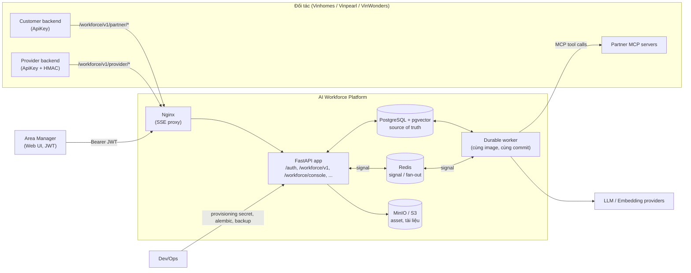
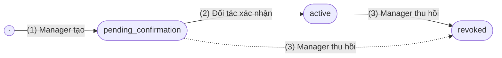
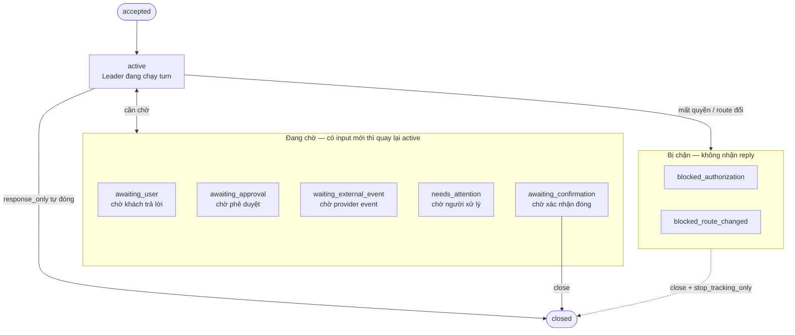
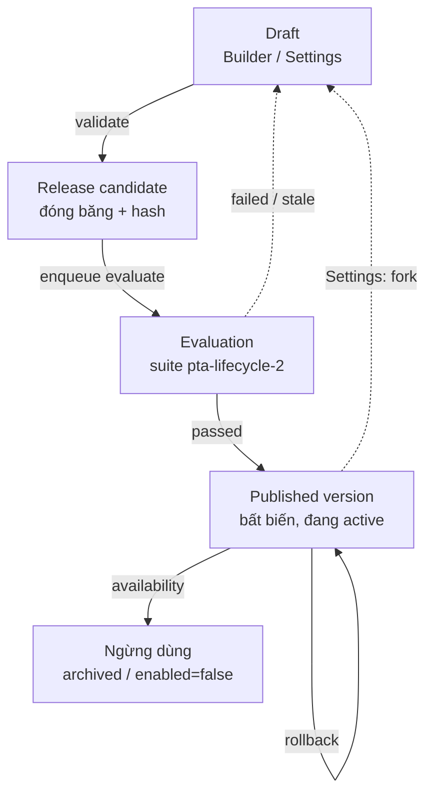
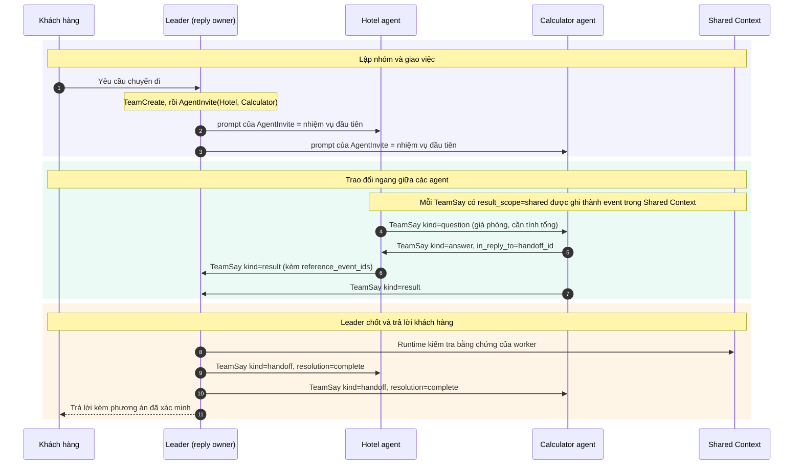
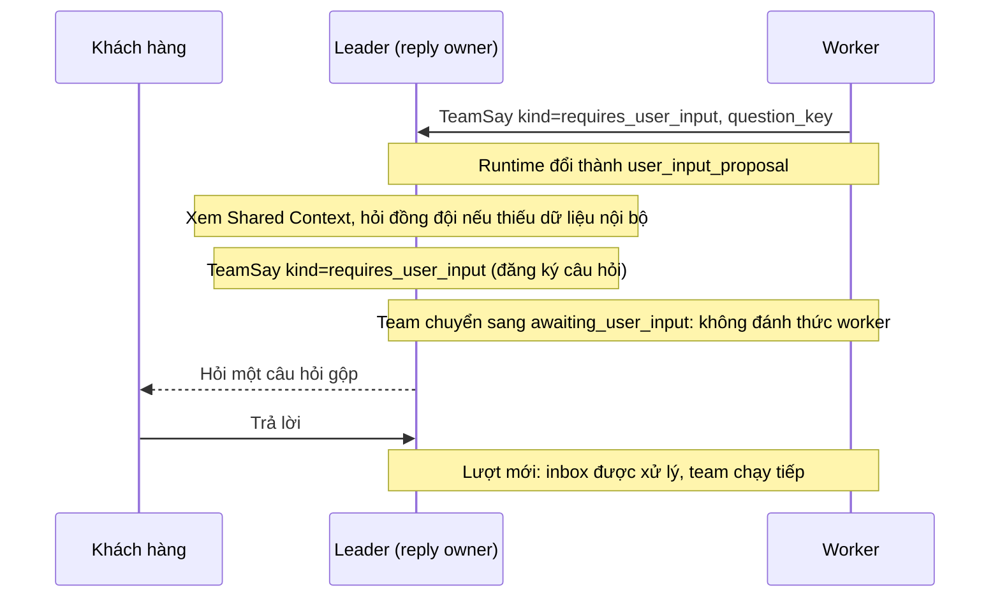
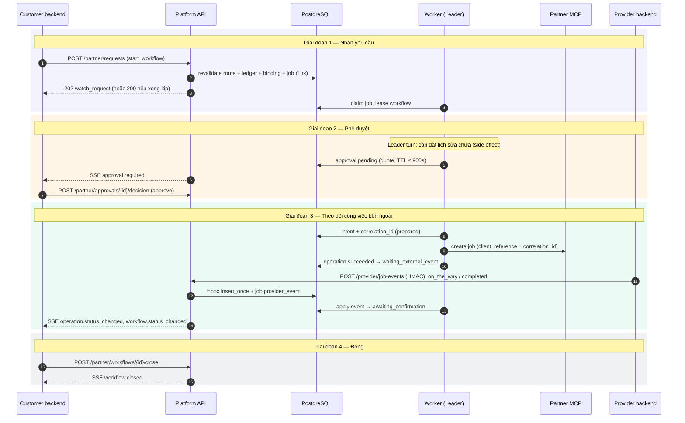

# Đặc tả Yêu cầu Phần mềm (SRS) — AI Workforce Platform

| Thuộc tính | Giá trị |
|---|---|
| Ngày | 2026-10-13 |
| Phạm vi | Lớp **AI Workforce** + các phần platform/web UI mà Workforce sử dụng |
| Chuẩn tham chiếu | Cấu trúc theo ISO/IEC/IEEE 29148 (kế thừa IEEE 830), điều chỉnh cho dự án |
---

## Mục lục

1. [Giới thiệu](#1-giới-thiệu)
2. [Mô tả tổng quan](#2-mô-tả-tổng-quan)
3. [Yêu cầu chức năng](#3-yêu-cầu-chức-năng)
4. [Yêu cầu giao diện ngoài](#4-yêu-cầu-giao-diện-ngoài)
5. [Yêu cầu dữ liệu](#5-yêu-cầu-dữ-liệu)
6. [Yêu cầu phi chức năng](#6-yêu-cầu-phi-chức-năng)
7. [Quy tắc nghiệp vụ và giới hạn](#7-quy-tắc-nghiệp-vụ-và-giới-hạn)
8. [Tiêu chí chấp nhận và release](#8-tiêu-chí-chấp-nhận-và-release)
9. [Trạng thái hiện thực và truy vết](#9-trạng-thái-hiện-thực-và-truy-vết)
10. [Vấn đề mở và mâu thuẫn cần chốt](#10-vấn-đề-mở-và-mâu-thuẫn-cần-chốt)
11. [Phụ lục](#11-phụ-lục)

---

## 1. Giới thiệu

### 1.1 Mục đích

Tài liệu này đặc tả các yêu cầu chức năng, phi chức năng, giao diện và dữ liệu của **AI Workforce Platform**. Đây là một nền tảng dùng chung, đa tenant, xây trên framework đa agent AgentScope. Nền tảng cho phép:

- **Đối tác** (các đơn vị thuộc Vingroup như Vinhomes, Vinpearl, VinWonders) gửi yêu cầu khách hàng từ backend của họ, cắm MCP tool server và báo sự kiện công việc dài hạn.
- **Quản lý khu vực (Area Manager)** tạo AI agent bằng hội thoại, đánh giá rồi publish vào thư viện agent riêng của tài khoản.
- **Leader agent** của nền tảng, khi có yêu cầu, chọn đúng các agent đã publish, điều phối chúng, gọi tool, hỏi người dùng, xin đồng ý trước khi thực hiện hành động có tác dụng phụ (đặt chỗ, ghi dữ liệu), và theo dõi các công việc bên ngoài kéo dài.

Đối tượng đọc: đội phát triển (6 owner module), QA, DevOps, đại diện đối tác tích hợp và người duyệt kiến trúc.

### 1.2 Phạm vi

**Trong phạm vi v1:**

| # | Năng lực |
|---|---|
| S1 | Xác thực Area Manager (JWT + refresh token), danh tính manager gắn scope tenant/domain/area/account |
| S2 | Định tuyến yêu cầu đối tác tới **đúng tài khoản manager** (không chỉ tới domain/area) |
| S3 | Một lifecycle trung lập theo ngành cho ticket/workflow với 3 pattern: `response_only`, `interactive`, `external_tracking` |
| S4 | Customer API và Provider API tại `/workforce/v1`, do nền tảng host; đối tác chỉ gọi vào, không cần dựng webhook receiver |
| S5 | Public event log bền vững, history phân trang, SSE replay theo cursor |
| S6 | Tool gateway duy nhất với policy fail-closed, quote, phê duyệt (HITL), idempotency, reconciliation |
| S7 | Theo dõi external operation qua provider event (HMAC) và status query |
| S8 | Asset ảnh hai chiều (khách hàng ↔ provider) qua presigned URL |
| S9 | Builder: tạo một hoặc nhiều agent bằng hội thoại, có phát hiện tái sử dụng |
| S10 | Lifecycle agent: validate, evaluate, publish phiên bản bất biến, rollback, archive/disable, pin phiên bản cho workflow đang chạy |
| S11 | Cộng tác runtime giữa các agent (TeamSay), Shared Context có giới hạn token |
| S12 | Web UI cho manager: Leader (ticket + chat) và Builder |

**Ngoài phạm vi v1** (`docs/workforce/KE_HOACH_TRIEN_KHAI.md` §16): RBAC nhiều tầng/admin, billing/marketplace, partner portal, chuyển sang Kubernetes, viết lại AgentScope, outbound webhook, Temporal.

### 1.3 Định nghĩa và thuật ngữ

| Thuật ngữ | Định nghĩa |
|---|---|
| **Scope** | Bộ `(tenant_id, domain_id, area_id, manager_account_id)`, là chủ sở hữu của mọi tài nguyên Workforce. `manager_account_id = auth_users.id` |
| **Audience** | Bộ `(partner_client_id, external_user_id, external_conversation_id, external_ticket_id?, residence_id?)`, là ranh giới người dùng cuối/ticket bên đối tác |
| **Partner client** | Hệ thống backend của đối tác, xác thực bằng API key `dp_<key_id>.<secret>` |
| **Customer API** | API cho backend chăm sóc khách hàng của đối tác (`credential_purpose=customer_api`) |
| **Provider API** | API cho backend nghiệp vụ/nhà cung cấp của đối tác gửi sự kiện công việc (`credential_purpose=provider_events`, có ký HMAC) |
| **Route / Partner manager route** | Ánh xạ `(tenant_id, partner_client_id, external_management_ref) → (area_id, manager_account_id)` |
| **external_management_ref** | Mã quản lý phía đối tác (ví dụ `BQL-OP1-A`), dùng để định tuyến tới đúng manager |
| **Residence** | Căn hộ/cơ sở của cư dân, đồng bộ từ đối tác, gắn với route |
| **Workflow** | Thực thể điều phối bền vững gắn 1-1 với một ticket/hội thoại bên đối tác |
| **Binding** | Liên kết bất biến giữa ticket/hội thoại của đối tác và workflow/conversation/group của nền tảng |
| **Turn** | Một lượt xử lý của Leader, kích hoạt bởi một nguyên nhân (cause): tin nhắn, reply, approval, external event, timer |
| **Leader** | Agent điều phối cố định của nền tảng, được pin phiên bản đã publish |
| **Specialist / business agent** | Agent nghiệp vụ do manager build và publish |
| **Builder** | Agent/luồng hội thoại giúp manager tạo agent mới |
| **Pin** | Phiên bản agent hoặc protocol được cố định cho một workflow; không đổi trong suốt workflow |
| **Async tool protocol** | Snapshot bất biến mô tả cách một tool tạo và theo dõi external operation (trạng thái terminal, correlation, ordering, timeout) |
| **External operation** | Công việc bên ngoài kéo dài (ví dụ thợ sửa chữa), theo dõi qua provider event hoặc status query |
| **Receipt** | Biên nhận cho một provider event đã nhận |
| **Quote** | Báo giá đã xác minh cho một hành động có tác dụng phụ; phê duyệt được ràng buộc với quote |
| **HITL** | Human-in-the-loop: phê duyệt của con người trước hành động có tác dụng phụ |
| **Durable job** | Công việc nền lưu trong PostgreSQL, có lease, fencing token và retry |
| **UOW** | Unit of Work: transaction có commit tường minh |
| **Shared Context** | Bộ ngữ cảnh dùng chung theo team/ticket, có summary trích nguồn và budget token |

### 1.4 Tài liệu tham chiếu

| Mã | Tài liệu | Ghi chú |
|---|---|---|
| R1 | `docs/workforce/KE_HOACH_TRIEN_KHAI.md` v1.4.3 (10/10/2026) | Kiến trúc, ownership, acceptance |
| R2 | `docs/workforce/CONTRACT_TICH_HOP_DOI_TAC.md` v1.4 (12/10/2026) | Hợp đồng API đối tác |
| R3 | `docs/workforce/KE_HOACH_SHARED_CONTEXT.md` (13/10/2026) | Shared Context |
| R4 | `docs/workforce/RUNTIME_COLLABORATION.md` (13/10/2026) | Cộng tác runtime |
| R5 | `docs/multi_tenant_rbac_business_analysis_vi.md` | Phân tích RBAC đa tenant |
| R6 | `docs/area_platform_api_vi.md` | API area platform (legacy) |
| R7 | `docs/workforce/handoffs/**` (PHASE_C/D_SEQUENCE, STATUS từng người) | Trạng thái phase |
| R8 | `deploy/workforce/event_delivery/{README,RUNBOOK,RELEASE_CHECKLIST}.md`, `alerts.example.yml`, `proxy.example.conf` | Vận hành |
| R9 | `.github/workflows/workforce-phase-d.yml` (gốc repo) | CI gate Phase D |
| R10 | `src/agentscope/app/workforce/**`, `src/agentscope/app/_router/**`, `storage/_sql/_alembic/versions/**` | Code nguồn |

### 1.5 Quy ước

- **Mã yêu cầu:** `FR-<MODULE>-nn` (chức năng), `NFR-<NHÓM>-nn` (phi chức năng), `IR-nn` (giao diện), `DR-nn` (dữ liệu), `BR-nn` (quy tắc nghiệp vụ).
- **Mức bắt buộc:** **PHẢI** (bắt buộc, tương đương SHALL), **NÊN** (khuyến nghị, SHOULD), **CÓ THỂ** (tuỳ chọn, MAY).

---

## 2. Mô tả tổng quan

### 2.1 Bối cảnh sản phẩm

AI Workforce Platform là một lớp mở rộng nằm trong service FastAPI của AgentScope (`src/agentscope/app/_app.py`, hàm `create_app`). Lớp Workforce gồm 9 subpackage dưới `WF/`:

| Subpackage | Vai trò |
|---|---|
| `contracts` | Model dùng chung (Pydantic, `extra="forbid"`, frozen), port/interface, mã lỗi, export JSON Schema |
| `foundation` | SQL engine, UOW, danh tính manager, định tuyến đối tác, xác thực HMAC provider, durable job, signal, SSE, metrics |
| `registry` | Async tool protocol (snapshot bất biến + head/enable) |
| `builder` | Trích yêu cầu từ hội thoại, chọn tool, đối chiếu tái sử dụng, tạo proposal |
| `orchestration` | Partner ingress, binding, state machine workflow, checkpoint, continuation của Leader, public event log/SSE |
| `execution` | Tool gateway, policy, transaction, approval, booking, MCP adapter, external operation, provider event, reconciliation |
| `lifecycle` | Validate, evaluate, release/publish/rollback/availability, xác thực pin |
| `integrations` | Composition root (`WorkforceBootstrap`, `build_phase_c_runtime`), router release |
| `assets` | Upload/download ảnh gắn với ticket/operation |

Ngoài ra còn dùng các thành phần platform: auth (`_router/_auth.py`), business/area platform (`_router/_business.py`), Workforce console (`_router/_workforce_console.py`), sessions/chat/SSE, agents, team/shared context, storage và web UI (`examples/web_ui/frontend`).

#### Sơ đồ ngữ cảnh

### 2.2 Chức năng chính của sản phẩm

1. **Định danh và định tuyến:** suy scope từ credential; định tuyến yêu cầu đối tác tới đúng manager qua route grant đã được hai bên xác nhận.
2. **Ticket/Workflow dài hạn:** nhận yêu cầu (idempotent), gắn ticket vào workflow, chạy turn của Leader, ngủ khi chờ mà không tốn model call, thức dậy khi có sự kiện, đóng workflow tường minh.
3. **Giao tiếp sự kiện:** public event log có thứ tự, history phân trang, SSE replay theo cursor.
4. **Thực thi có kiểm soát:** mọi tool call đi qua một gateway, có kiểm tra policy, quote và phê duyệt, ghi intent bền vững trước khi gọi mạng, chuyển sang trạng thái `unknown` thay vì retry mù.
5. **Theo dõi công việc bên ngoài:** provider event có ký HMAC, inbox idempotent, xử lý thứ tự, quarantine, reconciliation.
6. **Xây dựng và phát hành agent:** Builder bằng hội thoại, evaluate với gate định lượng, publish phiên bản bất biến, rollback.
7. **Cộng tác đa agent:** Leader chọn specialist, TeamSay, Shared Context có budget.

### 2.3 Các lớp người dùng và actor

| Actor | Loại | Mô tả | Xác thực |
|---|---|---|---|
| **AREA_MANAGER** | Người, role sản phẩm **duy nhất** (R1 §2.1) | Đăng ký với domain/area; build, evaluate, publish agent; quản lý MCP; cấp route cho đối tác; xem hàng đợi và timeline ticket; duyệt memory | JWT Bearer + refresh cookie |
| **Partner customer backend** | Máy, `ActorContext.kind=partner` | Gửi yêu cầu/trả lời của khách hàng, đọc kết quả, nghe SSE, gửi phê duyệt, đóng workflow, xác nhận route, đồng bộ residence | `Authorization: ApiKey dp_<key_id>.<secret>` |
| **Partner provider backend** | Máy, `credential_purpose=provider_events` | Gửi job event, đọc receipt, upload ảnh provider | ApiKey + HMAC-SHA256 |
| **Người dùng cuối / cư dân** (`external_user_id`) | Người, phía đối tác | Do đối tác xác thực; không đăng nhập vào nền tảng | Gián tiếp qua đối tác |
| **Nhân viên, kỹ thuật viên, tài xế** | Người, phía đối tác | Chỉ tác động qua tích hợp máy của đối tác | Gián tiếp |
| **Dev/Ops** | Vận hành | Cấp API key (`X-Provisioning-Secret`), import catalog MCP, chạy migration, backup. **Không phải** role admin | Secret vận hành |
| **System** | `ActorContext.kind=system` | Worker, timer, reconciliation | Nội bộ |
| **Agent runtime** | Không phải tài khoản | Leader, Builder, Planner/specialist; team `leader/worker` | Nội bộ |
| *VINGROUP_ADMIN* | *Chỉ có trong R5* | *Quản trị tài khoản manager, gán MCP, xoay key, đọc audit* | ***[CẦN XÁC NHẬN]*** (xem §10) |

Phân cấp tổ chức dùng trong ví dụ: Vingroup (organization) → Vinhomes / Vinpearl / VinWonders (domain) → Ocean Park 1 / Ocean Park 2 (area). Migration `0008_area_platform` seed `vinhomes{ocean-park-1, ocean-park-2}`, `vinpearl`, `vinwonders`.

### 2.4 Môi trường vận hành

| Thành phần | Yêu cầu |
|---|---|
| Runtime | Python ≥ 3.11; FastAPI, Uvicorn, Pydantic v2, SQLAlchemy 2 async, Alembic |
| CSDL | PostgreSQL 17 + pgvector (image `pgvector/pgvector:pg17`). Dùng `FOR UPDATE`, `SKIP LOCKED`, `ON CONFLICT`. SQLite chỉ dùng cho test |
| Message bus | Redis 7 (signal, fan-out, lock); bản in-memory dùng cho dev |
| Object storage | MinIO/S3 (asset, tài liệu KB), presigned URL qua `S3_PUBLIC_ENDPOINT` |
| Reverse proxy | Nginx, tắt buffering cho route SSE |
| Frontend | React 19 + Vite, Node 22, pnpm 10.19.0 |
| Container | `Dockerfile` (python:3.11-slim + Node 20), `compose.yaml` (app, redis, postgres, minio) |

### 2.5 Ràng buộc thiết kế

- **CON-01:** Kiến trúc là một ứng dụng FastAPI cộng một tiến trình durable worker riêng; API và worker **PHẢI** chạy cùng image và cùng commit. Không dùng microservice, Kubernetes hay Temporal ở v1.
- **CON-02:** PostgreSQL là **source of truth**. Redis chỉ dùng cho signal/fan-out; mất Redis không được làm mất dữ liệu.
- **CON-03:** Không có outbound webhook. Nền tảng host mọi endpoint; đối tác chỉ gọi vào.
- **CON-04:** Router `/workforce/v1` chỉ được mount khi truyền `WorkforceBootstrap` đầy đủ vào `create_app` (`_app.py`). Production **PHẢI** dừng khởi động (fail fast) nếu thiếu `SharedContextService` chuẩn hoặc dùng storage instance khác.
- **CON-05:** Migration chỉ được thêm (additive). Không `create_all` lúc runtime; không downgrade làm mất dữ liệu inbox/workflow/event đang mở.
- **CON-06:** Model contract dùng `extra="forbid"` để chặn chèn trường lạ (scope, group, agent ID…).
- **CON-07:** Lớp Workforce không đọc biến môi trường trực tiếp. Cấu hình được truyền qua constructor (`WorkforceBootstrap`, `PhaseCRuntimeDependencies`).

### 2.6 Giả định và phụ thuộc

- **ASM-01:** Đối tác tự xác thực người dùng cuối và chịu trách nhiệm về tính đúng của `external_user_id`.
- **ASM-02:** Partner MCP server tuân thủ schema đã khai báo. Nếu schema thay đổi (drift), hệ thống phát hiện và chặn.
- **ASM-03:** LLM provider khả dụng; chi phí model không được tính như billing (budget collaboration chỉ là giới hạn kỹ thuật).
- **DEP-01:** Bên thứ ba: LLM/embedding/TTS provider, MCP server (Playwright, AMap, MCP của đối tác), GitHub MCP registry, ClawHub, OTLP collector.

---

## 3. Yêu cầu chức năng

### 3.1 Xác thực và danh tính (AUTH)

Nguồn: `_router/_auth.py`, `auth/_service.py`, `deps.py`, `WF/foundation/_identity.py`.

| ID | Yêu cầu |
|---|---|
| FR-AUTH-01 | Hệ thống **PHẢI** cho phép đăng ký Area Manager qua `POST /auth/register` với email, username, password (≥ 12 ký tự), `domain_id`, `area_id`; area **PHẢI** thuộc domain đã chọn |
| FR-AUTH-02 | Hệ thống **PHẢI** băm mật khẩu bằng Argon2id |
| FR-AUTH-03 | `POST /auth/login` nhận `tenant_id`, định danh (email hoặc username) và password; trả về access token JWT (PyJWT, có kiểm tra issuer và audience, mặc định TTL 15 phút) |
| FR-AUTH-04 | Refresh token **PHẢI** xoay vòng mỗi lần dùng; lưu trong cookie HttpOnly `agentscope_refresh` (path `/auth`, SameSite=lax, mặc định 30 ngày); lưu ở DB dưới dạng hash HMAC-SHA256 có pepper; **PHẢI** phát hiện việc dùng lại refresh token cũ |
| FR-AUTH-05 | Có các endpoint `POST /auth/refresh`, `POST /auth/logout`, `POST /auth/logout-all`, `GET /auth/me` |
| FR-AUTH-06 | JWT secret và refresh pepper **PHẢI** dài ≥ 32 byte; thiếu thì không khởi động |
| FR-AUTH-07 | Khi bật auth, header `X-User-ID` **PHẢI** bị bỏ qua. Chế độ legacy (không có auth service, tenant `"legacy"`) chỉ được dùng cho dev |
| FR-AUTH-08 | Danh tính manager cho Workforce **PHẢI** được nạp từ membership ở trạng thái `verified`, join với `auth_users`, `business_domains`, `areas` đang active. Nếu domain/area trong token khác DB thì từ chối ("token scope is stale") |
| FR-AUTH-09 | Mỗi manager có tối đa **một** membership (UNIQUE `manager_account_id`). Xác minh membership là CAS `pending_verification → verified` |
| FR-AUTH-10 | Principal **PHẢI** có role `AREA_MANAGER` mới được dùng các API manager của Workforce |

### 3.2 Danh mục, API key đối tác, residence (DIR)

Nguồn: `_router/_business.py`, `business/_service.py`.

| ID | Yêu cầu |
|---|---|
| FR-DIR-01 | `GET /directory/domains` và `GET /directory/domains/{domain_id}/areas` là public, phục vụ form đăng ký |
| FR-DIR-02 | `POST /integrations/api-keys` cấp API key cho partner client; **PHẢI** có header `X-Provisioning-Secret` hợp lệ (≥ 32 byte) |
| FR-DIR-03 | API key có định dạng `dp_<key_id>.<secret>`, chỉ hiển thị một lần; DB chỉ lưu hash (HMAC với `PARTNER_API_KEY_PEPPER`); tra cứu theo `key_id`, so sánh secret trong thời gian hằng |
| FR-DIR-04 | `PUT /partner/residences/{residence_id}` đồng bộ residence một cách idempotent (200 khi cập nhật, 201 khi tạo mới) |
| FR-DIR-05 | Residence **PHẢI** gắn với route (`partner_residences.route_id`) để kiểm tra sender, residence và route khớp nhau |
| FR-DIR-06 | API key **NÊN** hỗ trợ expiry, xoay vòng (key mới, thời gian chồng lấn ngắn, rồi revoke key cũ), rate limit và IP allowlist |

### 3.3 Định tuyến đối tác → manager (ROUTE)

Nguồn: `WF/foundation/_partner_routing.py`, `_route_grants.py`, `WF/contracts/_partner_routing.py`, R1 §2.6.

| ID | Yêu cầu |
|---|---|
| FR-ROUTE-01 | Định tuyến gồm **hai lớp**: (1) credential xác định partner client/domain; (2) `PartnerManagerRoute` ánh xạ `(tenant_id, partner_client_id, external_management_ref) → area_id + manager_account_id`. Key của một domain **KHÔNG** được cấp quyền tới mọi manager trong domain đó |
| FR-ROUTE-02 | Trạng thái route: `pending_confirmation → active → disabled / revoked` |
| FR-ROUTE-03 | Manager tạo grant (bằng JWT của mình, cần membership `verified` và ≥ 1 operation); đối tác xác nhận bằng credential `customer_api` của mình (CAS theo `expected_revision`); manager có thể revoke |
| FR-ROUTE-04 | Mỗi route mang danh sách `allowed_operations` thuộc `PartnerOperation`: `submit_request`, `reply`, `read_result`, `receive_events`, `submit_consent`, `close_workflow`, `confirm_route`, `sync_residence`, `publish_job_event`, `read_event_receipt` |
| FR-ROUTE-05 | `resolve` **PHẢI** tìm được đúng **một** route `active` cho `(client, external_management_ref)`, membership `verified`, và `membership_revision` của route bằng revision hiện tại của membership. Nếu có residence thì đối chiếu thêm với `partner_residences` |
| FR-ROUTE-06 | `revalidate` **PHẢI** chạy lại bên trong mọi transaction ghi: route ID, revision, owner không đổi, operation được cấp |
| FR-ROUTE-07 | Phản hồi lỗi định tuyến: key sai/hết hạn/bị revoke → `401`; không có grant hoặc sai domain/area/client/manager/residence → `403 ROUTE_NOT_AUTHORIZED` (không liệt kê manager khác); nhiều route active → `409 ROUTE_AMBIGUOUS`, không dispatch; route đổi khi workflow đang chạy → `blocked_route_changed` / `blocked_authorization` |
| FR-ROUTE-08 | Quyền sở hữu **không** chuyển khi ánh xạ lại route: hội thoại cũ vẫn thuộc owner ban đầu |

**Ví dụ:** `BQL-OP1-A → ocean-park-1/manager-A` và `BQL-OP1-B → ocean-park-1/manager-B`: cùng area nhưng hai đích khác nhau, dữ liệu tách biệt.

**Vòng đời route:**

- (1) Manager tạo grant bằng JWT; cần membership `verified` và ít nhất một operation.
- (2) Đối tác xác nhận bằng credential `customer_api`, gửi kèm `expected_revision` (CAS).
- (3) Manager thu hồi được ở cả `pending_confirmation` lẫn `active`. Đường nét đứt là trường hợp thu hồi trước khi đối tác xác nhận.
- Trạng thái `disabled` có khai báo trong enum nhưng hiện không có đoạn code nào chuyển route sang trạng thái này **[CẦN XÁC NHẬN]**.

### 3.4 Partner ingress và Workflow (WF)

Nguồn: `WF/orchestration/_ingress.py`, `_router.py`, `workflows/_service.py`, `workflows/_continuation.py`, `WF/contracts/_conversation.py`.

#### 3.4.1 Nhận yêu cầu

| ID | Yêu cầu |
|---|---|
| FR-WF-01 | `POST /workforce/v1/partner/requests` nhận `PartnerRequestEnvelope` với `schema_version="1"`, `command_type ∈ {start_workflow, workflow_reply}` |
| FR-WF-02 | `start_workflow` **KHÔNG** được có `workflow_id`; `workflow_reply` **PHẢI** có `workflow_id` (thiếu → `WORKFLOW_REFERENCE_REQUIRED`) |
| FR-WF-03 | Message có dạng `{type:"text", text ≤ 20.000 ký tự, attachments ≤ 10 asset_id không trùng}`; body ≤ 262.144 byte (vượt → `413 PAYLOAD_TOO_LARGE`) |
| FR-WF-04 | Đối tác **KHÔNG** được gửi `ticket_id`, `conversation_id`, `group_id`, `tenant_id`, `domain_id`, `area_id`, `manager_account_id`, `route_id`, `agent_id`, `tool_id`, credential, role hay execution mode; trường lạ bị từ chối (`422 REQUEST_BODY_INVALID`) |
| FR-WF-05 | **Idempotency:** tính `payload_hash = sha256(canonical JSON)`; ledger `wf_partner_commands` khoá theo `(tenant_id, partner_client_id, external_request_id)`. Gửi lại cùng ID và cùng payload → trả kết quả đã lưu, kể cả khi route đã được ánh xạ lại; cùng ID nhưng khác payload/kind/target → `409 IDEMPOTENCY_CONFLICT`; khác `external_user_id` → từ chối |
| FR-WF-06 | Với `start_workflow`: định tuyến theo `external_management_ref` + user (+ residence). Với `workflow_reply`: dùng lại scope, route và revision của yêu cầu gốc; khác audience/management ref/workflow → `409 WORKFLOW_BINDING_MISMATCH` |
| FR-WF-07 | Trong **một** transaction: kiểm tra scope active → `routing.revalidate` → claim ledger → nếu mới thì `start_with_binding` hoặc `accept_reply`, bind asset, attach request → commit |
| FR-WF-08 | POST chờ kết quả của turn hiện tại tối đa `bounded_wait_seconds` (code: **8 s**, R2: **25 s**, **[CẦN XÁC NHẬN]**). Xong trong thời gian chờ → `200`; chưa xong → đúng **một** `202` với `next_action=watch_request`. Chờ theo signal hoàn tất, có polling dự phòng |
| FR-WF-09 | Mọi phản hồi **PHẢI** có `workflow_state` và `next_action`, cùng `request_id`, `external_ticket_id`, `conversation_id`, `workflow_id`, `workflow_revision`, `ticket_id`, `result.messages[]`, `error`, `accepted_at`, `completed_at`, `status_url`, `conversation_url`, `event_stream_url` |
| FR-WF-10 | `GET /workforce/v1/partner/requests/{request_id}?external_user_id=` trả trạng thái yêu cầu (operation `read_result`) |

#### 3.4.2 Binding và vòng đời workflow

| ID | Yêu cầu |
|---|---|
| FR-WF-11 | Binding ticket ↔ workflow là **bất biến** và duy nhất theo `(tenant, client, user, external_conversation_id)`, `(tenant, client, user, external_ticket_id)`, `conversation_id`, `group_id`. Trùng → `409 TICKET_ALREADY_BOUND` / `CONVERSATION_ALREADY_BOUND` |
| FR-WF-12 | Khi bắt đầu workflow, hệ thống **PHẢI** lấy phiên bản Leader đã publish (deployment đang hiện hành, enabled, chưa archived), ghi input, checkpoint revision 1, phát `request.accepted`, rồi enqueue job `workforce.shared_context.project` (job này sẽ enqueue tiếp `workforce.workflow.continue`) |
| FR-WF-13 | `accept_reply` bị từ chối khi workflow đã đóng hoặc bị block, hoặc revision không khớp (`REVISION_CONFLICT`); hợp lệ thì chuyển sang `active` và phát `workflow.status_changed` |
| FR-WF-14 | **Continuation:** giữ lease workflow (120 s) kèm fencing token; bỏ qua cause đã xử lý (`duplicate`); hoãn cause `external_event` hoặc `timer` khi đang chờ người (`deferred_human_input`); gọi Leader qua runtime đã pin; commit bằng CAS trên revision + fence; phát `assistant.message` và `workflow.status_changed`/`workflow.closed`; signal sau khi commit |
| FR-WF-15 | `ExecutionGuard.check(effect)` **PHẢI** chạy trước mọi tác dụng phụ (model hoặc tool): workflow chưa đóng, aggregate và revision không đổi, lease còn hiệu lực, trigger được phép, workflow published read-only thì không có tác dụng phụ |
| FR-WF-16 | Turn ném `PermissionError` → workflow chuyển sang `blocked_authorization` |
| FR-WF-17 | Mỗi workflow có pattern `response_only` / `interactive` / `external_tracking`. Một `response_only` + published read-only **PHẢI** đóng trong một turn |

#### 3.4.3 Máy trạng thái workflow

Ghi chú: ngoài các đường trong sơ đồ, đối tác có thể đóng workflow từ **bất kỳ** trạng thái nào chưa `closed` nếu gửi `stop_tracking_only=true` (FR-WF-26). Hai trạng thái bị chặn chỉ thoát được bằng cách này.

| `workflow_state` | `next_action` | Trạng thái task (Shared Context) |
|---|---|---|
| `accepted` | `watch_request` | `queued` |
| `active` | `watch_request` | `running` |
| `waiting_external_event` | `watch_events` | `waiting_external` |
| `awaiting_user` | `submit_reply` | `waiting_user` |
| `awaiting_approval` | `submit_approval` | `waiting_approval` |
| `awaiting_confirmation` | `confirm_close` | `waiting_user` |
| `needs_attention` | `resolve_attention` | `blocked` |
| `blocked_authorization` | `resolve_attention` | `blocked` |
| `blocked_route_changed` | `resolve_attention` | `blocked` |
| `closed` | `none` | `completed` |

**Quy tắc chuyển trạng thái** (`_validate_decision`), các yêu cầu từ FR-WF-18 đến FR-WF-24:

- **FR-WF-18:** Một turn đã hoàn tất không được kết thúc ở `accepted` hoặc `active`.
- **FR-WF-19:** `awaiting_approval` cần một approval ID bền vững.
- **FR-WF-20:** `waiting_external_event` cần pattern `external_tracking` và ít nhất một operation đang chờ với `creation_status=succeeded` và capability `receive_status` hoặc `status_query`.
- **FR-WF-21:** Không được vào `awaiting_confirmation` khi còn task, câu hỏi hay operation đang chờ.
- **FR-WF-22:** Trong một turn, không được đổi `session_refs`, `agent_version_pins`, `protocol_pins`. Lịch sử operation và bộ đếm usage chỉ được tăng.
- **FR-WF-23:** Approval đang chờ phải luôn hiển thị; chỉ một cause loại approval mới được giải quyết approval của chính nó.
- **FR-WF-24:** Mỗi turn tăng revision **đúng 1**; revision của workflow và của checkpoint phải khớp nhau.

`RequestStatus`: `accepted → queued → running → completed / failed / blocked`. Khi đọc, một request đang chờ được hiển thị là `blocked` nếu workflow ở trạng thái `closed` (`WORKFLOW_CLOSED`), `blocked_authorization` (`ROUTE_NOT_AUTHORIZED`), `blocked_route_changed` (`ROUTE_CONFLICT`) hoặc `needs_attention` (`WORKFLOW_NEEDS_ATTENTION`).

#### 3.4.4 Đóng workflow

| ID | Yêu cầu |
|---|---|
| FR-WF-25 | `POST /workforce/v1/partner/workflows/{workflow_id}/close` đóng workflow tường minh và idempotent; body gồm `expected_revision`, `reason` (≤ 200 ký tự), `stop_tracking_only` |
| FR-WF-26 | Chỉ được đóng từ `awaiting_confirmation`, trừ khi `stop_tracking_only=true`. Còn approval hoặc operation đang chờ mà không có `stop_tracking_only` → `409 WORKFLOW_NOT_READY_TO_CLOSE` |
| FR-WF-27 | Sự kiện đến sau khi đóng chỉ được ghi nhận (audit), **không** mở lại workflow |
| FR-WF-28 | Manager **NÊN** có `GET /workforce/v1/workflows/{id}` và `POST /workforce/v1/workflows/{id}/close` bằng JWT (theo R2) |

### 3.5 Public event log, history và SSE (EVT)

Nguồn: `WF/orchestration/partner_events/*`, `WF/foundation/_sse.py`, `_signals.py`.

| ID | Yêu cầu |
|---|---|
| FR-EVT-01 | Public event log trong DB là source of truth. `sequence` tăng dần theo từng conversation, bắt đầu từ 1 (UNIQUE `(conversation_id, sequence)`); cùng `event_id` mà khác nội dung → `409 EVENT_ID_CONFLICT` |
| FR-EVT-02 | Chỉ phát ra các event trong allowlist: `request.accepted`, `workflow.status_changed`, `ticket.created`, `ticket.status_changed`, `assistant.message`, `approval.required`, `approval.resolved`, `operation.status_changed`, `workflow.awaiting_user`, `workflow.needs_attention`, `workflow.closed` |
| FR-EVT-03 | Envelope gồm `schema_version`, `event_id`, `sequence`, `event_type`, `occurred_at`, `recorded_at`, `conversation_id`, `external_ticket_id`, `external_conversation_id`, `external_user_id`, `workflow_id`, `ticket_id`, `payload` |
| FR-EVT-04 | `GET /workforce/v1/partner/conversations/{id}?external_user_id=` trả snapshot kèm `snapshot_cursor` (operation `read_events`) |
| FR-EVT-05 | `GET …/event-history?external_user_id=&after_cursor=&limit=` trả `{items, next_cursor, has_more}`; `limit` từ 1 đến 500, mặc định 100 |
| FR-EVT-06 | `GET …/events` (SSE, `text/event-stream`) replay trước (trang 100), sau đó chờ signal hoặc gửi heartbeat (mặc định 15 s, > 0 và ≤ 60). Kết nối lại bằng `Last-Event-ID` hoặc `after_cursor`; hai giá trị này mâu thuẫn → `422`. Xác thực và cursor được kiểm tra **trước** khi gửi header SSE |
| FR-EVT-07 | Cursor không xác định hoặc hết hạn → `410 EVENT_CURSOR_EXPIRED` (client tải lại snapshot) |
| FR-EVT-08 | Quyền được kiểm tra lại ở mỗi frame; credential bị revoke thì stream **PHẢI** kết thúc trong ≤ 60 s |
| FR-EVT-09 | Signal message bus (`agentscope:workforce:{conversation\|request}:{sha256(scope+id)}`) chỉ mang tính gợi ý và được phát sau commit; mất signal không làm mất sự kiện |
| FR-EVT-10 | Client **PHẢI** khử trùng lặp theo `event_id` và `message_id`; ký tự xuống dòng trong `id`/`event` của SSE bị từ chối |

### 3.6 Thực thi tool (EXE)

Nguồn: `WF/execution/_gateway.py`, `_policy.py`, `_transactions.py`, `_mcp_adapter.py`, `_calculator.py`, `_effects.py`.

| ID | Yêu cầu |
|---|---|
| FR-EXE-01 | Mọi tool call **PHẢI** đi qua `ExecutionGateway.execute`; không có đường gọi tool nào khác |
| FR-EXE-02 | **Policy fail-closed:** tải lại run (không ở trạng thái cancelled/failed/closed; mode `production` hoặc `evaluation`); kiểm tra lại membership, route, grant, audience, binding; phiên bản agent đã được pin; tool descriptor khả dụng và đúng scope; `tool_id` và `schema_hash` của binding khớp; có đủ capability; effect nằm trong `execution_policy.allowed_effects`; `llm_alias` khớp `^[A-Za-z_][A-Za-z0-9_-]{0,63}$`. Các kiểm tra này chạy **kể cả khi** permission mode legacy là bypass |
| FR-EXE-03 | Input **PHẢI** được validate theo JSON Schema (Draft 2020-12) và khớp `arguments_hash` |
| FR-EXE-04 | Idempotency theo `(scope, run_id, idempotency_key)` + fingerprint; call đã xong thì trả lại kết quả cũ; fingerprint khác → `IDEMPOTENCY_CONFLICT` |
| FR-EXE-05 | Effect thuộc tập `read`, `write`, `booking`, `cancel`, `communicate`, `ask_user`. Trong đó `write`, `booking`, `cancel` là tác dụng phụ, **PHẢI** có quote đã xác minh và được đánh dấu `effect_reviewed` |
| FR-EXE-06 | **Intent bền vững trước khi gọi mạng:** trong một transaction, kiểm tra policy lần nữa → `reserve` → `operations.prepare`; kiểm tra policy lần cuối ngay trước dispatch |
| FR-EXE-07 | Trạng thái call: `proposed → awaiting_approval` (tác dụng phụ chưa được duyệt) `→ executing → succeeded / failed / unknown`. Dùng `unknown` khi tác dụng phụ có thể đã xảy ra (timeout, crash, phản hồi lỗi); call bị bỏ dở được khôi phục thành `unknown` + `EXECUTION_INTERRUPTED`. **KHÔNG** retry mù với thao tác ghi |
| FR-EXE-08 | MCP adapter ẩn các trường do server sở hữu (`asset_downloads`, trường idempotency đã cấu hình), phát hiện schema drift (`MCP_SCHEMA_DRIFT`) và cấm credential production ở mode evaluation (`EVAL_PRODUCTION_CREDENTIAL_FORBIDDEN`) |
| FR-EXE-09 | Tool dựng sẵn `builtin.money.v1`: tính tiền bằng số nguyên (`Money{amount_minor, currency}`), tối đa 1000 item, quantity từ 1 đến 10.000, số tiền ≤ 10^18 |
| FR-EXE-10 | Manager tra cứu `GET /workforce/v1/executions/{call_id}` (call_id, status, output, error, external_transaction_id, started_at, finished_at, approval_id) và `GET /workforce/v1/booking-operations/{operation_id}` |
| FR-EXE-11 | `BookingReconciler` truy vấn theo `provider_reference` đã lưu và **không bao giờ** chạy lại thao tác create; `summarize()` trả `confirmed/partial/unknown/failed` với `automatic_compensation: False` |

### 3.7 Phê duyệt — HITL (APR)

Nguồn: `WF/execution/_approvals.py`, `_partner_approval.py`, `_router.py`, `app/_chat_consent.py`.

| ID | Yêu cầu |
|---|---|
| FR-APR-01 | Approval được tạo cùng lúc với HITL event; `allowed_decider.kind ∈ {manager, partner}` |
| FR-APR-02 | Quote **PHẢI** có đủ: `quote_ref`, `quote_version`, provider, option, dates, amount, fees, cancellation_terms, `expires_at` |
| FR-APR-03 | Hạn của approval = min(`quote.expires_at`, now + 900 s) |
| FR-APR-04 | Trạng thái: `pending → approved / rejected`; `approved → consumed`, được tiêu thụ nguyên tử cùng execution intent |
| FR-APR-05 | Gửi lại cùng quyết định → trả bản ghi hiện có; quyết định khác → `APPROVAL_ALREADY_RESOLVED`; hết hạn → `APPROVAL_EXPIRED`; hash không khớp → `APPROVAL_CONTENT_CHANGED` |
| FR-APR-06 | Manager: `GET /workforce/v1/conversations/{id}/approvals`; `POST /workforce/v1/approvals/{id}/decision` với body **đúng** `{decision ∈ {approve,reject}, arguments_hash, quote_hash}` |
| FR-APR-07 | Đối tác: `POST /workforce/v1/partner/approvals/{id}/decision` → `202`; có `expected_revision` (int strict) và `quote_ref`; ghi vào ledger (`approval_decision`); nếu approve thì enqueue trigger `approval` trong cùng transaction |
| FR-APR-08 | Phê duyệt bằng chat: `POST /workforce/v1/partner/approvals/{id}/chat` → `202`; body `message` (≤ 2000 ký tự) và không có `decision`. Chỉ chấp nhận cụm từ chính xác (`xac nhan`/`dong y`/`confirm`/`yes` hoặc `tu choi`/`huy`/`cancel`/`no`), có thể kèm approval ID hoặc 8 ký tự cuối của ID. Nội dung không rõ → `422 APPROVAL_CHAT_CLARIFICATION_REQUIRED` |
| FR-APR-09 | Việc đặt chỗ (booking) chỉ được thực hiện sau khi có đồng ý tường minh gắn với arguments hash và quote; không được vượt ngân sách đã duyệt |

### 3.8 External operation, provider event, reconciliation (OPS)

Nguồn: `WF/execution/external_operations/*`, `provider_events/*`, `WF/foundation/_provider_auth.py`.

| ID | Yêu cầu |
|---|---|
| FR-OPS-01 | Chỉ tạo external operation khi protocol có `capability=external_tracking` cùng provider_events hoặc status_query, và run có `workflow_id` |
| FR-OPS-02 | **PHẢI** lưu intent kèm `correlation_id` do server sinh (`creation_status=prepared`) **trước** khi gọi provider. Chỉ các `create_fields` đã khai báo (`client_reference`/`idempotency_key`) mới nhận giá trị correlation; model tự điền các trường này → `CORRELATION_FIELD_SERVER_OWNED` |
| FR-OPS-03 | `ExternalCreationStatus`: `prepared`, `succeeded`, `failed`, `unknown` |
| FR-OPS-04 | `POST /workforce/v1/provider/job-events` → `202` + `ProviderEventReceipt`. Thứ tự xử lý: xác thực HMAC trên raw bytes **trước** khi parse JSON → kiểm tra envelope chuẩn (`occurred_at` có timezone, `provider_version` là int strict, có `external_job_id` hoặc `client_reference`, ≤ 10 attachment không trùng) → `authorize_integration("publish_job_event")` → `insert_once` vào inbox → enqueue job `provider_event` trong cùng transaction → ACK |
| FR-OPS-05 | Inbox idempotent theo `(tenant, integration, external_event_id)`; cùng ID khác payload → `409 EVENT_ID_CONFLICT`. Inbox **PHẢI** được commit trước khi trả `2xx` |
| FR-OPS-06 | Processor tìm operation chỉ trong namespace của provider đã xác minh; không tìm thấy → `quarantined` / `OPERATION_NOT_BOUND` |
| FR-OPS-07 | **Thứ tự sự kiện** theo ordering mode `snapshot` / `delta` / `transition`: version cũ hơn → `ignored`; cùng version khác nội dung → quarantine `PROVIDER_VERSION_CONFLICT`; delta bị thiếu version → `PROVIDER_VERSION_GAP` (chờ reconciliation); `on_the_way` đến muộn không được ghi đè `completed`; trạng thái terminal không chuyển tiếp được |
| FR-OPS-08 | Event hợp lệ cập nhật operation và gọi `workflow.apply_external_event`. Nếu workflow đã đóng hoặc bị revoke thì vẫn lưu dữ kiện nhưng không phát ra ngoài |
| FR-OPS-09 | Trạng thái receipt công khai: `accepted`, `processing`, `applied`, `duplicate`, `quarantined`, `rejected`, `needs_attention` (trạng thái nội bộ `ignored` hiển thị ra ngoài là `rejected`). Tra cứu bằng `GET /workforce/v1/provider/event-receipts/{id}` (ký HMAC trên body rỗng, grant `read_event_receipt`) |
| FR-OPS-10 | **Reconciliation** (job `operation_reconcile`): chỉ áp dụng cho operation đang chờ hoặc `unknown` có protocol khai báo `status_query`; truy vấn chạy ngoài transaction, sau đó CAS theo revision; kết quả `terminal`, `stale_query`, `needs_attention`, `unchanged`, `applied`. `escalate` ghi nhận cần chú ý và **không bao giờ** tự tạo ra trạng thái hoàn thành |
| FR-OPS-11 | Vòng đời operation mẫu: `pending → assigned → on_the_way → arrived → in_progress → completed` (hoặc `failed` / `cancelled`) |
| FR-OPS-12 | Quarantine **NÊN** có scanner định kỳ và dọn dẹp theo TTL |

### 3.9 Asset ảnh (AST)

Nguồn: `WF/assets/_service.py`, `_router.py`, `_tables.py`.

| ID | Yêu cầu |
|---|---|
| FR-AST-01 | Khách hàng upload ảnh: `POST /workforce/v1/partner/assets/upload-sessions` (`201`, body ≤ 65.536 byte) trả presigned PUT URL → client PUT lên URL → `POST /workforce/v1/partner/assets/{id}/complete?external_user_id=&external_conversation_id=&external_ticket_id=` |
| FR-AST-02 | Tải ảnh: `POST /workforce/v1/partner/assets/{id}/download-url` trả presigned GET URL ngắn hạn (TTL 300 s) |
| FR-AST-03 | Provider upload ảnh: `POST /workforce/v1/provider/assets/upload-sessions` (`201`) và `POST /workforce/v1/provider/assets/{id}/complete`; cần HMAC và grant `publish_job_event` |
| FR-AST-04 | Chỉ nhận `image/jpeg`, `image/png`, `image/gif`, `image/webp`; kích thước 1 B – 20 MiB; upload URL có TTL 900 s |
| FR-AST-05 | Khi complete, size, content type, metadata `asset-id` và magic bytes **PHẢI** khớp, nếu không → `rejected` / `422 ASSET_UPLOAD_MISMATCH`; session hết hạn → `410 ASSET_UPLOAD_SESSION_EXPIRED`; object được chuyển sang key bất biến |
| FR-AST-06 | Asset gắn với audience/ticket; dùng sai binding → `403 ASSET_BINDING_MISMATCH` / `PROVIDER_ASSET_BINDING_MISMATCH`. Attachment của provider event phải được upload cho đúng operation và workflow |
| FR-AST-07 | MCP tool muốn nhận ảnh **PHẢI** khai báo capability `asset_download_v1` và trường input `asset_downloads`, nếu không → `422 TOOL_ASSET_CAPABILITY_MISSING` |
| FR-AST-08 | Trạng thái asset: `pending_upload → active / rejected` (`deleted` có định nghĩa nhưng chưa dùng) |

### 3.10 Registry và async tool protocol (REG)

Nguồn: `WF/registry/event_protocols/*`.

| ID | Yêu cầu |
|---|---|
| FR-REG-01 | Kích hoạt một partner MCP connection **PHẢI** khám phá và đăng ký **toàn bộ** tool của server đó vào catalog (ví dụ: MCP có 6 tool → đăng ký đủ 6) |
| FR-REG-02 | Async tool protocol là snapshot **bất biến** theo `(scope, tool_version_id, protocol_id, protocol_version)`, có `schema_hash` tính trên toàn bộ cấu hình |
| FR-REG-03 | Mỗi tool version có một head trỏ tới protocol hiện hành, kèm cờ `enabled` và `revision ≥ 1`; disable protocol thì chặn publish mới (`PROTOCOL_DISABLED`) |
| FR-REG-04 | Quy tắc protocol: `read_only_auto_close` cần một terminal read không qua approval; result mode `terminal` không được cấu hình tracking; result mode `pending` cần provider integration, correlation field, `status_field`, `terminal_statuses`, `timeout_seconds`; mode `delta` cần ordering theo `provider_version`; `$ref` chỉ được trỏ tới schema đóng gói sẵn (không tải qua URL) |
| FR-REG-05 | Capabilities: `create`/`terminal`, `receive_status`, `status_query`, `approval` |
| FR-REG-06 | Chuẩn hoá event là tất định (deterministic normalization) theo protocol đã pin |

### 3.11 Builder (BLD)

Nguồn: `_router/_workforce_console.py`, `WF/builder/*`, `WF/contracts/_reuse.py`, `_batch.py`.

| ID | Yêu cầu |
|---|---|
| FR-BLD-01 | Manager xem danh sách và chi tiết hội thoại Builder: `GET /workforce/console/builder/conversations`, `GET /workforce/console/builder/conversations/{id}` |
| FR-BLD-02 | `POST /workforce/console/builder/prepare`: LLM đề xuất outline, sau đó sinh agent (prompt, chọn tool độc quyền, skill markdown, evaluation). Trạng thái proposal: `needs_input`, `ready`, `blocked`, `published` |
| FR-BLD-03 | `POST /workforce/console/builder/publish` **PHẢI** kiểm tra `expected_revision` (sai → `409`) và trạng thái `ready` (chi tiết ở FR-BLD-28; xem khoảng trống về revision ở §3.11.1 i) |
| FR-BLD-04 | Một hội thoại có thể tạo **một** agent hoặc **nhiều** agent độc lập (batch, tối đa 12). Gói `WF/builder` có thêm mode `single` (đúng 1 agent) và yêu cầu agent key duy nhất, nhưng gói này chưa được nối vào console |
| FR-BLD-05 | **Tái sử dụng (thiết kế đích, gói `WF/builder`):** đối chiếu `business_key`, `match_type`, `reuse_status`; hành động `reuse / resume / revise / create / clarify / repair`; kết quả `completed_reused`; xung đột → `AGENT_ALREADY_EXISTS`, `AGENT_BUILD_IN_PROGRESS`, `REUSE_DECISION_STALE`. Builder trên console hiện chỉ dùng so trùng theo độ giống từ ngữ (FR-BLD-25). Thư viện agent tính theo **từng tài khoản manager** |
| FR-BLD-06 | Trích yêu cầu (gói `WF/builder`): `intent ∈ {build, runtime, clarify}`; `tracking_intent ∈ {create_only, track_to_completion, unspecified}`; `track_to_completion` cần effect `external_operation` cùng một policy hoặc câu hỏi làm rõ; `timeout_behavior ∈ {needs_attention, status_query}` |
| FR-BLD-07 | Giới hạn của gói `WF/builder`: trích xuất 1–3 lần (mặc định 2), timeout 30 s, input ≤ 16.000 ký tự; tối đa 100 session và 20× số đó cho message; phân trang catalog 1–100 trang (mặc định 10); idempotent theo `client_message_id` |
| FR-BLD-08 | Hội thoại và đề xuất của Builder trên console **PHẢI** được lưu bền vững: hiện lưu dưới dạng session/message của agent `workforce-builder` trong storage chính (FR-BLD-36). Phiên làm việc của gói `WF/builder` vẫn chỉ nằm trong bộ nhớ |
| FR-BLD-09 | Vòng đời agent ở console: `GET /workforce/console/agents`, `POST /workforce/console/agents/{agent_id}/lifecycle` (`draft` ↔ `published`; publish làm agent có thể được mời/invitable) |
| FR-BLD-10 | Context và ReAct config của agent Workforce do nền tảng cố định. Model của **Builder** và của agent được phát hành do manager chọn (FR-BLD-40); `WORKFORCE_MODEL_NAME` và `WORKFORCE_MODEL_CREDENTIAL_ID` chỉ áp dụng cho **Leader** |

#### 3.11.1 Mô tả chi tiết Agent Builder

Nguồn: `app/_router/_workforce_console.py`, `app/_workforce_policy.py`, `examples/web_ui/frontend/src/pages/workforce/builder/index.tsx`.

**Agent Builder** là trợ lý hội thoại giúp Area Manager tạo agent nghiệp vụ mà không cần tự viết prompt hay cấu hình. Manager mô tả nhu cầu bằng lời; Builder đề xuất cần những agent nào, sinh cấu hình cho từng agent, tự đánh giá, rồi phát hành vào **thư viện agent** của manager. Leader chỉ được mời các agent đã phát hành trong thư viện này (FR-AGC-02).

Builder **khác** Leader: Builder chỉ tạo cấu hình agent, không xử lý ticket, không gắn agent vào một nhóm hay một ticket cố định. Một yêu cầu "tạo một team" chỉ là cách tạo nhiều agent cùng lúc; việc ghép nhóm do Leader làm lúc chạy.

**Luồng tổng quát:**

Ở bước dàn ý, khi cần làm rõ hoặc khi bị chặn, manager chỉ cần nhắn tiếp: Builder sẽ lập lại dàn ý mới dựa trên toàn bộ hội thoại.

##### a) Giai đoạn 1 — Lập dàn ý

| ID | Yêu cầu |
|---|---|
| FR-BLD-11 | `POST /workforce/console/builder/prepare` với `confirm_outline=false` (mặc định) chạy giai đoạn lập dàn ý. Body gồm `message` (1–16.000 ký tự), `chat_model_config` (model do manager chọn) và `conversation_id` (bỏ trống thì tạo hội thoại mới) |
| FR-BLD-12 | Builder lấy **danh mục tool** từ mọi MCP đang bật của manager; mỗi tool có id dạng `<mcp_id>:<tool_name>`. Builder chỉ được chọn tool có trong danh mục này, không được bịa tool |
| FR-BLD-13 | Model trả về dàn ý gồm 1–12 agent, mỗi agent có tên (≤ 100 ký tự), mục tiêu (≤ 4.000 ký tự) và các tool gợi ý. Dàn ý **không** chứa prompt hay skill |
| FR-BLD-14 | Quy tắc chia agent: tôn trọng việc manager muốn một agent hay một nhóm; tách các năng lực nghiệp vụ độc lập thành agent riêng (lập kế hoạch, khách sạn, di chuyển, tính toán, hỗ trợ kỹ thuật là các mảng riêng); các thao tác liên quan trong cùng một mảng (ví dụ tìm và đặt khách sạn) có thể chung một agent; không tạo hai agent cho cùng một năng lực |
| FR-BLD-15 | **Mỗi tool chỉ thuộc một agent** trong cả đề xuất. Tool nghiệp vụ phải giao cho agent chuyên trách; agent lập kế hoạch/điều phối phải nhờ agent chuyên trách qua `TeamSay` thay vì giữ bản sao tool. Server lọc lại: tool không có trong danh mục hoặc đã được agent trước nhận sẽ bị loại khỏi dàn ý |
| FR-BLD-16 | Kết quả trả về trạng thái `needs_input`, kèm danh sách agent dự kiến và câu hỏi mời manager góp ý hoặc bấm "Chốt định hướng và sinh cấu hình" |

##### b) Giai đoạn 2 — Sinh cấu hình

| ID | Yêu cầu |
|---|---|
| FR-BLD-17 | Gọi lại `prepare` với `confirm_outline=true` để sinh cấu hình đúng theo dàn ý đã chốt, không gộp các năng lực đã tách |
| FR-BLD-18 | Với mỗi agent, Builder **chỉ được** tạo năm thành phần: `name` (≤ 100 ký tự), `objective` (≤ 4.000), `system_prompt` (20–30.000), `selected_tool_ids`, và một skill (`skill_name` ≤ 100, `skill_markdown` 20–50.000). Tối đa 12 agent mỗi lần |
| FR-BLD-19 | Builder **KHÔNG** được tạo hay sửa tham số model, giới hạn context, cấu hình ReAct, timeout, credential, quyền hay chính sách phát hành |
| FR-BLD-20 | System prompt được sinh **PHẢI** hướng dẫn agent khi nào cần trao đổi với agent khác qua `TeamSay`, nhưng không được gắn cứng vào một ticket cụ thể |
| FR-BLD-21 | Nếu năng lực nghiệp vụ không làm được với các tool hiện có, Builder hỏi **một** câu làm rõ cụ thể hoặc không trả về agent nào và giải thích năng lực còn thiếu (trạng thái `needs_input`) |
| FR-BLD-22 | Server tự gắn **chính sách bằng chứng** của nền tảng (`BUSINESS_AGENT_EVIDENCE_POLICY`) vào cuối system prompt của mọi agent nghiệp vụ. Chính sách này ưu tiên hơn mọi chỉ dẫn do Builder viết: chỉ dùng thông tin khách hàng cung cấp, Shared Context đã xác minh và kết quả tool thành công làm bằng chứng; không bịa giá, lịch, tình trạng; không lấy ID nội bộ làm mã ticket hay mã đặt chỗ |
| FR-BLD-23 | Skill được chuẩn hoá thành file `SKILL.md` có phần đầu `name` (dạng slug) và `description` (lấy từ mục tiêu, tối đa 300 ký tự) |

##### c) Tự đánh giá và phát hiện agent trùng

Mỗi agent được sinh ra được chấm theo 5 tiêu chí:

| Tiêu chí | Điều kiện đạt |
|---|---|
| `system_prompt` | Dài ít nhất 80 ký tự |
| `registered_tools` | Mọi tool được chọn đều có trong danh mục |
| `exclusive_tool_assignment` | Không có tool nào đã thuộc agent khác trong cùng đề xuất |
| `capability_has_tools` | Có ít nhất một tool hợp lệ |
| `skill` | Skill dài ít nhất 40 ký tự |

| ID | Yêu cầu |
|---|---|
| FR-BLD-24 | Điểm (`score`) = số tiêu chí đạt / 5. Kết quả đánh giá (`evaluation`) gồm `passed`, `score`, `checks`, danh sách tool không hợp lệ, tool bị trùng và độ giống với agent đã có |
| FR-BLD-25 | **Phát hiện agent trùng:** so mục tiêu của agent mới với mô tả (hoặc system prompt) của mọi agent nghiệp vụ hiện có của manager, bằng độ giống Jaccard trên tập từ dài hơn 2 ký tự. Nếu độ giống ≥ 0,72 thì đề xuất **dùng lại** agent cũ (`reuse_agent_id`) thay vì tạo mới |
| FR-BLD-26 | Một agent được coi là đạt (`passed`) khi đạt cả 5 tiêu chí, **hoặc** khi có agent cũ để dùng lại (độ giống ≥ 0,72) |
| FR-BLD-27 | Đề xuất có trạng thái `ready` khi mọi agent đều đạt; `blocked` khi có ít nhất một agent không đạt hoặc không có agent nào |

##### d) Giai đoạn 3 — Phát hành

| ID | Yêu cầu |
|---|---|
| FR-BLD-28 | `POST /workforce/console/builder/publish` với `{conversation_id, proposal_id, expected_revision ≥ 1}`. Server kiểm tra: đề xuất tồn tại và đúng là đề xuất mới nhất của hội thoại (sai → `404`); revision khớp (sai → `409`); trạng thái là `ready` (sai → `409`); không có tool nào gán cho hai agent (sai → `409`, kèm danh sách tool) |
| FR-BLD-29 | Với agent được đề xuất dùng lại: không tạo bản ghi mới, trả về agent cũ với `reused=true` |
| FR-BLD-30 | Với agent mới, server tạo `AgentRecord` gồm: tên; system prompt đã gắn chính sách bằng chứng; context/ReAct cố định của nền tảng; `system_role=business`; `lifecycle_state=published`; `invitable=true` với mô tả mời là mục tiêu agent; danh sách tool đã gán (`tool_bindings`); skill; kết quả đánh giá |
| FR-BLD-31 | Server tạo một session chính cho agent với model mà manager đã chọn. Workspace của agent **chỉ** chứa đúng các tool đã chọn: gỡ mọi MCP mặc định của hệ thống trước, rồi bật từng MCP với danh sách `enable_tools` tương ứng; skill được cài dưới dạng gói `<slug>/SKILL.md`. Nếu một MCP đã bị tắt hoặc không còn → `409` |
| FR-BLD-32 | Sau khi phát hành, Builder ghi thêm một tin nhắn xác nhận vào hội thoại, kèm đề xuất ở trạng thái `published`; phát hành lại cùng đề xuất đó sẽ bị từ chối (`409`) |

##### e) Thư viện agent và vòng đời

| ID | Yêu cầu |
|---|---|
| FR-BLD-33 | `GET /workforce/console/agents` liệt kê mọi agent nghiệp vụ của manager với tên, mục tiêu, `lifecycle_state`, số tool và kết quả đánh giá |
| FR-BLD-34 | `POST /workforce/console/agents/{agent_id}/lifecycle` chuyển giữa `draft` và `published`. Chỉ agent `published` mới có `invitable=true`, tức Leader mới thấy và mời được. Agent không phải loại nghiệp vụ → `404` |
| FR-BLD-35 | Thư viện là của **từng tài khoản manager**: Builder chỉ so trùng và chỉ phát hành trong phạm vi agent của chính manager đó |

##### f) Hội thoại và bộ nhớ của Builder

| ID | Yêu cầu |
|---|---|
| FR-BLD-36 | Mỗi hội thoại Builder là một session của agent hệ thống `workforce-builder`, lưu trong storage chính. Tiêu đề hội thoại là 80 ký tự đầu của tin nhắn đầu tiên |
| FR-BLD-37 | Mỗi lượt lưu cả tin nhắn của manager và câu trả lời của Builder; đề xuất được lưu kèm câu trả lời. "Đề xuất hiện hành" là đề xuất của tin nhắn mới nhất có đề xuất |
| FR-BLD-38 | Khi hội thoại dài vượt 60% context của model, các tin nhắn cũ được tóm tắt (tóm tắt tối đa 10% context, thử tối đa 2 lần). Tin nhắn gốc **không** bị xoá; bản tóm tắt chỉ dùng cho Builder, **không** chia sẻ sang ticket lúc chạy |
| FR-BLD-39 | Trước mỗi lần gọi model, server đo toàn bộ prompt (kể cả danh mục tool và schema đầu ra) và giữ 10% context cho đầu ra. Không đủ chỗ → `409` với thông báo mở hội thoại mới hoặc chọn model có context lớn hơn; **không** cắt nội dung âm thầm. Số đo được ghi lại cho mỗi lượt |

##### g) Model, ngôn ngữ và xử lý lỗi

| ID | Yêu cầu |
|---|---|
| FR-BLD-40 | Manager chọn model cho Builder ở giao diện (`LlmSelect`); lựa chọn được lưu theo hội thoại và cũng là model của session chính của agent được phát hành. Context, ReAct, timeout, bảo mật và chính sách phát hành do nền tảng cố định, Builder không đổi được |
| FR-BLD-41 | Mỗi lần gọi model của Builder có timeout 60 giây. Lỗi nhà cung cấp model trả về `502` kèm thông báo tiếng Việt dễ hiểu: hết thời gian, credential không có quyền dùng model, hết quota hoặc bị giới hạn tốc độ, không kết nối được nhà cung cấp, hoặc model trả sai định dạng |
| FR-BLD-42 | Builder trả lời theo ngôn ngữ của yêu cầu gần nhất (tiếng Việt hoặc tiếng Anh), nhận diện bằng dấu tiếng Việt và từ khoá. System prompt và skill được sinh ra cũng phải dặn agent trả lời theo ngôn ngữ của khách hàng |
| FR-BLD-43 | Chưa có credential model nào → `409` "Hãy thêm model credential trước khi dùng Builder hoặc Leader" |

##### h) Giao diện Agent Builder

Trang `/workforce/builder` gồm:

- **Danh sách hội thoại** bên trái, kèm nút tạo hội thoại mới.
- **Khung chat** để mô tả nhu cầu, cùng ô chọn model.
- **Thẻ đề xuất** hiển thị: lời nhắn của Builder, câu hỏi làm rõ, model đang dùng và ghi chú cấu hình cố định; danh sách agent dự kiến (ở bước dàn ý) hoặc cấu hình chi tiết từng agent (prompt, tool, skill, kết quả đánh giá, agent cũ được đề xuất dùng lại); nút "Chốt định hướng và sinh cấu hình" (khi `needs_input` có dàn ý) và nút "Phát hành" (khi `ready`); nhãn "Đã phát hành" hoặc "Bị chặn".
- **Danh sách "Agent trong platform"** với nút bật/tắt phát hành từng agent và nhãn "Đang phát hành" / "Bản nháp"; ghi chú "Leader chỉ thấy agent đang phát hành".

##### i) Khoảng trống so với thiết kế đích **[CẦN XÁC NHẬN]**

1. **Builder console chưa đi qua lifecycle chuẩn.** Đánh giá ở mục c) chỉ là kiểm tra hình thức. Builder phát hành thẳng `lifecycle_state=published` mà không qua quy trình validate → evaluate (suite `pta-lifecycle-2`, gate ≥ 0,90 / ≥ 0,95 / 0 vi phạm) → phiên bản bất biến ở §3.12.
2. **Revision luôn bằng 1.** Đề xuất mới luôn có `revision=1`, nên phép kiểm tra `expected_revision` khi phát hành gần như không có tác dụng; chống phát hành trùng hiện dựa vào trạng thái `published` và khoá theo user **trong một process**.
3. **Dùng lại agent có thể bỏ qua đánh giá:** độ giống ≥ 0,72 làm agent được coi là đạt dù các tiêu chí khác trượt; độ giống chỉ dựa trên từ ngữ, và không kiểm tra agent cũ có đang `published` hay không.
4. **Bật/tắt phát hành không đánh giá lại** agent.
5. **Gói `WF/builder` chưa được nối vào console.** Các khái niệm ở FR-BLD-04 đến FR-BLD-07 (reuse action, batch, trích intent) mới có trong gói này, chưa được Builder trên giao diện sử dụng.

### 3.12 Lifecycle: validate, evaluate, release (LC)

Nguồn: `WF/lifecycle/async_evaluation/*`, `releases/*`, `WF/integrations/async_runtime/_releases.py`.

| ID | Yêu cầu |
|---|---|
| FR-LC-01 | **Validate draft** trả về mã blocker: `TOOL_SNAPSHOT_SET_MISMATCH`, `TOOL_SCHEMA_DRIFT`, `MISSING_PROTOCOL`, `PROTOCOL_HASH_DRIFT`, `POLICY_*`, `MISSING_STATUS_QUERY`, `MISSING_TRACKING_CAPABILITY`, `MISSING_HUMAN_CONFIRMATION`, `MISSING_ASYNC_POLICY`, `UNUSED_ASYNC_POLICY` |
| FR-LC-02 | **Evaluate:** đăng ký evaluation đã đóng băng, stage candidate (CAS theo `expected_candidate_revision`), enqueue job `workforce.lifecycle.evaluate` (key `evaluation:<id>`) trong một transaction. Input được đóng băng và niêm phong bằng hash; có thay đổi → `STALE_EVALUATION` |
| FR-LC-03 | Suite `pta-lifecycle-2` gồm các case `response-only`, `interactive-booking`, `external-events`, `unknown-reconciliation`, `audience-isolation`. Hiện chỉ chạy được ở mode `"mock"` |
| FR-LC-04 | **Gate `pta-gate-1`:** completion_rate ≥ 0,90; argument_rate ≥ 0,95; **0** vi phạm hard-gate (`BOOKING_WITHOUT_CONSENT`, `UNCONFIRMED_COMPLETION`, `CROSS_AUDIENCE`, `SECRET_LEAK`, `UNBOUND_TOOL`, `APPROVED_BUDGET_EXCEEDED`, `UNTRIGGERED_OR_MISSING_LLM_TURN`) |
| FR-LC-05 | `EvaluationStatus`: `queued`, `running`, `passed`, `failed`, `cancelled`, `error` |
| FR-LC-06 | **Publish** `POST /workforce/v1/manager/agent-releases/publish` `{command_id (1..200), selections[≥1]}` → `version_ids`. Các bước: kiểm tra lại membership → command idempotent (khác request → `IDEMPOTENCY_CONFLICT`) → selection không trùng, mỗi agent một selection → khoá deployment head → kiểm tra revision của draft và deployment → agent không archived/disabled (`AGENT_UNAVAILABLE`) → validate lại dependency trong transaction (`PROTOCOL_DISABLED`) → `check_persisted_release` (phát lại evidence) → chèn version bất biến (`IMMUTABLE_VERSION_CONFLICT`) → activate → commit |
| FR-LC-07 | **Rollback** `POST …/{agent_id}/rollback` `{command_id, version_id, expected_revision ≥ 0}`: kích hoạt lại một version có sẵn; không tạo version mới; không đổi pin của workflow đang chạy |
| FR-LC-08 | **Availability** `PATCH …/{agent_id}/availability` `{expected_revision, archived, enabled}`: `archived` chặn việc chọn agent cho workflow mới; `enabled=false` thu hồi agent và chặn continuation (`AGENT_DISABLED_OR_REVOKED`) |
| FR-LC-09 | Tra cứu: `GET …?capability=` (catalog các version đang hiện hành), `GET …/versions/{version_id}` (vẫn đọc được sau khi archive/disable), `GET …/deployments/{agent_id}`, `GET …/versions/{version_id}/references` (tham chiếu retention: workflow, checkpoint, tool_call) |
| FR-LC-10 | `PinnedVersionAuthorization` **PHẢI** kiểm tra lại mọi pin agent và pin protocol ở mỗi trigger (`WORKFLOW_PROTOCOL_PIN_MISMATCH`). Workflow đang chạy giữ nguyên version đã pin |
| FR-LC-11 | Settings của agent đã publish: fork thành draft, evaluate lại, publish lại |
| FR-LC-12 | Policy dialect được hỗ trợ: `pta-phase-a-1`, `bhn-phase-a-1` |

**Vòng đời release agent:**

- **rollback** kích hoạt lại một version cũ, không tạo version mới (FR-LC-07).
- **Settings: fork** tạo một draft mới từ version đang dùng, sau đó phải evaluate và publish lại (FR-LC-11).
- Workflow đang chạy luôn giữ version đã pin; publish hay rollback chỉ ảnh hưởng workflow mới (FR-LC-10).

### 3.13 Leader runtime và cộng tác (COL)

Nguồn: `_router/_workforce_console.py`, `_team_turn.py`, `_shared_context.py`, `middleware/*`, R3, R4.

| ID | Yêu cầu |
|---|---|
| FR-COL-01 | `GET /workforce/console/leader/bootstrap` tạo hoặc nâng cấp Leader agent cố định của nền tảng |
| FR-COL-02 | `POST /workforce/console/leader/tickets` (`201`): mỗi ticket là một session mới với workspace riêng |
| FR-COL-03 | Leader chọn một tập con agent từ thư viện của manager (không lọc theo batch). Người dùng có thể `@agent`, thêm thành viên thủ công hoặc chat trực tiếp với một agent |
| FR-COL-04 | Agent nhắn cho nhau bằng `TeamSay` với kind `question \| answer \| progress \| result \| error \| conflict \| handoff` |
| FR-COL-05 | Khi worker cần hỏi người dùng (`requires_user_input`), yêu cầu đó thành proposal nội bộ để reply owner duyệt; tại mỗi thời điểm chỉ có **một** câu hỏi đã duyệt đang chờ người dùng |
| FR-COL-06 | Leader đóng handoff bằng resolution: `complete` (cần evidence), `verify` (có giới hạn), `stop`. Kết thúc cộng tác nội bộ **không** đóng ticket |
| FR-COL-07 | Budget cộng tác do server cấu hình: `COLLABORATION_MAX_EXCHANGES=24`, `MAX_MODEL_CALLS=16`, `MAX_TOKENS=200000`, `MAX_ACTIVE_SECONDS=180`, `MAX_VERIFICATIONS=2`. Thời gian đo bằng monotonic clock, không tính thời gian chờ. Đây **không phải** giới hạn billing |
| FR-COL-08 | Budget theo workflow: `max_model_turns=100`, `max_tool_calls=1000`, `max_tokens=1.000.000`; bộ đếm không bao giờ giảm |
| FR-COL-09 | **Shared Context:** mỗi team/ticket có một `TeamSharedContextRecord`; không xoá source event; summary theo task **PHẢI** trích `source_event_ids`; packet mode `task \| references \| isolated`; result scope `caller \| shared`; `hop_count` tối đa 12; xung đột cùng revision retry tối đa 3 lần |
| FR-COL-10 | Trước mỗi model call, đo toàn bộ prompt và dành 10% cửa sổ ngữ cảnh cho output; **không** cắt cụt ngầm. Tokenizer là tiktoken (fallback `o200k_base`); model khác dùng ước lượng `estimated:utf8-bytes-div-4` |
| FR-COL-11 | Production **PHẢI** có runner Leader turn (`LeaderTurnRunner`) thật, không phải test double |

#### 3.13.1 Mô hình giao tiếp giữa các agent

Nguồn: `app/_tool/_team_say.py`, `_team_create.py`, `_agent_invite.py`, `app/_team_turn.py`, `app/_bus_ops.py`, `app/middleware/_inbox_middleware.py`, `_team_member_middleware.py`, `_leader_evidence_middleware.py`, `_shared_context_middleware.py`, `app/_manager/_wakeup_dispatcher.py`, `_handoff_dispatcher.py`, `app/_router/_chat.py`, `app/_workforce_policy.py`, `docs/workforce/RUNTIME_COLLABORATION.md`.

Các agent **không gọi trực tiếp lẫn nhau**. Mỗi agent chạy trong một session riêng, và giao tiếp duy nhất qua tool `TeamSay`. Thông điệp được ghi bền vững, chuyển vào hộp thư (inbox) của session nhận, rồi được chèn vào ngữ cảnh của agent nhận ở bước suy luận kế tiếp.

**Các thành phần tham gia:**

| Thành phần | Vai trò |
|---|---|
| **Leader** | Agent điều phối cố định (`system_role=leader`). Lập nhóm, mời thành viên, giao việc, chốt kết quả, là người duy nhất trả lời khách hàng (trừ khi khách hàng `@mention` một agent khác) |
| **Worker** | Agent nghiệp vụ được mời vào nhóm. Nhận việc, trao đổi ngang với đồng đội, báo kết quả cho reply owner |
| **Reply owner** | Session đang chịu trách nhiệm trả lời khách hàng trong lượt hiện tại. Mặc định là Leader; khi khách hàng `@mention` thì là agent được nhắc tên |
| **Team / roster** | Danh sách thành viên của nhóm. Thành viên được gọi theo tên: thành viên tạo mới dùng tên agent; thành viên được mời dùng `"<tên>@<8 ký tự đầu agent_id>"` để tránh trùng tên |
| **Shared Context** | Kho ngữ cảnh chung theo nhóm/task: lưu event, fact, quyết định và kết quả mà mọi thành viên đọc được (FR-COL-09) |
| **Inbox** | Hàng đợi thông điệp theo từng session trên message bus (Redis) |
| **TeamHandoffRecord** | Bản ghi bền vững của mỗi lần chuyển thông điệp, lưu theo từng người nhận, phục vụ phục hồi và khử trùng lặp |
| **WakeupDispatcher** | Tiến trình duy nhất trong mỗi process được phép khởi chạy một lượt chạy (run) cho session; đánh thức session đang rảnh khi có thông điệp |
| **HandoffDispatcher** | Tiến trình nền phát lại các thông điệp bị gián đoạn (chu kỳ 2 giây) |

##### a) Lập nhóm

| ID | Yêu cầu |
|---|---|
| FR-AGC-01 | Leader lập nhóm bằng `TeamCreate(name, description)` và trở thành trưởng nhóm. Mỗi session chỉ được dẫn dắt **một** nhóm tại một thời điểm. Trong cùng một session/ticket, mọi lượt tiếp theo **PHẢI** dùng lại nhóm đã có |
| FR-AGC-02 | Leader mời thành viên bằng `AgentInvite(target, prompt, additional_assignments)`. Chỉ được mời agent nghiệp vụ **đã publish** có trong danh mục invitable tại thời điểm chạy; mỗi target trong một lần mời phải là một agent khác nhau. `TeamCreate` **PHẢI** hoàn tất trước `AgentInvite` (không gọi song song) |
| FR-AGC-03 | `AgentInvite` "mượn" agent: tạo một session mới gắn với nhóm trên `AgentRecord` sẵn có. System prompt và cấu hình của agent giữ nguyên trong suốt lượt chạy; workspace và model lấy từ session của người gọi, nên một lần mượn chéo owner **không** mang theo MCP, skill hay quyền của owner gốc |
| FR-AGC-04 | `prompt` trong `AgentInvite` được giao làm **nhiệm vụ đầu tiên** của thành viên; Leader **KHÔNG** gửi lặp lại nhiệm vụ đó bằng `TeamSay` |
| FR-AGC-05 | Không được tạo agent mới trong lúc chat. Nếu không có agent phù hợp, Leader báo khách hàng rằng năng lực đó phải được build và publish qua Builder trước |
| FR-AGC-06 | `TeamDelete` giải tán nhóm và chỉ xoá các session gắn với nhóm; `AgentRecord` gốc vẫn còn |
| FR-AGC-07 | Leader **NÊN** chia yêu cầu thành các đầu việc riêng và mời đúng một specialist cho mỗi năng lực cần dùng, dựa trên năng lực tool thực tế trong danh mục chứ không chỉ dựa vào tên agent. Khi yêu cầu còn thiếu dữ liệu cốt lõi, chỉ mời tối đa một agent lập kế hoạch để xác định thông tin còn thiếu, rồi hỏi khách hàng **một** câu gộp (`app/_workforce_policy.py`) |

##### b) Kênh TeamSay

Tham số của `TeamSay`:

| Tham số | Ý nghĩa | Ràng buộc |
|---|---|---|
| `content` | Nội dung thông điệp; người nhận thấy như một tin nhắn trong ngữ cảnh | Bắt buộc |
| `to` | Tên thành viên nhận; `null` = gửi cho mọi thành viên khác | Worker **bắt buộc** chỉ định; không gửi cho chính mình |
| `kind` | Loại thông điệp (bảng dưới) | Mặc định `result` |
| `task_id` | Task logic; bỏ trống = task đang hoạt động của nhóm | Phải do runtime cấp, agent không được tự đặt |
| `context_mode` | Ngữ cảnh người nhận được nạp: `task` / `references` / `isolated` | Mặc định `task` |
| `result_scope` | `shared` (ghi vào Shared Context) hoặc `caller` (chỉ người gọi) | Mặc định `shared`, riêng `isolated` thì mặc định `caller` |
| `reference_event_ids` | Event nguồn được trích dẫn | ≤ 50; bắt buộc khi `context_mode=references` |
| `context_delta` | Cập nhật fact/ràng buộc/quyết định/kết quả vào trạng thái task | Không được đổi trạng thái ticket (trường `status` bị bỏ qua) |
| `thread_id`, `in_reply_to` | Nối các thông điệp thành một chuỗi hỏi–đáp | ≤ 255 ký tự |
| `hop_count` | Số bước trong một chuỗi | 1–12 |
| `artifact_refs` | Tham chiếu tới artifact | ≤ 50 |
| `question_key` | Khoá ngữ nghĩa ổn định của câu hỏi cho khách hàng (ví dụ `missing:travel_dates`) | Bắt buộc với `requires_user_input` |
| `resolution` | Reply owner chốt một assignment: `complete` / `verify` / `stop` | Chỉ dùng với `kind=handoff` |
| `idempotency_key` | Khoá retry | ≤ 255; thường để runtime tự sinh |

Các loại thông điệp (`kind`):

| `kind` | Dùng khi | Ai gửi | Đánh thức người nhận |
|---|---|---|---|
| `handoff` | Giao việc; hoặc chốt assignment kèm `resolution` | Thường là Leader | Có |
| `question` | Hỏi một đồng đội; runtime ghi nhận ai đang chờ ai | Mọi thành viên | Có |
| `answer` | Trả lời một `question`, kèm `in_reply_to` | Mọi thành viên | Có (chỉ người hỏi; không gửi lặp cho Leader) |
| `result` | Báo kết quả cuối, kèm nguồn | Worker; Leader chỉ được gửi khi đã có báo cáo hợp lệ của worker | Có |
| `progress` | Cập nhật tiến độ, **không** phải kết quả cuối | Mọi thành viên | **Không** |
| `error` | Báo phần không hoàn tất | Mọi thành viên | Có |
| `conflict` | Hai nguồn mâu thuẫn; phải dẫn ít nhất hai event nguồn hiện hành | Gửi cho reply owner | Có |
| `requires_user_input` | Cần khách hàng bổ sung thông tin (xem mục e) | Worker gửi cho reply owner; reply owner tự đăng ký | Xem mục e |
| `user_input_proposal` | Do runtime chuyển từ `requires_user_input` của worker | Runtime | Có |

| ID | Yêu cầu |
|---|---|
| FR-AGC-08 | Thông điệp chỉ được gửi cho thành viên có trong roster tại thời điểm gọi; tên không tồn tại → lỗi kèm danh sách tên hợp lệ. Session không thuộc nhóm → lỗi |
| FR-AGC-09 | Worker **KHÔNG** được broadcast; mọi thông điệp của worker phải có `to` |
| FR-AGC-10 | Leader **KHÔNG** được gửi `result`/`answer` khi chưa có báo cáo hiện hành của worker hỗ trợ ("không bịa trạng thái, giá hay thời gian dự kiến") |
| FR-AGC-11 | Khi worker gửi `result`/`answer` mà nội dung chỉ là lời hứa (ví dụ "đang tìm", "sẽ cập nhật", "please wait"), runtime **PHẢI** hạ thành `progress` và buộc worker tiếp tục cho đến khi có kết quả, câu hỏi hoặc lỗi cụ thể |
| FR-AGC-12 | `conflict` từ worker **PHẢI** gửi cho reply owner để xét |
| FR-AGC-13 | `TeamSay` **KHÔNG** được thay đổi vòng đời ticket; việc đóng ticket thuộc workflow/Customer API |

##### c) Đường đi của một thông điệp

Khi một agent gọi `TeamSay`, runtime xử lý theo thứ tự sau:

1. **Kiểm tra đầu vào:** chế độ `references` phải có event nguồn; `hop_count` trong 1–12; `requires_user_input` phải có `question_key`.
2. **Lập danh bạ nhóm:** tên → (session, agent) cho Leader và mọi thành viên; xác nhận người gửi thuộc nhóm.
3. **Đọc lượt hiện tại của nhóm** (`TeamTurnState`): ai là reply owner, nhóm có đang chờ khách hàng không.
4. **Kiểm tra task:** `task_id` phải tồn tại trong Shared Context; worker chỉ được dùng task đã được gắn cho mình.
5. **Kiểm tra liên kết chuỗi:** `in_reply_to`/`thread_id` hợp lệ, tính lại `hop_count`.
6. **Sinh `handoff_id`:** SHA-256 của toàn bộ tham số và lượt hiện tại; cùng lời gọi lặp lại cho cùng `handoff_id`.
7. **Ghi intent bền vững** (`TeamHandoffRecord` dạng `intent:<handoff_id>`) **trước** khi thay đổi bất kỳ phụ thuộc nào.
8. **Điều phối** (`coordinate_handoff`): cập nhật ai đang chờ ai, ngân sách cộng tác, xử lý `resolution`, và có thể điều chỉnh danh sách người nhận.
9. **Ghi event vào Shared Context** nếu `result_scope=shared`. Nếu event bị đánh dấu **stale** (khách hàng đã đổi yêu cầu sau khi agent nạp ngữ cảnh), kết quả chỉ được lưu để audit, không được chia sẻ, và lượt này phải dừng.
10. **Đóng gói thông điệp** thành `HintBlock` có dạng `<team-message from="..." kind="...">` kèm `handoff_id`, `task_id` và `reference_event_ids`.
11. **Với mỗi người nhận:** ghi `TeamHandoffRecord` bền vững → giữ khoá giao nhận → bỏ qua nếu đã giao → đăng ký chỉ dẫn ngữ cảnh (`ContextDirective`) → đẩy vào inbox → đánh dấu `delivered`.
12. **Đánh dấu intent là `consumed`** và trả về số người nhận.

##### d) Phía người nhận

| ID | Yêu cầu |
|---|---|
| FR-AGC-14 | Khi đẩy thông điệp vào inbox, nếu session nhận đang rảnh (không có run nào đang đọc inbox) thì runtime enqueue một trigger `wake`. `WakeupDispatcher` là nơi **duy nhất** khởi chạy run, nên không thể có hai run cùng chạy trên một session |
| FR-AGC-15 | `InboxMiddleware` lấy tối đa 100 thông điệp ở đầu mỗi bước suy luận và chèn vào ngữ cảnh của agent; mỗi thông điệp cũng được phát ra SSE để giao diện hiển thị |
| FR-AGC-16 | `SharedContextIsolationMiddleware` lọc đầu vào model theo `context_mode`: `task` nạp trạng thái task chung; `references` chỉ nạp các event được trích dẫn; `isolated` chỉ nạp system prompt và thông điệp hiện tại. Lượt `isolated`/`references` được ghi lại để các lượt `task` sau không vô tình đọc nội dung riêng đó |
| FR-AGC-17 | `TeamMemberLoopMiddleware`: worker **PHẢI** kết thúc lượt bằng một `TeamSay` gửi reply owner. Nếu worker kết thúc mà chưa báo cáo, runtime nhắc tối đa 3 lần, sau đó kết thúc lượt với lỗi thay vì lặp vô hạn |
| FR-AGC-18 | `LeaderEvidenceMiddleware`: khi Leader đã giao việc trong lượt, câu trả lời của Leader bị giữ lại cho đến khi đủ báo cáo của worker (chờ tối đa 60 giây, nhắc tối đa 2 lần); câu trả lời chứa khẳng định không có bằng chứng sẽ bị chặn |
| FR-AGC-19 | Leader **KHÔNG** cần hỏi thăm tiến độ: worker tự báo khi xong. Leader chỉ trả lời báo cáo của worker khi có câu hỏi hoặc yêu cầu bổ sung |

##### e) Reply owner và việc hỏi khách hàng

Mỗi lượt khách hàng nhắn tạo một `TeamTurnState` gồm `mode` (`leader` hoặc `direct_mention`), reply owner, `status` (`running` hoặc `awaiting_user_input`) và danh sách câu hỏi đang chờ.

| ID | Yêu cầu |
|---|---|
| FR-AGC-20 | Chỉ reply owner được hỏi khách hàng. `requires_user_input` của worker **PHẢI** gửi cho reply owner và được runtime chuyển thành `user_input_proposal`; gửi cho người khác → lỗi |
| FR-AGC-21 | Reply owner xét đề xuất dựa trên Shared Context, hỏi đồng đội nếu thiếu dữ liệu nội bộ, rồi mới đăng ký câu hỏi thật bằng `TeamSay(kind="requires_user_input", to=null)`. Lời gọi này chỉ ghi trạng thái chờ, không broadcast câu hỏi; reply owner hỏi câu đó **một lần** trong câu trả lời cuối |
| FR-AGC-22 | Câu hỏi được khử trùng lặp theo `question_key` và theo độ giống nội dung (chuẩn hoá NFKC; trùng nếu một câu ≥ 20 ký tự nằm trong câu kia, hoặc độ giống ≥ 0,82) |
| FR-AGC-23 | Khi nhóm ở `awaiting_user_input`: thông điệp mới vẫn được lưu vào inbox nhưng **không** đánh thức người nhận; `TeamSay` bị từ chối, trừ worker báo cáo cho reply owner; worker không gọi model/tool. Inbox được xử lý ở lượt khách hàng kế tiếp |
| FR-AGC-24 | Chỉ một câu hỏi đã duyệt được chờ khách hàng trả lời tại một thời điểm |
| FR-AGC-25 | Câu hỏi bị **stale** (task đã đổi sau khi agent nạp ngữ cảnh) bị từ chối; agent phải nạp lại ngữ cảnh và tính lại |

##### f) Khách hàng nhắn trực tiếp một agent

| ID | Yêu cầu |
|---|---|
| FR-AGC-26 | Tin nhắn của khách hàng bắt đầu bằng `@<tên thành viên>` (hoặc có `target_agent_id`) được chuyển thẳng cho thành viên đó, với `mode=direct_mention`; thành viên đó trở thành reply owner của lượt. Ký tự ngay sau tên phải là khoảng trắng, `:`, `,` hoặc `-`; khi nhiều tên khớp thì ưu tiên tên dài nhất; phần `@tên` được cắt khỏi nội dung |
| FR-AGC-27 | Agent được nhắc tên nhận kèm lịch sử hội thoại khách hàng, giới hạn 12.000 ký tự gần nhất, và vẫn **PHẢI** ghi kết quả quan trọng vào Shared Context |
| FR-AGC-28 | Chữ `@agent` nằm giữa nội dung `TeamSay` **không** phải lệnh định tuyến; định tuyến giữa các agent chỉ qua tham số `to` |
| FR-AGC-29 | `target_agent_id` chỉ hợp lệ với session đã có nhóm và phải là thành viên của nhóm, nếu không → `400` |

##### g) Leader chốt assignment

| ID | Yêu cầu |
|---|---|
| FR-AGC-30 | `resolution=complete` chỉ hợp lệ khi đã có `result`/`answer` của worker cùng bằng chứng tool/provider hiện hành, đúng task, và không còn phụ thuộc nào đang chờ. Đủ nguồn là điều kiện cần; Leader vẫn phải xét nguồn có đáp ứng mục tiêu không |
| FR-AGC-31 | `resolution=verify` yêu cầu kiểm chứng thêm, tối đa `COLLABORATION_MAX_VERIFICATIONS` (mặc định 2) lần; không xoá ngân sách đã dùng |
| FR-AGC-32 | `resolution=stop` dừng assignment, giải phóng các agent đang chờ phụ thuộc đó, và phải nêu rõ phần chưa hoàn tất. Assignment đã dừng do hết giới hạn không được "hồi sinh" bằng một handoff đổi tên |
| FR-AGC-33 | Yêu cầu mới của khách hàng mở chu kỳ xử lý mới **trong cùng ticket/nhóm**: không tạo ticket mới, không mất lịch sử. Kết thúc trao đổi nội bộ **không** đóng ticket |

##### h) Phê duyệt tool của worker

| ID | Yêu cầu |
|---|---|
| FR-AGC-34 | Khi tool call của worker cần con người xác nhận, run của worker dừng trên chính session của nó; yêu cầu xác nhận **PHẢI** được phản chiếu sang session của Leader để giao diện Leader hiển thị (`SubagentHitlCard`) và xử lý. Kết quả xác nhận được định tuyến ngược về session của worker để chạy tiếp (`app/_service/_projectors/_subagent_hitl.py`) |

##### i) Độ bền, phục hồi và chống lặp

| ID | Yêu cầu |
|---|---|
| FR-AGC-35 | Mỗi thông điệp có `handoff_id` tất định; bản ghi giao nhận theo từng người nhận dùng id = SHA-256(`handoff_id` + session nhận). Giao nhận được bảo vệ bằng khoá theo (`handoff_id`, session) và marker "đã giao" để không giao trùng |
| FR-AGC-36 | `HandoffDispatcher` khi khởi động phát lại các thông điệp chưa giao, kể cả bản ghi đã `delivered` nhưng mất inbox do Redis khởi động lại; sau đó quét lại mỗi 2 giây. Người nhận khử trùng lặp theo `handoff_id`, nên phát lại là an toàn |
| FR-AGC-37 | Intent thuộc một revision yêu cầu cũ của khách hàng bị huỷ khi phục hồi |
| FR-AGC-38 | Runtime chặn việc lặp lại nội dung đã chuẩn hoá mà không có bằng chứng mới, và phát hiện vòng phụ thuộc (A → B → A). Mọi trao đổi vẫn bị giới hạn bởi số lượt, model call, token và thời gian (FR-COL-07) |
| FR-AGC-39 | Lỗi `TeamSay` được trả về agent dưới dạng kết quả tool có cờ `retryable`; lỗi do dữ liệu không hợp lệ, cộng tác đã dừng hoặc xung đột đồng thời trên Shared Context thì không retry |

> **[CẦN XÁC NHẬN]** Luồng trên hiện được kiểm thử qua các regression trong `tests/team_*`, `tests/leader_evidence_middleware_test.py` và `tests/workforce/orchestration/`, nhưng chưa có lần chạy end-to-end với model và MCP thật (`RUNTIME_COLLABORATION.md`). Với Partner API, Leader chạy qua `LeaderTurnRunner`, và interface này chưa có implementation production (FR-COL-11).

### 3.14 Ticket và memory của area platform — legacy (LEG)

Nguồn: `_router/_business.py`, R6. Phần này là code cũ; mô hình định tuyến mới ở §3.3 thay thế quy tắc "mọi manager trong area thấy hàng đợi của area".

| ID | Yêu cầu |
|---|---|
| FR-LEG-01 | Đối tác tạo ticket: `POST /partner/tickets` (`201`); area suy ra từ ánh xạ residence. Hiện chỉ lưu ticket, **chưa** dispatch agent |
| FR-LEG-02 | Đối tác đọc ticket: `GET /partner/tickets/{ticket_id}` |
| FR-LEG-03 | Manager xem hàng đợi `GET /tickets?status=` và cập nhật `PATCH /tickets/{ticket_id}/status` |
| FR-LEG-04 | Memory có kiểm duyệt: `POST /memories/candidates` chỉ lưu text; `…/approve` mới tạo embedding pgvector (1536 chiều); `…/reject` không tạo embedding; `GET /memories/search?query=&agent_id=&limit=` chỉ trả memory đã duyệt, đang active và thuộc domain/area của người gọi |
| FR-LEG-05 | Dữ liệu ticket/memory cũ chỉ có scope area **PHẢI** được backfill owner hoặc đưa vào quarantine |

### 3.15 Web UI cho manager (UI)

Nguồn: `examples/web_ui/frontend/src/App.tsx`, `pages/workforce/*`, `api/workforce.ts`, `api/client.ts`.

| ID | Yêu cầu |
|---|---|
| FR-UI-01 | Màn hình đăng nhập và đăng ký có chọn domain/area (`pages/auth`) |
| FR-UI-02 | `/` chuyển hướng tới `/workforce/leader`: danh sách ticket và chat với Leader |
| FR-UI-03 | `/workforce/builder`: hội thoại Builder, review proposal, publish, chuyển đổi draft/published |
| FR-UI-04 | Chat (`/chat/:agentId?/:sessionId?/:memberId?`) có `ConfirmCard` và `SubagentHitlCard` cho phê duyệt tool, renderer cho Bash/Edit(diff)/Read/Write/Glob/Grep/TaskCreate, các panel Permission/MCP/Skill/KnowledgeBase/Task/Team |
| FR-UI-05 | Access token chỉ giữ trong bộ nhớ và gửi qua Bearer; khi nhiều request cùng nhận 401 thì chỉ gọi refresh một lần; refresh thất bại → phát sự kiện auth-expired |
| FR-UI-06 | Đa ngôn ngữ en / vi / zh (i18next) |
| FR-UI-07 | Màn hình approval, timeline ticket, event channel và SSE transport cho Workforce (`features/workforce/**`) |
| FR-UI-08 | Các trang platform: `/schedule`, `/channel`, `/credential`, `/mcp[/:hubId]`, `/skill[/:hubId]`, `/knowledge[/:kbId]` |

### 3.16 Nền tảng hỗ trợ (PLT) — tóm tắt

Đây là năng lực của AgentScope platform mà Workforce dùng lại. Chi tiết endpoint ở §4.6.

| ID | Năng lực |
|---|---|
| FR-PLT-01 | **Agent CRUD:** `/agent/` (bao gồm `system_role` business/leader, `lifecycle_state`, `tool_bindings`, `generated_skill`, `evaluation`) |
| FR-PLT-02 | **Session và chat:** `/sessions/*`, `POST /chat/` (bất đồng bộ; trả `409` nếu session đang có run), SSE `/sessions/{id}/stream` (heartbeat 30 s), interrupt, HITL qua `UserConfirmResultEvent`/`ExternalExecutionResultEvent` hoặc text "xác nhận/hủy" |
| FR-PLT-03 | **Permission mode:** `DEFAULT`, `ACCEPT_EDITS`, `EXPLORE`, `BYPASS`, `DONT_ASK` (mặc định cho lịch chạy tự động); rule theo bash substring, path glob, MCP tool |
| FR-PLT-04 | **Credential/model:** openai, anthropic, dashscope, deepseek, gemini, minimax, moonshot, ollama, volcengine, xai; secret được che trong response |
| FR-PLT-05 | **MCP, skill, hub:** GitHub MCP hub, ClawHub; workspace MCP/skill theo agent/session |
| FR-PLT-06 | **Knowledge base/RAG:** parser text/PDF/Word/PPT/Excel/ảnh; vector store Qdrant/Milvus/MongoDB/Elasticsearch; blob local/S3 |
| FR-PLT-07 | **Schedule** (cron + timezone, APScheduler), **SOP** (run, verdict), **channel** (Feishu/Lark, DingTalk, Discord) |
| FR-PLT-08 | **Workspace/sandbox:** Local, Docker, E2B, Daytona, K8s, OpenSandbox, Bubblewrap, AppleContainer; isolation `per_session/per_agent/per_user` |
| FR-PLT-09 | **Health:** `GET /health` báo readiness theo từng thành phần |
| FR-PLT-10 | **Access policy:** người dùng chỉ sở hữu tài nguyên của mình; `DenyAllResourceAccessPolicy` mặc định không cấp quyền chéo owner |

---

## 4. Yêu cầu giao diện ngoài

### 4.1 Quy ước chung (IR)

- **IR-01:** Base path của API Workforce là `/workforce/v1`; major version nằm trong URL; mọi public event có `schema_version`.
- **IR-02:** Timestamp dùng RFC 3339 UTC. ID của đối tác là opaque, phân biệt hoa thường, dài 1–200 ký tự (`external_management_ref` 1–128). ID của nền tảng là UUID.
- **IR-03:** Error envelope thống nhất: `{"error": {"code", "message", "details", "request_id", "retryable"}}`. Thông báo lỗi **không** chứa nội dung exception của provider.
- **IR-04:** Sandbox và production dùng credential tách biệt (ví dụ `https://sandbox-api.platform.example`, `https://api.platform.example`).
- **IR-05:** Header tuỳ chọn `X-Correlation-Id`; `Last-Event-ID` khi kết nối lại SSE.

### 4.2 Xác thực

| Loại | Header | Quy tắc |
|---|---|---|
| Manager | `Authorization: Bearer <JWT>` | JWT 15 phút; refresh qua cookie HttpOnly |
| Customer API | `Authorization: ApiKey dp_<key_id>.<secret>` | Key chỉ dùng phía server; **không** đặt trong app mobile hay trình duyệt |
| Provider API | `Authorization: ApiKey …`, `X-Partner-Timestamp` (unix giây), `X-Partner-Key-Id`, `X-Partner-Signature: v1=<64 hex>` | Chữ ký = HMAC-SHA256(secret, `"<timestamp>." + raw_body`), so sánh thời gian hằng; lệch đồng hồ ≤ 5 phút; credential phải active, chưa revoke, chưa hết hạn, purpose `provider_events`, tenant/client khớp với API key; secret ≥ 32 byte |
| Provisioning | `X-Provisioning-Secret` | Chỉ dành cho Dev/Ops |

### 4.3 Customer API (`/workforce/v1`, credential `customer_api`)

| Method | Path | Mô tả | Mã trả về |
|---|---|---|---|
| POST | `/partner/requests` | start_workflow / workflow_reply | 200, 202, 401, 403, 409, 413, 422 |
| GET | `/partner/requests/{request_id}?external_user_id=` | Trạng thái yêu cầu | 200, 403, 404 |
| GET | `/partner/conversations/{conversation_id}?external_user_id=` | Snapshot | 200, 403, 404 |
| GET | `/partner/conversations/{conversation_id}/event-history` | History phân trang | 200, 410 |
| GET | `/partner/conversations/{conversation_id}/events` | SSE | 200 (stream), 410, 422 |
| POST | `/partner/workflows/{workflow_id}/close` | Đóng workflow | 200, 409 |
| POST | `/partner/approvals/{approval_id}/decision` | Quyết định phê duyệt | 202, 409 |
| POST | `/partner/approvals/{approval_id}/chat` | Phê duyệt bằng chat | 202, 422 |
| POST | `/partner/assets/upload-sessions` | Mở phiên upload ảnh | 201 |
| POST | `/partner/assets/{asset_id}/complete` | Hoàn tất upload | 200, 410, 422 |
| POST | `/partner/assets/{asset_id}/download-url` | Lấy URL tải | 200, 403 |
| POST | `/partner/routes/{route_id}/confirm` | Xác nhận route (R2) | Chưa có router |

### 4.4 Provider API (`/workforce/v1`, ApiKey + HMAC)

| Method | Path | Mô tả | Mã trả về |
|---|---|---|---|
| POST | `/provider/job-events` | Gửi job event | 202, 401, 409, 413 |
| GET | `/provider/event-receipts/{receipt_id}` | Trạng thái receipt | 200, 404 |
| POST | `/provider/assets/upload-sessions` | Mở phiên upload ảnh provider | 201 |
| POST | `/provider/assets/{asset_id}/complete` | Hoàn tất upload | 200, 410, 422 |

Body của provider event: `external_event_id`, `external_job_id` và/hoặc `client_reference`, `event_type`, `provider_version`, `occurred_at`, `data` (≤ 64 KiB), `attachments` (tuỳ chọn).

### 4.5 Manager API (Bearer JWT)

| Method | Path | Mô tả |
|---|---|---|
| GET | `/workforce/v1/executions/{call_id}` | Trạng thái tool call |
| GET | `/workforce/v1/booking-operations/{operation_id}` | Trạng thái booking |
| GET | `/workforce/v1/conversations/{conversation_id}/approvals` | Danh sách approval |
| POST | `/workforce/v1/approvals/{approval_id}/decision` | Quyết định phê duyệt |
| POST | `/workforce/v1/manager/agent-releases/publish` | Publish |
| POST | `/workforce/v1/manager/agent-releases/{agent_id}/rollback` | Rollback |
| PATCH | `/workforce/v1/manager/agent-releases/{agent_id}/availability` | Archive/disable |
| GET | `/workforce/v1/manager/agent-releases?capability=` | Catalog version hiện hành |
| GET | `/workforce/v1/manager/agent-releases/versions/{version_id}` | Một version cụ thể |
| GET | `/workforce/v1/manager/agent-releases/deployments/{agent_id}` | Deployment head |
| GET | `/workforce/v1/manager/agent-releases/versions/{version_id}/references` | Tham chiếu retention |
| GET | `/workforce/console/builder/conversations[/{id}]` | Hội thoại Builder |
| POST | `/workforce/console/builder/prepare` | Sinh proposal |
| POST | `/workforce/console/builder/publish` | Publish proposal |
| GET | `/workforce/console/agents` | Danh sách agent Workforce |
| POST | `/workforce/console/agents/{agent_id}/lifecycle` | draft ↔ published |
| GET | `/workforce/console/leader/bootstrap` | Khởi tạo Leader |
| POST | `/workforce/console/leader/tickets` | Tạo ticket/session mới |
| GET | `/tickets`, PATCH `/tickets/{id}/status` | Hàng đợi ticket (legacy) |
| `*` | `/memories/*` | Memory có kiểm duyệt (legacy) |
| GET / POST | `/workforce/v1/workflows/{id}[/close]` | Theo R2, chưa có router |

### 4.6 API platform liên quan

`/auth/*`, `/directory/*`, `/integrations/api-keys`, `/partner/tickets`, `/partner/residences/{id}`, `/agent/*`, `/sessions/*`, `/chat/`, `/credential/*`, `/model/`, `/tts-model/`, `/embedding-model/`, `/mcp*`, `/skill*`, `/hub/*`, `/workspace/*`, `/knowledge_bases/*`, `/schedule/*`, `/sop/*`, `/channels/*`, `/health`. Danh sách đầy đủ xem trong `src/agentscope/app/_router/`.

### 4.7 SSE

- **IR-06:** Content-Type `text/event-stream`; mỗi frame có `id` (cursor), `event` (event_type) và `data` (envelope JSON).
- **IR-07:** Heartbeat 15 s; Nginx cho route `^/workforce/v1/partner/conversations/[^/]+/events$` **PHẢI** tắt buffering/cache/gzip, chuyển tiếp `Authorization` và `Last-Event-ID`, đặt `X-Accel-Buffering: no`, `proxy_read_timeout 1h`, `proxy_send_timeout 60s` (`deploy/workforce/event_delivery/proxy.example.conf`).

### 4.8 Giao diện phần mềm

| Hệ thống | Giao thức | Ghi chú |
|---|---|---|
| PostgreSQL + pgvector | asyncpg / SQLAlchemy | Source of truth |
| Redis | `MessageBus` | Signal, fan-out, lock |
| MinIO/S3 | S3 API + presigned URL | Asset, tài liệu KB |
| LLM provider | HTTP SDK (OpenAI, Anthropic, DashScope, Gemini…) | Qua credential |
| MCP server | stdio / HTTP (`mcp<2`) | Qua `McpAdapter` |
| OTLP collector | OpenTelemetry | Tracing |
| Channel | Feishu/Lark, DingTalk, Discord | Kênh chat |

### 4.9 Hướng dẫn tích hợp cho đối tác (theo R2)

- **Customer:** retry khi lỗi mạng hoặc 5xx với **cùng** `external_request_id` và cùng body, dùng backoff có jitter; tuân thủ `Retry-After` khi nhận 429; **không** đổi ID để lách lỗi 409. Timeout phía proxy/client phải dài hơn thời gian chờ của POST.
- **Provider:** lưu event vào outbox trước khi gửi; mỗi lần retry giữ nguyên ID và payload, chỉ ký lại chữ ký mới.

---

## 5. Yêu cầu dữ liệu

### 5.1 Nhóm bảng

Migration Alembic: `0001`–`0008` (core platform, auth, area platform), `0009_workforce_foundation`, `0010_workforce_runtime`, `0011_workforce_releases`, `0012_workforce_assets`, `0013`–`0015` (shared context, handoff, backfill).

| Nhóm | Bảng | Khoá / ràng buộc chính |
|---|---|---|
| Auth | `auth_users`, `auth_sessions` | — |
| Business | `business_domains`, `areas`, `partner_api_clients`, `partner_api_credentials`, `partner_residences`, `memory_candidates`, `tickets`, `ticket_events`, `reme_memories` (pgvector 1536) | — |
| Foundation | `wf_manager_memberships` | UNIQUE(`manager_account_id`) |
| | `wf_partner_manager_routes` | UNIQUE(`partner_client_id`, `external_management_ref`); có `membership_revision`, `allowed_operations` |
| | `wf_provider_integrations` | UNIQUE(`tenant_id`, `partner_client_id`, `name`) |
| | `wf_provider_credentials` | UNIQUE(`api_credential_id`, `signing_key_id`); `secret_ref` là tham chiếu, secret nằm ngoài DB |
| | `wf_durable_jobs` | UNIQUE(`owner_namespace`, `idempotency_key`); lease, `fencing_token`, `attempt`/`max_attempts`, `not_before` |
| Orchestration | `wf_workflows` | UNIQUE(`conversation_id`), UNIQUE(`group_id`); lease + fence |
| | `wf_workflow_bindings` | 4 unique (xem FR-WF-11) |
| | `wf_workflow_inputs` | UNIQUE(`workflow_id`, `cause_kind`, `cause_id`) |
| | `wf_workflow_checkpoints` | UNIQUE(`workflow_id`, `state_revision`) |
| | `wf_partner_commands` | UNIQUE(`tenant_id`, `partner_client_id`, `external_request_id`) |
| | `wf_partner_requests` | — |
| | `wf_public_events` | UNIQUE(`conversation_id`, `sequence`) |
| Execution | `wf_tool_calls` | UNIQUE(scope, `run_id`, `idempotency_key`) |
| | `wf_approvals`, `wf_booking_operations` | UNIQUE(`call_id`) |
| | `wf_execution_events` | — |
| | `wf_external_operations` | UNIQUE(`call_id`), UNIQUE(`correlation_id`), UNIQUE(`tenant_id`, `provider_integration_id`, `external_job_id`) |
| | `wf_provider_event_inbox` | UNIQUE(`tenant_id`, `provider_integration_id`, `external_event_id`) |
| Registry | `wf_async_protocol_versions` (bất biến), `wf_async_protocol_heads` | UNIQUE theo scope + tool_version |
| Lifecycle | `wf_evaluations`, `wf_evaluation_cases`, `wf_evaluation_turn_evidence`, `wf_evaluation_steps`, `wf_release_candidates`, `wf_published_versions`, `wf_agent_deployments`, `wf_release_commands` | PK ghép bắt đầu bằng các cột scope |
| Assets | `wf_assets` | UNIQUE(`object_uri`) |
| Team | `teams`, `team_shared_contexts`, `team_shared_context_snapshots`, `team_turns`, `team_handoffs` | — |

### 5.2 Yêu cầu dữ liệu

| ID | Yêu cầu |
|---|---|
| DR-01 | Mọi bảng Workforce có scope **PHẢI** chứa đủ 4 cột scope, và mọi truy vấn **PHẢI** lọc theo đủ scope + audience |
| DR-02 | Published version, evaluation và protocol version là **bất biến**; mọi thay đổi tạo bản ghi mới |
| DR-03 | Secret (API key, signing secret, credential MCP) **KHÔNG** được lưu dạng plaintext trong DB. API key lưu dạng hash; signing secret lưu qua `SecretStorePort` với khoá nằm ngoài DB |
| DR-04 | Retention: public event giữ suốt thời gian workflow mở + **≥ 90 ngày** sau khi đóng; dữ liệu dedupe của provider **≥ 180 ngày**; agent version và evaluation giữ vĩnh viễn. Đây là mặc định đề xuất, chưa phải yêu cầu pháp lý **[CẦN XÁC NHẬN]** |
| DR-05 | Purge **PHẢI** theo scope, hỗ trợ dry-run và tôn trọng watermark; xoá cứng tài khoản sau 30 ngày (R5 §16) |
| DR-06 | Cache key, Redis topic, object key S3 và đường dẫn workspace **PHẢI** chứa scope (đề xuất `org:{org}:domain:{d}:area:{a}:agent:{agent}`) |
| DR-07 | Truy vấn pgvector **PHẢI** lọc theo scope **trước** khi lấy top-k |

---

## 6. Yêu cầu phi chức năng

### 6.1 Bảo mật và đa tenant (SEC)

| ID | Yêu cầu |
|---|---|
| NFR-SEC-01 | Scope **PHẢI** được suy ra từ credential đã xác thực, **không bao giờ** lấy từ body, header hay output của LLM. Scope trên URL không khớp → `403` + ghi audit |
| NFR-SEC-02 | Cách ly dữ liệu giữa tenant, domain, area, manager, người dùng cuối và ticket ở mọi lớp: SQL, pgvector, Redis, S3, workspace, job, SSE, log. Worker đọc lại scope từ DB, không tin payload trong broker |
| NFR-SEC-03 | Nội dung message và output của tool là dữ liệu không tin cậy, không được thay đổi scope hay quyền |
| NFR-SEC-04 | Không ghi secret vào log, label metric hay SSE; response che secret |
| NFR-SEC-05 | Mọi tool call kiểm tra binding ∩ catalog ∩ scope ∩ audience và kiểm tra lại route/grant ngay trước khi thực thi |
| NFR-SEC-06 | **Audit** (`audit_events`) cho: đăng nhập thành công/thất bại, thay đổi vòng đời user, thay đổi domain/area, tạo/xoay/revoke key, gán/bỏ gán MCP, từ chối do sai scope, tool call thay đổi dữ liệu, xoá/xuất dữ liệu. **[Chưa có audit log tập trung]** |
| NFR-SEC-07 | Tự đăng ký công khai chỉ chấp nhận được ở môi trường nội bộ/pilot; **PHẢI** có cơ chế mời hoặc xác minh trước khi mở ra Internet |
| NFR-SEC-08 | Tạm khoá (suspend) tài khoản **PHẢI** revoke refresh session và credential ngay lập tức |
| NFR-SEC-09 | Thu hồi MCP hoặc quyền **PHẢI** có hiệu lực ngay cả giữa phiên đang chạy |

### 6.2 Độ tin cậy và toàn vẹn (REL)

| ID | Yêu cầu |
|---|---|
| NFR-REL-01 | **Transactional outbox:** job được enqueue trong cùng UOW với thay đổi trạng thái; signal chỉ được phát sau commit; UOW rollback nếu không gọi `commit()` |
| NFR-REL-02 | **Durable job:** lease 30 s, heartbeat 10 s, fencing token tăng ở mỗi lần claim, `SKIP LOCKED`, lease hết hạn có thể được claim lại; `max_attempts=5`, `retry_base=5s` cố định; lỗi handler được cô lập (`JOB_HANDLER_FAILED`, `JOB_HANDLER_NOT_FOUND`) |
| NFR-REL-03 | Supervisor tự khởi động lại vòng lặp worker (idle 0,25 s, restart 0,5 s) |
| NFR-REL-04 | Khi khởi động lại, hệ thống khôi phục bằng cách quét DB; không có sự kiện nào bị mất sau gián đoạn (milestone M9) |
| NFR-REL-05 | Thao tác ghi bị timeout chuyển sang `unknown` và đi vào reconciliation; không retry mù |
| NFR-REL-06 | Thời gian chờ không tốn model call nào (ticket có thể chờ dài, đã test 200 ngày với simulated clock) |
| NFR-REL-07 | Rollback vận hành: tắt việc nhận yêu cầu mới nhưng giữ ingress, persistence và SSE hoạt động |

### 6.3 Hiệu năng và timeout (PERF)

| ID | Thông số | Giá trị |
|---|---|---|
| NFR-PERF-01 | POST chờ kết quả | 8 s (code) / 25 s (R2), **[CẦN XÁC NHẬN]** |
| NFR-PERF-02 | SSE heartbeat | 15 s (≤ 60 s) |
| NFR-PERF-03 | Độ trễ khi revoke stream | ≤ 60 s |
| NFR-PERF-04 | Lease workflow / job | 120 s / 30 s |
| NFR-PERF-05 | Lệch đồng hồ HMAC tối đa | 5 phút |
| NFR-PERF-06 | SLO latency/throughput/availability | **Chưa định nghĩa, [CẦN XÁC NHẬN]** |
| NFR-PERF-07 | Rate limit (429) | **Chưa có giá trị, [CẦN XÁC NHẬN]** |

### 6.4 Quan sát (OBS)

| ID | Yêu cầu |
|---|---|
| NFR-OBS-01 | Metric đã có: `workforce_worker_iterations_total{outcome}`, `workforce_worker_restarts_total{error_type}`, `workforce_sse_connections_total`, `workforce_sse_replays_total`, `workforce_provider_events_total{outcome=accepted\|duplicate\|applied\|ignored\|quarantined}` |
| NFR-OBS-02 | Metric yêu cầu thêm (R1 §17.8): backlog trigger/khôi phục lease, tuổi chờ của workflow, số provider unknown, độ trễ public event, số reconnect/cursor-expired của SSE, số lượt bị chặn do auth |
| NFR-OBS-03 | ID dùng để trace/audit: `request_id`, `workflow_id`, `operation_id`, `event_id`, `receipt_id` |
| NFR-OBS-04 | Alert (`alerts.example.yml`): `WorkforceWorkerRestartBurst` (≥ 3 lần restart/10 phút, critical); `WorkforceDurableJobFailure` (có failed/retry_scheduled/lease_lost trong 10 phút, warning); `WorkforceProviderEventQuarantine` (có event quarantined, warning); `WorkforceNoWorkerProgress` (0 iteration trong 15 phút, critical) |
| NFR-OBS-05 | Tracing qua OpenTelemetry |

### 6.5 Triển khai và vận hành (OPS)

| ID | Yêu cầu |
|---|---|
| NFR-OPS-01 | Quy trình deploy: `scripts/workforce/check_phase_d_environment.py` → `alembic upgrade head` → khởi động API + worker |
| NFR-OPS-02 | Backup bằng `pg_dump --format=custom`; restore bằng `pg_restore --exit-on-error --no-owner --no-privileges` vào một DB riêng; CI **PHẢI** kiểm tra backup/restore |
| NFR-OPS-03 | Chỉ có một Alembic head |
| NFR-OPS-04 | Lên production cần change approval, bản backup gần nhất, người chịu trách nhiệm rollback và operator on-call |

### 6.6 Khả năng kiểm thử và chất lượng (QA)

| ID | Yêu cầu |
|---|---|
| NFR-QA-01 | Test concurrency và migration **PHẢI** chạy trên PostgreSQL thật, không dùng SQLite |
| NFR-QA-02 | Báo cáo JUnit của 8 suite (foundation, registry, builder, lifecycle, orchestration, execution, integrations, e2e) trên cùng `github.sha`; chỉ đạt khi **failures=0, errors=0, skipped=0** |
| NFR-QA-03 | Không có stub hay TODO trong luồng acceptance của code production; mỗi PR có test hành vi và test lỗi |
| NFR-QA-04 | Frontend lint/build đạt; có browser regression cho Builder (Playwright) |
| NFR-QA-05 | Evidence từ sandbox là bắt buộc cho gate MD; **không** được dùng kết quả mock để thay thế |

### 6.7 Khả năng sử dụng và bảo trì

- **NFR-USE-01:** UI hỗ trợ tiếng Việt; người dùng có thể xác nhận phê duyệt bằng lời ("xác nhận"/"hủy").
- **NFR-MNT-01:** Contract có schema JSON được sinh tự động (`docs/workforce/contracts/generated/workforce-v1.schema.json`) và test phát hiện drift.
- **NFR-MNT-02:** Mỗi module có owner và thư mục riêng; file core dùng chung do Foundation sở hữu (R1 §5.1).

---

## 7. Quy tắc nghiệp vụ và giới hạn

| ID | Quy tắc / giới hạn | Giá trị |
|---|---|---|
| BR-01 | Body của request customer/provider | ≤ 262.144 byte (256 KiB) |
| BR-02 | Body của request asset | ≤ 65.536 byte |
| BR-03 | Text của message | 1–20.000 ký tự |
| BR-04 | Số attachment mỗi message | ≤ 10, không trùng |
| BR-05 | `data` của provider event | ≤ 64 KiB |
| BR-06 | ID đối tác / `external_management_ref` | 1–200 / 1–128 ký tự |
| BR-07 | `reason` khi đóng / message phê duyệt qua chat | ≤ 200 / ≤ 2000 ký tự |
| BR-08 | Trang history | mặc định 100, tối đa 500 |
| BR-09 | Ảnh | JPEG/PNG/GIF/WebP, 1 B – 20 MiB; TTL upload 900 s, download 300 s |
| BR-10 | TTL của approval | min(hạn quote, 900 s) |
| BR-11 | Budget workflow | 100 model turn, 1000 tool call, 1.000.000 token |
| BR-12 | Budget cộng tác | 24 exchange, 16 model call, 200.000 token, 180 s active, 2 verification |
| BR-13 | Shared Context | packet 3000 token, history 2000 token, kích hoạt summary ở 0,80, summary tối đa 0,25, 2 lần thử; hop ≤ 12 |
| BR-14 | Money calculator | ≤ 1000 item; quantity 1–10.000; số tiền ≤ 10^18; dùng số nguyên minor unit |
| BR-15 | `command_id` khi release | 1–200 ký tự |
| BR-16 | Mật khẩu | ≥ 12 ký tự |
| BR-17 | Secret (JWT, pepper, provisioning, HMAC) | ≥ 32 byte |
| BR-18 | Một workflow có một pin cho mỗi agent và một pin protocol cho mỗi tool version | — |
| BR-19 | Mọi timestamp phải có timezone | — |
| BR-20 | Ví dụ acceptance case du lịch: chuyến Bãi Cháy, ngân sách 10.000.000 VND, dự phòng 2.000.000 VND; Planner, Hotel, Car và Calculator tham gia, agent Technical không được gọi; booking chỉ sau khi có đồng ý tường minh | — |

---

## 8. Tiêu chí chấp nhận và release

### 8.1 Milestone (R1 §15.1)

| Mã | Nội dung |
|---|---|
| M0 / M0R | Có thể làm song song; ánh xạ và lọc dữ liệu đúng |
| M1 | MCP trở thành tool catalog |
| M2 / M2R | Build đúng; tái sử dụng không tạo bản trùng |
| M3 | Publish có kiểm tra |
| M4 | Case du lịch |
| M5 | Booking có kiểm soát |
| M6 | Settings và phát hành lại |
| M7 | Bàn giao vận hành |
| M8 / M8I | Ticket nhiều lượt; hai ticket của cùng một khách hàng được cách ly |
| M9 | Không mất sự kiện sau gián đoạn |
| M10 | Bàn giao tích hợp với hai backend đối tác |
| MA–MD | Gate bổ sung; MD cần evidence từ sandbox |

### 8.2 Bộ kiểm thử chấp nhận

- **88 case** (R1 §15.2): 1–20 du lịch/booking; 21–38 tái sử dụng và batch; 39–55 ánh xạ và cách ly; 56–78 ticket bất đồng bộ; 79–83 các pattern lifecycle; 84–88 cách ly hai ticket.
- **12 test bảo mật RBAC** (R5 §14). Ví dụ: token của Ocean Park 1 không đọc được dữ liệu Ocean Park 2; token Vinhomes không truy cập được Vinpearl; user bị suspend không đăng nhập hay refresh được; key bị revoke không gọi được; cách ly pgvector/Redis/S3/workspace; mọi lần từ chối đều được audit.
- **SC-01…SC-16** cho Shared Context cùng 10 mục Definition of Done (R3).
- **Checklist trước production của đối tác** (R2 §14.3, 15 mục).
- **Gate chất lượng agent:** completion ≥ 90%, argument ≥ 95%, 0 vi phạm hard-gate.

### 8.3 Gate Phase D và release

- **D5:** chạy full slice qua SQL/ASGI/worker; không được skip vì thiếu factory; kiểm tra concurrency trên PostgreSQL thật trong CI.
- **D6:** một Alembic head; backup/restore trong CI; có proxy, metrics, alert và runbook; dùng chung `MetricSink`; frontend lint/build và browser regression cho Builder.
- **D7:** 8 báo cáo JUnit trên cùng SHA; có bất kỳ failure, error hoặc **skip** nào thì fail; upload `PHASE_D_RELEASE_CANDIDATE.md`.
- **Release Candidate** chỉ được công nhận sau khi merge vào `develop2` và CI xanh. RC **không** đồng nghĩa với việc đạt production.
- **Release checklist** (`RELEASE_CHECKLIST.md`, 12 mục): JUnit 0/0/0; SSE được kiểm tra qua proxy thật; evidence sandbox (hoặc `NOT_VERIFIED` kèm lý do); ghi full SHA của `develop2`.

---

## 9. Trạng thái hiện thực và truy vết

### 9.1 Ma trận module ↔ owner ↔ trạng thái

| Module | Owner (R1 §5) | Nhánh | Yêu cầu | Trạng thái |
|---|---|---|---|---|
| Foundation, contracts, integrations, migration, CI, deploy | Nguyễn Chí Hoàng | `feat/wf-foundation` | FR-AUTH-08..10, FR-ROUTE, NFR-REL, NFR-OPS | C1, C7, D1 đã merge; D5–D7 làm xong trong working tree, **chưa merge** |
| Registry, tool catalog, event protocol | Nguyễn Phương Đông | `feat/wf-registry` | FR-REG | Protocol: đã có; MCP catalog/discovery (NPD-01–09): chưa có |
| Builder | Bùi Hữu Nghĩa | `feat/wf-builder` | FR-BLD | C3, D3 đã merge; Builder console chạy được nhưng chưa đi qua lifecycle chuẩn; gói `WF/builder` chưa nối vào console (§3.11.1 i) |
| Lifecycle | Phó Tiến Anh | `feat/wf-lifecycle` | FR-LC | C5, D4 đã merge; evaluate chỉ có mode mock, chưa có endpoint |
| Orchestration, event log, SSE, timeline UI | Phan Huy Hoàng | `feat/wf-orchestration` | FR-WF, FR-EVT, FR-UI-07 | Backend đã có (C4, D2); timeline UI chưa nối |
| Execution, approvals, external ops, provider events, E2E | Phan Hoàng Dũng | `feat/wf-execution` | FR-EXE, FR-APR, FR-OPS, FR-AST | C3, C6 (11/11 pass), D3 đã merge |

### 9.2 Tình trạng test (theo R7, ngày 13/10/2026)

- `tests/workforce`: 647 passed, 22 skipped (12 browser, 10 PostgreSQL), 313 subtest passed. Báo cáo D7 ở local fail theo thiết kế vì có skip.
- Regression cho phần collaboration: 421 passed, **1 failed** (`PhaseAAcceptance.test_artifacts_have_no_drift`, do artifact schema Phase A chưa cập nhật các trường `PinnedRuntimeContext`).
- Frontend: 21 cảnh báo lint có sẵn; build cảnh báo bundle lớn.
- Giới hạn của harness: crash test dùng cancellation/SQL reconnect thay vì kill tiến trình; Leader/catalog/quote/HITL/MCP/auth resolver là test double trong E2E; test chờ 200 ngày dùng simulated clock.

---

## 10. Vấn đề mở và mâu thuẫn cần chốt

| # | Vấn đề | Chi tiết | Đề xuất |
|---|---|---|---|
| OI-01 | **Mô hình RBAC** **[CẦN XÁC NHẬN]** | R1 (v1.3+) chỉ có 1 role `AREA_MANAGER` và ghi rõ không thêm admin; R5 có thêm `VINGROUP_ADMIN` (quản trị tài khoản, gán MCP, đọc audit) | SRS này theo R1. Cần chốt ai sẽ suspend/xoá tài khoản, gán MCP và xoay key nếu không có admin |
| OI-02 | **Thời gian chờ của POST** **[CẦN XÁC NHẬN]** | R2 ghi 25 s (`PARTNER_TURN_WAIT_SECONDS`); code mặc định `bounded_wait_seconds=8.0` (`WF/orchestration/_router.py`, `_composition.py`) | Thống nhất một giá trị và cập nhật contract hoặc code |
| OI-03 | **Alembic head** | Repo đã tới `0015_shared_context_backfill`; `check_phase_d_environment.py` và bước restore trong CI pin `0012_workforce_assets`; RUNBOOK/D6 vẫn ghi `0011` | Cập nhật script, CI và runbook về head thực tế |
| OI-04 | **Router Workforce chưa được mount ở bản deploy mẫu** | `examples/agent_service/main.py` (entrypoint của Dockerfile) không truyền `workforce_bootstrap`, nên `/workforce/v1/*` không có; chỉ có `/workforce/console/*` | Bổ sung composition production |
| OI-05 | **Endpoint có trong R2 nhưng chưa có router** | `POST /partner/routes/{id}/confirm`; `GET/POST /workflows/{id}[/close]` cho manager. Ngoài ra, các thao tác route grant (tạo/revoke), xác minh membership, đồng bộ residence ở `/workforce/v1`, publish/enable protocol, khởi chạy evaluation mới chỉ có ở tầng service | Bổ sung endpoint, hoặc ghi rõ là thao tác do Dev/Ops thực hiện |
| OI-06 | **Frontend Workforce chưa hoàn thiện** | `features/workforce/**` (approval, timeline, event channel, SSE) chưa được route nào import | Lên kế hoạch nối vào route |
| OI-07 | **Thành phần production còn thiếu** | `LeaderTurnRunner` thật; Builder chưa có canonical write xuống PostgreSQL; MCP catalog/discovery; evaluate với model thật | Đưa vào backlog P1 |
| OI-08 | **Chưa được kiểm chứng trên sandbox** | Sandbox `NOT_VERIFIED` (chưa có endpoint/credential/scenario); chưa có smoke test với model và MCP thật | Lấy thông tin sandbox từ đối tác |
| OI-09 | **D5–D7 chưa merge; có test drift Phase A** | Chưa có CI xanh trên commit merge | Merge và sửa drift |
| OI-10 | **Thiếu định nghĩa NFR** | Chưa có SLO số, giá trị rate limit, chính sách retention pháp lý, quota/metering | Cần product/legal chốt |
| OI-11 | **Câu hỏi còn mở trong R5** | Một hay nhiều manager mỗi area; thời gian giữ trước khi purge; expiry/rate limit/IP allowlist của key; credential MCP theo tài khoản hay theo area | Cần chốt |
| OI-12 | **Khoảng trống legacy** | `X-User-ID` vẫn hoạt động khi tắt auth; bất kỳ ai cũng có thể tự đăng ký vào một area; `POST /partner/tickets` không dispatch agent; nhiều truy vấn chỉ lọc theo `user_id`; chưa có audit tập trung | Đánh giá trước khi mở ra Internet |
| OI-13 | **Tài liệu lệch với code** | Nhiều README trong `WF/**` và `tests/workforce/README.md` vẫn ghi "chưa hiện thực"; header của R1 ghi "plan/scaffold"; đường dẫn `D:\` trong R1 | Cập nhật tài liệu |

---

## 11. Phụ lục

### Phụ lục A — Enum trạng thái

| Enum | Giá trị |
|---|---|
| `WorkflowState` | `accepted`, `active`, `waiting_external_event`, `awaiting_user`, `awaiting_approval`, `awaiting_confirmation`, `needs_attention`, `blocked_authorization`, `blocked_route_changed`, `closed` |
| `NextAction` | `none`, `submit_reply`, `submit_approval`, `watch_request`, `watch_events`, `confirm_close`, `resolve_attention` |
| `WorkflowPattern` | `response_only`, `interactive`, `external_tracking` |
| `RequestStatus` | `accepted`, `queued`, `running`, `completed`, `failed`, `blocked` |
| Route status | `pending_confirmation`, `active`, `disabled`, `revoked` |
| Membership status | `pending_verification`, `verified` |
| Account status (R5) | `pending`, `active`, `suspended`, `deleting`, `deleted` |
| Tool call status | `proposed`, `awaiting_approval`, `executing`, `succeeded`, `failed`, `unknown` |
| Effect | `read`, `write`, `booking`, `cancel`, `communicate`, `ask_user` |
| Approval status | `pending`, `approved`, `rejected`, `consumed` |
| `ExternalCreationStatus` | `prepared`, `succeeded`, `failed`, `unknown` |
| Receipt (public) | `accepted`, `processing`, `applied`, `duplicate`, `quarantined`, `rejected`, `needs_attention` |
| Inbox (nội bộ) | `accepted`, `applied`, `quarantined`, `ignored` |
| Ordering mode | `snapshot`, `delta`, `transition` |
| Asset status | `pending_upload`, `active`, `rejected`, `deleted` |
| `EvaluationStatus` | `queued`, `running`, `passed`, `failed`, `cancelled`, `error` |
| Builder proposal (console) | `needs_input`, `ready`, `blocked`, `published` |
| `BuildProposal.status` (WF/builder) | `needs_input`, `ready`, `confirmed`, `completed_reused` |
| `ReuseAction` | `reuse`, `resume`, `revise`, `create`, `clarify`, `repair` |
| Agent lifecycle (console) | `draft`, `published` |
| TeamSay kind | `question`, `answer`, `progress`, `result`, `error`, `conflict`, `handoff` |
| Permission mode | `DEFAULT`, `ACCEPT_EDITS`, `EXPLORE`, `BYPASS`, `DONT_ASK` |

### Phụ lục B — Mã lỗi → HTTP

| Mã lỗi | HTTP |
|---|---|
| Key sai / hết hạn / bị revoke | 401 |
| `ROUTE_NOT_AUTHORIZED`, `AUTHORIZATION_DENIED`, `ASSET_BINDING_MISMATCH`, `PROVIDER_ASSET_BINDING_MISMATCH` | 403 |
| `RESOURCE_NOT_FOUND` | 404 |
| `ROUTE_AMBIGUOUS`, `ROUTE_CONFLICT`, `IDEMPOTENCY_CONFLICT`, `REVISION_CONFLICT`, `TICKET_ALREADY_BOUND`, `CONVERSATION_ALREADY_BOUND`, `WORKFLOW_BINDING_MISMATCH`, `WORKFLOW_CLOSED`, `WORKFLOW_NOT_READY_TO_CLOSE`, `WORKFLOW_CONFLICT`, `EVENT_ID_CONFLICT`, mã có chứa `CONFLICT`/`STALE` ở API release | 409 |
| `EVENT_CURSOR_EXPIRED`, `ASSET_UPLOAD_SESSION_EXPIRED` | 410 |
| `PAYLOAD_TOO_LARGE` | 413 |
| `REQUEST_BODY_INVALID`, `EXTERNAL_TICKET_REQUIRED`, `WORKFLOW_REFERENCE_REQUIRED`, `UNSUPPORTED_MESSAGE_PART`, `ASSET_UPLOAD_MISMATCH`, `TOOL_ASSET_CAPABILITY_MISSING`, `APPROVAL_CHAT_CLARIFICATION_REQUIRED`, `MISSING_REQUIRED_CAPABILITY` | 422 |
| Quá rate limit | 429 (kèm `Retry-After`) |
| Lỗi upstream của hub | 502 / 503 |

Mã lỗi nghiệp vụ khác: `CONVERSATION_SCOPE_MISMATCH`, `AGENT_ALREADY_EXISTS`, `AGENT_BUILD_IN_PROGRESS`, `REUSE_DECISION_STALE`, `APPROVAL_ALREADY_RESOLVED`, `APPROVAL_EXPIRED`, `APPROVAL_CONTENT_CHANGED`, `EXECUTION_INTERRUPTED`, `CORRELATION_FIELD_SERVER_OWNED`, `OPERATION_NOT_BOUND`, `PROVIDER_VERSION_CONFLICT`, `PROVIDER_VERSION_GAP`, `MCP_SCHEMA_DRIFT`, `EVAL_PRODUCTION_CREDENTIAL_FORBIDDEN`, `STALE_EVALUATION`, `AGENT_UNAVAILABLE`, `PROTOCOL_DISABLED`, `IMMUTABLE_VERSION_CONFLICT`, `AGENT_DISABLED_OR_REVOKED`, `WORKFLOW_PROTOCOL_PIN_MISMATCH`, `WORKFLOW_NEEDS_ATTENTION`.

### Phụ lục C — Biến môi trường chính

| Nhóm | Biến |
|---|---|
| Core | `AGENTSCOPE_PORT`, `AGENTSCOPE_SQL_URL`, `SHARED_CONTEXT_STORAGE_BACKEND`, `LOG_LEVEL`, `AGENTSCOPE_WORKER_BOOTSTRAP` |
| Auth | `AUTH_ENABLED`, `AUTH_JWT_SECRET`, `AUTH_REFRESH_PEPPER`, `AUTH_JWT_ISSUER`, `AUTH_JWT_AUDIENCE`, `AUTH_DEFAULT_TENANT_ID`, `AUTH_ACCESS_TTL_MINUTES`, `AUTH_REFRESH_TTL_DAYS`, `AUTH_COOKIE_SECURE`, `CORS_ALLOWED_ORIGINS` |
| Đối tác | `PARTNER_API_KEY_PEPPER`, `PARTNER_API_PROVISIONING_SECRET` |
| Workforce | `WORKFORCE_MODEL_NAME`, `WORKFORCE_MODEL_CREDENTIAL_ID`, `WORKFORCE_TEST_POSTGRES_URL` |
| Cộng tác | `COLLABORATION_MAX_{EXCHANGES,MODEL_CALLS,TOKENS,ACTIVE_SECONDS,VERIFICATIONS}`, `SHARED_CONTEXT_*` |
| Lưu trữ | `POSTGRES_*`, `REDIS_{HOST,PORT,DB,PASSWORD,URL}`, `MINIO_*`, `S3_{ENABLED,ENDPOINT,PUBLIC_ENDPOINT,BUCKET}`, `AWS_*` |
| Memory/embedding | `MEMORY_EMBEDDING_{API_KEY,BASE_URL,MODEL,DIMENSIONS,PASS_DIMENSIONS}`, `REME_EMBEDDING_DIMENSIONS`, `LLM_*`, `MEM0_API_KEY` |
| Model | `OPENAI_API_KEY`, `ANTHROPIC_API_KEY`, `DASHSCOPE_API_KEY`, `GEMINI_API_KEY`, `MODEL_PROVIDER`, `MODEL_NAME`, `MODEL_BASE_URL` |
| Khác | `REALTIME_MODEL`, `AMAP_API_KEY`, `CLAWHUB_API_TOKEN` |

Cấu hình không dùng biến môi trường (truyền qua constructor `WorkforceBootstrap` / `PhaseCRuntimeDependencies`): `provider_clock_skew=5min`, `worker_idle_seconds=0.25`, `worker_restart_seconds=0.5`, `bounded_wait_seconds=8.0`, `heartbeat_seconds=15.0`, `worker_id="workforce-phase-c"`, cùng 19 port bắt buộc (leader, mcp, quote_provider, hitl, shared_context, customer/manager dependency…).

### Phụ lục D — Durable job types

| Job type | Idempotency key | Mục đích |
|---|---|---|
| `provider_event` | receipt id | Xử lý provider event từ inbox |
| `operation_reconcile` | `timer_id` | Reconciliation qua status query |
| `workforce.workflow.continue` | `workflow:<sha256>` | Chạy turn tiếp theo của Leader |
| `workforce.lifecycle.evaluate` | `evaluation:<id>` | Chạy evaluation |
| `workforce.shared_context.project` | `shared-context:<wf>:<kind>:<event>` | Chiếu sự kiện vào Shared Context (`customer_message`, `customer_reply`, `external_event`, `context_update`) |

### Phụ lục E — Luồng tuần tự tiêu biểu (ticket sửa chữa có theo dõi bên ngoài)

