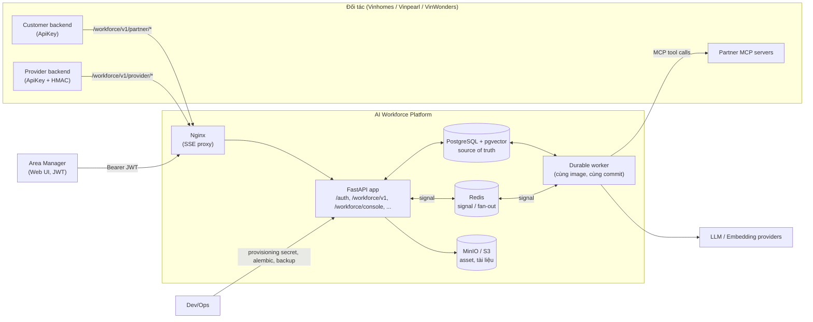
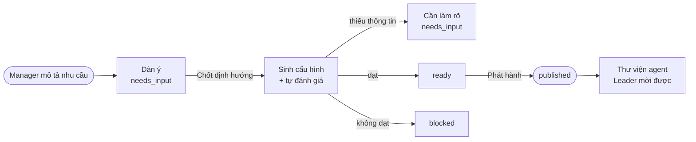
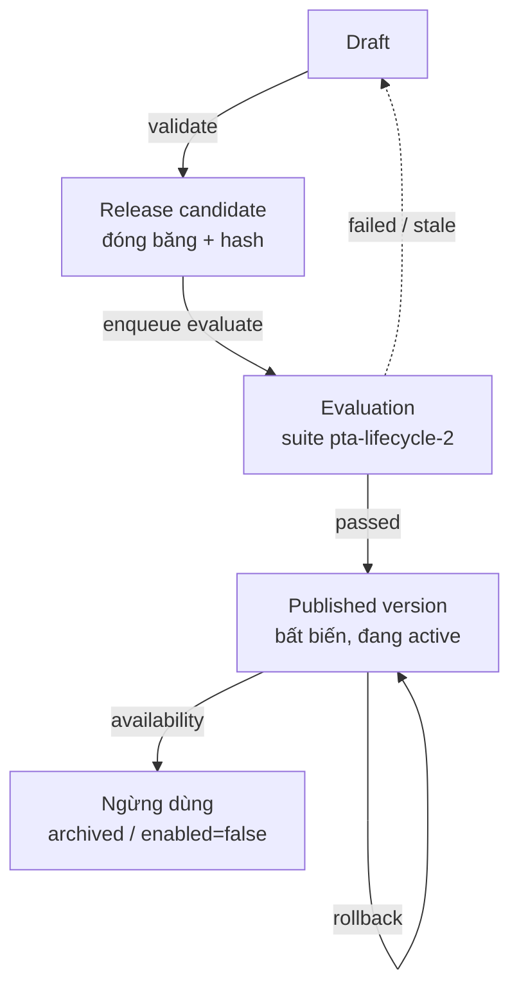
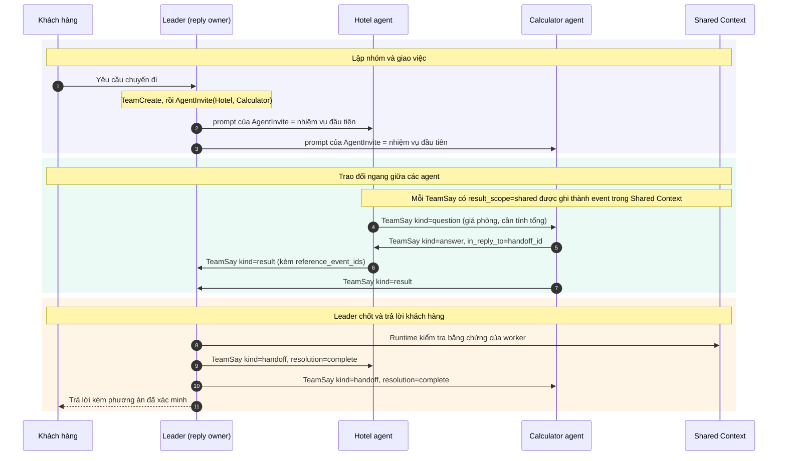
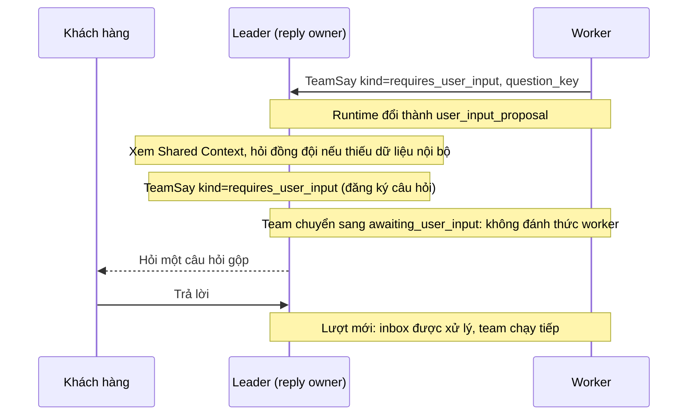
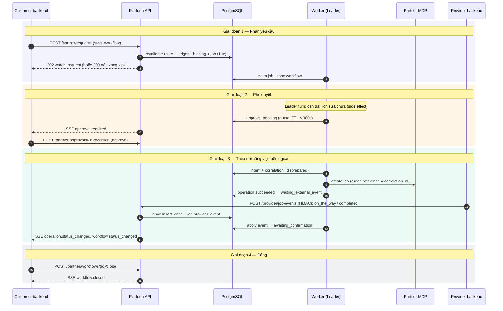

# Đặc tả Phần mềm (SRS) — AI Workforce Platform

| Thuộc tính | Giá trị |
|---|---|
| Ngày | 2026-10-14 |
| Loại tài liệu | Mô tả hệ thống đã xây dựng (as-built) |
| Phạm vi | Lớp **AI Workforce** + các phần platform/web UI mà Workforce sử dụng |
| Chuẩn tham chiếu | Cấu trúc theo ISO/IEC/IEEE 29148 (kế thừa IEEE 830), điều chỉnh cho dự án |

---

## Mục lục

1. [Giới thiệu](#1-giới-thiệu)
2. [Tổng quan hệ thống](#2-tổng-quan-hệ-thống)
3. [Chức năng hệ thống](#3-chức-năng-hệ-thống)
4. [Giao diện ngoài](#4-giao-diện-ngoài)
5. [Dữ liệu](#5-dữ-liệu)
6. [Đặc tính phi chức năng](#6-đặc-tính-phi-chức-năng)
7. [Quy tắc nghiệp vụ và giới hạn](#7-quy-tắc-nghiệp-vụ-và-giới-hạn)
8. [Kiểm thử và phát hành](#8-kiểm-thử-và-phát-hành)
9. [Tổ chức mã nguồn](#9-tổ-chức-mã-nguồn)
10. [Phụ lục](#10-phụ-lục)

---

## 1. Giới thiệu

### 1.1 Mục đích

Tài liệu này mô tả chức năng, giao diện, dữ liệu và các đặc tính phi chức năng của **AI Workforce Platform** như đã được xây dựng. Đây là một nền tảng dùng chung, đa tenant, xây trên framework đa agent AgentScope. Nền tảng cho phép:

- **Đối tác** (các đơn vị thuộc Vingroup như Vinhomes, Vinpearl, VinWonders) gửi yêu cầu khách hàng từ backend của họ, cắm MCP tool server và báo sự kiện công việc dài hạn.
- **Quản lý khu vực (Area Manager)** tạo AI agent bằng hội thoại rồi phát hành vào thư viện agent riêng của tài khoản.
- **Leader agent** của nền tảng, khi có yêu cầu, chọn đúng các agent đã phát hành, điều phối chúng, gọi tool, hỏi người dùng, xin đồng ý trước khi thực hiện hành động có tác dụng phụ (đặt chỗ, ghi dữ liệu), và theo dõi các công việc bên ngoài kéo dài.

Đối tượng đọc: đội phát triển, QA, DevOps, đại diện đối tác tích hợp và người duyệt kiến trúc.

### 1.2 Phạm vi

Các năng lực chính của nền tảng:

| Năng lực | Mô tả ngắn |
|---|---|
| Xác thực và danh tính | Area Manager đăng nhập bằng JWT + refresh token; danh tính gắn với scope tenant/domain/area/account |
| Định tuyến đối tác | Yêu cầu của đối tác được định tuyến tới **đúng tài khoản manager**, không chỉ tới domain hay area |
| Ticket/Workflow | Một lifecycle trung lập theo ngành với 3 pattern: `response_only`, `interactive`, `external_tracking` |
| API đối tác | Customer API và Provider API tại `/workforce/v1`, do nền tảng host; đối tác chỉ gọi vào, không cần dựng webhook receiver |
| Sự kiện | Public event log bền vững, history phân trang, SSE replay theo cursor |
| Thực thi tool | Một tool gateway duy nhất với policy fail-closed, quote, phê duyệt (HITL), idempotency, reconciliation |
| Theo dõi công việc ngoài | External operation được theo dõi qua provider event (ký HMAC) và status query |
| Ảnh | Asset ảnh hai chiều (khách hàng ↔ provider) qua presigned URL |
| Agent Builder | Tạo một hoặc nhiều agent bằng hội thoại, tự đánh giá, phát hiện agent trùng |
| Lifecycle agent | Validate, evaluate, phát hành phiên bản bất biến, rollback, archive/disable, pin phiên bản cho workflow đang chạy |
| Cộng tác đa agent | Các agent trao đổi qua `TeamSay`, dùng chung Shared Context có giới hạn token |
| Web UI | Màn hình Leader (ticket + chat) và Agent Builder cho manager |

Những gì nền tảng chủ động **không** làm: RBAC nhiều tầng/admin, billing/marketplace, partner portal, chạy trên Kubernetes, viết lại AgentScope, outbound webhook, Temporal.

### 1.3 Định nghĩa và thuật ngữ

| Thuật ngữ | Định nghĩa |
|---|---|
| **Scope** | Bộ `(tenant_id, domain_id, area_id, manager_account_id)`, là chủ sở hữu của mọi tài nguyên Workforce. `manager_account_id = auth_users.id` |
| **Audience** | Bộ `(partner_client_id, external_user_id, external_conversation_id, external_ticket_id?, residence_id?)`, là ranh giới người dùng cuối/ticket bên đối tác |
| **Partner client** | Hệ thống backend của đối tác, xác thực bằng API key `dp_<key_id>.<secret>` |
| **Customer API** | API cho backend chăm sóc khách hàng của đối tác (`credential_purpose=customer_api`) |
| **Provider API** | API cho backend nghiệp vụ/nhà cung cấp của đối tác gửi sự kiện công việc (`credential_purpose=provider_events`, có ký HMAC) |
| **Route / Partner manager route** | Ánh xạ `(tenant_id, partner_client_id, external_management_ref) → (area_id, manager_account_id)` |
| **external_management_ref** | Mã quản lý phía đối tác (ví dụ `BQL-OP1-A`), dùng để định tuyến tới đúng manager |
| **Residence** | Căn hộ/cơ sở của cư dân, đồng bộ từ đối tác, gắn với route |
| **Workflow** | Thực thể điều phối bền vững gắn 1-1 với một ticket/hội thoại bên đối tác |
| **Binding** | Liên kết bất biến giữa ticket/hội thoại của đối tác và workflow/conversation/group của nền tảng |
| **Turn** | Một lượt xử lý của Leader, kích hoạt bởi một nguyên nhân (cause): tin nhắn, reply, approval, external event, timer |
| **Leader** | Agent điều phối cố định của nền tảng, được pin phiên bản đã phát hành |
| **Specialist / business agent** | Agent nghiệp vụ do manager tạo bằng Builder và phát hành |
| **Builder** | Trợ lý hội thoại giúp manager tạo agent mới |
| **Pin** | Phiên bản agent hoặc protocol được cố định cho một workflow; không đổi trong suốt workflow |
| **Async tool protocol** | Snapshot bất biến mô tả cách một tool tạo và theo dõi external operation (trạng thái terminal, correlation, ordering, timeout) |
| **External operation** | Công việc bên ngoài kéo dài (ví dụ thợ sửa chữa), theo dõi qua provider event hoặc status query |
| **Receipt** | Biên nhận cho một provider event đã nhận |
| **Quote** | Báo giá đã xác minh cho một hành động có tác dụng phụ; phê duyệt được ràng buộc với quote |
| **HITL** | Human-in-the-loop: phê duyệt của con người trước hành động có tác dụng phụ |
| **Durable job** | Công việc nền lưu trong PostgreSQL, có lease, fencing token và retry |
| **UOW** | Unit of Work: transaction có commit tường minh |
| **Shared Context** | Bộ ngữ cảnh dùng chung theo team/ticket, có summary trích nguồn và budget token |

### 1.4 Tài liệu tham chiếu

| Tài liệu | Nội dung |
|---|---|
| `docs/workforce/KE_HOACH_TRIEN_KHAI.md` | Kiến trúc và phân công module |
| `docs/workforce/CONTRACT_TICH_HOP_DOI_TAC.md` | Hợp đồng API đối tác |
| `docs/workforce/KE_HOACH_SHARED_CONTEXT.md` | Shared Context |
| `docs/workforce/RUNTIME_COLLABORATION.md` | Cộng tác runtime giữa các agent |
| `docs/multi_tenant_rbac_business_analysis_vi.md` | Phân tích đa tenant |
| `docs/area_platform_api_vi.md` | API area platform |
| `deploy/workforce/event_delivery/{README,RUNBOOK,RELEASE_CHECKLIST}.md`, `alerts.example.yml`, `proxy.example.conf` | Vận hành |
| `.github/workflows/workforce-phase-d.yml` (gốc repo) | CI gate |
| `src/agentscope/app/workforce/**`, `src/agentscope/app/_router/**`, `storage/_sql/_alembic/versions/**` | Mã nguồn |

Trong tài liệu, đường dẫn tính từ `platform_VP/agentscope/`; `WF/` là viết tắt của `src/agentscope/app/workforce/`.

---

## 2. Tổng quan hệ thống

### 2.1 Bối cảnh

AI Workforce Platform là một lớp mở rộng nằm trong service FastAPI của AgentScope (`src/agentscope/app/_app.py`, hàm `create_app`). Lớp Workforce gồm 9 subpackage dưới `WF/`:

| Subpackage | Vai trò |
|---|---|
| `contracts` | Model dùng chung (Pydantic, `extra="forbid"`, frozen), port/interface, mã lỗi, export JSON Schema |
| `foundation` | SQL engine, UOW, danh tính manager, định tuyến đối tác, xác thực HMAC provider, durable job, signal, SSE, metrics |
| `registry` | Async tool protocol (snapshot bất biến + head/enable) |
| `builder` | Thư viện trích yêu cầu, chọn tool và đối chiếu tái sử dụng |
| `orchestration` | Partner ingress, binding, state machine workflow, checkpoint, continuation của Leader, public event log/SSE |
| `execution` | Tool gateway, policy, transaction, approval, booking, MCP adapter, external operation, provider event, reconciliation |
| `lifecycle` | Validate, evaluate, release/publish/rollback/availability, xác thực pin |
| `integrations` | Composition root (`WorkforceBootstrap`, `build_phase_c_runtime`), router release |
| `assets` | Upload/download ảnh gắn với ticket/operation |

Ngoài ra lớp Workforce dùng các thành phần platform: auth (`_router/_auth.py`), business/area platform (`_router/_business.py`), Workforce console (`_router/_workforce_console.py`), sessions/chat/SSE, agents, team/shared context, storage và web UI (`examples/web_ui/frontend`).

#### Sơ đồ ngữ cảnh

### 2.2 Chức năng chính

1. **Định danh và định tuyến:** suy scope từ credential; định tuyến yêu cầu đối tác tới đúng manager qua route grant đã được hai bên xác nhận.
2. **Ticket/Workflow dài hạn:** nhận yêu cầu (idempotent), gắn ticket vào workflow, chạy turn của Leader, ngủ khi chờ mà không tốn model call, thức dậy khi có sự kiện, đóng workflow tường minh.
3. **Giao tiếp sự kiện:** public event log có thứ tự, history phân trang, SSE replay theo cursor.
4. **Thực thi có kiểm soát:** mọi tool call đi qua một gateway, có kiểm tra policy, quote và phê duyệt, ghi intent bền vững trước khi gọi mạng, chuyển sang trạng thái `unknown` thay vì retry mù.
5. **Theo dõi công việc bên ngoài:** provider event có ký HMAC, inbox idempotent, xử lý thứ tự, quarantine, reconciliation.
6. **Xây dựng và phát hành agent:** Builder bằng hội thoại, evaluate với gate định lượng, phát hành phiên bản bất biến, rollback.
7. **Cộng tác đa agent:** Leader chọn specialist, các agent trao đổi qua TeamSay, dùng chung Shared Context có budget.

### 2.3 Người dùng và actor

| Actor | Loại | Mô tả | Xác thực |
|---|---|---|---|
| **AREA_MANAGER** | Người, role sản phẩm duy nhất | Đăng ký với domain/area; tạo và phát hành agent; quản lý MCP; cấp route cho đối tác; xem hàng đợi và timeline ticket; duyệt memory | JWT Bearer + refresh cookie |
| **Partner customer backend** | Máy, `ActorContext.kind=partner` | Gửi yêu cầu/trả lời của khách hàng, đọc kết quả, nghe SSE, gửi phê duyệt, đóng workflow, đồng bộ residence | `Authorization: ApiKey dp_<key_id>.<secret>` |
| **Partner provider backend** | Máy, `credential_purpose=provider_events` | Gửi job event, đọc receipt, upload ảnh provider | ApiKey + HMAC-SHA256 |
| **Người dùng cuối / cư dân** (`external_user_id`) | Người, phía đối tác | Do đối tác xác thực; không đăng nhập vào nền tảng | Gián tiếp qua đối tác |
| **Nhân viên, kỹ thuật viên, tài xế** | Người, phía đối tác | Chỉ tác động qua tích hợp máy của đối tác | Gián tiếp |
| **Dev/Ops** | Vận hành | Cấp API key (`X-Provisioning-Secret`), chạy migration, backup. Không phải role admin | Secret vận hành |
| **System** | `ActorContext.kind=system` | Worker, timer, reconciliation | Nội bộ |
| **Agent runtime** | Không phải tài khoản | Leader, Builder, các specialist; team `leader/worker` | Nội bộ |

Phân cấp tổ chức dùng trong ví dụ: Vingroup (organization) → Vinhomes / Vinpearl / VinWonders (domain) → Ocean Park 1 / Ocean Park 2 (area). Migration `0008_area_platform` seed `vinhomes{ocean-park-1, ocean-park-2}`, `vinpearl`, `vinwonders`.

### 2.4 Môi trường vận hành

| Thành phần | Công nghệ |
|---|---|
| Runtime | Python ≥ 3.11; FastAPI, Uvicorn, Pydantic v2, SQLAlchemy 2 async, Alembic |
| CSDL | PostgreSQL 17 + pgvector (image `pgvector/pgvector:pg17`). Dùng `FOR UPDATE`, `SKIP LOCKED`, `ON CONFLICT`. SQLite dùng cho test |
| Message bus | Redis 7 (signal, fan-out, lock); bản in-memory dùng cho dev |
| Object storage | MinIO/S3 (asset, tài liệu KB), presigned URL qua `S3_PUBLIC_ENDPOINT` |
| Reverse proxy | Nginx, tắt buffering cho route SSE |
| Frontend | React 19 + Vite, Node 22, pnpm 10.19.0 |
| Container | `Dockerfile` (python:3.11-slim + Node 20), `compose.yaml` (app, redis, postgres, minio) |

### 2.5 Nguyên tắc thiết kế

- **Một ứng dụng + một worker:** kiến trúc gồm một ứng dụng FastAPI và một tiến trình durable worker riêng, chạy cùng image và cùng commit. Không dùng microservice, Kubernetes hay Temporal.
- **PostgreSQL là nguồn dữ liệu gốc:** Redis chỉ dùng cho signal/fan-out; mất Redis không làm mất dữ liệu.
- **Không có outbound webhook:** nền tảng host mọi endpoint; đối tác chỉ gọi vào.
- **Lắp ghép tường minh:** router `/workforce/v1` được mount khi truyền `WorkforceBootstrap` vào `create_app` (`_app.py`). Ở production, ứng dụng dừng khởi động nếu thiếu `SharedContextService` chuẩn hoặc dùng storage instance khác.
- **Migration chỉ thêm:** không `create_all` lúc runtime; không downgrade làm mất dữ liệu inbox/workflow/event đang mở.
- **Chặn trường lạ:** model contract dùng `extra="forbid"` để không ai chèn được scope, group hay agent ID qua request.
- **Cấu hình qua constructor:** lớp Workforce không đọc biến môi trường trực tiếp; cấu hình được truyền qua `WorkforceBootstrap` và `PhaseCRuntimeDependencies`.

### 2.6 Phụ thuộc bên ngoài

- Đối tác tự xác thực người dùng cuối và chịu trách nhiệm về tính đúng của `external_user_id`.
- Partner MCP server tuân thủ schema đã khai báo; khi schema thay đổi (drift), hệ thống phát hiện và chặn.
- Dịch vụ bên thứ ba: LLM/embedding/TTS provider, MCP server (Playwright, AMap, MCP của đối tác), GitHub MCP registry, ClawHub, OTLP collector.

---

## 3. Chức năng hệ thống

### 3.1 Xác thực và danh tính

Nguồn: `_router/_auth.py`, `auth/_service.py`, `deps.py`, `WF/foundation/_identity.py`.

- **Đăng ký:** Area Manager đăng ký qua `POST /auth/register` với email, username, password (≥ 12 ký tự), `domain_id`, `area_id`; area phải thuộc domain đã chọn. Mật khẩu được băm bằng Argon2id.
- **Đăng nhập:** `POST /auth/login` nhận `tenant_id`, định danh (email hoặc username) và password, trả về access token JWT (PyJWT, kiểm tra issuer và audience, mặc định hết hạn sau 15 phút).
- **Refresh token:** xoay vòng sau mỗi lần dùng; nằm trong cookie HttpOnly `agentscope_refresh` (path `/auth`, SameSite=lax, mặc định 30 ngày); DB chỉ lưu hash HMAC-SHA256 có pepper; việc dùng lại refresh token cũ bị phát hiện.
- **Các endpoint khác:** `POST /auth/refresh`, `POST /auth/logout`, `POST /auth/logout-all`, `GET /auth/me`.
- **Khoá bí mật:** JWT secret và refresh pepper dài ít nhất 32 byte; thiếu thì ứng dụng không khởi động.
- **Chế độ legacy:** khi bật auth, header `X-User-ID` bị bỏ qua. Chế độ không có auth service (tenant `"legacy"`) chỉ dùng cho dev.
- **Danh tính manager trong Workforce:** được nạp từ membership ở trạng thái `verified`, join với `auth_users`, `business_domains`, `areas` đang active. Nếu domain/area trong token khác DB thì yêu cầu bị từ chối ("token scope is stale"). Mỗi manager có tối đa một membership; việc xác minh là phép CAS `pending_verification → verified`. Chỉ principal có role `AREA_MANAGER` mới dùng được các API manager.

### 3.2 Danh mục, API key đối tác, residence

Nguồn: `_router/_business.py`, `business/_service.py`.

- **Danh mục public:** `GET /directory/domains` và `GET /directory/domains/{domain_id}/areas`, dùng cho form đăng ký.
- **Cấp API key:** `POST /integrations/api-keys` cấp key cho partner client, yêu cầu header `X-Provisioning-Secret` hợp lệ (≥ 32 byte).
- **Định dạng key:** `dp_<key_id>.<secret>`, chỉ hiển thị một lần. DB chỉ lưu hash (HMAC với `PARTNER_API_KEY_PEPPER`); hệ thống tra cứu theo `key_id` và so sánh secret trong thời gian hằng.
- **Đồng bộ residence:** `PUT /partner/residences/{residence_id}` đồng bộ idempotent (200 khi cập nhật, 201 khi tạo mới). Residence gắn với route (`partner_residences.route_id`) để kiểm tra sender, residence và route khớp nhau.

### 3.3 Định tuyến đối tác → manager

Nguồn: `WF/foundation/_partner_routing.py`, `_route_grants.py`, `WF/contracts/_partner_routing.py`.

- **Hai lớp định tuyến:** (1) credential xác định partner client/domain; (2) `PartnerManagerRoute` ánh xạ `(tenant_id, partner_client_id, external_management_ref) → area_id + manager_account_id`. Key của một domain không có quyền tới mọi manager trong domain đó.
- **Quyền theo route:** mỗi route mang danh sách `allowed_operations`: `submit_request`, `reply`, `read_result`, `receive_events`, `submit_consent`, `close_workflow`, `confirm_route`, `sync_residence`, `publish_job_event`, `read_event_receipt`.
- **Tìm route:** hệ thống tìm đúng **một** route `active` cho `(client, external_management_ref)`, với membership `verified` và `membership_revision` của route bằng revision hiện tại của membership. Nếu có residence thì đối chiếu thêm với `partner_residences`.
- **Kiểm tra lại trong transaction:** mọi transaction ghi đều kiểm tra lại route ID, revision, owner và operation được cấp.
- **Phản hồi lỗi:** key sai/hết hạn/bị revoke → `401`; không có grant hoặc sai domain/area/client/manager/residence → `403 ROUTE_NOT_AUTHORIZED` (không liệt kê manager khác); nhiều route active → `409 ROUTE_AMBIGUOUS`, không dispatch; route đổi khi workflow đang chạy → `blocked_route_changed` / `blocked_authorization`.
- **Quyền sở hữu giữ nguyên:** khi ánh xạ lại route, hội thoại cũ vẫn thuộc owner ban đầu.

**Ví dụ:** `BQL-OP1-A → ocean-park-1/manager-A` và `BQL-OP1-B → ocean-park-1/manager-B`: cùng area nhưng hai đích khác nhau, dữ liệu tách biệt.

**Vòng đời route:**

- (1) Manager tạo grant bằng JWT; cần membership `verified` và ít nhất một operation.
- (2) Đối tác xác nhận bằng credential `customer_api`, gửi kèm `expected_revision` (CAS).
- (3) Manager thu hồi được ở cả `pending_confirmation` lẫn `active`. Đường nét đứt là trường hợp thu hồi trước khi đối tác xác nhận.

### 3.4 Partner ingress và Workflow

Nguồn: `WF/orchestration/_ingress.py`, `_router.py`, `workflows/_service.py`, `workflows/_continuation.py`, `WF/contracts/_conversation.py`.

#### 3.4.1 Nhận yêu cầu

- **Endpoint:** `POST /workforce/v1/partner/requests` nhận `PartnerRequestEnvelope` với `schema_version="1"`, `command_type` là `start_workflow` hoặc `workflow_reply`. `start_workflow` không có `workflow_id`; `workflow_reply` bắt buộc có `workflow_id` (thiếu → `WORKFLOW_REFERENCE_REQUIRED`).
- **Nội dung:** message có dạng `{type:"text", text ≤ 20.000 ký tự, attachments ≤ 10 asset_id không trùng}`; body ≤ 262.144 byte (vượt → `413 PAYLOAD_TOO_LARGE`).
- **Trường bị cấm:** đối tác không được gửi `ticket_id`, `conversation_id`, `group_id`, `tenant_id`, `domain_id`, `area_id`, `manager_account_id`, `route_id`, `agent_id`, `tool_id`, credential, role hay execution mode; trường lạ bị từ chối (`422 REQUEST_BODY_INVALID`).
- **Idempotency:** hệ thống tính `payload_hash = sha256(canonical JSON)` và ghi vào ledger `wf_partner_commands`, khoá theo `(tenant_id, partner_client_id, external_request_id)`. Gửi lại cùng ID và cùng payload → trả kết quả đã lưu, kể cả khi route đã được ánh xạ lại; cùng ID nhưng khác payload/kind/target → `409 IDEMPOTENCY_CONFLICT`; khác `external_user_id` → từ chối.
- **Định tuyến:** với `start_workflow`, hệ thống định tuyến theo `external_management_ref` + user (+ residence). Với `workflow_reply`, hệ thống dùng lại scope, route và revision của yêu cầu gốc; khác audience/management ref/workflow → `409 WORKFLOW_BINDING_MISMATCH`.
- **Một transaction:** kiểm tra scope active → kiểm tra lại route → claim ledger → nếu là lệnh mới thì `start_with_binding` hoặc `accept_reply`, gắn asset, ghi request → commit.
- **Chờ kết quả:** POST chờ kết quả của turn hiện tại tối đa 8 giây (`bounded_wait_seconds`). Xong trong thời gian chờ → `200`; chưa xong → đúng **một** `202` với `next_action=watch_request`. Việc chờ dựa trên signal hoàn tất, có polling dự phòng.
- **Phản hồi:** luôn có `workflow_state` và `next_action`, cùng `request_id`, `external_ticket_id`, `conversation_id`, `workflow_id`, `workflow_revision`, `ticket_id`, `result.messages[]`, `error`, `accepted_at`, `completed_at`, `status_url`, `conversation_url`, `event_stream_url`.
- **Tra cứu:** `GET /workforce/v1/partner/requests/{request_id}?external_user_id=` trả trạng thái yêu cầu (operation `read_result`).

#### 3.4.2 Binding và vòng đời workflow

- **Binding bất biến:** liên kết ticket ↔ workflow là duy nhất theo `(tenant, client, user, external_conversation_id)`, `(tenant, client, user, external_ticket_id)`, `conversation_id`, `group_id`. Trùng → `409 TICKET_ALREADY_BOUND` / `CONVERSATION_ALREADY_BOUND`.
- **Bắt đầu workflow:** hệ thống lấy phiên bản Leader đã phát hành (deployment đang hiện hành, enabled, chưa archived), ghi input, tạo checkpoint revision 1, phát `request.accepted`, rồi enqueue job `workforce.shared_context.project` (job này enqueue tiếp `workforce.workflow.continue`).
- **Nhận reply:** `accept_reply` từ chối khi workflow đã đóng hoặc bị chặn, hoặc revision không khớp (`REVISION_CONFLICT`); hợp lệ thì chuyển sang `active` và phát `workflow.status_changed`.
- **Continuation:** worker giữ lease workflow (120 s) kèm fencing token; bỏ qua cause đã xử lý (`duplicate`); hoãn cause `external_event` hoặc `timer` khi đang chờ người (`deferred_human_input`); gọi Leader qua runtime đã pin; commit bằng CAS trên revision + fence; phát `assistant.message` và `workflow.status_changed`/`workflow.closed`; phát signal sau khi commit.
- **ExecutionGuard:** chạy trước mọi tác dụng phụ (model hoặc tool), kiểm tra workflow chưa đóng, aggregate và revision không đổi, lease còn hiệu lực, trigger được phép, và workflow published read-only thì không có tác dụng phụ. Turn ném `PermissionError` → workflow chuyển sang `blocked_authorization`.
- **Pattern:** mỗi workflow có pattern `response_only` / `interactive` / `external_tracking`. Một workflow `response_only` + published read-only đóng ngay trong một turn.

#### 3.4.3 Máy trạng thái workflow

Ngoài các đường trong sơ đồ, đối tác có thể đóng workflow từ **bất kỳ** trạng thái nào chưa `closed` nếu gửi `stop_tracking_only=true`. Hai trạng thái bị chặn chỉ thoát được bằng cách này.

| `workflow_state` | `next_action` | Trạng thái task (Shared Context) |
|---|---|---|
| `accepted` | `watch_request` | `queued` |
| `active` | `watch_request` | `running` |
| `waiting_external_event` | `watch_events` | `waiting_external` |
| `awaiting_user` | `submit_reply` | `waiting_user` |
| `awaiting_approval` | `submit_approval` | `waiting_approval` |
| `awaiting_confirmation` | `confirm_close` | `waiting_user` |
| `needs_attention` | `resolve_attention` | `blocked` |
| `blocked_authorization` | `resolve_attention` | `blocked` |
| `blocked_route_changed` | `resolve_attention` | `blocked` |
| `closed` | `none` | `completed` |

**Quy tắc chuyển trạng thái** (`_validate_decision`):

- Một turn đã hoàn tất không kết thúc ở `accepted` hoặc `active`.
- `awaiting_approval` cần một approval ID bền vững.
- `waiting_external_event` cần pattern `external_tracking` và ít nhất một operation đang chờ với `creation_status=succeeded` và capability `receive_status` hoặc `status_query`.
- Không vào `awaiting_confirmation` khi còn task, câu hỏi hay operation đang chờ.
- Trong một turn, `session_refs`, `agent_version_pins`, `protocol_pins` không đổi; lịch sử operation và bộ đếm usage chỉ tăng.
- Approval đang chờ luôn hiển thị; chỉ một cause loại approval mới giải quyết được approval của chính nó.
- Mỗi turn tăng revision đúng 1; revision của workflow và của checkpoint luôn khớp nhau.

`RequestStatus`: `accepted → queued → running → completed / failed / blocked`. Khi đọc, một request đang chờ được hiển thị là `blocked` nếu workflow ở trạng thái `closed` (`WORKFLOW_CLOSED`), `blocked_authorization` (`ROUTE_NOT_AUTHORIZED`), `blocked_route_changed` (`ROUTE_CONFLICT`) hoặc `needs_attention` (`WORKFLOW_NEEDS_ATTENTION`).

#### 3.4.4 Đóng workflow

- **Endpoint:** `POST /workforce/v1/partner/workflows/{workflow_id}/close` đóng workflow tường minh và idempotent; body gồm `expected_revision`, `reason` (≤ 200 ký tự), `stop_tracking_only`.
- **Điều kiện:** chỉ đóng được từ `awaiting_confirmation`, trừ khi `stop_tracking_only=true`. Còn approval hoặc operation đang chờ mà không có `stop_tracking_only` → `409 WORKFLOW_NOT_READY_TO_CLOSE`.
- **Sau khi đóng:** sự kiện đến muộn chỉ được ghi nhận (audit), không mở lại workflow.

### 3.5 Public event log, history và SSE

Nguồn: `WF/orchestration/partner_events/*`, `WF/foundation/_sse.py`, `_signals.py`.

- **Event log:** log trong DB là nguồn dữ liệu gốc. `sequence` tăng dần theo từng conversation, bắt đầu từ 1 (UNIQUE `(conversation_id, sequence)`); cùng `event_id` mà khác nội dung → `409 EVENT_ID_CONFLICT`.
- **Loại event phát ra ngoài:** `request.accepted`, `workflow.status_changed`, `ticket.created`, `ticket.status_changed`, `assistant.message`, `approval.required`, `approval.resolved`, `operation.status_changed`, `workflow.awaiting_user`, `workflow.needs_attention`, `workflow.closed`.
- **Envelope:** `schema_version`, `event_id`, `sequence`, `event_type`, `occurred_at`, `recorded_at`, `conversation_id`, `external_ticket_id`, `external_conversation_id`, `external_user_id`, `workflow_id`, `ticket_id`, `payload`.
- **Snapshot:** `GET /workforce/v1/partner/conversations/{id}?external_user_id=` trả snapshot kèm `snapshot_cursor` (operation `read_events`).
- **History:** `GET …/event-history?external_user_id=&after_cursor=&limit=` trả `{items, next_cursor, has_more}`; `limit` từ 1 đến 500, mặc định 100.
- **SSE:** `GET …/events` (`text/event-stream`) replay trước (trang 100), sau đó chờ signal hoặc gửi heartbeat (mặc định 15 s, trong khoảng > 0 và ≤ 60). Kết nối lại bằng `Last-Event-ID` hoặc `after_cursor`; hai giá trị mâu thuẫn → `422`. Xác thực và cursor được kiểm tra **trước** khi gửi header SSE. Cursor không xác định hoặc hết hạn → `410 EVENT_CURSOR_EXPIRED` (client tải lại snapshot).
- **Kiểm tra quyền liên tục:** quyền được kiểm tra lại ở mỗi frame; credential bị revoke thì stream kết thúc trong ≤ 60 s.
- **Signal:** message bus phát signal trên kênh `agentscope:workforce:conversation:<hash>` hoặc `agentscope:workforce:request:<hash>` (hash = SHA-256 của scope và id) sau khi commit. Signal chỉ mang tính gợi ý; mất signal không làm mất sự kiện.
- **Phía client:** client khử trùng lặp theo `event_id` và `message_id`; ký tự xuống dòng trong `id`/`event` của SSE bị từ chối.

### 3.6 Thực thi tool

Nguồn: `WF/execution/_gateway.py`, `_policy.py`, `_transactions.py`, `_mcp_adapter.py`, `_calculator.py`, `_effects.py`.

- **Một cổng duy nhất:** mọi tool call đi qua `ExecutionGateway.execute`.
- **Policy fail-closed:** gateway tải lại run (không ở trạng thái cancelled/failed/closed; mode `production` hoặc `evaluation`) và kiểm tra lại membership, route, grant, audience, binding; phiên bản agent đã được pin; tool descriptor khả dụng và đúng scope; `tool_id` và `schema_hash` của binding khớp; đủ capability; effect nằm trong `execution_policy.allowed_effects`; `llm_alias` khớp `^[A-Za-z_][A-Za-z0-9_-]{0,63}$`. Các kiểm tra này chạy kể cả khi permission mode legacy là bypass.
- **Kiểm tra input:** input được validate theo JSON Schema (Draft 2020-12) và phải khớp `arguments_hash`.
- **Idempotency:** khoá theo `(scope, run_id, idempotency_key)` + fingerprint; call đã xong thì trả lại kết quả cũ; fingerprint khác → `IDEMPOTENCY_CONFLICT`.
- **Effect:** `read`, `write`, `booking`, `cancel`, `communicate`, `ask_user`. Ba loại `write`, `booking`, `cancel` là tác dụng phụ; chúng cần quote đã xác minh và được đánh dấu `effect_reviewed`.
- **Ghi intent trước khi gọi mạng:** trong một transaction, gateway kiểm tra policy lần nữa → `reserve` → `operations.prepare`; kiểm tra policy lần cuối ngay trước khi dispatch.
- **Trạng thái call:** `proposed → awaiting_approval` (tác dụng phụ chưa được duyệt) `→ executing → succeeded / failed / unknown`. `unknown` được dùng khi tác dụng phụ có thể đã xảy ra (timeout, crash, phản hồi lỗi); call bị bỏ dở được khôi phục thành `unknown` + `EXECUTION_INTERRUPTED`. Thao tác ghi không bao giờ bị retry mù.
- **MCP adapter:** ẩn các trường do server sở hữu (`asset_downloads`, trường idempotency đã cấu hình), phát hiện schema drift (`MCP_SCHEMA_DRIFT`) và cấm credential production ở mode evaluation (`EVAL_PRODUCTION_CREDENTIAL_FORBIDDEN`).
- **Tool tính tiền dựng sẵn** `builtin.money.v1`: dùng số nguyên (`Money{amount_minor, currency}`), tối đa 1000 item, quantity từ 1 đến 10.000, số tiền ≤ 10^18.
- **Tra cứu cho manager:** `GET /workforce/v1/executions/{call_id}` (call_id, status, output, error, external_transaction_id, started_at, finished_at, approval_id) và `GET /workforce/v1/booking-operations/{operation_id}`.
- **Đối soát booking:** `BookingReconciler` truy vấn theo `provider_reference` đã lưu và không bao giờ chạy lại thao tác create; `summarize()` trả `confirmed/partial/unknown/failed` với `automatic_compensation: False`.

### 3.7 Phê duyệt (HITL)

Nguồn: `WF/execution/_approvals.py`, `_partner_approval.py`, `_router.py`, `app/_chat_consent.py`.

- **Tạo approval:** approval được tạo cùng lúc với HITL event; người quyết định (`allowed_decider.kind`) là `manager` hoặc `partner`.
- **Quote:** gồm `quote_ref`, `quote_version`, provider, option, dates, amount, fees, cancellation_terms, `expires_at`.
- **Thời hạn:** min(`quote.expires_at`, now + 900 s).
- **Trạng thái:** `pending → approved / rejected`; `approved → consumed`, được tiêu thụ nguyên tử cùng execution intent.
- **Xử lý trùng và lỗi:** gửi lại cùng quyết định → trả bản ghi hiện có; quyết định khác → `APPROVAL_ALREADY_RESOLVED`; hết hạn → `APPROVAL_EXPIRED`; hash không khớp → `APPROVAL_CONTENT_CHANGED`.
- **Manager:** `GET /workforce/v1/conversations/{id}/approvals`; `POST /workforce/v1/approvals/{id}/decision` với body đúng `{decision (approve hoặc reject), arguments_hash, quote_hash}`.
- **Đối tác:** `POST /workforce/v1/partner/approvals/{id}/decision` → `202`; có `expected_revision` (int strict) và `quote_ref`; quyết định được ghi vào ledger (`approval_decision`); nếu approve thì trigger `approval` được enqueue trong cùng transaction.
- **Phê duyệt bằng chat:** `POST /workforce/v1/partner/approvals/{id}/chat` → `202`; body có `message` (≤ 2000 ký tự) và không có `decision`. Chỉ chấp nhận cụm từ chính xác (`xac nhan`, `dong y`, `confirm`, `yes` hoặc `tu choi`, `huy`, `cancel`, `no`), có thể kèm approval ID hoặc 8 ký tự cuối của ID. Nội dung không rõ → `422 APPROVAL_CHAT_CLARIFICATION_REQUIRED`.
- **Booking có kiểm soát:** việc đặt chỗ chỉ diễn ra sau khi có đồng ý tường minh gắn với arguments hash và quote, và không vượt ngân sách đã duyệt.

### 3.8 External operation, provider event, reconciliation

Nguồn: `WF/execution/external_operations/*`, `provider_events/*`, `WF/foundation/_provider_auth.py`.

- **Điều kiện tạo:** external operation chỉ được tạo khi protocol có `capability=external_tracking` cùng provider_events hoặc status_query, và run có `workflow_id`.
- **Intent trước khi gọi provider:** hệ thống lưu intent kèm `correlation_id` do server sinh (`creation_status=prepared`) trước khi gọi provider. Chỉ các `create_fields` đã khai báo (`client_reference`/`idempotency_key`) mới nhận giá trị correlation; model tự điền các trường này → `CORRELATION_FIELD_SERVER_OWNED`. `ExternalCreationStatus`: `prepared`, `succeeded`, `failed`, `unknown`.
- **Nhận provider event:** `POST /workforce/v1/provider/job-events` → `202` + `ProviderEventReceipt`. Thứ tự xử lý: xác thực HMAC trên raw bytes **trước** khi parse JSON → kiểm tra envelope (`occurred_at` có timezone, `provider_version` là int strict, có `external_job_id` hoặc `client_reference`, ≤ 10 attachment không trùng) → `authorize_integration("publish_job_event")` → `insert_once` vào inbox → enqueue job `provider_event` trong cùng transaction → trả ACK.
- **Inbox idempotent:** khoá theo `(tenant, integration, external_event_id)`; cùng ID khác payload → `409 EVENT_ID_CONFLICT`. Inbox được commit trước khi trả `2xx`.
- **Tìm operation:** processor chỉ tìm trong namespace của provider đã xác minh; không tìm thấy → `quarantined` / `OPERATION_NOT_BOUND`.
- **Thứ tự sự kiện** theo ordering mode `snapshot` / `delta` / `transition`: version cũ hơn → `ignored`; cùng version khác nội dung → quarantine `PROVIDER_VERSION_CONFLICT`; delta thiếu version → `PROVIDER_VERSION_GAP` (chờ reconciliation); `on_the_way` đến muộn không ghi đè `completed`; trạng thái terminal không chuyển tiếp được.
- **Áp dụng event:** event hợp lệ cập nhật operation và gọi `workflow.apply_external_event`. Nếu workflow đã đóng hoặc bị revoke thì dữ kiện vẫn được lưu nhưng không phát ra ngoài.
- **Receipt:** trạng thái công khai `accepted`, `processing`, `applied`, `duplicate`, `quarantined`, `rejected`, `needs_attention` (trạng thái nội bộ `ignored` hiển thị ra ngoài là `rejected`). Tra cứu bằng `GET /workforce/v1/provider/event-receipts/{id}` (ký HMAC trên body rỗng, grant `read_event_receipt`).
- **Reconciliation** (job `operation_reconcile`): áp dụng cho operation đang chờ hoặc `unknown` có protocol khai báo `status_query`; truy vấn chạy ngoài transaction, sau đó CAS theo revision; kết quả `terminal`, `stale_query`, `needs_attention`, `unchanged`, `applied`. `escalate` ghi nhận cần chú ý và không bao giờ tự tạo ra trạng thái hoàn thành.
- **Vòng đời operation mẫu:** `pending → assigned → on_the_way → arrived → in_progress → completed` (hoặc `failed` / `cancelled`).

### 3.9 Asset ảnh

Nguồn: `WF/assets/_service.py`, `_router.py`, `_tables.py`.

- **Khách hàng upload:** `POST /workforce/v1/partner/assets/upload-sessions` (`201`, body ≤ 65.536 byte) trả presigned PUT URL → client PUT lên URL → `POST /workforce/v1/partner/assets/{id}/complete?external_user_id=&external_conversation_id=&external_ticket_id=`.
- **Tải ảnh:** `POST /workforce/v1/partner/assets/{id}/download-url` trả presigned GET URL ngắn hạn (300 s).
- **Provider upload:** `POST /workforce/v1/provider/assets/upload-sessions` (`201`) và `POST /workforce/v1/provider/assets/{id}/complete`; cần HMAC và grant `publish_job_event`.
- **Định dạng:** `image/jpeg`, `image/png`, `image/gif`, `image/webp`; kích thước 1 B – 20 MiB; upload URL có hạn 900 s.
- **Kiểm tra khi hoàn tất:** size, content type, metadata `asset-id` và magic bytes phải khớp, nếu không → `rejected` / `422 ASSET_UPLOAD_MISMATCH`; session hết hạn → `410 ASSET_UPLOAD_SESSION_EXPIRED`; object được chuyển sang key bất biến.
- **Gắn với ticket:** asset gắn với audience/ticket; dùng sai binding → `403 ASSET_BINDING_MISMATCH` / `PROVIDER_ASSET_BINDING_MISMATCH`. Attachment của provider event phải được upload cho đúng operation và workflow.
- **Truyền ảnh cho tool:** MCP tool muốn nhận ảnh phải khai báo capability `asset_download_v1` và trường input `asset_downloads`, nếu không → `422 TOOL_ASSET_CAPABILITY_MISSING`.
- **Trạng thái asset:** `pending_upload → active / rejected`.

### 3.10 MCP, danh mục tool và async tool protocol

Nguồn: `_router/_mcp.py`, `WF/registry/event_protocols/*`.

- **Danh mục tool:** khi manager thêm hoặc đồng bộ một MCP server (`POST /mcp`, `POST /mcp/{mcp_id}/sync`), nền tảng khám phá và lưu **toàn bộ** tool của server đó. Agent Builder dùng danh mục tool của các MCP đang bật (§3.11).
- **Protocol bất biến:** async tool protocol là snapshot bất biến theo `(scope, tool_version_id, protocol_id, protocol_version)`, có `schema_hash` tính trên toàn bộ cấu hình.
- **Head:** mỗi tool version có một head trỏ tới protocol hiện hành, kèm cờ `enabled` và `revision ≥ 1`; protocol bị tắt thì không thể phát hành agent mới dùng nó (`PROTOCOL_DISABLED`).
- **Quy tắc protocol:** `read_only_auto_close` cần một terminal read không qua approval; result mode `terminal` không cấu hình tracking; result mode `pending` cần provider integration, correlation field, `status_field`, `terminal_statuses`, `timeout_seconds`; mode `delta` cần ordering theo `provider_version`; `$ref` chỉ trỏ tới schema đóng gói sẵn (không tải qua URL).
- **Capabilities:** `create`/`terminal`, `receive_status`, `status_query`, `approval`.
- **Chuẩn hoá event:** tất định (deterministic) theo protocol đã pin.

### 3.11 Agent Builder

Nguồn: `app/_router/_workforce_console.py`, `app/_workforce_policy.py`, `examples/web_ui/frontend/src/pages/workforce/builder/index.tsx`.

**Agent Builder** là trợ lý hội thoại giúp Area Manager tạo agent nghiệp vụ mà không cần tự viết prompt hay cấu hình. Manager mô tả nhu cầu bằng lời; Builder đề xuất cần những agent nào, sinh cấu hình cho từng agent, tự đánh giá, rồi phát hành vào **thư viện agent** của manager. Leader chỉ mời được các agent đã phát hành trong thư viện này.

Builder **khác** Leader: Builder chỉ tạo cấu hình agent, không xử lý ticket, không gắn agent vào một nhóm hay một ticket cố định. Một yêu cầu "tạo một team" chỉ là cách tạo nhiều agent cùng lúc; việc ghép nhóm do Leader làm lúc chạy.

**Luồng tổng quát:**

Ở bước dàn ý, khi cần làm rõ hoặc khi bị chặn, manager chỉ cần nhắn tiếp: Builder lập lại dàn ý mới dựa trên toàn bộ hội thoại.

**Các endpoint** (prefix `/workforce/console`, xác thực bằng JWT của manager):

| Method | Path | Chức năng |
|---|---|---|
| GET | `/builder/conversations` | Danh sách hội thoại Builder |
| GET | `/builder/conversations/{conversation_id}` | Chi tiết một hội thoại, kèm đề xuất hiện hành |
| POST | `/builder/prepare` | Lập dàn ý hoặc sinh cấu hình |
| POST | `/builder/publish` | Phát hành đề xuất |
| GET | `/agents` | Danh sách agent nghiệp vụ trong thư viện |
| POST | `/agents/{agent_id}/lifecycle` | Chuyển agent giữa `draft` và `published` |

#### a) Giai đoạn 1 — Lập dàn ý

- **Gọi:** `POST /workforce/console/builder/prepare` với `confirm_outline=false` (mặc định). Body gồm `message` (1–16.000 ký tự), `chat_model_config` (model do manager chọn) và `conversation_id` (bỏ trống thì tạo hội thoại mới).
- **Danh mục tool:** Builder lấy tool từ mọi MCP đang bật của manager; mỗi tool có id dạng `<mcp_id>:<tool_name>`. Builder chỉ chọn tool có trong danh mục này, không bịa tool.
- **Kết quả của model:** dàn ý gồm 1–12 agent, mỗi agent có tên (≤ 100 ký tự), mục tiêu (≤ 4.000 ký tự) và các tool gợi ý. Dàn ý không chứa prompt hay skill.
- **Cách chia agent:** tôn trọng việc manager muốn một agent hay một nhóm; tách các năng lực nghiệp vụ độc lập thành agent riêng (lập kế hoạch, khách sạn, di chuyển, tính toán, hỗ trợ kỹ thuật là các mảng riêng); các thao tác liên quan trong cùng một mảng (ví dụ tìm và đặt khách sạn) có thể chung một agent; không tạo hai agent cho cùng một năng lực.
- **Mỗi tool chỉ thuộc một agent** trong cả đề xuất. Tool nghiệp vụ được giao cho agent chuyên trách; agent lập kế hoạch/điều phối nhờ agent chuyên trách qua `TeamSay` thay vì giữ bản sao tool. Server lọc lại: tool không có trong danh mục hoặc đã được agent trước nhận bị loại khỏi dàn ý.
- **Trả về:** trạng thái `needs_input`, danh sách agent dự kiến và câu hỏi mời manager góp ý hoặc bấm "Chốt định hướng và sinh cấu hình".

#### b) Giai đoạn 2 — Sinh cấu hình

- **Gọi:** `prepare` với `confirm_outline=true`. Builder sinh cấu hình đúng theo dàn ý đã chốt, không gộp các năng lực đã tách.
- **Năm thành phần Builder được tạo** cho mỗi agent: `name` (≤ 100 ký tự), `objective` (≤ 4.000), `system_prompt` (20–30.000), `selected_tool_ids`, và một skill (`skill_name` ≤ 100, `skill_markdown` 20–50.000). Tối đa 12 agent mỗi lần.
- **Những gì Builder không được chạm vào:** tham số model, giới hạn context, cấu hình ReAct, timeout, credential, quyền và chính sách phát hành.
- **Hướng dẫn cộng tác:** system prompt được sinh ra hướng dẫn agent khi nào cần trao đổi với agent khác qua `TeamSay`, nhưng không gắn cứng vào một ticket cụ thể.
- **Khi thiếu năng lực:** nếu nghiệp vụ không làm được với các tool hiện có, Builder hỏi **một** câu làm rõ cụ thể hoặc không trả về agent nào và giải thích năng lực còn thiếu (trạng thái `needs_input`).
- **Chính sách bằng chứng:** server tự gắn `BUSINESS_AGENT_EVIDENCE_POLICY` vào cuối system prompt của mọi agent nghiệp vụ. Chính sách này ưu tiên hơn mọi chỉ dẫn do Builder viết: chỉ dùng thông tin khách hàng cung cấp, Shared Context đã xác minh và kết quả tool thành công làm bằng chứng; không bịa giá, lịch, tình trạng; không lấy ID nội bộ làm mã ticket hay mã đặt chỗ.
- **Skill:** được chuẩn hoá thành file `SKILL.md` có phần đầu `name` (dạng slug) và `description` (lấy từ mục tiêu, tối đa 300 ký tự).

#### c) Tự đánh giá và phát hiện agent trùng

Mỗi agent được sinh ra được chấm theo 5 tiêu chí:

| Tiêu chí | Điều kiện đạt |
|---|---|
| `system_prompt` | Dài ít nhất 80 ký tự |
| `registered_tools` | Mọi tool được chọn đều có trong danh mục |
| `exclusive_tool_assignment` | Không có tool nào đã thuộc agent khác trong cùng đề xuất |
| `capability_has_tools` | Có ít nhất một tool hợp lệ |
| `skill` | Skill dài ít nhất 40 ký tự |

- **Điểm:** `score` = số tiêu chí đạt / 5. Kết quả đánh giá (`evaluation`) gồm `passed`, `score`, `checks`, danh sách tool không hợp lệ, tool bị trùng và độ giống với agent đã có.
- **Phát hiện agent trùng:** Builder so mục tiêu của agent mới với mô tả (hoặc system prompt) của mọi agent nghiệp vụ hiện có của manager, bằng độ giống Jaccard trên tập từ dài hơn 2 ký tự. Nếu độ giống ≥ 0,72, Builder đề xuất **dùng lại** agent cũ (`reuse_agent_id`) thay vì tạo mới.
- **Đạt:** một agent đạt (`passed`) khi đạt cả 5 tiêu chí, hoặc khi có agent cũ để dùng lại.
- **Trạng thái đề xuất:** `ready` khi mọi agent đều đạt; `blocked` khi có ít nhất một agent không đạt hoặc không có agent nào.

#### d) Giai đoạn 3 — Phát hành

- **Gọi:** `POST /workforce/console/builder/publish` với `{conversation_id, proposal_id, expected_revision ≥ 1}`.
- **Kiểm tra:** đề xuất tồn tại và là đề xuất mới nhất của hội thoại (sai → `404`); revision khớp (sai → `409`); trạng thái là `ready` (sai → `409`); không có tool nào gán cho hai agent (sai → `409`, kèm danh sách tool).
- **Agent dùng lại:** không tạo bản ghi mới; trả về agent cũ với `reused=true`.
- **Agent mới:** server tạo `AgentRecord` gồm tên; system prompt đã gắn chính sách bằng chứng; context/ReAct cố định của nền tảng; `system_role=business`; `lifecycle_state=published`; `invitable=true` với mô tả mời là mục tiêu agent; danh sách tool đã gán (`tool_bindings`); skill; kết quả đánh giá.
- **Workspace của agent:** server tạo một session chính cho agent với model manager đã chọn. Workspace **chỉ** chứa đúng các tool đã chọn: gỡ mọi MCP mặc định của hệ thống trước, rồi bật từng MCP với danh sách `enable_tools` tương ứng; skill được cài dưới dạng gói `<slug>/SKILL.md`. MCP đã bị tắt hoặc không còn → `409`.
- **Sau khi phát hành:** Builder ghi thêm một tin nhắn xác nhận vào hội thoại, kèm đề xuất ở trạng thái `published`; phát hành lại cùng đề xuất đó bị từ chối (`409`).

#### e) Thư viện agent và vòng đời

- `GET /workforce/console/agents` liệt kê mọi agent nghiệp vụ của manager với tên, mục tiêu, `lifecycle_state`, số tool và kết quả đánh giá.
- `POST /workforce/console/agents/{agent_id}/lifecycle` chuyển giữa `draft` và `published`. Chỉ agent `published` có `invitable=true`, tức Leader mới thấy và mời được. Agent không phải loại nghiệp vụ → `404`.
- Thư viện là của **từng tài khoản manager**: Builder chỉ so trùng và chỉ phát hành trong phạm vi agent của chính manager đó; hai manager cùng area không dùng lại agent của nhau.

#### f) Hội thoại và bộ nhớ của Builder

- **Lưu trữ:** mỗi hội thoại Builder là một session của agent hệ thống `workforce-builder`, lưu trong storage chính. Tiêu đề hội thoại là 80 ký tự đầu của tin nhắn đầu tiên.
- **Mỗi lượt:** lưu cả tin nhắn của manager và câu trả lời của Builder; đề xuất được lưu kèm câu trả lời. "Đề xuất hiện hành" là đề xuất của tin nhắn mới nhất có đề xuất.
- **Tóm tắt:** khi hội thoại dài vượt 60% context của model, các tin nhắn cũ được tóm tắt (tóm tắt tối đa 10% context, thử tối đa 2 lần). Tin nhắn gốc không bị xoá; bản tóm tắt chỉ dùng cho Builder, không chia sẻ sang ticket lúc chạy.
- **Ngân sách context:** trước mỗi lần gọi model, server đo toàn bộ prompt (kể cả danh mục tool và schema đầu ra) và giữ 10% context cho đầu ra. Không đủ chỗ → `409` với thông báo mở hội thoại mới hoặc chọn model có context lớn hơn; nội dung không bao giờ bị cắt âm thầm. Số đo được ghi lại cho mỗi lượt.

#### g) Model, ngôn ngữ và xử lý lỗi

- **Model:** manager chọn model cho Builder ở giao diện (`LlmSelect`); lựa chọn được lưu theo hội thoại và cũng là model của session chính của agent được phát hành. Context, ReAct, timeout, bảo mật và chính sách phát hành do nền tảng cố định.
- **Timeout và lỗi:** mỗi lần gọi model của Builder có timeout 60 giây. Lỗi nhà cung cấp model trả về `502` kèm thông báo tiếng Việt dễ hiểu: hết thời gian, credential không có quyền dùng model, hết quota hoặc bị giới hạn tốc độ, không kết nối được nhà cung cấp, hoặc model trả sai định dạng.
- **Ngôn ngữ:** Builder trả lời theo ngôn ngữ của yêu cầu gần nhất (tiếng Việt hoặc tiếng Anh), nhận diện bằng dấu tiếng Việt và từ khoá. System prompt và skill được sinh ra cũng dặn agent trả lời theo ngôn ngữ của khách hàng.
- **Chưa có credential:** → `409` "Hãy thêm model credential trước khi dùng Builder hoặc Leader".

#### h) Giao diện Agent Builder

Trang `/workforce/builder` gồm:

- **Danh sách hội thoại** bên trái, kèm nút tạo hội thoại mới.
- **Khung chat** để mô tả nhu cầu, cùng ô chọn model.
- **Thẻ đề xuất** hiển thị: lời nhắn của Builder, câu hỏi làm rõ, model đang dùng và ghi chú cấu hình cố định; danh sách agent dự kiến (ở bước dàn ý) hoặc cấu hình chi tiết từng agent (prompt, tool, skill, kết quả đánh giá, agent cũ được đề xuất dùng lại); nút "Chốt định hướng và sinh cấu hình" (khi `needs_input` có dàn ý) và nút "Phát hành" (khi `ready`); nhãn "Đã phát hành" hoặc "Bị chặn".
- **Danh sách "Agent trong platform"** với nút bật/tắt phát hành từng agent và nhãn "Đang phát hành" / "Bản nháp"; ghi chú "Leader chỉ thấy agent đang phát hành".

### 3.12 Lifecycle: validate, evaluate, release

Nguồn: `WF/lifecycle/async_evaluation/*`, `releases/*`, `WF/integrations/async_runtime/_releases.py`.

- **Validate draft:** trả về mã chặn khi cấu hình không hợp lệ: `TOOL_SNAPSHOT_SET_MISMATCH`, `TOOL_SCHEMA_DRIFT`, `MISSING_PROTOCOL`, `PROTOCOL_HASH_DRIFT`, `POLICY_*`, `MISSING_STATUS_QUERY`, `MISSING_TRACKING_CAPABILITY`, `MISSING_HUMAN_CONFIRMATION`, `MISSING_ASYNC_POLICY`, `UNUSED_ASYNC_POLICY`. Policy dialect được hỗ trợ: `pta-phase-a-1`, `bhn-phase-a-1`.
- **Evaluate:** đăng ký evaluation đã đóng băng, stage candidate (CAS theo `expected_candidate_revision`) và enqueue job `workforce.lifecycle.evaluate` (key `evaluation:<id>`) trong một transaction. Input được đóng băng và niêm phong bằng hash; có thay đổi → `STALE_EVALUATION`. Trạng thái: `queued`, `running`, `passed`, `failed`, `cancelled`, `error`.
- **Bộ kiểm thử** `pta-lifecycle-2` gồm các case `response-only`, `interactive-booking`, `external-events`, `unknown-reconciliation`, `audience-isolation`.
- **Gate `pta-gate-1`:** completion_rate ≥ 0,90; argument_rate ≥ 0,95; **0** vi phạm hard-gate (`BOOKING_WITHOUT_CONSENT`, `UNCONFIRMED_COMPLETION`, `CROSS_AUDIENCE`, `SECRET_LEAK`, `UNBOUND_TOOL`, `APPROVED_BUDGET_EXCEEDED`, `UNTRIGGERED_OR_MISSING_LLM_TURN`).
- **Phát hành:** `POST /workforce/v1/manager/agent-releases/publish` `{command_id (1..200), selections[≥1]}` → `version_ids`. Các bước: kiểm tra lại membership → command idempotent (khác request → `IDEMPOTENCY_CONFLICT`) → selection không trùng, mỗi agent một selection → khoá deployment head → kiểm tra revision của draft và deployment → agent không archived/disabled (`AGENT_UNAVAILABLE`) → validate lại dependency trong transaction (`PROTOCOL_DISABLED`) → `check_persisted_release` (phát lại evidence) → chèn version bất biến (`IMMUTABLE_VERSION_CONFLICT`) → kích hoạt → commit.
- **Rollback:** `POST …/{agent_id}/rollback` `{command_id, version_id, expected_revision ≥ 0}` kích hoạt lại một version có sẵn; không tạo version mới; không đổi pin của workflow đang chạy.
- **Availability:** `PATCH …/{agent_id}/availability` `{expected_revision, archived, enabled}`: `archived` chặn việc chọn agent cho workflow mới; `enabled=false` thu hồi agent và chặn continuation (`AGENT_DISABLED_OR_REVOKED`).
- **Tra cứu:** `GET …?capability=` (catalog các version đang hiện hành), `GET …/versions/{version_id}` (vẫn đọc được sau khi archive/disable), `GET …/deployments/{agent_id}`, `GET …/versions/{version_id}/references` (tham chiếu retention: workflow, checkpoint, tool_call).
- **Pin phiên bản:** `PinnedVersionAuthorization` kiểm tra lại mọi pin agent và pin protocol ở mỗi trigger (`WORKFLOW_PROTOCOL_PIN_MISMATCH`). Workflow đang chạy giữ nguyên version đã pin.

**Vòng đời release agent:**

- **Rollback** kích hoạt lại một version cũ, không tạo version mới.
- Workflow đang chạy luôn giữ version đã pin; phát hành hay rollback chỉ ảnh hưởng workflow mới.

### 3.13 Leader runtime và cộng tác

Nguồn: `_router/_workforce_console.py`, `_team_turn.py`, `_shared_context.py`, `middleware/*`, `docs/workforce/KE_HOACH_SHARED_CONTEXT.md`, `docs/workforce/RUNTIME_COLLABORATION.md`.

- **Khởi tạo Leader:** `GET /workforce/console/leader/bootstrap` tạo hoặc nâng cấp Leader agent cố định của nền tảng. Model của Leader lấy theo `WORKFORCE_MODEL_CREDENTIAL_ID` và `WORKFORCE_MODEL_NAME`.
- **Tạo ticket:** `POST /workforce/console/leader/tickets` (`201`) tạo một session mới với workspace riêng cho mỗi ticket.
- **Chọn agent:** Leader chọn một tập con agent từ thư viện của manager. Người dùng có thể `@agent`, thêm thành viên thủ công hoặc chat trực tiếp với một agent.
- **Budget cộng tác** do server cấu hình: `COLLABORATION_MAX_EXCHANGES=24`, `MAX_MODEL_CALLS=16`, `MAX_TOKENS=200000`, `MAX_ACTIVE_SECONDS=180`, `MAX_VERIFICATIONS=2`. Thời gian đo bằng monotonic clock, không tính thời gian chờ. Đây là giới hạn kỹ thuật, không phải giới hạn billing.
- **Budget theo workflow:** `max_model_turns=100`, `max_tool_calls=1000`, `max_tokens=1.000.000`; bộ đếm không bao giờ giảm.
- **Shared Context:** mỗi team/ticket có một `TeamSharedContextRecord`; source event không bị xoá; summary theo task trích `source_event_ids`; packet mode `task`, `references` hoặc `isolated`; result scope `caller` hoặc `shared`; `hop_count` tối đa 12; xung đột cùng revision được retry tối đa 3 lần.
- **Ngân sách prompt:** trước mỗi model call, hệ thống đo toàn bộ prompt và dành 10% cửa sổ ngữ cảnh cho output; không cắt cụt ngầm. Tokenizer là tiktoken (fallback `o200k_base`); model khác dùng ước lượng `estimated:utf8-bytes-div-4`.

#### 3.13.1 Mô hình giao tiếp giữa các agent

Nguồn: `app/_tool/_team_say.py`, `_team_create.py`, `_agent_invite.py`, `app/_team_turn.py`, `app/_bus_ops.py`, `app/middleware/_inbox_middleware.py`, `_team_member_middleware.py`, `_leader_evidence_middleware.py`, `_shared_context_middleware.py`, `app/_manager/_wakeup_dispatcher.py`, `_handoff_dispatcher.py`, `app/_router/_chat.py`, `app/_workforce_policy.py`.

Các agent **không gọi trực tiếp lẫn nhau**. Mỗi agent chạy trong một session riêng và chỉ giao tiếp qua tool `TeamSay`. Thông điệp được ghi bền vững, chuyển vào hộp thư (inbox) của session nhận, rồi được chèn vào ngữ cảnh của agent nhận ở bước suy luận kế tiếp.

**Các thành phần tham gia:**

| Thành phần | Vai trò |
|---|---|
| **Leader** | Agent điều phối cố định (`system_role=leader`). Lập nhóm, mời thành viên, giao việc, chốt kết quả; là người duy nhất trả lời khách hàng, trừ khi khách hàng `@mention` một agent khác |
| **Worker** | Agent nghiệp vụ được mời vào nhóm. Nhận việc, trao đổi ngang với đồng đội, báo kết quả cho reply owner |
| **Reply owner** | Session đang chịu trách nhiệm trả lời khách hàng trong lượt hiện tại. Mặc định là Leader; khi khách hàng `@mention` thì là agent được nhắc tên |
| **Team / roster** | Danh sách thành viên của nhóm. Thành viên được gọi theo tên: thành viên tạo mới dùng tên agent; thành viên được mời dùng `"<tên>@<8 ký tự đầu agent_id>"` để tránh trùng tên |
| **Shared Context** | Kho ngữ cảnh chung theo nhóm/task: lưu event, fact, quyết định và kết quả mà mọi thành viên đọc được |
| **Inbox** | Hàng đợi thông điệp theo từng session trên message bus (Redis) |
| **TeamHandoffRecord** | Bản ghi bền vững của mỗi lần chuyển thông điệp, lưu theo từng người nhận, phục vụ phục hồi và khử trùng lặp |
| **WakeupDispatcher** | Tiến trình duy nhất trong mỗi process được khởi chạy một lượt chạy (run) cho session; đánh thức session đang rảnh khi có thông điệp |
| **HandoffDispatcher** | Tiến trình nền phát lại các thông điệp bị gián đoạn (chu kỳ 2 giây) |

##### a) Lập nhóm

- **TeamCreate:** Leader lập nhóm bằng `TeamCreate(name, description)` và trở thành trưởng nhóm. Mỗi session chỉ dẫn dắt một nhóm tại một thời điểm; trong cùng một session/ticket, mọi lượt tiếp theo dùng lại nhóm đã có.
- **AgentInvite:** Leader mời thành viên bằng `AgentInvite(target, prompt, additional_assignments)`. Chỉ agent nghiệp vụ **đã phát hành** có trong danh mục invitable tại thời điểm chạy mới được mời; mỗi target trong một lần mời là một agent khác nhau. `TeamCreate` phải hoàn tất trước `AgentInvite` (không gọi song song).
- **"Mượn" agent:** `AgentInvite` tạo một session mới gắn với nhóm trên `AgentRecord` sẵn có. System prompt và cấu hình của agent giữ nguyên trong suốt lượt chạy; workspace và model lấy từ session của người gọi, nên một lần mượn chéo owner không mang theo MCP, skill hay quyền của owner gốc.
- **Nhiệm vụ đầu tiên:** `prompt` trong `AgentInvite` là nhiệm vụ đầu tiên của thành viên; Leader không gửi lặp lại nhiệm vụ đó bằng `TeamSay`.
- **Không tạo agent trong chat:** nếu không có agent phù hợp, Leader báo khách hàng rằng năng lực đó phải được tạo và phát hành qua Builder trước.
- **TeamDelete:** giải tán nhóm và chỉ xoá các session gắn với nhóm; `AgentRecord` gốc vẫn còn.
- **Cách Leader chọn thành viên** (`app/_workforce_policy.py`): chia yêu cầu thành các đầu việc riêng và mời đúng một specialist cho mỗi năng lực, dựa trên năng lực tool thực tế trong danh mục chứ không chỉ dựa vào tên agent. Khi yêu cầu còn thiếu dữ liệu cốt lõi, Leader chỉ mời tối đa một agent lập kế hoạch để xác định thông tin còn thiếu, rồi hỏi khách hàng **một** câu gộp.

##### b) Kênh TeamSay

Tham số của `TeamSay`:

| Tham số | Ý nghĩa | Ràng buộc |
|---|---|---|
| `content` | Nội dung thông điệp; người nhận thấy như một tin nhắn trong ngữ cảnh | Bắt buộc |
| `to` | Tên thành viên nhận; `null` = gửi cho mọi thành viên khác | Worker bắt buộc chỉ định; không gửi cho chính mình |
| `kind` | Loại thông điệp (bảng dưới) | Mặc định `result` |
| `task_id` | Task logic; bỏ trống = task đang hoạt động của nhóm | Do runtime cấp, agent không tự đặt |
| `context_mode` | Ngữ cảnh người nhận được nạp: `task`, `references` hoặc `isolated` | Mặc định `task` |
| `result_scope` | `shared` (ghi vào Shared Context) hoặc `caller` (chỉ người gọi) | Mặc định `shared`; riêng `isolated` mặc định `caller` |
| `reference_event_ids` | Event nguồn được trích dẫn | ≤ 50; bắt buộc khi `context_mode=references` |
| `context_delta` | Cập nhật fact/ràng buộc/quyết định/kết quả vào trạng thái task | Không đổi được trạng thái ticket (trường `status` bị bỏ qua) |
| `thread_id`, `in_reply_to` | Nối các thông điệp thành một chuỗi hỏi–đáp | ≤ 255 ký tự |
| `hop_count` | Số bước trong một chuỗi | 1–12 |
| `artifact_refs` | Tham chiếu tới artifact | ≤ 50 |
| `question_key` | Khoá ngữ nghĩa ổn định của câu hỏi cho khách hàng (ví dụ `missing:travel_dates`) | Bắt buộc với `requires_user_input` |
| `resolution` | Reply owner chốt một assignment: `complete`, `verify` hoặc `stop` | Dùng với `kind=handoff` |
| `idempotency_key` | Khoá retry | ≤ 255; thường để runtime tự sinh |

Các loại thông điệp (`kind`):

| `kind` | Dùng khi | Ai gửi | Đánh thức người nhận |
|---|---|---|---|
| `handoff` | Giao việc; hoặc chốt assignment kèm `resolution` | Thường là Leader | Có |
| `question` | Hỏi một đồng đội; runtime ghi nhận ai đang chờ ai | Mọi thành viên | Có |
| `answer` | Trả lời một `question`, kèm `in_reply_to` | Mọi thành viên | Có (chỉ người hỏi; không gửi lặp cho Leader) |
| `result` | Báo kết quả cuối, kèm nguồn | Worker; Leader chỉ gửi được khi đã có báo cáo hợp lệ của worker | Có |
| `progress` | Cập nhật tiến độ, không phải kết quả cuối | Mọi thành viên | Không |
| `error` | Báo phần không hoàn tất | Mọi thành viên | Có |
| `conflict` | Hai nguồn mâu thuẫn; dẫn ít nhất hai event nguồn hiện hành | Gửi cho reply owner | Có |
| `requires_user_input` | Cần khách hàng bổ sung thông tin (xem mục e) | Worker gửi cho reply owner; reply owner tự đăng ký | Xem mục e |
| `user_input_proposal` | Do runtime chuyển từ `requires_user_input` của worker | Runtime | Có |

Quy tắc gửi:

- Thông điệp chỉ gửi được cho thành viên có trong roster tại thời điểm gọi; tên không tồn tại → lỗi kèm danh sách tên hợp lệ. Session không thuộc nhóm → lỗi.
- Worker không broadcast; mọi thông điệp của worker có `to`.
- Leader không gửi `result`/`answer` khi chưa có báo cáo hiện hành của worker hỗ trợ ("không bịa trạng thái, giá hay thời gian dự kiến").
- Khi worker gửi `result`/`answer` mà nội dung chỉ là lời hứa (ví dụ "đang tìm", "sẽ cập nhật", "please wait"), runtime hạ thành `progress` và buộc worker tiếp tục cho đến khi có kết quả, câu hỏi hoặc lỗi cụ thể.
- `conflict` từ worker được gửi cho reply owner để xét.
- `TeamSay` không thay đổi vòng đời ticket; việc đóng ticket thuộc workflow/Customer API.

##### c) Đường đi của một thông điệp

Khi một agent gọi `TeamSay`, runtime xử lý theo thứ tự:

1. **Kiểm tra đầu vào:** chế độ `references` phải có event nguồn; `hop_count` trong 1–12; `requires_user_input` phải có `question_key`.
2. **Lập danh bạ nhóm:** tên → (session, agent) cho Leader và mọi thành viên; xác nhận người gửi thuộc nhóm.
3. **Đọc lượt hiện tại của nhóm** (`TeamTurnState`): ai là reply owner, nhóm có đang chờ khách hàng không.
4. **Kiểm tra task:** `task_id` phải tồn tại trong Shared Context; worker chỉ dùng được task đã được gắn cho mình.
5. **Kiểm tra liên kết chuỗi:** `in_reply_to`/`thread_id` hợp lệ, tính lại `hop_count`.
6. **Sinh `handoff_id`:** SHA-256 của toàn bộ tham số và lượt hiện tại; cùng lời gọi lặp lại cho cùng `handoff_id`.
7. **Ghi intent bền vững** (`TeamHandoffRecord` dạng `intent:<handoff_id>`) **trước** khi thay đổi bất kỳ phụ thuộc nào.
8. **Điều phối** (`coordinate_handoff`): cập nhật ai đang chờ ai, ngân sách cộng tác, xử lý `resolution`, và có thể điều chỉnh danh sách người nhận.
9. **Ghi event vào Shared Context** nếu `result_scope=shared`. Nếu event bị đánh dấu **stale** (khách hàng đã đổi yêu cầu sau khi agent nạp ngữ cảnh), kết quả chỉ được lưu để audit, không được chia sẻ, và lượt này dừng lại.
10. **Đóng gói thông điệp** thành `HintBlock` dạng `<team-message from="..." kind="...">` kèm `handoff_id`, `task_id` và `reference_event_ids`.
11. **Với mỗi người nhận:** ghi `TeamHandoffRecord` bền vững → giữ khoá giao nhận → bỏ qua nếu đã giao → đăng ký chỉ dẫn ngữ cảnh (`ContextDirective`) → đẩy vào inbox → đánh dấu `delivered`.
12. **Đánh dấu intent là `consumed`** và trả về số người nhận.

##### d) Phía người nhận

- **Đánh thức:** khi đẩy thông điệp vào inbox, nếu session nhận đang rảnh (không có run nào đang đọc inbox), runtime enqueue một trigger `wake`. `WakeupDispatcher` là nơi duy nhất khởi chạy run, nên không có hai run cùng chạy trên một session.
- **Đọc inbox:** `InboxMiddleware` lấy tối đa 100 thông điệp ở đầu mỗi bước suy luận và chèn vào ngữ cảnh của agent; mỗi thông điệp cũng được phát ra SSE để giao diện hiển thị.
- **Lọc ngữ cảnh:** `SharedContextIsolationMiddleware` lọc đầu vào model theo `context_mode`: `task` nạp trạng thái task chung; `references` chỉ nạp các event được trích dẫn; `isolated` chỉ nạp system prompt và thông điệp hiện tại. Lượt `isolated`/`references` được ghi lại để các lượt `task` sau không vô tình đọc nội dung riêng đó.
- **Worker phải báo cáo:** `TeamMemberLoopMiddleware` buộc worker kết thúc lượt bằng một `TeamSay` gửi reply owner. Nếu worker kết thúc mà chưa báo cáo, runtime nhắc tối đa 3 lần, sau đó kết thúc lượt với lỗi thay vì lặp vô hạn.
- **Leader phải có bằng chứng:** `LeaderEvidenceMiddleware` giữ câu trả lời của Leader cho đến khi đủ báo cáo của các worker đã được giao việc trong lượt (chờ tối đa 60 giây, nhắc tối đa 2 lần); câu trả lời chứa khẳng định không có bằng chứng bị chặn.
- **Không hỏi thăm tiến độ:** worker tự báo khi xong; Leader chỉ trả lời báo cáo của worker khi có câu hỏi hoặc yêu cầu bổ sung.

##### e) Reply owner và việc hỏi khách hàng

Mỗi lượt khách hàng nhắn tạo một `TeamTurnState` gồm `mode` (`leader` hoặc `direct_mention`), reply owner, `status` (`running` hoặc `awaiting_user_input`) và danh sách câu hỏi đang chờ.

- **Chỉ reply owner hỏi khách hàng.** `requires_user_input` của worker được gửi cho reply owner và runtime chuyển thành `user_input_proposal`; gửi cho người khác → lỗi.
- **Duyệt câu hỏi:** reply owner xét đề xuất dựa trên Shared Context, hỏi đồng đội nếu thiếu dữ liệu nội bộ, rồi mới đăng ký câu hỏi thật bằng `TeamSay(kind="requires_user_input", to=null)`. Lời gọi này chỉ ghi trạng thái chờ, không broadcast câu hỏi; reply owner hỏi câu đó **một lần** trong câu trả lời cuối.
- **Khử trùng lặp câu hỏi:** theo `question_key` và theo độ giống nội dung (chuẩn hoá NFKC; trùng nếu một câu dài ≥ 20 ký tự nằm trong câu kia, hoặc độ giống ≥ 0,82).
- **Khi nhóm ở `awaiting_user_input`:** thông điệp mới vẫn được lưu vào inbox nhưng không đánh thức người nhận; `TeamSay` bị từ chối, trừ worker báo cáo cho reply owner; worker không gọi model/tool. Inbox được xử lý ở lượt khách hàng kế tiếp.
- **Một câu hỏi tại một thời điểm:** chỉ một câu hỏi đã duyệt chờ khách hàng trả lời.
- **Câu hỏi stale** (task đã đổi sau khi agent nạp ngữ cảnh) bị từ chối; agent nạp lại ngữ cảnh và tính lại.

##### f) Khách hàng nhắn trực tiếp một agent

- **Định tuyến `@mention`:** tin nhắn bắt đầu bằng `@<tên thành viên>` (hoặc có `target_agent_id`) được chuyển thẳng cho thành viên đó, với `mode=direct_mention`; thành viên đó trở thành reply owner của lượt. Ký tự ngay sau tên phải là khoảng trắng, `:`, `,` hoặc `-`; khi nhiều tên khớp thì ưu tiên tên dài nhất; phần `@tên` được cắt khỏi nội dung.
- **Ngữ cảnh:** agent được nhắc tên nhận kèm lịch sử hội thoại khách hàng (12.000 ký tự gần nhất) và vẫn ghi kết quả quan trọng vào Shared Context.
- **`@agent` trong TeamSay không phải lệnh định tuyến;** định tuyến giữa các agent chỉ qua tham số `to`.
- **Ràng buộc `target_agent_id`:** chỉ hợp lệ với session đã có nhóm và phải là thành viên của nhóm, nếu không → `400`.

##### g) Leader chốt assignment

- **`resolution=complete`:** hợp lệ khi đã có `result`/`answer` của worker cùng bằng chứng tool/provider hiện hành, đúng task, và không còn phụ thuộc nào đang chờ. Đủ nguồn là điều kiện cần; Leader vẫn xét nguồn có đáp ứng mục tiêu không.
- **`resolution=verify`:** yêu cầu kiểm chứng thêm, tối đa `COLLABORATION_MAX_VERIFICATIONS` (mặc định 2) lần; không xoá ngân sách đã dùng.
- **`resolution=stop`:** dừng assignment, giải phóng các agent đang chờ phụ thuộc đó, và nêu rõ phần chưa hoàn tất. Assignment đã dừng do hết giới hạn không "hồi sinh" được bằng một handoff đổi tên.
- **Yêu cầu mới của khách hàng** mở chu kỳ xử lý mới **trong cùng ticket/nhóm**: không tạo ticket mới, không mất lịch sử. Kết thúc trao đổi nội bộ không đóng ticket.

##### h) Phê duyệt tool của worker

Khi tool call của worker cần con người xác nhận, run của worker dừng trên chính session của nó; yêu cầu xác nhận được phản chiếu sang session của Leader để giao diện Leader hiển thị (`SubagentHitlCard`) và xử lý. Kết quả xác nhận được định tuyến ngược về session của worker để chạy tiếp (`app/_service/_projectors/_subagent_hitl.py`).

##### i) Độ bền, phục hồi và chống lặp

- **Không giao trùng:** mỗi thông điệp có `handoff_id` tất định; bản ghi giao nhận theo từng người nhận dùng id = SHA-256(`handoff_id` + session nhận). Giao nhận được bảo vệ bằng khoá theo (`handoff_id`, session) và marker "đã giao".
- **Phát lại sau sự cố:** khi khởi động, `HandoffDispatcher` phát lại các thông điệp chưa giao, kể cả bản ghi đã `delivered` nhưng mất inbox do Redis khởi động lại; sau đó quét lại mỗi 2 giây. Người nhận khử trùng lặp theo `handoff_id`, nên phát lại là an toàn.
- **Intent cũ:** intent thuộc một revision yêu cầu cũ của khách hàng bị huỷ khi phục hồi.
- **Chống vòng lặp:** runtime chặn việc lặp lại nội dung đã chuẩn hoá mà không có bằng chứng mới, và phát hiện vòng phụ thuộc (A → B → A). Mọi trao đổi bị giới hạn bởi budget cộng tác.
- **Lỗi:** lỗi `TeamSay` được trả về agent dưới dạng kết quả tool có cờ `retryable`; lỗi do dữ liệu không hợp lệ, cộng tác đã dừng hoặc xung đột đồng thời trên Shared Context thì không retry.

### 3.14 Ticket và memory của area platform

Nguồn: `_router/_business.py`.

- **Đối tác tạo ticket:** `POST /partner/tickets` (`201`); area được suy ra từ ánh xạ residence. Đối tác đọc ticket qua `GET /partner/tickets/{ticket_id}`.
- **Hàng đợi của manager:** `GET /tickets?status=` và `PATCH /tickets/{ticket_id}/status`.
- **Memory có kiểm duyệt:** `POST /memories/candidates` chỉ lưu text; `…/approve` mới tạo embedding pgvector (1536 chiều); `…/reject` không tạo embedding; `GET /memories/search?query=&agent_id=&limit=` chỉ trả memory đã duyệt, đang active và thuộc domain/area của người gọi.

### 3.15 Web UI cho manager

Nguồn: `examples/web_ui/frontend/src/App.tsx`, `pages/workforce/*`, `api/workforce.ts`, `api/client.ts`.

- **Đăng nhập/đăng ký** có chọn domain/area (`pages/auth`).
- **`/workforce/leader`** (trang mặc định khi vào `/`): danh sách ticket và chat với Leader.
- **`/workforce/builder`:** Agent Builder (§3.11).
- **Chat** (`/chat/:agentId?/:sessionId?/:memberId?`): `ConfirmCard` và `SubagentHitlCard` cho phê duyệt tool; renderer cho Bash/Edit(diff)/Read/Write/Glob/Grep/TaskCreate; các panel Permission/MCP/Skill/KnowledgeBase/Task/Team.
- **Phiên đăng nhập:** access token chỉ giữ trong bộ nhớ và gửi qua Bearer; khi nhiều request cùng nhận 401 thì chỉ gọi refresh một lần; refresh thất bại → phát sự kiện auth-expired.
- **Đa ngôn ngữ:** en / vi / zh (i18next).
- **Các trang platform:** `/schedule`, `/channel`, `/credential`, `/mcp[/:hubId]`, `/skill[/:hubId]`, `/knowledge[/:kbId]`.

### 3.16 Nền tảng hỗ trợ

Năng lực của AgentScope platform mà Workforce dùng lại. Danh sách endpoint ở §4.6.

| Năng lực | Mô tả |
|---|---|
| Agent | CRUD `/agent/` (gồm `system_role` business/leader, `lifecycle_state`, `tool_bindings`, `generated_skill`, `evaluation`) |
| Session và chat | `/sessions/*`, `POST /chat/` (bất đồng bộ; trả `409` nếu session đang có run), SSE `/sessions/{id}/stream` (heartbeat 30 s), interrupt, HITL qua `UserConfirmResultEvent`/`ExternalExecutionResultEvent` hoặc text "xác nhận/hủy" |
| Permission mode | `DEFAULT`, `ACCEPT_EDITS`, `EXPLORE`, `BYPASS`, `DONT_ASK` (mặc định cho lịch chạy tự động); rule theo bash substring, path glob, MCP tool |
| Credential/model | openai, anthropic, dashscope, deepseek, gemini, minimax, moonshot, ollama, volcengine, xai; secret được che trong response |
| MCP, skill, hub | GitHub MCP hub, ClawHub; workspace MCP/skill theo agent/session |
| Knowledge base/RAG | Parser text/PDF/Word/PPT/Excel/ảnh; vector store Qdrant/Milvus/MongoDB/Elasticsearch; blob local/S3 |
| Schedule, SOP, channel | Schedule (cron + timezone, APScheduler); SOP (run, verdict); channel Feishu/Lark, DingTalk, Discord |
| Workspace/sandbox | Local, Docker, E2B, Daytona, K8s, OpenSandbox, Bubblewrap, AppleContainer; isolation `per_session`, `per_agent`, `per_user` |
| Health | `GET /health` báo readiness theo từng thành phần |
| Access policy | Người dùng chỉ sở hữu tài nguyên của mình; `DenyAllResourceAccessPolicy` mặc định không cấp quyền chéo owner |

---

## 4. Giao diện ngoài

### 4.1 Quy ước chung

- **Đường dẫn và phiên bản:** base path của API Workforce là `/workforce/v1`; major version nằm trong URL; mọi public event có `schema_version`.
- **Định dạng:** timestamp theo RFC 3339 UTC. ID của đối tác là opaque, phân biệt hoa thường, dài 1–200 ký tự (`external_management_ref` 1–128). ID của nền tảng là UUID.
- **Error envelope:** `{"error": {"code", "message", "details", "request_id", "retryable"}}`. Thông báo lỗi không chứa nội dung exception của provider.
- **Môi trường:** sandbox và production dùng credential tách biệt.
- **Header tuỳ chọn:** `X-Correlation-Id`; `Last-Event-ID` khi kết nối lại SSE.

### 4.2 Xác thực

| Loại | Header | Quy tắc |
|---|---|---|
| Manager | `Authorization: Bearer <JWT>` | JWT 15 phút; refresh qua cookie HttpOnly |
| Customer API | `Authorization: ApiKey dp_<key_id>.<secret>` | Key chỉ dùng phía server, không đặt trong app mobile hay trình duyệt |
| Provider API | `Authorization: ApiKey …`, `X-Partner-Timestamp` (unix giây), `X-Partner-Key-Id`, `X-Partner-Signature: v1=<64 hex>` | Chữ ký = HMAC-SHA256(secret, `"<timestamp>." + raw_body`), so sánh thời gian hằng; lệch đồng hồ ≤ 5 phút; credential phải active, chưa revoke, chưa hết hạn, purpose `provider_events`, tenant/client khớp với API key; secret ≥ 32 byte |
| Provisioning | `X-Provisioning-Secret` | Dành cho Dev/Ops |

### 4.3 Customer API (`/workforce/v1`, credential `customer_api`)

| Method | Path | Chức năng | Mã trả về |
|---|---|---|---|
| POST | `/partner/requests` | start_workflow / workflow_reply | 200, 202, 401, 403, 409, 413, 422 |
| GET | `/partner/requests/{request_id}?external_user_id=` | Trạng thái yêu cầu | 200, 403, 404 |
| GET | `/partner/conversations/{conversation_id}?external_user_id=` | Snapshot | 200, 403, 404 |
| GET | `/partner/conversations/{conversation_id}/event-history` | History phân trang | 200, 410 |
| GET | `/partner/conversations/{conversation_id}/events` | SSE | 200 (stream), 410, 422 |
| POST | `/partner/workflows/{workflow_id}/close` | Đóng workflow | 200, 409 |
| POST | `/partner/approvals/{approval_id}/decision` | Quyết định phê duyệt | 202, 409 |
| POST | `/partner/approvals/{approval_id}/chat` | Phê duyệt bằng chat | 202, 422 |
| POST | `/partner/assets/upload-sessions` | Mở phiên upload ảnh | 201 |
| POST | `/partner/assets/{asset_id}/complete` | Hoàn tất upload | 200, 410, 422 |
| POST | `/partner/assets/{asset_id}/download-url` | Lấy URL tải | 200, 403 |

### 4.4 Provider API (`/workforce/v1`, ApiKey + HMAC)

| Method | Path | Chức năng | Mã trả về |
|---|---|---|---|
| POST | `/provider/job-events` | Gửi job event | 202, 401, 409, 413 |
| GET | `/provider/event-receipts/{receipt_id}` | Trạng thái receipt | 200, 404 |
| POST | `/provider/assets/upload-sessions` | Mở phiên upload ảnh provider | 201 |
| POST | `/provider/assets/{asset_id}/complete` | Hoàn tất upload | 200, 410, 422 |

Body của provider event: `external_event_id`, `external_job_id` và/hoặc `client_reference`, `event_type`, `provider_version`, `occurred_at`, `data` (≤ 64 KiB), `attachments` (tuỳ chọn).

### 4.5 Manager API (Bearer JWT)

| Method | Path | Chức năng |
|---|---|---|
| GET | `/workforce/v1/executions/{call_id}` | Trạng thái tool call |
| GET | `/workforce/v1/booking-operations/{operation_id}` | Trạng thái booking |
| GET | `/workforce/v1/conversations/{conversation_id}/approvals` | Danh sách approval |
| POST | `/workforce/v1/approvals/{approval_id}/decision` | Quyết định phê duyệt |
| POST | `/workforce/v1/manager/agent-releases/publish` | Phát hành |
| POST | `/workforce/v1/manager/agent-releases/{agent_id}/rollback` | Rollback |
| PATCH | `/workforce/v1/manager/agent-releases/{agent_id}/availability` | Archive/disable |
| GET | `/workforce/v1/manager/agent-releases?capability=` | Catalog version hiện hành |
| GET | `/workforce/v1/manager/agent-releases/versions/{version_id}` | Một version cụ thể |
| GET | `/workforce/v1/manager/agent-releases/deployments/{agent_id}` | Deployment head |
| GET | `/workforce/v1/manager/agent-releases/versions/{version_id}/references` | Tham chiếu retention |
| GET | `/workforce/console/builder/conversations[/{id}]` | Hội thoại Builder |
| POST | `/workforce/console/builder/prepare` | Lập dàn ý / sinh cấu hình |
| POST | `/workforce/console/builder/publish` | Phát hành đề xuất của Builder |
| GET | `/workforce/console/agents` | Danh sách agent Workforce |
| POST | `/workforce/console/agents/{agent_id}/lifecycle` | draft ↔ published |
| GET | `/workforce/console/leader/bootstrap` | Khởi tạo Leader |
| POST | `/workforce/console/leader/tickets` | Tạo ticket/session mới |
| GET, PATCH | `/tickets`, `/tickets/{id}/status` | Hàng đợi ticket |
| (nhiều) | `/memories/*` | Memory có kiểm duyệt |

### 4.6 API platform liên quan

`/auth/*`, `/directory/*`, `/integrations/api-keys`, `/partner/tickets`, `/partner/residences/{id}`, `/agent/*`, `/sessions/*`, `/chat/`, `/credential/*`, `/model/`, `/tts-model/`, `/embedding-model/`, `/mcp*`, `/skill*`, `/hub/*`, `/workspace/*`, `/knowledge_bases/*`, `/schedule/*`, `/sop/*`, `/channels/*`, `/health`. Danh sách đầy đủ ở `src/agentscope/app/_router/`.

### 4.7 SSE

- **Định dạng:** Content-Type `text/event-stream`; mỗi frame có `id` (cursor), `event` (event_type) và `data` (envelope JSON); heartbeat 15 s.
- **Proxy:** Nginx cho route `^/workforce/v1/partner/conversations/[^/]+/events$` tắt buffering/cache/gzip, chuyển tiếp `Authorization` và `Last-Event-ID`, đặt `X-Accel-Buffering: no`, `proxy_read_timeout 1h`, `proxy_send_timeout 60s` (`deploy/workforce/event_delivery/proxy.example.conf`).

### 4.8 Giao diện phần mềm

| Hệ thống | Giao thức | Ghi chú |
|---|---|---|
| PostgreSQL + pgvector | asyncpg / SQLAlchemy | Nguồn dữ liệu gốc |
| Redis | `MessageBus` | Signal, fan-out, lock, inbox |
| MinIO/S3 | S3 API + presigned URL | Asset, tài liệu KB |
| LLM provider | HTTP SDK (OpenAI, Anthropic, DashScope, Gemini…) | Qua credential |
| MCP server | stdio / HTTP (`mcp<2`) | Qua `McpAdapter` |
| OTLP collector | OpenTelemetry | Tracing |
| Channel | Feishu/Lark, DingTalk, Discord | Kênh chat |

### 4.9 Hướng dẫn tích hợp cho đối tác

- **Customer:** retry khi lỗi mạng hoặc 5xx với **cùng** `external_request_id` và cùng body, dùng backoff có jitter; tuân thủ `Retry-After` khi nhận 429; không đổi ID để lách lỗi 409. Timeout phía proxy/client dài hơn thời gian chờ của POST.
- **Provider:** lưu event vào outbox trước khi gửi; mỗi lần retry giữ nguyên ID và payload, chỉ ký lại chữ ký mới.

---

## 5. Dữ liệu

### 5.1 Nhóm bảng

Migration Alembic: `0001`–`0008` (core platform, auth, area platform), `0009_workforce_foundation`, `0010_workforce_runtime`, `0011_workforce_releases`, `0012_workforce_assets`, `0013`–`0015` (shared context, handoff, backfill).

| Nhóm | Bảng | Khoá / ràng buộc chính |
|---|---|---|
| Auth | `auth_users`, `auth_sessions` | — |
| Business | `business_domains`, `areas`, `partner_api_clients`, `partner_api_credentials`, `partner_residences`, `memory_candidates`, `tickets`, `ticket_events`, `reme_memories` (pgvector 1536) | — |
| Foundation | `wf_manager_memberships` | UNIQUE(`manager_account_id`) |
| | `wf_partner_manager_routes` | UNIQUE(`partner_client_id`, `external_management_ref`); có `membership_revision`, `allowed_operations` |
| | `wf_provider_integrations` | UNIQUE(`tenant_id`, `partner_client_id`, `name`) |
| | `wf_provider_credentials` | UNIQUE(`api_credential_id`, `signing_key_id`); `secret_ref` là tham chiếu, secret nằm ngoài DB |
| | `wf_durable_jobs` | UNIQUE(`owner_namespace`, `idempotency_key`); lease, `fencing_token`, `attempt`/`max_attempts`, `not_before` |
| Orchestration | `wf_workflows` | UNIQUE(`conversation_id`), UNIQUE(`group_id`); lease + fence |
| | `wf_workflow_bindings` | 4 ràng buộc unique (xem §3.4.2) |
| | `wf_workflow_inputs` | UNIQUE(`workflow_id`, `cause_kind`, `cause_id`) |
| | `wf_workflow_checkpoints` | UNIQUE(`workflow_id`, `state_revision`) |
| | `wf_partner_commands` | UNIQUE(`tenant_id`, `partner_client_id`, `external_request_id`) |
| | `wf_partner_requests` | — |
| | `wf_public_events` | UNIQUE(`conversation_id`, `sequence`) |
| Execution | `wf_tool_calls` | UNIQUE(scope, `run_id`, `idempotency_key`) |
| | `wf_approvals`, `wf_booking_operations` | UNIQUE(`call_id`) |
| | `wf_execution_events` | — |
| | `wf_external_operations` | UNIQUE(`call_id`), UNIQUE(`correlation_id`), UNIQUE(`tenant_id`, `provider_integration_id`, `external_job_id`) |
| | `wf_provider_event_inbox` | UNIQUE(`tenant_id`, `provider_integration_id`, `external_event_id`) |
| Registry | `wf_async_protocol_versions` (bất biến), `wf_async_protocol_heads` | UNIQUE theo scope + tool_version |
| Lifecycle | `wf_evaluations`, `wf_evaluation_cases`, `wf_evaluation_turn_evidence`, `wf_evaluation_steps`, `wf_release_candidates`, `wf_published_versions`, `wf_agent_deployments`, `wf_release_commands` | PK ghép bắt đầu bằng các cột scope |
| Assets | `wf_assets` | UNIQUE(`object_uri`) |
| Team | `teams`, `team_shared_contexts`, `team_shared_context_snapshots`, `team_turns`, `team_handoffs` | — |

### 5.2 Đặc điểm dữ liệu

- **Scope trên mọi bảng:** mọi bảng Workforce có scope đều chứa đủ 4 cột scope, và mọi truy vấn lọc theo đủ scope + audience.
- **Bất biến:** published version, evaluation và protocol version không bao giờ bị sửa; mọi thay đổi tạo bản ghi mới. Version và evaluation được giữ vĩnh viễn.
- **Bí mật:** API key, signing secret và credential MCP không lưu dạng plaintext trong DB. API key lưu dạng hash; signing secret lưu qua `SecretStorePort` với khoá nằm ngoài DB.
- **Tách biệt theo scope ở các kho khác:** cache key, Redis topic, object key S3 và đường dẫn workspace đều chứa scope.
- **pgvector:** truy vấn lọc theo scope **trước** khi lấy top-k.

---

## 6. Đặc tính phi chức năng

### 6.1 Bảo mật và đa tenant

- **Scope từ credential:** scope được suy ra từ credential đã xác thực, không bao giờ lấy từ body, header hay output của LLM. Scope trên URL không khớp → `403`.
- **Cách ly dữ liệu** giữa tenant, domain, area, manager, người dùng cuối và ticket ở mọi lớp: SQL, pgvector, Redis, S3, workspace, job, SSE, log. Worker đọc lại scope từ DB, không tin payload trong broker.
- **Dữ liệu không tin cậy:** nội dung message và output của tool không thay đổi được scope hay quyền.
- **Không lộ bí mật:** secret không xuất hiện trong log, label metric hay SSE; response che secret.
- **Kiểm tra trước khi thực thi:** mọi tool call kiểm tra binding ∩ catalog ∩ scope ∩ audience và kiểm tra lại route/grant ngay trước khi thực thi.

### 6.2 Độ tin cậy và toàn vẹn

- **Transactional outbox:** job được enqueue trong cùng UOW với thay đổi trạng thái; signal chỉ được phát sau commit; UOW tự rollback nếu không gọi `commit()`.
- **Durable job:** lease 30 s, heartbeat 10 s, fencing token tăng ở mỗi lần claim, `SKIP LOCKED`, lease hết hạn có thể được claim lại; `max_attempts=5`, `retry_base=5s` cố định; lỗi handler được cô lập (`JOB_HANDLER_FAILED`, `JOB_HANDLER_NOT_FOUND`).
- **Tự phục hồi worker:** supervisor tự khởi động lại vòng lặp worker (idle 0,25 s, restart 0,5 s).
- **Khởi động lại an toàn:** khi khởi động lại, hệ thống khôi phục bằng cách quét DB; không có sự kiện nào bị mất sau gián đoạn.
- **Không retry mù:** thao tác ghi bị timeout chuyển sang `unknown` và đi vào reconciliation.
- **Chờ không tốn chi phí:** thời gian chờ không tốn model call nào; một ticket có thể chờ rất lâu (đã kiểm thử 200 ngày bằng simulated clock).
- **Rollback vận hành:** có thể tắt việc nhận yêu cầu mới mà vẫn giữ ingress, persistence và SSE hoạt động.

### 6.3 Hiệu năng và timeout

| Thông số | Giá trị |
|---|---|
| POST chờ kết quả | 8 s |
| SSE heartbeat | 15 s (≤ 60 s) |
| Độ trễ khi revoke stream | ≤ 60 s |
| Lease workflow / job | 120 s / 30 s |
| Lệch đồng hồ HMAC tối đa | 5 phút |
| Timeout mỗi lần gọi model của Builder | 60 s |
| Leader chờ báo cáo của worker | tối đa 60 s |

### 6.4 Quan sát

- **Metrics:** `workforce_worker_iterations_total{outcome}`, `workforce_worker_restarts_total{error_type}`, `workforce_sse_connections_total`, `workforce_sse_replays_total`, `workforce_provider_events_total{outcome}` với `outcome` là `accepted`, `duplicate`, `applied`, `ignored` hoặc `quarantined`.
- **ID dùng để trace/audit:** `request_id`, `workflow_id`, `operation_id`, `event_id`, `receipt_id`.
- **Alert** (`deploy/workforce/event_delivery/alerts.example.yml`):

| Alert | Điều kiện | Mức |
|---|---|---|
| `WorkforceWorkerRestartBurst` | ≥ 3 lần restart trong 10 phút | critical |
| `WorkforceDurableJobFailure` | Có job `failed`, `retry_scheduled` hoặc `lease_lost` trong 10 phút | warning |
| `WorkforceProviderEventQuarantine` | Có event bị quarantine | warning |
| `WorkforceNoWorkerProgress` | 0 iteration trong 15 phút | critical |

- **Tracing:** qua OpenTelemetry.

### 6.5 Triển khai và vận hành

- **Quy trình deploy:** `scripts/workforce/check_phase_d_environment.py` → `alembic upgrade head` → khởi động API + worker.
- **Backup/restore:** backup bằng `pg_dump --format=custom`; restore bằng `pg_restore --exit-on-error --no-owner --no-privileges` vào một DB riêng; CI kiểm tra backup/restore.
- **Xoay key provider:** cấp key mới, chồng lấn ngắn, rồi thu hồi key cũ.
- **Lên production** cần change approval, bản backup gần nhất, người chịu trách nhiệm rollback và operator on-call (`RELEASE_CHECKLIST.md`).

### 6.6 Khả năng sử dụng và bảo trì

- **Tiếng Việt:** UI hỗ trợ tiếng Việt; người dùng có thể xác nhận phê duyệt bằng lời ("xác nhận", "hủy"); Builder và Leader trả lời theo ngôn ngữ của người dùng.
- **Contract có schema:** JSON Schema của contract được sinh tự động (`docs/workforce/contracts/generated/workforce-v1.schema.json`), có test phát hiện drift.
- **Module rõ ràng:** mỗi module có owner và thư mục riêng; file core dùng chung do module Foundation quản lý (§9).

---

## 7. Quy tắc nghiệp vụ và giới hạn

| Quy tắc / giới hạn | Giá trị |
|---|---|
| Body của request customer/provider | ≤ 262.144 byte (256 KiB) |
| Body của request asset | ≤ 65.536 byte |
| Text của message | 1–20.000 ký tự |
| Số attachment mỗi message | ≤ 10, không trùng |
| `data` của provider event | ≤ 64 KiB |
| ID đối tác / `external_management_ref` | 1–200 / 1–128 ký tự |
| `reason` khi đóng / message phê duyệt qua chat | ≤ 200 / ≤ 2000 ký tự |
| Trang history | mặc định 100, tối đa 500 |
| Ảnh | JPEG/PNG/GIF/WebP, 1 B – 20 MiB; upload URL 900 s, download URL 300 s |
| Thời hạn approval | min(hạn quote, 900 s) |
| Budget workflow | 100 model turn, 1000 tool call, 1.000.000 token |
| Budget cộng tác | 24 exchange, 16 model call, 200.000 token, 180 s active, 2 verification |
| Shared Context | packet 3000 token, history 2000 token, tóm tắt khi đạt 0,80, tóm tắt tối đa 0,25, 2 lần thử; hop ≤ 12 |
| TeamSay | `hop_count` 1–12; ≤ 50 event nguồn; ≤ 50 artifact; khoá ≤ 255 ký tự |
| Money calculator | ≤ 1000 item; quantity 1–10.000; số tiền ≤ 10^18; dùng số nguyên minor unit |
| Builder | message 1–16.000 ký tự; ≤ 12 agent mỗi lần; độ giống để dùng lại ≥ 0,72 |
| `command_id` khi release | 1–200 ký tự |
| Mật khẩu | ≥ 12 ký tự |
| Secret (JWT, pepper, provisioning, HMAC) | ≥ 32 byte |
| Pin | Một pin cho mỗi agent và một pin protocol cho mỗi tool version trong một workflow |
| Timestamp | Luôn có timezone |

**Ví dụ nghiệp vụ tham chiếu (case du lịch):** chuyến đi Bãi Cháy, ngân sách 10.000.000 VND, dự phòng 2.000.000 VND. Các agent Planner, Hotel, Car và Calculator tham gia; agent Technical không được gọi. Việc đặt chỗ chỉ diễn ra sau khi khách hàng đồng ý tường minh.

---

## 8. Kiểm thử và phát hành

### 8.1 Bộ kiểm thử

- **Workforce:** `tests/workforce/` chia theo module: `foundation`, `registry`, `builder`, `lifecycle`, `orchestration`, `execution`, `integrations`, `e2e` (kèm `assets`, `console`, `fixtures`).
- **Cộng tác đa agent:** `tests/team_collaboration_test.py`, `tests/team_member_middleware_test.py`, `tests/team_say_shared_context_test.py`, `tests/team_shared_context_test.py`, `tests/leader_evidence_middleware_test.py`.
- **Phạm vi bao phủ:** cách ly giữa hai ticket của cùng một khách hàng, replay SSE và race khi đóng, thứ tự provider event, phục hồi sau lỗi (fault/recovery E2E), chờ dài 200 ngày bằng simulated clock, phát hành/rollback/pin protocol, regression của Builder (backend và trình duyệt).
- **Gate chất lượng agent** khi evaluate: completion ≥ 90%, argument ≥ 95%, 0 vi phạm hard-gate (§3.12).

### 8.2 CI gate

Workflow "Workforce Phase D Gate" (`.github/workflows/workforce-phase-d.yml` ở gốc repo):

- **Kích hoạt:** PR chạm vào các đường dẫn Workforce, và push lên `develop2`.
- **Môi trường:** Python 3.11 (uv), PostgreSQL thật (`pgvector/pgvector:pg17`), Playwright Chromium, frontend Builder chạy bằng Vite.
- **Nội dung:** chạy 8 bộ test (foundation, registry, builder, lifecycle, orchestration, execution, integrations, e2e) trên PostgreSQL thật; kiểm tra backup/restore; lint/build frontend và regression trình duyệt của Builder.
- **Báo cáo:** `scripts/workforce/write_phase_d_report.py` tổng hợp 8 báo cáo JUnit trên cùng `github.sha` thành `PHASE_D_RELEASE_CANDIDATE.md`; chỉ đạt khi **failures=0, errors=0, skipped=0**.

### 8.3 Quy trình phát hành

Theo `deploy/workforce/event_delivery/RELEASE_CHECKLIST.md`:

- Báo cáo JUnit đạt 0 failure / 0 error / 0 skip.
- SSE được kiểm tra qua proxy thật.
- Đính kèm evidence từ sandbox.
- Ghi full SHA của commit phát hành.
- Lên production cần change approval, backup gần nhất, người chịu trách nhiệm rollback và operator on-call.

---

## 9. Tổ chức mã nguồn

| Module | Owner | Nhánh | Phạm vi |
|---|---|---|---|
| Foundation, contracts, integrations, migration, CI, deploy | Nguyễn Chí Hoàng | `feat/wf-foundation` | Danh tính, định tuyến, durable job, SSE, composition, migration `0009`–`0012`, CI, `deploy/workforce/`, `scripts/workforce/` |
| Registry, tool catalog, event protocol | Nguyễn Phương Đông | `feat/wf-registry` | Async tool protocol, chuẩn hoá event |
| Builder | Bùi Hữu Nghĩa | `feat/wf-builder` | Agent Builder |
| Lifecycle | Phó Tiến Anh | `feat/wf-lifecycle` | Validate, evaluate, release, rollback, pin |
| Orchestration, event log, SSE, timeline UI | Phan Huy Hoàng | `feat/wf-orchestration` | Ingress, workflow, public event, SSE |
| Execution, approvals, external ops, provider events, E2E | Phan Hoàng Dũng | `feat/wf-execution` | Tool gateway, approval, booking, external operation, provider event, asset |

Dự án được thực hiện qua bốn giai đoạn: **A** (contract, schema, fake), **B** (phát triển độc lập từng module với fake port), **C** (ghép nối các module thành luồng hoàn chỉnh), **D** (chịu lỗi, quan sát và bàn giao vận hành).

---

## 10. Phụ lục

### Phụ lục A — Enum trạng thái

| Enum | Giá trị |
|---|---|
| `WorkflowState` | `accepted`, `active`, `waiting_external_event`, `awaiting_user`, `awaiting_approval`, `awaiting_confirmation`, `needs_attention`, `blocked_authorization`, `blocked_route_changed`, `closed` |
| `NextAction` | `none`, `submit_reply`, `submit_approval`, `watch_request`, `watch_events`, `confirm_close`, `resolve_attention` |
| `WorkflowPattern` | `response_only`, `interactive`, `external_tracking` |
| `RequestStatus` | `accepted`, `queued`, `running`, `completed`, `failed`, `blocked` |
| Route status | `pending_confirmation`, `active`, `revoked` |
| Membership status | `pending_verification`, `verified` |
| Tool call status | `proposed`, `awaiting_approval`, `executing`, `succeeded`, `failed`, `unknown` |
| Effect | `read`, `write`, `booking`, `cancel`, `communicate`, `ask_user` |
| Approval status | `pending`, `approved`, `rejected`, `consumed` |
| `ExternalCreationStatus` | `prepared`, `succeeded`, `failed`, `unknown` |
| Receipt (public) | `accepted`, `processing`, `applied`, `duplicate`, `quarantined`, `rejected`, `needs_attention` |
| Inbox (nội bộ) | `accepted`, `applied`, `quarantined`, `ignored` |
| Ordering mode | `snapshot`, `delta`, `transition` |
| Asset status | `pending_upload`, `active`, `rejected` |
| `EvaluationStatus` | `queued`, `running`, `passed`, `failed`, `cancelled`, `error` |
| Đề xuất của Builder | `needs_input`, `ready`, `blocked`, `published` |
| Agent lifecycle (console) | `draft`, `published` |
| TeamSay kind | `handoff`, `question`, `answer`, `result`, `progress`, `error`, `conflict`, `requires_user_input`, `user_input_proposal` |
| Team turn | mode `leader`, `direct_mention`; status `running`, `awaiting_user_input` |
| Permission mode | `DEFAULT`, `ACCEPT_EDITS`, `EXPLORE`, `BYPASS`, `DONT_ASK` |

### Phụ lục B — Mã lỗi → HTTP

| Mã lỗi | HTTP |
|---|---|
| Key sai / hết hạn / bị revoke | 401 |
| `ROUTE_NOT_AUTHORIZED`, `AUTHORIZATION_DENIED`, `ASSET_BINDING_MISMATCH`, `PROVIDER_ASSET_BINDING_MISMATCH` | 403 |
| `RESOURCE_NOT_FOUND` | 404 |
| `ROUTE_AMBIGUOUS`, `ROUTE_CONFLICT`, `IDEMPOTENCY_CONFLICT`, `REVISION_CONFLICT`, `TICKET_ALREADY_BOUND`, `CONVERSATION_ALREADY_BOUND`, `WORKFLOW_BINDING_MISMATCH`, `WORKFLOW_CLOSED`, `WORKFLOW_NOT_READY_TO_CLOSE`, `WORKFLOW_CONFLICT`, `EVENT_ID_CONFLICT`, mã có chứa `CONFLICT`/`STALE` ở API release | 409 |
| `EVENT_CURSOR_EXPIRED`, `ASSET_UPLOAD_SESSION_EXPIRED` | 410 |
| `PAYLOAD_TOO_LARGE` | 413 |
| `REQUEST_BODY_INVALID`, `EXTERNAL_TICKET_REQUIRED`, `WORKFLOW_REFERENCE_REQUIRED`, `UNSUPPORTED_MESSAGE_PART`, `ASSET_UPLOAD_MISMATCH`, `TOOL_ASSET_CAPABILITY_MISSING`, `APPROVAL_CHAT_CLARIFICATION_REQUIRED`, `MISSING_REQUIRED_CAPABILITY` | 422 |
| Lỗi nhà cung cấp model khi dùng Builder | 502 |
| Lỗi upstream của hub | 502 / 503 |

Mã lỗi nghiệp vụ khác: `CONVERSATION_SCOPE_MISMATCH`, `AGENT_ALREADY_EXISTS`, `AGENT_BUILD_IN_PROGRESS`, `REUSE_DECISION_STALE`, `APPROVAL_ALREADY_RESOLVED`, `APPROVAL_EXPIRED`, `APPROVAL_CONTENT_CHANGED`, `EXECUTION_INTERRUPTED`, `CORRELATION_FIELD_SERVER_OWNED`, `OPERATION_NOT_BOUND`, `PROVIDER_VERSION_CONFLICT`, `PROVIDER_VERSION_GAP`, `MCP_SCHEMA_DRIFT`, `EVAL_PRODUCTION_CREDENTIAL_FORBIDDEN`, `STALE_EVALUATION`, `AGENT_UNAVAILABLE`, `PROTOCOL_DISABLED`, `IMMUTABLE_VERSION_CONFLICT`, `AGENT_DISABLED_OR_REVOKED`, `WORKFLOW_PROTOCOL_PIN_MISMATCH`, `WORKFLOW_NEEDS_ATTENTION`.

### Phụ lục C — Biến môi trường chính

| Nhóm | Biến |
|---|---|
| Core | `AGENTSCOPE_PORT`, `AGENTSCOPE_SQL_URL`, `SHARED_CONTEXT_STORAGE_BACKEND`, `LOG_LEVEL`, `AGENTSCOPE_WORKER_BOOTSTRAP` |
| Auth | `AUTH_ENABLED`, `AUTH_JWT_SECRET`, `AUTH_REFRESH_PEPPER`, `AUTH_JWT_ISSUER`, `AUTH_JWT_AUDIENCE`, `AUTH_DEFAULT_TENANT_ID`, `AUTH_ACCESS_TTL_MINUTES`, `AUTH_REFRESH_TTL_DAYS`, `AUTH_COOKIE_SECURE`, `CORS_ALLOWED_ORIGINS` |
| Đối tác | `PARTNER_API_KEY_PEPPER`, `PARTNER_API_PROVISIONING_SECRET` |
| Workforce | `WORKFORCE_MODEL_NAME`, `WORKFORCE_MODEL_CREDENTIAL_ID` (model của Leader), `WORKFORCE_TEST_POSTGRES_URL` |
| Cộng tác | `COLLABORATION_MAX_EXCHANGES`, `COLLABORATION_MAX_MODEL_CALLS`, `COLLABORATION_MAX_TOKENS`, `COLLABORATION_MAX_ACTIVE_SECONDS`, `COLLABORATION_MAX_VERIFICATIONS`, `SHARED_CONTEXT_*` |
| Lưu trữ | `POSTGRES_*`, `REDIS_HOST`, `REDIS_PORT`, `REDIS_DB`, `REDIS_PASSWORD`, `REDIS_URL`, `MINIO_*`, `S3_ENABLED`, `S3_ENDPOINT`, `S3_PUBLIC_ENDPOINT`, `S3_BUCKET`, `AWS_*` |
| Memory/embedding | `MEMORY_EMBEDDING_API_KEY`, `MEMORY_EMBEDDING_BASE_URL`, `MEMORY_EMBEDDING_MODEL`, `MEMORY_EMBEDDING_DIMENSIONS`, `MEMORY_EMBEDDING_PASS_DIMENSIONS`, `REME_EMBEDDING_DIMENSIONS`, `LLM_*`, `MEM0_API_KEY` |
| Model | `OPENAI_API_KEY`, `ANTHROPIC_API_KEY`, `DASHSCOPE_API_KEY`, `GEMINI_API_KEY`, `MODEL_PROVIDER`, `MODEL_NAME`, `MODEL_BASE_URL` |
| Khác | `REALTIME_MODEL`, `AMAP_API_KEY`, `CLAWHUB_API_TOKEN` |

Cấu hình truyền qua constructor `WorkforceBootstrap` / `PhaseCRuntimeDependencies` (không qua biến môi trường): `provider_clock_skew=5min`, `worker_idle_seconds=0.25`, `worker_restart_seconds=0.5`, `bounded_wait_seconds=8.0`, `heartbeat_seconds=15.0`, `worker_id="workforce-phase-c"`, cùng 19 port bắt buộc (leader, mcp, quote_provider, hitl, shared_context, customer/manager dependency…).

### Phụ lục D — Durable job types

| Job type | Idempotency key | Mục đích |
|---|---|---|
| `provider_event` | receipt id | Xử lý provider event từ inbox |
| `operation_reconcile` | `timer_id` | Reconciliation qua status query |
| `workforce.workflow.continue` | `workflow:<sha256>` | Chạy turn tiếp theo của Leader |
| `workforce.lifecycle.evaluate` | `evaluation:<id>` | Chạy evaluation |
| `workforce.shared_context.project` | `shared-context:<wf>:<kind>:<event>` | Chiếu sự kiện vào Shared Context (`customer_message`, `customer_reply`, `external_event`, `context_update`) |

### Phụ lục E — Luồng tuần tự tiêu biểu (ticket sửa chữa có theo dõi bên ngoài)

