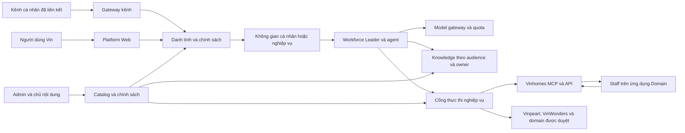
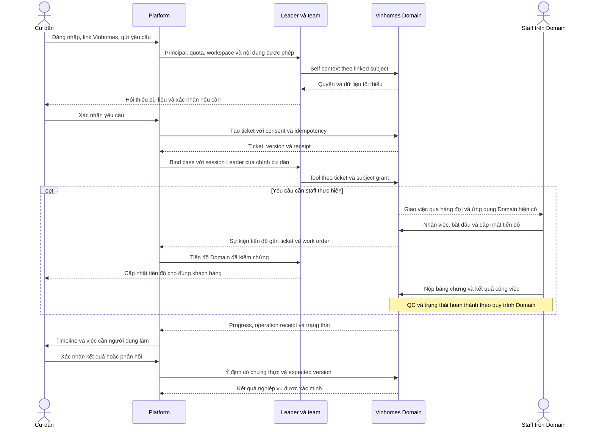

# Phần 1/2 giao Người 1 — Nền tảng, quyền, dữ liệu và tích hợp Domain

Rà soát bắt đầu 17/10/2026, hoàn thiện kế hoạch 18/10/2026 theo giờ Việt Nam. Trạng thái: **kế hoạch đề xuất để triển khai**, chưa phải tính năng đã phát hành.

Tài liệu giao **Người 1** triển khai nền tảng, quyền/dữ liệu và API Platform–Domain. [Phần 2 giao Người 2](KE_HOACH_VIN_PLATFORM_PHAN_2_TRAI_NGHIEM_VA_CHUYEN_DOI_2026-10-18.md) triển khai runtime agent, giao diện Platform và tự động hóa. Đây là **hai luồng công việc song song của hai người**, không phải yêu cầu làm xong Phần 1 mới bắt đầu Phần 2. Cả hai đọc mục 0 và mục 12 của tài liệu này trước khi viết code.

## 0. Phân công Người 1 và quy tắc phối hợp

### 0.0. Chốt lại phạm vi sản phẩm/UI ngày 18/10

**Khách hàng dùng cùng giao diện Platform hiện có với đầy đủ tính năng cá nhân và dữ liệu cách ly. Giữ shell/sidebar/các trang Leader, chat, Agent, Builder/eval, Knowledge, Lịch và Kênh; không thiết kế lại UI cư dân.** Người 1 mở quyền và scope dữ liệu trong backend; Người 2 áp dụng chúng vào các trang hiện có. Provider/MCP/Skill được cấp vẫn xem/chọn/dùng được, cấu hình quản trị chỉ đọc đối với khách hàng; không chặn cả trang chỉ vì khách hàng không có quyền sửa. BQL/admin giữ luồng đang dùng, staff giữ ứng dụng Domain. Quyền sở hữu toàn bộ frontend là phân công file, không phải yêu cầu làm lại frontend. Quy tắc chi tiết và gate UI ở mục 0.0 của Phần 2.

### 0.1. Kết quả Người 1 phải giao

Người 1 chịu trách nhiệm server xác định đúng ai đang dùng, quyền trên dữ liệu/tài nguyên, ai chịu quota, bí mật được giữ ở đâu, và nghiệp vụ Domain được gọi bằng quyền nào. Đầu ra gồm backend/API có test, persistence/migration, adapter Vinhomes và dữ liệu tiến độ cho khách hàng. Không chỉ giao schema hoặc tài liệu thiết kế.

Người 2 chịu trách nhiệm biến các khả năng này thành luồng sử dụng chạy được: chat/Leader/team, agent cá nhân, Builder/eval, lịch/kênh, giao diện khách hàng–BQL–admin và release ứng dụng. Người 2 sử dụng resolver/gateway/DTO của Người 1; không viết một hệ thống quyền hoặc quota khác.

Hai người cùng chịu trách nhiệm nghiệm thu end-to-end. Người 1 chủ trì dữ liệu, auth, migration và Domain; Người 2 chủ trì browser/runtime, build và đóng gói Platform. Chủ nghiệp vụ cung cấp tài liệu thật, quyền API và ký UAT; đây không phải một lập trình viên thứ ba để hoàn tất phần việc bị bỏ trống.

### 0.2. Quyền sửa file: một file chỉ có một người sở hữu

Quy ước đường dẫn: `P = platform_VP/agentscope`, `A = P/src/agentscope/app`, `D = vinhome_Recident/services/vinhomes-api/src/vinhomes_api`. Bảng chỉ định owner để tránh conflict, không yêu cầu sửa mọi file trong danh sách. Với file chưa liệt kê, chốt owner trong handoff trước khi sửa.

| File/module | Owner duy nhất | Người còn lại phối hợp thế nào? |
| --- | --- | --- |
| `vinhome_Recident/**`, gồm Domain API/schema/tests, resident redirect, deploy và staff regression | Người 1 | Người 2 gửi contract hoặc lỗi tích hợp; không sửa staff UI/workflow để làm Platform chạy được. |
| `A/auth/**`, `A/access/**`, `A/business/**`, `A/_service/_access.py`; router auth/admin/business/provider/model/MCP/skill/hub/KB và schema tương ứng | Người 1 | Người 2 dùng API/capability; không thay auth bằng frontend role hoặc `X-User-ID`. |
| `A/_service/_model.py`, model/embedding/TTS resolvers, `A/_model_ledger.py`, `P/src/agentscope/model/**` | Người 1 | Người 2 gọi model qua gateway được bảo vệ; yêu cầu thêm purpose/billing context bằng contract. |
| `A/rag/**`, KB/index/download services, `_service/_management_mcp.py`, `_skill_packages.py` | Người 1 | Người 2 làm UI Knowledge/resource picker và gọi dịch vụ; không tự query vector/blob hoặc cấp quyền catalog. |
| **Toàn bộ `A/storage/**`**, gồm base, Redis, SQL, models agent/session/schedule/channel, mappers/exports và Alembic | Người 1 | Người 2 gửi DTO/state transition/CAS/lease cần lưu; Người 1 thực hiện adapter/schema/migration/test persistence. |
| `A/_app.py`, `A/_lifespan.py`, `A/deps.py`, router/service exports, `P/examples/agent_service/main.py` | Người 1 | Người 2 gửi router/dependency/lifecycle hook đã hoàn thiện để Người 1 mount. Không hai PR cùng sửa bootstrap. |
| `A/workforce/contracts/**`, `foundation/**`, orchestration public `_router.py`, async-runtime bootstrap/composition | Người 1 | Người 2 review contract và cung cấp continuation/runtime hooks; giữ API đối tác cũ tương thích. |
| Unified `_composition.py`, `_grants.py`, `_partner_setup.py`, `_tables.py`, `_provider.py`, `_contract.py`, `_secrets.py`, `_team_routes.py`, exports; backend authority/projection mới của khách hàng/BQL | Người 1 | Người 2 sử dụng subject/grant/query đã kiểm quyền. `_workforce_insights.py` cũng do Người 1 sửa khi thêm API đọc. |
| `_workforce_console.py`, `_workforce_studio.py`; chat/agent/session/personal-chat/workspace routers; `A/_service/_chat.py` | Người 2 | Người 1 cung cấp helper; Người 2 sửa call sites, đặc biệt bỏ seed key ở console và inject principal/billing vào runtime. |
| `A/_agent_spec.py`, `A/_personal_chat.py`, readiness/bindings/publish/eval services; `_service/_toolkit.py`, `_workspace.py`, `_session.py`, `_session_projection.py`, `_mcp_render.py`; team/memory/runtime | Người 2 | Dùng policy/resolver Người 1; session projection là consumer của authority, không tự suy quyền; đổi storage gửi Người 1. |
| Unified `_case.py`, `_runner.py`, `_readiness.py`, `_quality.py`, `_recovery.py`, `_close.py`, `_approvals.py` | Người 2 | Dùng grant/binding và Domain projection của Người 1, không suy quyền/trạng thái nguồn từ prompt. |
| Schedule/channel routers và request schemas, scheduler/channel runtime, `_service/_channel.py`, `_credential_binding.py` | Người 2 | Người 1 cấp secret/identity/storage/run ledger; Người 2 làm hành vi runtime/delivery/approval. |
| **Toàn bộ frontend Platform**, frontend packages/tests và `P/examples/web_ui/pnpm-lock.yaml` | Người 2 | Người 1 không sửa UI để chữa contract backend; sửa schema/API hoặc gửi yêu cầu UI. |
| Platform Compose/Dockerfile/deploy/runbook và script đóng gói | Người 2 | Người 1 giao migration order/config manifest và review; Domain deploy do Người 1 giữ. |
| Python dependency/lock, cấu hình test chung và `.github/workflows/**` | Người 1 | Người 2 gửi dependency/gate cần thêm; frontend dependency/lock vẫn thuộc Người 2. |

Owner test đi theo module được sửa. `test_platform_credential.py` thuộc Người 2 vì gắn trực tiếp console; test model/access/KB/persistence thuộc Người 1. Với test dùng chung, người không sở hữu thêm file test riêng hoặc gửi delta để owner tích hợp, không ghi đè conftest của nhau.

### 0.3. Cách bắt đầu và bàn giao hằng ngày

1. Cùng pin `dev_Chien@fe56707a966864ec7915be30421762d30cba4d15` (= `develop2` sau PR #99, cập nhật 18/10), ghi trạng thái WIP, tạo worktree/branch riêng từ cùng mốc khi bắt đầu triển khai. Branch nào đã tách từ mốc cũ `1ec4465d` thì commit WIP của mình rồi rebase lên `fe56707a` trước PR đầu tiên; PR #99 sửa `_workforce_console.py`, `_agent_eval.py`, `_agent_studio.py`, `_service/_chat.py`, schedule/channel router, `storage/_model/_schedule.py`, `_session.py` và `platform_access.py`. Không checkout/reset workspace đang dùng và không đưa WIP khác vào commit.
2. Chốt contract C01–C10 ở mục 12 trong 2–3 ngày làm việc đầu: DTO, lỗi, state machine, methods storage, owner file và fixture. Người 1 xuất schema + stub interface; Người 2 viết consumer/fixture theo cùng schema, không tạo payload giả tùy ý.
3. Các phụ thuộc ở backlog là **điều kiện tích hợp/hoàn thành**. Người 2 có thể xây consumer bằng fixture ngay, nhưng production không có đường fallback sang fixture khi API thật chưa sẵn.
4. Handoff mỗi ngày ghi task/commit, contract version, exports/API dùng được, test đã chạy và việc chờ người kia. Mỗi PR thay contract phải có cả hai review; thay breaking thì tăng version và cập nhật consumer trong cùng đợt tích hợp.
5. Request sửa file chung cần field/schema, lý do, default/backfill, CAS/idempotency và test mong đợi. Owner áp dụng ở PR nhỏ trước; người kia rebase/cherry-pick commit đó vào worktree của mình.
6. Tích hợp theo lát chức năng chạy xuyên hai phần: đăng nhập → chat có quota; KB → agent; link → yêu cầu → staff Domain → khách hàng; cuối cùng lịch/kênh và cutover. Không đợi một người hoàn tất toàn bộ phạm vi.

## 1. Đích đến và các quyết định đã xác nhận

Platform trở thành sản phẩm dùng chung trong hệ sinh thái Vingroup: cư dân/khách hàng, BQL và admin đăng nhập trực tiếp, có không gian AI cá nhân. Người dùng có Workforce Leader, chat từng agent, tạo agent riêng, kiểm thử trong sandbox, đặt lịch và kết nối kênh ngoài như Discord. Các hệ thống Vinhomes, Vinpearl, VinWonders và những bên được chấp thuận cung cấp nghiệp vụ qua MCP/API có phân quyền. Staff tiếp tục nhận và thực hiện công việc trên ứng dụng Domain hiện có; khả năng mở AI cá nhân cho nhân viên trong tương lai là phạm vi riêng, không chuyển nơi tác nghiệp của staff.

Đợt đầu phục vụ cư dân Vinhomes hiện tại và cư dân mới. Thiết kế dữ liệu phải mở rộng được cho người dùng Vin khác; việc thêm một domain không cấp quyền xem dữ liệu của domain đó cho toàn bộ người dùng.

| Nội dung | Quyết định của chủ dự án |
| --- | --- |
| Điểm vào của cư dân | Đăng nhập và chat trực tiếp trên Platform; sau khi vận hành ổn định thì bỏ chatbot cư dân trong app Vinhomes. |
| Danh tính | Có tài khoản Platform; liên kết tài khoản Vinhomes sau khi đăng nhập Vinhomes và đồng ý cấp quyền. Sau này liên kết các domain khác theo cùng nguyên tắc. |
| Xử lý yêu cầu | Cư dân tự build agent và gửi yêu cầu cho Workforce Leader/team **của chính mình** trên Platform, theo dõi tại đó. Yêu cầu không đi qua route, Leader hay đội agent của BQL; không ai khác (BQL, khách hàng khác) thấy hội thoại, agent hay KB của khách. |
| Tính năng cho khách hàng | Đủ mọi tính năng Platform như tài khoản BQL hiện có (Leader, chat từng agent, Builder, eval sandbox, lịch, kênh, KB), trong không gian riêng. MCP/provider/skill do domain/admin cấu hình sẵn chỉ xem và gắn vào agent, không sửa. |
| Agent cá nhân | Được tạo, sửa, build, eval sandbox, sử dụng riêng; được chat riêng từng agent và dùng Leader. |
| Provider, Skill, MCP | Chỉ xem/chọn/dùng những tài nguyên đã được cấp; không tạo, sửa, xóa, nhập URL MCP, cài từ hub hoặc thay cấu hình quản trị. |
| Knowledge | Đọc kho Vin đúng quyền, không sửa; tạo kho riêng, tải tài liệu riêng có giới hạn dung lượng; mặc định chỉ chủ sở hữu nhìn thấy. |
| Model | Dùng key do Platform quản lý. Admin đặt hạn mức token ngày/tháng theo nhóm và điều chỉnh từng người; hết hạn mức thì dừng, thông báo rõ. BQL/admin có chính sách riêng. |
| BQL và admin | Tiếp tục dùng Platform như hiện tại. Đợt này **không** xây dashboard BQL mới, hàng đợi ngoại lệ trên Platform hay cầu nối phê duyệt từ Platform (quyết định 18/10). |
| Staff thực hiện công việc | Tiếp tục đăng nhập và nhận/xử lý công việc trên Domain như hiện tại. Agent Platform điều phối qua MCP/API, theo dõi tiến độ/kết quả Domain và cập nhật cho khách hàng trên Platform. Không yêu cầu staff chuyển sang Platform để nhận việc. |

**Ranh giới tác nghiệp đã được chủ dự án xác nhận ngày 18/10:** staff vẫn dùng Domain để nhận việc, chấp nhận/bắt đầu công việc, cập nhật tiến độ, nộp bằng chứng và hoàn thành theo quyền/quy trình hiện có. Domain giữ hàng đợi, phân công, work order và trạng thái nghiệp vụ; agent Platform quản lý luồng yêu cầu, theo dõi việc thực hiện qua MCP/API/sự kiện và gửi thông tin đã xác minh cho khách hàng. Không tạo hàng đợi staff, hồ sơ staff hoặc work order song song trên Platform; không bắt staff có tài khoản Platform để làm công việc cũ.

Bỏ bước BQL giám sát mọi cuộc chat không đồng nghĩa bỏ QC, phê duyệt theo thẩm quyền hoặc xác nhận của cư dân. Domain vẫn quyết định ai được điều phối, thu phí, sửa lịch, hủy và nghiệm thu. Trường hợp agent không xử lý được thì vào hàng đợi vận hành sẵn có trên Domain (staff/vận hành), không vào một màn hình mới trên Platform. Nghiệm thu phải đi qua thao tác staff thật ở Domain rồi kiểm tra thông tin quay về đúng khách hàng tại Platform.

“Tài liệu nội bộ Vin” phải có audience: cư dân không mặc nhiên được đọc tài liệu nhân sự, tài chính, hồ sơ cư dân khác hoặc SOP chỉ dành cho nhân viên. Nhân viên cũng chỉ thấy bộ tài liệu được cấp theo đơn vị/vai trò.

## 2. Kết quả kiểm tra hiện trạng và độ tin cậy

### 2.1. Mốc kiểm tra

- Source đọc trong workspace `E:/AI-Workforce-Platform`, nhánh `dev_Chien`. Rà soát chính làm ở `1ec4465d7f2928f9610b02b0126d39b1443f4163`; ngày 18/10 `dev_Chien` được fast-forward lên `fe56707a966864ec7915be30421762d30cba4d15` sau khi `origin/develop2` merge PR #99 (eval sandbox theo ticket, Discord, lịch) và bản sửa login `c3030318`. Khác biệt giữa hai mốc là 50 file trong eval/lịch/kênh/login cùng `platform_access.py` và `eval_fixture.py` phía Domain; các mục auth, access, secret, quota, KB và liên kết Domain ở kế hoạch này không bị thay đổi. Các dòng eval/lịch/kênh bên dưới đã đối chiếu lại trên `fe56707a`.
- Điều này chỉ xác nhận refs/source local, không xác nhận image/VPS đang chạy.
- Có WIP tài liệu ngoài phạm vi và hai kế hoạch Vin đang hoàn thiện. Lần cập nhật này chỉ sửa kế hoạch, thêm ghi chép contract; không thay source ứng dụng, checkout nhánh, commit/push hoặc đọc `.env`/file secret. Chủ dự án xác nhận đã chủ động xóa JEV; không khôi phục tài liệu/file cũ để tái đưa JEV vào.
- Rà soát source của Platform và Vinhomes: auth, scope, tài nguyên, agent/team, Builder/publish, eval, RAG/memory, ledger, kênh, lịch, MCP/grants, request/event và triển khai.
- Không SSH/VPS, không đọc file secret, không truy vấn dữ liệu người dùng production, không gọi model/embedding hoặc Discord thật. Chưa chạy lại bộ test toàn hệ thống. Vì vậy đây là **kiểm tra kiến trúc/code phục vụ kế hoạch**, không phải xác nhận production/UAT.
- Báo cáo dọn Docker ghi image `d6693197-no-jev-20261017`; đây là bằng chứng lịch sử từ báo cáo, chưa được xác minh live ở lần này. Không lấy image/migration/count trong tài liệu cũ làm hiện trạng runtime mặc định.

### 2.2. Hiện có và khoảng thiếu

| Mảng | Hiện có trong source | Cần sửa/bổ sung cho đích đến |
| --- | --- | --- |
| Đăng nhập | Các vai trò `PLATFORM_ADMIN`, `DOMAIN_ADMIN`, `AREA_MANAGER`; đăng ký gắn domain/khu và tạo membership quản lý. | Người dùng thông thường, không gian cá nhân, liên kết nhiều domain; không đăng ký cư dân thành BQL. |
| Quyền tài nguyên | Có seam `ResourceAccessService`, quyền đọc/sửa agent, credential, KB và policy mặc định từ chối chia sẻ. | Policy được lưu bền vững; phân biệt xem/chọn/chạy/quản trị; chặn API MCP/skill/provider theo capability. |
| Key model | `_platform_credential` có đường lưu key Platform vào credential thuộc từng user; credential owner có đường nhận payload của mình. | **P0:** secret do service/admin giữ, DTO không chứa key, migration bản sao cũ, chặn seed/fallback cũ. Chỉ ẩn UI là chưa đủ. |
| Quota | Có model-call ledger, purpose, owner, usage và chi phí chưa biết khi thiếu giá. | Reservation trước call, giới hạn đồng thời, ngày/tháng, attribution về người trả hạn mức và phục hồi sau crash. |
| Agent/Leader | Có chat riêng, team, invite, trao đổi/review, Shared Context, version/publish. | Cấp cho người dùng thường; tách owner của hội thoại khỏi chủ thể nghiệp vụ; không mượn quyền BQL để chạy cho cư dân. |
| Publish | Studio hiện chuẩn bị workspace/bindings trước khi lưu kích hoạt version. | Giữ bản sửa này, kiểm tra race/crash và publish nhiều agent của Builder; không ghi lỗi cũ là chưa sửa nếu không tái hiện trên HEAD. |
| Knowledge | Có KB/document, RAG, collection riêng theo KB, file/blob và tham chiếu. | Kho Vin có audience/approval, entitlement; KB riêng có quota; ACL trên cả retrieval, citation, download, cache và memory. |
| Domain | Có resident API `/me`, create/list/detail requests và quyết định; có ticket/work-order services, ticket grants và luồng đối tác resolve manager. | Linked-subject adapter từ Platform, bind request/case/ticket/workflow đúng nguồn, grant Platform-origin; không xây aggregate yêu cầu thứ hai. |
| Báo cáo BQL | Có management grants và sáu read tools: list/summary/SLA/workload/knowledge/capabilities. | Giữ nguyên cho BQL dùng như hiện tại. Không thuộc đợt này. |
| Eval | Từ PR #99: MCP được admin khai trong env `WORKFORCE_EVAL_SANDBOXES` chạy thật trên sandbox; mỗi ca có ticket mẫu mới từ `POST /platform/eval-fixtures` (chỉ chạy khi DB có marker sandbox, production trả 409) và grant theo ticket; lỗi môi trường được tách khỏi agent trượt. MCP khác vẫn đọc thật, ghi mô phỏng. | Fixture theo **cư dân** (self-context, tạo yêu cầu trước ticket) và theo user/run; profile sandbox do admin quản lý trong dữ liệu thay cho env; production tools không thể bị chọn làm sandbox bằng input user. Tái dùng `_service/_eval_sandbox.py` và `eval_fixture.py`. |
| Lịch/kênh | Có scheduler, Discord/DingTalk/Feishu adapter. Từ PR #99: lịch `once` + `ended_at`, gửi kết quả vào kênh, hiện lần chạy gần nhất, không BYPASS, chỉ chọn Leader/agent đã phát hành; Discord có danh sách người duyệt, token bot mã hóa bằng `CHANNEL_CREDENTIALS_KEY`. | Liên kết danh tính kênh với user Platform, bot do Platform vận hành thay form token cho mọi user, delivery riêng từng người (hiện kết quả lịch gửi vào kênh của khu), run ledger từng lần chạy, `once` lỗi vẫn còn bật, quota, chống chạy/gửi trùng. |
| Hạ tầng | Theo cấu hình: Redis cho nhiều tài nguyên/session, SQL cho auth/workflow/Shared Context, MinIO và workspace/Qdrant. | Đo capacity và cô lập worker phù hợp; quota không được phụ thuộc việc tổng hợp toàn bộ ledger Redis sau call. |

Đã đối chiếu lịch sử nhánh hiện tại: `d6693197` gỡ JEV và `c50f8abe` ghi nhận rollback. Tìm trong app source, frontend, scripts và test/CI đã kiểm tra không còn luồng/module JEV hoạt động. Builder dùng model chat → duyệt dàn ý → sinh AgentSpec/tests → eval → publish. Giữ hai regression tại `tests/workforce/console/test_builder_rollback.py` ngăn credential/stage classifier cũ và proposal legacy quay lại. Không phục hồi `check_builder_jev.py`, SDK/provider/env/checkpoint hoặc cơ chế phân loại cũ.

## 3. Kiến trúc đích: cùng nền tảng, quyền và dữ liệu tách rõ



Không viết lại toàn bộ runtime hoặc tạo microservice mới chỉ để đổi đối tượng người dùng. Mở rộng các seam auth, access, model factory, storage, Leader, grant và channel đang có. Hợp đồng có thể nằm cùng backend trước, nhưng quyền phải được kiểm tra tại server và tại Domain nguồn.

### 3.1. Các khái niệm không được trộn lẫn

| Khái niệm | Ý nghĩa và quy tắc |
| --- | --- |
| Tenant/tổ chức | Ranh giới tổ chức theo mô hình hiện có; không gộp/xóa tenant đang vận hành chỉ vì đổi thương hiệu sản phẩm. |
| Domain | Hệ thống nghiệp vụ Vinhomes/Vinpearl/…; giữ `business_domains` hiện có khi phù hợp. Không đồng nhất domain nghiệp vụ với email domain hoặc hostname. |
| Platform user | Danh tính đăng nhập; giữ `auth_users.id` và lịch sử hiện có. |
| Membership | Vai trò và phạm vi tổ chức/domain/khu có thời hạn, do nguồn tin cậy xác nhận. Một user có thể có nhiều membership về sau. |
| Domain link | Quan hệ user Platform với subject của một Domain, kèm consent, scope và trạng thái thu hồi. Link không tự tạo membership BQL. |
| Workspace | Không gian sở hữu tài nguyên: cá nhân hoặc nghiệp vụ. Scope cá nhân lấy từ server, không từ `owner_id` trong body. |
| Resource owner | Chủ sở hữu agent/session/KB. Mỗi user có Leader và agent của riêng mình; đợt này không có agent dịch vụ dùng chung giữa nhiều khách hàng. Tài nguyên dùng chung chỉ là catalog chỉ đọc (MCP/provider/skill) và thư viện KB Vin. |
| Acting subject | Cư dân/khách hàng thực sự đang yêu cầu; Domain xác minh quyền trên căn hộ/ticket. |
| Billing subject | Người/nhóm chịu quota. Call của agent hệ thống cho cư dân vẫn tính về cư dân theo chính sách, không đổ hết vào tài khoản service. |

Với luồng cũ, giữ `manager_account_id` của route nghiệp vụ. Với luồng mới, thêm chủ thể cư dân và audience của case; không sửa nghĩa của `manager_account_id` thành user bất kỳ, không tạo membership quản lý giả.

### 3.2. Vai trò và capability

Đề xuất thêm vai trò cơ sở `VIN_USER`; “cư dân”, “khách Vinpearl”, “nhân viên dùng AI cá nhân trong tương lai” là membership/entitlement được xác minh. Staff tác nghiệp giữ tài khoản/role/quyền Domain hiện có; không tự đổi thành `VIN_USER` hoặc BQL để nhận việc. Giữ các role quản trị hiện hữu trong giai đoạn tương thích. Tránh một enum chứa mọi tổ hợp vai trò; auth token phải có revision/version quyền và kiểm tra lại trạng thái khi chạy tác vụ nhạy cảm.

Chỉ thêm role vào auth là chưa đủ: Workforce contract hiện dùng `Scope` có `manager_account_id` bắt buộc và `ActorContext` theo manager/partner/system. Người 1 phải giao customer/acting/billing DTO hoặc bridge rõ ràng cho Người 2, giữ ý nghĩa scope quản lý cũ; không truyền cư dân vào `manager_account_id`, không giả membership BQL để qua runtime gate.

| Quyền trên Platform | Người dùng Vin | BQL/quản lý trên Platform | Domain admin | Platform admin |
| --- | --- | --- | --- | --- |
| Leader, chat, agent cá nhân, eval, lịch, kênh | Có, theo quota/capability | Có, tách workspace nghiệp vụ | Có không gian cá nhân | Có không gian cá nhân |
| Xem/chọn model, skill, MCP được cấp | Có | Có | Có | Có |
| Sửa provider/key/catalog toàn nền tảng | Không | Không mặc định | Chỉ phần được ủy quyền | Có theo quyền quản trị |
| Đăng ký MCP/skill mới hoặc cài từ hub | Không | Không mặc định | Trong phạm vi được giao, qua xét duyệt | Theo quy trình catalog |
| KB Vin | Chỉ đọc đúng audience | Đọc đúng vai trò/khu | Quản trị nội dung domain nếu được giao | Quản trị policy; không tự coi là người duyệt nội dung |
| KB riêng | CRUD của mình | CRUD của mình | CRUD của mình | CRUD của mình |
| Dữ liệu nghiệp vụ | Của subject đã link | Theo membership nghiệp vụ | Theo quyền domain | Không tự vượt Domain authorization |
| Hội thoại/file riêng người khác | Không | Không | Không mặc định | Chỉ qua quy trình hỗ trợ đặc biệt có lý do, scope, thời hạn và audit |
| Hạn mức | Xem của mình | Xem quota nghiệp vụ/cá nhân được cấp | Cấu hình nhóm domain nếu được ủy quyền | Cấu hình nhóm, override và ngân sách hệ thống |

Bảng trên không chuyển quyền tác nghiệp staff sang Platform. Staff tiếp tục dùng ứng dụng Domain, chỉ thấy công việc/dữ liệu được giao theo quyền Domain. Nếu sau này staff được cấp AI cá nhân trên Platform, quyền đó độc lập với việc nhận và thực hiện công việc; không tự mở dữ liệu cư dân hoặc màn hình BQL.

“Skill chỉ đọc” vẫn cho phép dùng hướng dẫn đã duyệt để tạo agent riêng. Người dùng sửa mục tiêu/prompt của agent riêng; việc lưu prompt không được trở thành đường upload package, code, shell hoặc MCP URL mới để vượt chính sách skill/MCP.

## 4. IAM và liên kết tài khoản Domain

### 4.1. Đăng ký Platform

Tách đăng ký người dùng thường khỏi đăng ký/onboarding quản lý. User thường không cần chọn khu để nhận quyền BQL. Xác minh email/điện thoại theo cơ chế sản phẩm chọn, chống dò tài khoản và đăng ký tự động, có trạng thái chưa đủ điều kiện dùng model. Với pilot, eligibility được cấp theo danh sách mời hoặc link Vinhomes hợp lệ; chỉ tài khoản được cấp policy mới được tiêu model.

Một tài khoản được dùng cá nhân và nghiệp vụ. Chuyển workspace phải hiện rõ phạm vi đang làm việc. Người dùng không thể tự sửa role/membership qua profile, token cũ hoặc header `X-User-ID`. Giữ cơ chế thu hồi phiên, bảo vệ cookie/CSRF và rate limit cho login/link/callback.

### 4.2. Liên kết Vinhomes

1. User đã đăng nhập Platform chọn “Liên kết Vinhomes”; server tạo giao dịch link gắn user/session, domain, redirect cho phép, thời hạn và nonce.
2. Chuyển tới giao diện xác thực thuộc Domain/IdP tin cậy; Platform không thu hoặc lưu mật khẩu Vinhomes.
3. Domain hiển thị dữ liệu và hành động được xin quyền. Đồng ý sinh authorization code một lần, hết hạn ngắn; code gắn client/redirect/PKCE và subject.
4. Backend đổi code, kiểm tra issuer/audience/state/PKCE; nếu dùng OIDC thì kiểm tra ID token/nonce. Resolve subject từ server Domain, không từ mã cư dân hoặc căn hộ user nhập.
5. Lưu link active với consent/version/scope; secret hoặc refresh material mã hóa ở server, không trả về frontend, agent hoặc log.
6. Khi gọi nghiệp vụ, đổi lấy grant ngắn hạn đúng tool/resource/subject; Domain kiểm tra cư trú và quyền còn hiệu lực tại lúc gọi.
7. Gỡ link/Domain thu hồi/chuyển nhà: tăng authorization revision, vô hiệu grant/cache liên quan, dừng tác vụ mới; operation đã được Domain chấp nhận tiếp tục được đối soát bằng service identity có scope tối thiểu.

**Chưa có bằng chứng Vinhomes/Vinpearl/VinWonders thật đang cung cấp OAuth/OIDC phù hợp.** Hiện Domain trong repo có delegation ngắn hạn sau login; tận dụng được một số khả năng, nhưng không coi đó là link dài hạn đã hoàn chỉnh. Nếu hệ thống nguồn chưa có OAuth, đội Domain/IdP phải triển khai broker/authorization-code exchange tương đương với các ràng buộc trên. Không thay bằng nhập resident ID, đối chiếu email đơn thuần hoặc chia sẻ bootstrap token.

Chính sách mặc định: một subject cá nhân trong cùng Domain/tenant chỉ có một link active tới một Platform user. Link lại cần tái xác thực; xung đột phải giải quyết bằng recovery/audit, không tự merge tài khoản. Nhiều thành viên cùng căn hộ là nhiều subject độc lập có quyền do Domain cấp. Trường hợp pháp nhân/đại diện hộ cần mô hình ủy quyền rõ, không dùng chung mật khẩu.

## 5. Catalog chỉ đọc và quản lý secret

### 5.1. Hợp đồng tài nguyên

Catalog công bố metadata an toàn: ID/version, tên, mô tả, audience, trạng thái, model được phép, tool scopes, read/write, yêu cầu link/consent, môi trường và giới hạn. Tách `can_view`, `can_bind`, `can_execute`, `can_manage`; nhìn thấy tool không có nghĩa được chạy.

Đối với user thường, server từ chối create/update/delete/import/sync/install/discover tùy ý trên provider, credential, MCP, skill và hub. Áp cùng policy cho REST, Builder, agent tools, schedule, channel, export/import và endpoint tương thích cũ. Các tài nguyên có thể bị thu hồi khi đang dùng; execution phải recheck quyền, không chỉ lúc lưu AgentSpec.

### 5.2. Sửa P0 key chung

1. Loại bỏ đường seed key Platform vào credential user trong `_platform_credential` và các fallback tương tự; không chỉ thêm một shared credential bên cạnh.
2. Credential hệ thống thuộc service/admin, user chỉ lưu `provider_ref`/model alias được cấp. Model factory resolve secret ở backend sau kiểm tra quota và capability.
3. Public DTO dùng allowlist trường; không trả `api_key`, token, header, secret reference nội bộ, raw config hoặc đường dẫn nhạy cảm, kể cả user là owner của record legacy. Log/error/export cũng phải redacted.
4. Migration kiểm kê bản sao do Platform seed bằng metadata/provenance và đối chiếu kín; không xóa credential riêng BQL đang dùng chỉ vì trùng tên hiển thị. Remap agent/session/schedule và KB `embedding_model_config` sang ref mới, giữ ID/history khi cần tương thích; cách ly bản không phân loại được. Hiện KB có đường đọc credential theo chính KB owner: phải đổi sang provider resolver dùng chung cho chat, embedding/index/search, learning/verifier và các đường model/media được bật, không chỉ migrate ID trong record.
5. Thu hồi bản sao cũ và chặn đọc trước khi mở user thường. Nếu xác nhận key từng bị trả ra ngoài phạm vi tin cậy, rotation theo runbook; không tự in key để chứng minh.
6. Test với sentinel secret giả: mọi role/API/export/frontend bundle không thấy sentinel; runtime dùng đúng secret ref; record/fallback cũ không làm key xuất hiện lại. Sau migration phải upload/index/search một KB riêng và một KB service-owned thành công qua resolver mới.

Bot token, Domain refresh material và signing secret cũng mã hóa phía server, có version khóa và quy trình rotation. Admin nhập secret qua luồng riêng; thao tác xem catalog không được đọc lại giá trị secret.

## 6. Quota và model gateway dùng chung

### 6.1. Chính sách

- Admin đặt template cho nhóm cư dân, nhân viên, BQL, admin; override user có hiệu lực/ngày hết hạn. Không mặc định admin/service có vô hạn.
- Quota user khác với ngân sách tổng nhóm/domain/toàn Platform; một request phải đạt tất cả trần áp dụng. Nếu user ở nhiều nhóm, rule chọn template có thứ tự rõ và được lưu trong policy version; không cộng dồn hạn mức ngoài ý muốn.
- Dùng token input + output provider báo, cached input vẫn là phần của input, không cộng hai lần; trường usage không rõ phải có quy tắc provider cụ thể. Giới hạn tiền chỉ bật khi có catalog giá hợp lệ, không coi giá chưa biết là 0.
- Tính cả chat, Leader/worker, Builder, evaluator/judge, summary, verifier/memory, retry/fallback, lịch và kênh. Embedding có budget và rate limit riêng hoặc quy tắc quy đổi công khai; không bỏ qua vì không phải chat.
- Lưu UTC; cửa sổ ngày/tháng theo `Asia/Ho_Chi_Minh`. Call thuộc cửa sổ lúc reservation bắt đầu, kể cả trả usage sau nửa đêm; reservation chưa kết thúc không biến mất khi reset ngày.

### 6.2. Luồng thực thi bắt buộc

1. Server resolve `initiator_user_id`, `billing_subject_id`, workspace, purpose, model và policy revision; client/agent không tự đặt billing subject.
2. Tính token đầu vào của **outbound payload cuối cùng sau RAG/tool results/history**, bằng tokenizer/giới hạn context phù hợp provider, cộng output budget có trần và biên protocol; nếu không có bound tin cậy thì từ chối hoặc dùng cấu hình bound đã kiểm chứng. Không reserve chỉ từ câu hỏi ban đầu rồi gọi payload lớn hơn.
3. Trong một transaction/atomic operation giữ chỗ quota ngày, tháng, ngân sách liên quan và slot đồng thời. Khuyến nghị SQL là authority cho reservation; adapter hiện có không được tạo hai nguồn quota độc lập Redis/SQL. Policy thiếu/invalid hoặc quota authority không truy cập được thì không gọi provider; callback ledger best-effort hiện có không thay thế gate này.
4. Chỉ sau reservation thành công mới gọi provider. Mỗi attempt có ID; retry/fallback có reservation tương ứng. Worker/team chia sẻ ngân sách run có giới hạn số bước, không mỗi worker được toàn bộ phần còn lại.
5. Settle usage thực tế, giải phóng phần dư, append ledger idempotent; lỗi/hủy không chứng minh provider không tính phí. Usage thiếu/timeout giữ trạng thái pending reconciliation với mức dự phòng, không tự tính 0 hoặc hoàn toàn bộ.
6. Crash recovery dựa trạng thái attempt/provider receipt. Không giải phóng reservation chỉ vì TTL hết nếu call có thể đã chạy; chặn/tạm giữ phần nghi vấn tới khi đối soát.
7. Nếu provider báo usage cao hơn bound, ghi chênh lệch/nợ quota, dừng attempt tiếp theo, cảnh báo và điều chỉnh bound. Không hứa hard cap chi phí tuyệt đối chỉ bằng ước lượng token.

Hết quota trả lỗi ổn định `QUOTA_EXCEEDED` cùng scope, mức còn lại và thời điểm reset; HTTP đề xuất 429. Chat đang có output hợp lệ được giữ; dừng bước/worker tiếp theo an toàn, không hủy bừa một operation Domain đã được chấp nhận. Poll receipt/event cập nhật nghiệp vụ bằng service không cần gọi model mới. Job lịch ghi `blocked_quota`, không retry vòng lặp.

### 6.3. Kiểm thử chặn release

Cùng user gửi đồng thời từ web/Discord/lịch/eval phải không vượt số reservation cho phép; thiếu quota, policy thiếu/sai hoặc quota store mất kết nối đều không có network call tới provider. Test hai process với PostgreSQL thực, settle/replay/crash, chuyển ngày/tháng, thay policy giữa run, usage thiếu, model failover, fan-out team, double-click và credential legacy. Ledger phải có initiator, service owner và billing subject riêng để đối soát.

## 7. Knowledge Vin, kho riêng và memory

### 7.1. Hai phạm vi trong cùng trải nghiệm

| Kho | Chủ sở hữu và quyền | Dữ liệu được đưa vào |
| --- | --- | --- |
| Thư viện Vin | Chủ nội dung được ủy quyền quản trị; người dùng đọc/bind theo entitlement | Tài liệu có nguồn và phiên bản đã duyệt cho đúng audience/domain/khu. |
| Kho của tôi | User CRUD và gắn vào agent cá nhân; không tự chia sẻ | File cá nhân trong quota, trạng thái parse/index rõ; có quyền xóa và theo dõi dọn chỉ mục. |

Quyền tính theo **giao** của audience tài liệu, quyền user, grant của tác vụ và binding agent. Không lấy hợp các KB của thành viên team rồi đưa toàn bộ vào Shared Context. Agent có binding KB Vin không biến KB đó thành bản sao thuộc user.

Tài liệu có metadata: owner/nguồn/checksum, version, tenant/domain/khu, audience/classification, approver, ngày hiệu lực/hết hiệu lực, trạng thái và bản thay thế. Nội dung nội bộ nhân sự không được gắn audience “mọi cư dân” chỉ vì cùng Vin. Tool nghiệp vụ cung cấp dữ liệu động như hóa đơn/ticket; không dùng bản PDF cũ để trả trạng thái hiện tại.

### 7.2. Ingestion và retrieval

Upload giữ chỗ dung lượng trước khi cấp upload URL; validate kích thước thực/MIME, chống file nén hoặc parse quá tài nguyên, cách ly nội dung chưa xử lý. Parse/OCR trong worker hạn quyền, không thực thi macro/code hoặc tự fetch URL nội bộ từ tài liệu. Có giới hạn file, tổng byte gốc, số KB/document/chunk, thời gian parse và embedding budget; xóa thất bại không tự trả quota khi blob/chunk vẫn còn.

Kho Vin: file gốc → kiểm tra quyền/nguồn → parse/chunk → review/approval → index/publish → test truy xuất/citation. Chỉ index thử trong vùng riêng trước approval; chunk chưa được duyệt không lọt truy vấn cư dân. Domain KB và Platform KB không đồng bộ toàn bộ mặc định; chọn một nguồn chính thức cho mỗi bộ tài liệu, đồng bộ theo version/checksum hoặc truy vấn nguồn qua tool.

ACL phải được áp **trước khi kết quả/đoạn trích vào prompt**, tại query/store boundary hoặc collection được resolve bằng server. Hiện ACL chủ yếu cấp cả KB và retrieval chưa có document filter trong đường đã kiểm tra: pilot nên tách KB theo audience/quyền đồng nhất; chỉ đặt tài liệu khác ACL cùng KB khi document-level filter đã được triển khai và nghiệm thu. Citation/snippet/download/preview/search/export đều kiểm tra lại quyền; URL tải ký thời hạn ngắn. Tránh fetch rộng rồi lọc sau khi LLM đã nhìn thấy. Key cache phải chứa principal/scope/revision; thu hồi quyền invalidates cache/index và từ chối download mới.

Dùng chung một resource resolver từ catalog → validate AgentSpec → readiness → publish bindings → runtime → citation/download. Hiện chat có đường resolve KB chia sẻ nhưng readiness còn kiểm tra tài nguyên owned-only; chỉ mở listing KB Vin sẽ khiến agent cá nhân báo thiếu tài nguyên hoặc bind không đúng. Test toàn chuỗi bằng một KB do service sở hữu và một user chỉ có quyền đọc.

### 7.3. Memory và vòng đời riêng tư

Memory cá nhân theo user/workspace/agent; không học file riêng, prompt hay lịch sử người này vào bộ nhớ nghiệp vụ chung. Đưa bài học vào kho chung cần ẩn danh, provenance và duyệt nội dung. Memory hiện có chưa phải huấn luyện lại model; kế hoạch không thay model weights.

Derivation có `source_refs` tới document/resource ID + version, scope/authorization revision, và các cache/memory/artifact sinh ra; recall recheck quyền nguồn. Provenance ticket/event hiện có chưa tự bao phủ document ACL. Pilot không consolidate nội dung private/restricted KB vào memory chung; legacy thiếu nguồn bị chặn/quarantine khi không chứng minh còn quyền, không giữ recall chỉ vì item chưa hết TTL.

Thu hồi quyền ngăn truy xuất mới, thu hồi link/citation và cache. Với đoạn đã xuất trong hội thoại, phải có policy transcript rõ: chặn/mask các artifact nhạy cảm khi bắt buộc, lưu audit cần thiết theo retention. Không cam kết thu hồi được bản người dùng đã tải hợp lệ. Xóa KB chạy job dọn blob/vector/chunk/cache/memory derivation, ghi receipt; backup xóa theo retention đã duyệt, không tuyên bố bị xóa ngay khỏi mọi backup.

Trước rollout phải cấu hình quota có giá trị cụ thể và người chịu trách nhiệm: byte/user, byte/file, số file/KB/agent/lịch, embedding/ngày, thời hạn giữ file/log và thời gian hoàn tất xóa. Không cấu hình thì từ chối upload mới, không ngầm hiểu vô hạn. Các con số là tham số vận hành cần chốt sau đo tải, không phải tính năng còn bỏ ngỏ.

## 8. Platform-first: tạo và theo dõi yêu cầu Vinhomes

### 8.1. Hai đường quyền

- **Trước ticket:** grant theo linked subject cho `self/context`, `self/services`, `self/tickets` và tạo yêu cầu. Chỉ dữ liệu của chủ thể; không dùng bootstrap MCP để đọc dữ liệu nghiệp vụ.
- **Sau ticket:** grant subject + ticket/workflow + allowlisted tools + TTL; Domain kiểm tra lại subject sở hữu/được ủy quyền ticket. Quyền BQL là đường riêng theo membership, không kế thừa cho cư dân.

Các tên endpoint dưới đây là **đề xuất hợp đồng mới**, không phải xác nhận route đã tồn tại. Có thể bọc Domain delegation/API sẵn có sau khi kiểm tra coverage và threat model, không tạo MCP chỉ để đổi tên endpoint.

| Năng lực | Hợp đồng cần có |
| --- | --- |
| Self context | Server resolve danh tính liên kết, căn hộ/quyền đang active; dữ liệu tối thiểu để chọn dịch vụ. |
| Tạo yêu cầu | Subject grant, loại yêu cầu, nội dung/attachment được phép, consent, idempotency key; trả `ticket_id`, version, receipt và correlation. |
| Đọc/theo dõi | Chủ thể đúng ticket, state, next_action, expected version, progress có provenance; list phân trang theo subject. |
| Bổ sung/chấp thuận/hủy/đổi lịch | Actor proof từ Platform có chữ ký, exact payload/version, TTL/nonce và consent đúng người; Domain kiểm tra rule từng hành động. |
| Sự kiện | Outbox/sequence/idempotency, ký và kiểm tra hai chiều; replay/gap recovery; trạng thái cuối có receipt. |
| Đối soát | Operation unknown/pending có truy vấn trạng thái; không tạo lại yêu cầu khi timeout không rõ outcome. |

Tái dùng `resident_api.py`/`resident_cases.py`/`resident_contract.py` cho tạo, đọc và quyết định yêu cầu. Thiếu hiện tại là adapter linked subject và quyền materialize/link ticket từ Platform, không phải thiếu mọi API trước-ticket. Người 1 chốt một yêu cầu Domain làm nguồn chính thức, map `domain_request_id`/`domain_case_id`, `ticket_id` tùy chọn, Platform case/workflow và receipt; không tạo đồng thời hai request cùng nội dung. Khi cần materialize ticket, service/agent chỉ làm qua delegation nghiệp vụ được Domain cấp, không lấy resident grant để giả vai Operations.

**Chống tạo workflow trùng:** intake Domain hiện có đường gọi `link_ticket()` rồi queue `start_workflow`. Facade mới phải hỗ trợ `origin=platform` đã được backend xác thực, bind vào case/workflow Platform hiện có và không queue start thêm; `origin=domain` giữ flow cũ. Origin/case/workflow không lấy nguyên từ input model. Ticket grant sau đó chấp nhận binding Platform-origin có chứng thực, không buộc tạo một Domain-start command giả. Cùng idempotency key + cùng payload trả lại receipt cũ; cùng key khác payload bị conflict.

Đặc biệt, source Domain hiện dùng message của chat Domain làm bằng chứng ý định cho một số hành động như hủy/đổi lịch. Khi bỏ chatbot cũ, phải chấp nhận và xác minh bằng chứng cư dân từ Platform; không tắt kiểm tra nguồn hoặc giả tạo message Domain để vượt gate.

### 8.2. Trình tự chuẩn



Một case Platform lưu `customer_owner_id`, Domain subject/ticket, session Leader/agent của chính khách hàng xử lý case và audience projection. Không gắn case vào partner route, Leader hay group của BQL; không cho xem nội bộ BQL/nhân sự hoặc chain of thought. Timeline hiển thị kế hoạch, agent phụ trách, tiến độ, bằng chứng được phép, chấp thuận và kết quả; lời agent nói không tự đổi trạng thái ticket.

Giữ `platform-sync` hoặc consumer tương đương cho progress/outbox, receipt accepted/applied, publication acknowledgement và reconciliation. Bỏ UI/chatbot Reception không có nghĩa tắt worker này. Chỉ retire nhánh mirror reply vào chat Domain sau khi event consumers cho ticket cũ và case mới đều đã được thay thế/kiểm chứng.

Agent Platform nhận cập nhật từ thao tác staff ở Domain qua luồng trên, đồng thời có thể tra cứu trạng thái qua MCP/API có quyền. Projection của Platform giữ ticket/work-order correlation, version/sequence và thời điểm nguồn; sự kiện chậm/mất phải được phát hiện và đối soát. Agent chỉ thông báo mức tiến độ/kết quả Domain đã xác nhận, không tự coi staff đã nhận việc hoặc hoàn thành chỉ vì tool giao việc trả accepted.

Coverage sự kiện hiện có giới hạn: `provider_events()` chỉ map được việc có `platform_operations.client_reference`, tức work order Platform đã dispatch. Case chưa có operation, việc staff/BQL tạo thủ công và một số consent/ngoại lệ cần thêm case-event feed/replay hoặc mapping có chứng thực. Người 1 làm projection đủ coverage và Người 2 hiển thị `sync_pending`/thời điểm nguồn; không bịa client reference để các sự kiện này lọt qua.

Chuyển quote/completion card, ảnh kết quả và quyết định cư dân sang projection trên Platform. Giữ gate publication `ingestion_status=applied` trước khi mở hành động/ảnh liên quan; `accepted` hoặc HTTP 202 chỉ xác nhận đã nhận. Mất event/ack phải có replay/reconcile, không tự mở nút bằng lời model. Khi tạo grant Platform-origin, sửa cả điều kiện Domain-start command trong issuer và yêu cầu `external_request_id` ở client exchange theo contract binding mới.

Chuyển cả chính sách nhận diện/xử lý khẩn cấp đang nằm ở Reception sang điểm vào mới: hiển thị kênh hỗ trợ khẩn cấp do Domain cấu hình và escalation xác định, không chờ model hoặc quota. Không mở dispatch an ninh bị cấm qua tool thông thường. Khi quota model hết vẫn đọc được trạng thái/receipt và gửi liên hệ hỗ trợ theo quyền; nếu mở form intake không-AI thì dùng cùng Domain validation/idempotency, không gọi model ngầm.

Giữ vòng Leader lập đội/invite → giao việc → trao đổi/phản biện khi cần → Shared Context có chọn lọc → tổng hợp → follow-up. Agent cá nhân có thể giúp soạn yêu cầu và gọi năng lực được cấp; prompt tùy biến không sửa prompt/quy tắc của Workforce Leader hệ thống, không biến agent cá nhân thành điều phối BQL.

### 8.3. BQL trong đợt này

Quyết định 18/10: BQL tiếp tục dùng Platform như hiện tại (Leader, Builder, agent, route đối tác và management MCP đang có). Người 1 **không** xây dashboard BQL mới, hàng đợi ngoại lệ trên Platform hay cầu nối phê duyệt từ Platform. Ticket do cư dân tạo từ Platform không được bàn giao vào partner route/Leader của BQL (xem `origin=platform` ở 8.1). Trường hợp agent của cư dân không xử lý được thì đi vào hàng đợi vận hành có sẵn trên Domain. Luồng `origin=domain` cũ giữ nguyên cho ticket đang mở tới khi cutover xong.

## 9. Mô hình dữ liệu và API tối thiểu để hai người dùng chung

Các bảng/tên bên dưới là **mô hình logic đề xuất**. Người triển khai đối chiếu bảng hiện có rồi mở rộng; không tạo bảng song song cùng chức năng hoặc viết trước số migration cố định.

| Bản ghi | Trường/ràng buộc tối thiểu | Chủ sở hữu |
| --- | --- | --- |
| Membership/entitlement | User, tenant, domain/khu/audience, role/capability, issuer, hiệu lực, revision; kiểm tra tenant nhất quán | IAM |
| Workspace membership | Workspace type, owner, member quyền rõ; không suy quyền từ URL | Platform |
| Domain link/consent | User, domain, issuer/subject, scopes, consent version, status/revocation, secret ref; uniqueness active subject | IAM + Domain |
| Catalog/entitlement | Resource kind/owner/ID/version, audience, view/bind/execute/manage, environment, status | Catalog |
| Quota policy/reservation | Billing subject, nhóm, day/month window, limit/reserved/settled, policy rev, attempt/run ID, state; settle unique | Model gateway |
| KB classification | KB/document version, owner/audience, approval, source/checksum, effective dates, index generation | Knowledge |
| Derived source references | Source resource/document + version, authorization revision, derived memory/cache/artifact ID; thu hồi theo nguồn | Knowledge + memory |
| Domain case binding | Customer/workspace, subject, domain/ticket, session Leader/agent của khách, visibility, correlation, last sequence | Workflow |
| Intent/consent receipt | Actor, action, exact payload hash, resource/version, nonce/TTL, channel proof | Domain boundary |
| Audit event | Actor/service, action, resource/scope, before/after revision, result, correlation; tránh raw secret/prompt | Mọi module |

API đề xuất phía Platform: `/me/capabilities`, `/me/usage`, `/me/domain-links/*`, `/catalog/{providers,skills,mcps}`, `/knowledge/{library,mine}`, `/service-cases/*`; tài nguyên agent/chat dùng route hiện có sau bổ sung policy. Đây là tên định hướng, phải ghi OpenAPI/schema và test contract trước khi frontend phụ thuộc. API cũ còn dùng được cho BQL; không đổi nghĩa `/workforce/v1` âm thầm.

Lỗi cần chuẩn hóa: chưa link, link hết hạn, quyền bị thu hồi, resource không thuộc user, version conflict, quota hết, sandbox không sẵn, approval hết hạn, Domain outcome chưa rõ. Response không tiết lộ resource tồn tại của người khác; UI cho cách khôi phục thực tế. Mọi create/mutation có cơ chế idempotency/revision phù hợp.

SQL là authority cho IAM, link, entitlement, quota và case binding mới. Redis tiếp tục phục vụ tài nguyên/session/message bus theo adapter đang chạy; không khẳng định có transaction xuyên SQL–Redis–file. Dùng trạng thái prepare/active, manifest/version, outbox/job và reconciliation ở khoảng hở. Test crash tại từng bước trước khi chọn mức bảo đảm.

## 10. Backlog Người 1 và điều kiện bàn giao

| ID | Phạm vi đầu việc | Phụ thuộc | Hoàn thành khi |
| --- | --- | --- | --- |
| N1-01 | Chốt C01–C10, principal/workspace/capability/storage; giữ compatibility role cũ | Không | Người 2 nhận schema, fixture/stub và method signatures; cả hai review policy/error/state machine. |
| N1-02 | Đăng ký VIN_USER, membership, eligibility, revoke/session | N1-01 | Cư dân không có quyền BQL; user có thể đa vai trò mà scope không trộn. |
| N1-03 | Catalog entitlement và P0 secret | N1-01 | Chặn API quản trị tài nguyên với user thường; sentinel secret không lộ, legacy đã xử lý. |
| N1-04 | Model gateway, billing attribution, quota reservation/recovery | N1-01, N1-03 | Mọi đường call đi qua gate; race/crash/unknown usage đạt trên PostgreSQL nhiều process. |
| N1-05 | Link Vinhomes, consent, refresh/revoke | N1-02 + hợp đồng Domain/IdP | Link thật có bằng chứng; sai subject/replay/login CSRF bị từ chối. |
| N1-06 | Knowledge shared/private, quota, ACL/citation/delete | N1-02, N1-03, N1-04 | Không lộ chéo user/audience; retrieval và download thật đúng quyền. |
| N1-07 | Linked-subject adapter tái dùng resident request/intake, grant và intent proof Platform-origin | N1-05 | Một request nguồn, materialize/link ticket đúng quyền và bind workflow hiện có; không start trùng; quyết định cư dân có chứng thực. |
| N1-08 | Customer projection, staff progress/events/reconcile và emergency fallback | N1-07 | Người 2 nhận API/fixtures cho timeline của khách hàng; việc thủ công/case chưa operation cũng được theo dõi; staff Domain và approval đúng quyền. |
| N1-09 | Migration và observability nền | N1-02…N1-08 | Có dry-run, counts/hash, backup/restore, rollback feature flags và dashboard theo principal/billing subject. |

Tất cả N1-* do **Người 1** triển khai; Người 2 review và tích hợp các consumer N2-*. N1-03 và N1-04 là gate trước khi cho cư dân tiêu key chung. N1-05/N1-07/N1-08 là gate trước nghiệp vụ Vinhomes. Bản thân N1-08 có thể làm query BQL và fixture event song song khi phần link/intake còn đang hoàn thiện; điều kiện phụ thuộc trong bảng áp dụng cho nghiệm thu tổng thể. Không bắt hoàn thành Vinpearl/VinWonders mới pilot Vinhomes.

## 11. Căn cứ để người triển khai đối chiếu

- Auth/role: [auth service](../platform_VP/agentscope/src/agentscope/app/auth/_service.py), [auth router](../platform_VP/agentscope/src/agentscope/app/_router/_auth.py), [identity membership](../platform_VP/agentscope/src/agentscope/app/workforce/foundation/_identity.py).
- Quyền/secret: [access policy](../platform_VP/agentscope/src/agentscope/app/access/_policy.py), [access service](../platform_VP/agentscope/src/agentscope/app/_service/_access.py), [credential API](../platform_VP/agentscope/src/agentscope/app/_router/_credential.py), [model credential fallback](../platform_VP/agentscope/src/agentscope/app/_router/_workforce_console.py).
- Ledger/cấu hình: [model ledger](../platform_VP/agentscope/src/agentscope/app/_model_ledger.py), [entrypoint](../platform_VP/agentscope/examples/agent_service/main.py), [Compose VPS](../platform_VP/agentscope/compose.vps.yaml), [runbook P2](../platform_VP/agentscope/deploy/vps/P2_RUNBOOK.md).
- Nghiên cứu và đối chiếu chi tiết Domain/OAuth/MCP: [ghi chép nghiên cứu](research/NGHIEN_CUU_LIEN_KET_DOMAIN_VIN_2026-10-17.md). Những route/contract mới ở kế hoạch này đều là mục tiêu đề xuất.
- Luồng liên kết dùng thiết kế code/PKCE/redirect/issuer và quyền tối thiểu dựa trên [OAuth Security BCP, RFC 9700](https://www.rfc-editor.org/rfc/rfc9700.html#section-2), [PKCE, RFC 7636](https://www.rfc-editor.org/rfc/rfc7636.html), [OIDC Core](https://openid.net/specs/openid-connect-core-1_0.html). Phân tách token và audience cho MCP đối chiếu [MCP Authorization 2026-07-28](https://modelcontextprotocol.io/specification/2026-07-28/basic/authorization); đây là mục tiêu thiết kế cho adapter mới, không khẳng định custom grant hiện tại đã tuân toàn bộ OAuth/MCP spec đó.
- Bằng chứng source chi tiết: [phân quyền, secret, quota và Knowledge](research/KIEM_TRA_PHAN_QUYEN_DU_LIEU_VIN_2026-10-17.md), [tính năng cá nhân, lifecycle, kênh và lịch](research/KIEM_TRA_TINH_NANG_CA_NHAN_VIN_2026-10-17.md).
- Bổ sung lần phân công hai người: [contract và fileowner theo dev_Chien](research/HOP_DONG_VA_PHAN_CONG_HAI_NGUOI_DEV_CHIEN_2026-10-18.md). Đây là ghi chép nguồn phụ trợ, không phải phần triển khai thứ ba; bảng owner và C01–C10 trong hai kế hoạch là mốc phối hợp chính thức. Theo quyết định 18/10, **bỏ qua** các mục operator grant, management exceptions và hàng đợi ngoại lệ BQL trong tài liệu nghiên cứu này, cùng đề xuất bot Discord do Platform vận hành trong [nghiên cứu liên kết Domain](research/NGHIEN_CUU_LIEN_KET_DOMAIN_VIN_2026-10-17.md). Khi khác nhau, hai kế hoạch này thắng.
- Hai kế hoạch OP2/Builder ngày 17/10 và tài liệu kiến trúc giữ vai trò hồ sơ kiểm tra theo mốc riêng. Khi triển khai đích đến mới, dùng hai phần kế hoạch Vin này cho scope và thứ tự công việc; xác minh lại từng nhận định lỗi trên commit triển khai.

## 12. Contract C01–C10: Người 1 định nghĩa và thực thi, Người 2 sử dụng

Đây là **hợp đồng đích đề xuất**, không phải API/helper đã tồn tại. Người 1 tái dùng models/schema/route hiện có khi tương thích, đặt tên public cuối cùng trong OpenAPI và xuất DTO để Người 2 dùng. Không tạo một hệ kiểu ID/auth song song. Cả hai lưu schema, error examples và fixture có version trong repo trước PR consumer đầu tiên. Tên URL mới dưới đây chưa được phép gọi như endpoint đang chạy; đường KB thật hiện là `/knowledge_bases`.

| Contract | Người 1 phải giao | Người 2 dùng ở đâu và test giao nhau |
| --- | --- | --- |
| **C01 — Principal/capability** | Principal có platform user, tenant, workspace, memberships/effective scope, auth revision; capabilities view/bind/execute/manage. Tách customer acting subject và billing subject khỏi manager scope cũ. API đề xuất `GET /me/capabilities`. | Shell/route guard, chat/Leader/Builder/lịch/kênh. Test VIN_USER không thành manager; đổi workspace/revoke có hiệu lực server, không chỉ ẩn nút. |
| **C02 — Catalog/resource resolution** | Safe DTO resource ID/owner/version/kind/environment/audience/permission/status; resolver dùng chung cho chọn/validate/readiness/bind/runtime/download. Model alias không chứa secret/config nhạy cảm. API đề xuất `/catalog/*`; KB có thể dùng API hiện có kèm safe projection. | Người 2 sửa console/readiness/bindings, FE resource picker và export. Shared KB service-owned đi trọn publish → chat → citation; resource bị thu hồi thì run mới bị chặn. |
| **C03 — Model/secret/quota** | Provider resolver + pre-call guard ở outbound boundary sau RAG/tools, reserve/settle/reconcile theo attempt, budget user/group/day/month, max output/concurrency và purpose. Secret service-owned, callback telemetry không phải quota gate. API đề xuất `/me/usage`, admin policy; reserve/settle là internal. | Người 2 bỏ `_platform_credential` seed và đổi `_model_config` gọi resolver; mọi runtime/judge/summary/memory/channel/schedule qua guard. Chứng minh thiếu quota/store/policy thì 0 provider call, không có key user-owned legacy. |
| **C04 — Domain link** | Start/callback/list/revoke, state/PKCE/issuer/subject/consent và secret ref server; quyền cư trú kiểm ở Domain. API đề xuất `/me/domain-links/*`. Không thu mật khẩu Domain tại Platform. | UI kết nối, preflight agent/job, unlink. Test subject/link replay/sai user và job sau revoke; không coi install bot hoặc nhập resident ID là link Domain. |
| **C05 — Customer case và Domain adapter** | Map `platform_case_id`, customer/workspace, verified link/subject, Domain request/case, optional ticket/work-order, workflow, session Leader/agent của khách hàng, origin, revision/correlation. Tái dùng resident requests; materialize/link bằng service delegation đúng quyền. API đề xuất `/service-cases/*`. | Leader của khách nhận yêu cầu và gọi adapter; timeline trả về đúng user. Một yêu cầu/một correlation, retry không tạo case/ticket/workflow thứ hai; ticket `origin=platform` không vào partner route của BQL. |
| **C06 — Intent và quyết định** | Actor/action/resource, exact payload/quote hash, expected canonical version, nonce/expiry, consent/source proof, idempotency và receipt. Domain kiểm quyền riêng cho cư dân và staff. | Consent card web/Discord, hủy/đổi lịch, quote/completion. Chặn người bấm khác/sai hash/version/expired; chỉ mở quyết định theo publication đã applied, không dùng read grant ghi. |
| **C07 — Tiến độ cho khách hàng** | Safe case event envelope gồm schema version, event ID/sequence, case/request/ticket/operation refs, canonical version, occurred/as-of, origin/visibility, status, next action và receipt; replay/cursor/gap recovery. Chỉ trả cho đúng khách hàng sở hữu case. | Người 2 hiển thị timeline và báo tiến độ. Test event trễ/trùng/mất, việc thủ công và case chưa có operation; không chỉ cover work do Platform dispatch. |
| **C08 — Sandbox/eval** | Admin-approved profile/environment, trust/endpoint allowlist, subject/fixture/run namespace, grant factory, reset/cleanup và fixture receipts. Không đưa seed/reset vào production; report resource/policy manifest có version. Mở rộng seam PR #99 (`WORKFORCE_EVAL_SANDBOXES`, `eval_fixture.py`, grant theo ticket) thêm fixture theo cư dân đã link; không viết đường eval thứ hai. | Người 2 chạy eval nhiều lượt, mô phỏng có nhãn và sandbox thật có receipt; model/evaluator đều qua C03. Production URL không thành sandbox bằng user input. |
| **C09 — Persistence cho runtime tự động** | Storage methods/models cho schedule once/cron/run, channel identity/secret ref, delivery attempt/outbox, lease/fencing, idempotent claim/settlement và consent. Người 2 gửi state transitions; Người 1 làm Redis/SQL adapter đang được dùng và migration. | Người 2 làm scheduler/channel worker; không dùng in-memory dict làm authority. Chạy hai process/crash/replay không tạo trùng business operation; delivery retry không gọi model lại. |
| **C10 — Migration/release** | Migration graph/backfill, data-owner mapping/quarantine, config/secret reference manifest, feature flag và compatibility/recovery steps; schema mới expand trước contract cũ retire. | Người 2 build/deploy Platform theo manifest, Người 1 deploy Domain/migrate. Cùng ký canary/rollback/restore; không mở cư dân trước C01–C09 tương ứng đã nghiệm thu. |

### 12.1. Invariants trong mọi DTO và lỗi

- Owner, role, tenant, acting/billing subject, environment và `origin=platform` được server xác định/kiểm chứng; client chỉ gửi mục tiêu hoặc lựa chọn được phép. Identifier giữ kiểu đang dùng của nguồn tương ứng, không đổi text ID thành UUID theo sở thích.
- Tách `domain_request_id`/`domain_case_id` với `ticket_id`, `platform_case_id` và `workflow_id`; không dùng một trường `case_id` cho nhiều loại mà không ghi namespace. Work order có thể chưa tồn tại.
- Mutation cùng key + cùng payload trả cùng receipt; cùng key + payload khác trả conflict. UI không phải nơi giữ unique key cuối cùng; lưu correlation trước gọi Domain để phục hồi khi timeout.
- Chuẩn hóa `AUTH_REQUIRED`, `CAPABILITY_DENIED`, `DOMAIN_LINK_REQUIRED/EXPIRED`, `RESOURCE_REVOKED`, `REVISION_CONFLICT`, `QUOTA_EXCEEDED`, `SANDBOX_UNAVAILABLE`, `APPROVAL_EXPIRED`, `OUTCOME_UNKNOWN` và `SYNC_PENDING` hoặc mã tương đương đã chốt. HTTP status, retryability và `next_action` phải nhất quán; không đưa secret/tồn tại resource người khác vào lỗi.
- Giữ provider-event v1 đang dùng; projection customer mới phải có schema riêng/compatibility rõ. Không thay trường HMAC/event/receipt cũ âm thầm rồi làm worker đang chạy mất đồng bộ.
- DTO công khai có allowlist trường. Structured fixture phải qua chính schema production; mock không được tự cấp quyền hoặc làm `pending/accepted` thành `applied/completed`.

### 12.2. Thứ tự giao contract để Người 2 không chờ

| Mốc giao | Người 1 giao | Người 2 có thể hoàn thành song song |
| --- | --- | --- |
| S0 — Cùng chốt trước code feature | Schema/fixture C01–C10, file owners; ưu tiên callable C01–C03 và signatures C09 | Shell, client/schema adapters, feature flags, test fixture và thiết kế màn hình. |
| S1 — AI cá nhân | Auth/capability, safe catalog/provider/quota, KB resolver, storage agent/session thay đổi tối thiểu | Login → chat → private/shared KB → agent → eval/publish có quyền và quota. |
| S2 — Vinhomes trực tiếp | Link, resident adapter, Platform-origin binding/grant/intent, progress/replay | Leader intake → staff Domain → timeline/consent. |
| S3 — Tự động hóa | Sandbox fixture theo cư dân, schedule/channel persistence/leases, secret helpers | Lịch once/cron, Discord, eval sandbox, quản trị quota/catalog/KB cho admin. |
| S4 — Chuyển đổi | Migration/backfill/dry-run/restore, Domain compatibility và telemetry | RC Platform, browser/canary/UAT, pilot rồi cutover chatbot theo cohort. |

S0 phải có cả schema lẫn skeleton interface import được; S1–S3 giao từng slice nhỏ với test contract. Chưa có business sandbox thì chỉ ghi đạt mock/offline, không hoãn mọi UI tới S3 hoặc phát hành bằng đường giả.

## 13. Kiểm tra Người 1 phải chạy khi triển khai

Các lệnh dưới đây **đã đối chiếu đường dẫn/CI nhưng chưa chạy trong lần lập kế hoạch này**. Dùng Python/dependency đúng workflow: Platform Python 3.11; Domain Python 3.12. Chạy trong venv/shell test riêng, không load `.env`/`deployment.env` production. DB/Redis/MinIO phải là môi trường disposable có test role; `P2_TEST_POSTGRES_URL` có ca TRUNCATE ledger, tuyệt đối không dùng DSN thật. Thiếu env khiến integration skip phải ghi SKIP, không coi là PASS.

Tại `platform_VP/agentscope`, sau cài dependencies theo workflow:

```powershell
$env:PYTHONPATH = 'src;tests'
python -m pytest tests/auth_service_test.py tests/resource_access_policy_test.py tests/business_integration_test.py tests/service_model_test.py tests/workforce_model_ledger_test.py tests/service_knowledge_base_upload_test.py tests/service_knowledge_base_detail_test.py tests/storage_redis_knowledge_base_test.py tests/storage_sql_test.py --asyncio-mode=auto -q -rs
python -m pytest tests/workforce/foundation tests/workforce/integrations --import-mode=importlib --asyncio-mode=auto -q -rs
```

`WORKFORCE_TEST_POSTGRES_URL` bật các race gate PostgreSQL; ledger có biến test riêng theo fixture. Migration upgrade/restore phải chạy trên DB trống riêng trước khi đưa vào release. Không suy có dual-write ledger SQL/Redis chỉ vì tồn tại cả hai adapter.

Tại `vinhome_Recident/services/vinhomes-api`, với `RESIDENT_TEST_ADMIN_URL` và `RESIDENT_TEST_RUNTIME_URL` dành riêng cho test theo CI:

```powershell
python -m pytest tests/test_platform_mcp_v2.py tests/test_platform_management.py tests/test_platform_ticket_api.py tests/test_platform_bridge.py tests/test_reception_intake.py tests/test_reception_follow_up.py tests/test_auth_validation_privacy.py tests/test_schema_contract.py -q -rs
python -m ruff check src --select F401,F811,F821,F841
```

Trước RC chạy thêm full Domain suite `python -m pytest -q` và `python tests/run_business_http.py`; test toàn frontend Domain bằng `npm run typecheck`, `npm test`, `npm run build` tại `vinhome_Recident` để bảo vệ app staff. Giữ offline Reception regression trong giai đoạn legacy còn phục vụ cohort/ticket cũ.

Người 1 phải bổ sung test mới cho những contract chưa có: customer principal không giả manager, public catalog không lộ sentinel, gate quota trên final payload và crash reconciliation, KB ACL/provenance/delete, link consent/revoke, request→ticket dedup, intent Platform, case event coverage/replay, ticket `origin=platform` không vào partner route BQL và migration từng adapter. Các test nguồn hiện có không tự chứng minh tính năng mới.

## 14. Điều kiện hoàn tất phần Người 1

- [ ] C01–C10 có schema/version/fixture và consumer contract test của Người 2; không còn method/API chưa có người nhận triển khai.
- [ ] N1-01…N1-09 có code, persistence/migration, tests và evidence gắn SHA; Người 1 không tự đánh dấu N2-* đã xong vì API trả 200.
- [ ] Không còn seed key chung vào user record; B đã sửa console call sites và stale test expectation, migration cả KB embedding ref được kiểm chứng.
- [ ] Customer scope khác manager scope; Domain link và quyền công việc kiểm ở server, read-only BQL grant không ghi được.
- [ ] Một request/case nguồn, không start workflow hai lần; receipt/progress bao phủ việc staff xử lý trên Domain và việc tạo thủ công cần theo dõi.
- [ ] Cùng Người 2 đi qua toàn bộ U01–U30 ở Phần 2 theo đúng tầng bằng chứng; gate live chưa chạy vẫn ghi PENDING.
- [ ] Có handoff migration/config/deploy/rollback; staff giữ app/login/queue/thao tác Domain và BQL/admin vẫn dùng Platform đúng quyền.
