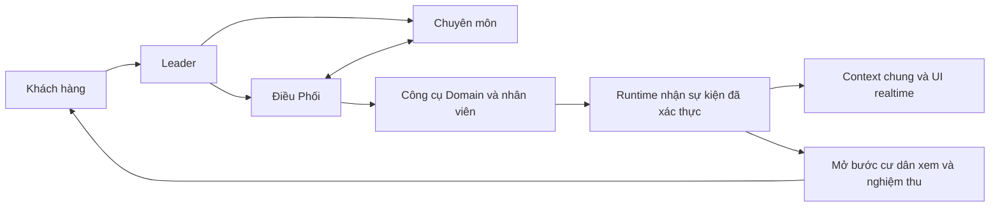

# Leader runtime: kết quả rà soát và kế hoạch sửa

Ngày rà soát: 17/10/2026. Workspace `E:\AI-Workforce-Platform`, nhánh `develop2`.

## Trạng thái

Bản sửa đã push lên `develop2` và phát hành trên VPS ngày 17/10/2026. Backend Platform chạy source `90ad2c90`, bao gồm sửa Leader `a130fa56` và sửa tích hợp `02437150`. Web chạy image `02437150`; hai file thay đổi ở `90ad2c90` chỉ thuộc backend. Domain API/sync/scheduler giữ image `9dd7504f`, có toàn bộ sửa Domain của bản này; mã nguồn Domain không đổi từ đó tới `90ad2c90`.

CI của `90ad2c90` qua 1.580 test, không lỗi hoặc bỏ qua. Kiểm tra HTTPS/realtime và điều kiện nghiệm thu B2 đã qua trên hai VPS. Các kiểm tra phát hành không gọi model thật và không gửi quyết định cư dân. Đây chưa phải nghiệm thu chất lượng phân tích của model và toàn bộ hành trình nghiệp vụ trên production.

Phần Agent Builder/JEV được sửa ở commit riêng `0f026557`; báo cáo này tập trung Leader, team, bằng chứng, tiến độ và nghiệm thu.

## Nguyên nhân của case B2

1. Thông báo do hệ thống tạo để đánh thức Leader có thể bị gắn actor cư dân. Nó tạo mốc yêu cầu khách hàng mới, khiến bằng chứng vừa nhận không còn nằm trong tập bằng chứng hiện hành.
2. Producer báo giá thiếu `currency`. Gate không thể xác nhận một giá trị không có đơn vị là VND; sửa producer để công bố VND thay vì nới gate đoán tiền tệ.
3. Gate có thể đọc số lượng vật tư, thời hạn bảo hành như số tiền, hoặc lấy tên công cụ làm tên đối tượng. Envelope và dữ liệu nghiệp vụ chưa được phân biệt đủ rõ.
4. Context chứa các lần đọc cùng snapshot, báo cáo dài và thông tin điều phối lặp lại. Chỉ giới hạn lịch sử hội thoại chưa đủ giữ phần trạng thái bắt buộc dưới 6.000 token.
5. Quyền nghiệm thu của cư dân bị phụ thuộc vào trạng thái Leader chờ xác nhận. Khi Leader lỗi context, Domain đã có kết quả nhân viên nhưng bước nghiệm thu vẫn bị khóa.

## Cách tổ chức Leader và Điều Phối

| Vai trò | Trách nhiệm | Khi cần chạy model |
|---|---|---|
| Leader | Hiểu yêu cầu, chọn đội phù hợp, giao đầu ra rõ, giải quyết bất đồng, tổng hợp và trả lời khách | Có yêu cầu mới cần phân tích hoặc quyết định chưa giải quyết |
| Điều Phối | Sở hữu thao tác ghi: giao nhân viên, đổi lịch, hủy; theo dõi công việc đã tạo | Đủ điều kiện thực hiện thao tác hoặc cần quyết định mới |
| Agent chuyên môn | Phân tích trong chuyên môn, đọc bằng chứng, hỏi trực tiếp đồng đội khi thiếu/mâu thuẫn | Có nhiệm vụ chuyên môn hoặc câu hỏi trực tiếp |
| Runtime | Lưu trạng thái, kiểm quyền, chống thực hiện lặp, nhận sự kiện, cập nhật phòng và khách | Không cần model cho cập nhật tiến độ thông thường |
| Domain | Quản lý nghiệp vụ, nhân viên, công việc, kiểm tra và xác nhận của cư dân | Giữ quyền quyết định nghiệp vụ tại Domain |

AgentScope đã có giao tiếp trực tiếp qua `TeamSay`, hộp thư, phụ thuộc nhiệm vụ và phản biện. Không nên ép mọi việc qua Leader hoặc bắt buộc các agent tranh luận ở mọi bước. Một thành viên chỉ hỏi khi có điểm cụ thể cần làm rõ; báo cáo cuối ngắn và dẫn mã bằng chứng.

## Bản sửa trong source

### P0: bằng chứng, context và nghiệm thu

- Thông báo provider dùng actor `system`; không tạo yêu cầu khách hàng mới.
- Báo giá khai báo `currency=VND`. Gate giữ riêng tiền, số lượng, thời hạn, đơn vị và đối tượng; không lấy input hoặc tên công cụ làm dữ kiện đầu ra.
- Lời trả lời trước của assistant không được nâng thành nguồn xác minh độc lập.
- Phát biểu “đã đóng phiếu/cư dân đã nghiệm thu” cần trạng thái hệ thống tương ứng. Lời cư dân hoặc suy đoán của agent không tự chứng minh hai trạng thái này.
- Điều kiện ngoại lệ theo cụm từ không được mở bởi nguồn bị phủ định như “không miễn phí”. Câu phủ định hợp lệ cũng không bị cấm chỉ vì chứa cụm từ đó.
- Các lần đọc toàn bộ `vh_ticket_get` được gộp theo phiên bản và snapshot. Con trỏ lịch sử có giá trị vẫn là trang dữ liệu riêng.
- Giảm dữ liệu điều phối trùng trong packet; lịch sử partner dùng chỉ mục, không gọi model chỉ để diễn đạt lại bằng chứng đã lưu.
- Khi packet lớn, chi tiết được thay bằng tham chiếu `CaseEvidence`. Nguồn gốc vẫn nguyên trong kho lưu; đọc lại bị giới hạn theo đúng phiếu. Báo cáo agent được đọc lại vẫn giữ thẩm quyền ban đầu.
- Kết quả MCP được lưu đầy đủ trong case log, không cắt chuỗi tại 6.000 ký tự.
- Sự kiện `job.result_published` đã xác thực, cùng các operation đã hoàn tất và không còn approval chờ, có thể tạo lời mời nghiệm thu trực tiếp mà không gọi lại Leader.
- Domain mở nghiệm thu theo công việc đã hoàn thành và biên nhận `job.result_published` đã `applied`, đúng công việc. Không phụ thuộc Leader diễn đạt thành công.
- Đóng workflow từ `needs_attention` vẫn cần xác nhận Domain đúng cư dân/phiếu/công việc và trạng thái hoàn tất thực tế. Các chặn quyền, revision, approval chờ và operation chưa rõ kết quả vẫn giữ.

### P1: trách nhiệm, câu hỏi và realtime

- Mỗi operation mới lưu `owner_agent_id` và `owner_session_id` bằng migration cộng thêm `0020_unified_operation_owner`.
- Tiến độ provider đưa trạng thái và agent theo dõi vào context chung; lookup operation bị giới hạn cùng workflow.
- Packet có các đầu vào khách đã cung cấp kèm nguồn. Các câu hỏi lặp về vị trí/căn/tòa/ngày/giờ nhận khóa ổn định; câu hỏi đơn giản về thông tin đã có bị từ chối ở cả `TeamSay` và `CaseSay`.
- Đây là lớp kiểm tra các trường thường gặp, không phải bộ hiểu mọi câu hỏi tiếng Việt. Chi tiết mới còn thiếu vẫn do agent phân tích.
- Chính sách server phân vai Leader/Điều Phối/chuyên môn; dùng snapshot còn hiệu lực, không polling bằng model và không giao lại công việc đã được nhân viên nhận.
- Phòng dùng SSE có kiểm tra chủ sở hữu, snapshot khi kết nối lại, heartbeat và bus cập nhật. Khi team được tạo sau session, stream chuyển sang theo dõi team đó.
- UI hiển thị phần việc, trạng thái, phụ thuộc, chặn và công việc nhân viên cùng agent theo dõi. Chỉ luồng room thay polling; danh sách session hiện vẫn có cơ chế làm mới riêng.

## Kiểm chứng

- Replay cả 60 snapshot đã chụp của case B2: không vượt 6.000 token; snapshot nghiệm thu 5.847 token, cao nhất trong tập là 5.997 token. Bộ đếm `o200k_base`; không gửi provider.
- Bộ kiểm tra Platform: 223 test qua; sau các bổ sung cuối, 54 test liên quan case và 12 test context/câu hỏi/realtime cũng qua. Bao phủ bằng chứng, số tiền/đơn vị, trao đổi ngang, phụ thuộc, chống lặp thao tác, phục hồi, grant, đóng phiếu và context SQL; các lượt chạy có test trùng nhau nên không cộng các con số này.
- Regression riêng kiểm tra provider wake là system, kết quả hoàn tất không gọi lượt model thứ hai, câu hỏi vị trí đã có bị chặn, đọc nguồn khác phiếu bị từ chối, báo cáo lưu trữ không thành bằng chứng MCP, và nghiệm thu sau lỗi Leader.
- Kiểm tra SSE gồm snapshot đầu, cập nhật revision, tạo team muộn và cách ly chủ sở hữu.
- Migration PostgreSQL đã chạy upgrade từ 0019, downgrade và upgrade lại, giữ nguyên operation cũ; trường owner cũ để NULL.
- Domain: 106 test qua trên PostgreSQL có migration/seed và runtime role hạn chế; test provider dùng ký HMAC, biên nhận và chống lặp. Bao gồm nghiệm thu khi Leader lỗi và từ chối receipt của công việc khác. Test không thay thế nghiệm thu với hai VPS thực.
- Frontend đã qua TypeScript và production build.

## Quy trình phát hành và nghiệm thu

1. Chốt commit theo đúng danh sách file Leader/Domain; giữ riêng thay đổi Builder, tài liệu khác và `.env`.
2. Sao lưu Platform PostgreSQL/Redis và dữ liệu Domain, ghi lại image hiện hành, dựng image từ revision đã chốt. Chạy migration 0020 trước app mới. Đây là migration nullable cộng thêm; rollback app không cần xóa hai cột ngay.
3. Phát hành đồng bộ Platform app, web và Domain API/sync. Không đổi key model hoặc bootstrap/grant trong bản sửa này.
4. Rà brief của tuyến OP2: tên agent trong brief cũ khác roster đã phát hành. Đổi đúng tên, bỏ yêu cầu đọc lại mọi dữ liệu ở mọi sự kiện. Không ghi đè tùy tiện spec nghiệp vụ của agent; không sửa contract đã ghim của case đang chạy.
5. Canary trên phiếu test tách biệt: kỹ thuật, vệ sinh, tình huống khẩn cấp và thiếu dữ liệu thực sự; kiểm tra hỏi ngang agent khi có mâu thuẫn, một thao tác giao việc, owner đúng, cập nhật nhân viên, báo giá, kết quả, chấp nhận và yêu cầu làm lại.
6. Kiểm tra stream qua HTTPS/proxy: không buffering, reconnect lấy snapshot đúng, không rò phiếu khác tài khoản. Đo số vòng model, token và độ trễ thực tế; chưa khẳng định tỷ lệ tiết kiệm trước phép đo này.
7. Với case B2 cũ, đọc trạng thái và biên nhận hiện hành trước. Khi đã có receipt đúng công việc thì mở bước cư dân quyết định theo luồng nghiệp vụ; không tự nghiệm thu, không tự đóng phiếu, không dispatch lại chỉ để khôi phục context.

Điều kiện nghiệm thu: thông tin đã có không bị hỏi lại trong các kịch bản kiểm thử; specialist trao đổi trực tiếp khi cần; mỗi thao tác chỉ có một hiệu ứng nghiệp vụ; tiến độ cùng owner hiện realtime; kết quả hợp lệ mở được quyết định cư dân dù Leader lỗi; chưa có bằng chứng hoặc chưa được cư dân chấp nhận thì không báo đã nghiệm thu/đóng phiếu.

## Kết quả phát hành ngày 17/10/2026

- Platform app: `agentscope-platform:90ad2c90-leader-integrated-20261017`, healthy. Web: `agentscope-platform-web:02437150-leader-integrated-20261017`.
- Domain API/sync/scheduler: `vinhomes-domain-api:9dd7504f-op2-capabilities-20261017`; API healthy, hai worker chạy. Image giữ cả sửa OP2 mới hơn; không hạ về image Leader cũ.
- [CI đã qua](https://github.com/nguyennanganhdev/AI-Workforce-Platform/actions/runs/39033342233): 1.580 test, 0 failure, 0 error, 0 skipped. Sandbox nghiệp vụ vẫn `NOT_VERIFIED`.
- Đối chiếu 401 file Python của app Platform và 91 file Python Domain đang chạy với source phát hành: khớp sau chuẩn hóa CRLF/LF. Các lớp image của gói Docker khớp VPS; app/web đã nạp lại thành công vào Docker Desktop.
- Migration thực tế: `0020_unified_operation_owner`; hai cột owner đã có. Các biến môi trường giữ nguyên ngoài hai image tag.
- Sao lưu Platform mới: `/opt/awp-platform/backups/20261017T123826Z-awp-platform`. Khôi phục thử độc lập cả PostgreSQL, Redis, MinIO và workspace: PASS; 439 khóa Redis bền và giá trị khớp. Bản sao lưu mã hóa đã được tải lên kho ngoài VPS. Bản sao lưu Domain trước phát hành được giữ riêng trên VPS Domain.
- HTTPS health và trang Leader trả 200. Phòng đúng chủ trả 200; khác chủ trả 404; stream chưa xác thực trả 401. Stream nhận tín hiệu Redis trong 0,129 giây và reconnect lấy snapshot hiện hành. Đây là độ trễ tín hiệu thông báo, không phải thời gian model xử lý nghiệp vụ.
- Ba tuyến active đều qua readiness: 4 thành viên/tuyến, một coordinator. Brief mới dùng roster hiện hành, ưu tiên context đã có và cập nhật theo sự kiện; chỉ áp dụng cho phiếu mới. Không sửa hợp đồng đã ghim hoặc phiên bản agent của phiếu đang chạy.
- B2: công việc completed, receipt `job.result_published` đúng công việc đã applied, approval pending; Domain cho phép cư dân quyết định dù workflow còn `needs_attention`. Chưa gửi chấp nhận/từ chối và chưa đóng phiếu. Một số session cũ không còn trong Redis; kiểm tra realtime dùng phòng còn tồn tại, không khôi phục hay tạo lại lịch sử đã mất.
- Gói giao nhận: `E:\AWP-Releases\leader-integrated-20261017-90ad2c90`, gồm image Platform/web/Domain, checksum, source archive, bằng chứng CI và script nạp image. Không chứa `.env`, credential hoặc bản sao lưu dữ liệu khách hàng.
- Image đã được chuyển và nạp trực tiếp trên VPS. Chưa publish thêm vào registry vì chưa xác định repository đích; tên registry trong tài liệu hiện chỉ là ví dụ.

Còn nghiệm thu: luồng cư dân → đội agent → nhân viên → báo giá/kết quả → cư dân chấp nhận hoặc yêu cầu làm lại với model thật; chất lượng trao đổi ngang, số vòng model và mức tiết kiệm token trong các case mới. Replay B2 và test kịch bản không thay thế bước này.
