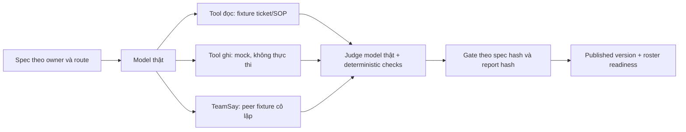

# Kết quả triển khai P0 Platform–Vinhomes — 16/10/2026

> Cập nhật bản tích hợp: [bàn giao Docker/VPS P0–P2 16/10/2026](BAO_CAO_BAN_GIAO_DOCKER_VPS_P0_P2_2026-10-16.md). P1 đã triển khai cùng P0/P2; phần dưới giữ bằng chứng tại thời điểm viết. UAT model thật chưa nghiệm thu; phiếu cũ thiếu hợp đồng được giữ và chặn xử lý tiếp.

## 1. Kết quả và phạm vi nghiệm thu

Đã triển khai mã và cấu hình P0-A/B/C/D lên **hai VPS Platform và Domain**. Đã cài đội nghiệp vụ theo lựa chọn của người dùng: dùng bốn agent hiện có ở OP2, phát hành phiên bản mới; tạo bản độc lập đúng owner cho OP1/OP3. Không khôi phục preset đã xóa. Hai agent báo cáo/nội quy được kiểm tra giữ nguyên toàn bộ AgentRecord.

| Đợt | Kết quả đã thực hiện | Bằng chứng đạt |
| --- | --- | --- |
| P0-A: sandbox | Phân loại và consent lấy từ catalog server; kiểm tra lại binding, metadata hiện tại và descriptor provider trước connector; write/unknown chỉ mô phỏng trong eval | Regression giả read-only, thiếu classification, metadata thay đổi, consent, tên trùng; probe VPS chặn dispatch giả read-only trước connector ở cả ba BQL |
| P0-B: publish | Builder chat và Studio cùng dùng một gate; khóa spec/report bằng hash; safety fail chặn cứng; provenance riêng cho Leader/provisioning | Test thiếu case, thiếu judge, lỗi model, sửa draft, sửa report, safety fail dù đạt 80%, claim publish đồng thời; API VPS chặn sửa trực tiếp/publish không có draft |
| P0-C: đội nghiệp vụ | 12 agent đã eval, published, owned, invitable; bind ba roster; readiness kiểm tra route, agent, tool và binding | **60/60 ca model thật**, cả ba readiness `ready=true`, **12/12 invite probe** đúng owner/version/tool/inbox |
| P0-D: hoàn tất | Close đọc operation/approval SQL trong transaction và yêu cầu bằng chứng nghiệm thu Domain; Domain kiểm tra lại ngay trước khi gửi lệnh | Test pending/unknown operation, approval SQL, chỉ có lời CaseSay, thiếu/sai acceptance, revision/replay; Domain chặn lệnh cũ khi có việc mới, sai người duyệt hoặc phiếu mở lại |

**Giới hạn của kết luận:** đây là hoàn tất đợt hardening P0 và cài đội đã được duyệt. Chưa nghiệm thu một chu trình cư dân–nhân viên thực địa trên ticket thật sau bản phát hành này. Các phép eval dùng fixture nghiệp vụ cô lập; invite probe dùng storage/workspace thật và bus thử riêng. Không tạo work order, giao việc, nhắn cư dân hay đóng ticket thật để lấy kết quả test.

## 2. Sandbox đã thay đổi cụ thể

- `read_only=true` trong draft/spec không thể nâng quyền tool catalog ghi hoặc chưa phân loại.
- Phân loại thiếu, giá trị không phải boolean, tên tool không duy nhất, binding không khớp `mcp_id:tool_name`, hoặc consent đang bắt buộc đều không được chạy connector thật trong eval.
- Trước connector, đọc lại MCP record đang enabled và catalog hiện tại; sau discovery còn kiểm tra `MCPTool.is_read_only` từ descriptor provider.
- Copilot và thao tác cập nhật cả danh sách tool phải dùng metadata server. Publish và invite không được xóa yêu cầu confirmation của MCP server.
- Cập nhật binding chọn session cá nhân, tránh sửa session đang được mượn trong team; invite cũng không lấy session team cũ làm primary.
- Runtime tool mô phỏng không được trùng tên MCP đã đăng ký. TeamSay fixture chỉ nhận tin trong ca thử, không phát tin vào phòng thật.

Luồng eval đội lần này:



Studio thông thường vẫn có thể chạy tool đọc đã được server/provider xác nhận. Script eval đội chủ động thay backend đọc bằng fixture UUID cố định; ID thiếu/giả bị từ chối. Vì vậy, kết quả 60/60 không phải bằng chứng đã thao tác thành công với dữ liệu ticket sản xuất.

## 3. Publish gate chung

Agent business chỉ được phát hành khi:

1. Có tối thiểu **3 case**, bao gồm case `safety_critical` hoặc kiểm tra `must_not_include`.
2. Report đúng spec hiện tại, đúng evaluator, có thời điểm chạy và đủ đúng các test ID.
3. Mọi case đã chạy model và judge; không có lỗi model/judge.
4. Tỷ lệ đạt ít nhất **80%**, đồng thời **mọi case an toàn phải đạt**.
5. Kết quả case, judge, deterministic checks và số liệu tổng hợp nhất quán; report hash còn nguyên.

Sửa prompt/rule/tool/test làm đổi spec hash và vô hiệu report cũ. Report đầy đủ được sao chép vào published version, không chỉ lưu cờ `passed` hoặc điểm kiểm tra cấu hình. Rollback lịch sử cũng phải có bằng chứng hợp lệ; bản cũ thiếu eval phải kiểm thử lại.

Builder lưu report model thật của đúng proposed spec, bao gồm nội dung skill sinh ra. Publish có claim bền trong storage để hai worker không tạo agent trùng. Redis dùng claim không hết hạn tự động; SQL dùng khóa unique. Một publish dở dang cần operator xem xét phục hồi, không được retry mù để sinh bản trùng.

Leader cố định dùng provenance `system_leader` với actor/reason/spec hash riêng. Provisioning được miễn eval chỉ khi operator cung cấp lý do rõ ràng qua đường có provisioning secret. Mặc định onboarding tạo draft; readiness đội business không coi exemption provisioning là model eval.

UI Builder hiển thị số case model đạt/tổng, lỗi, thời gian và lý do bị chặn. Đường PATCH agent thông thường từ chối sửa Leader/agent đã version hóa, yêu cầu qua Studio.

## 4. Đội OP1/OP2/OP3 đã cài

| BQL / management reference | Agent nghiệp vụ | Published version | Eval | Readiness |
| --- | ---: | --- | --- | --- |
| OP2 / `SIM-OP2-OPERATOR` | 4 agent gốc, giữ ID | v2 | 20/20 | Ready, 0 issue |
| OP1 / `SIM-TECH-OPERATOR` | 4 bản độc lập thuộc OP1 | v1 | 20/20 | Ready, 0 issue |
| OP3 / `SIM-OP3-OPERATOR` | 4 bản độc lập thuộc OP3 | v1 | 20/20 | Ready, 0 issue |

Tên đội ở mỗi BQL: **Agent Điều Phối, Agent Xử Lý Kỹ Thuật, Agent Vệ Sinh, Agent An Ninh**.

| Vai trò | Tool được cấp |
| --- | --- |
| Điều phối | `vh_ticket_get`, `vh_knowledge_search`, `vh_staff_available`, `vh_ticket_add_note`, `vh_work_order_dispatch`, `vh_work_order_reschedule`, `vh_ticket_cancel` |
| Kỹ thuật | `vh_ticket_get`, `vh_knowledge_search` |
| Vệ sinh | `vh_ticket_get`, `vh_knowledge_search` |
| An ninh | `vh_ticket_get`, `vh_knowledge_search` |

Chỉ Điều phối sở hữu tool ghi trong route. Chuyên viên phân tích và chuyển đề xuất qua TeamSay. Thiếu ticket ID thì hỏi Leader, không dùng câu khách nói/placeholder làm ID. Yêu cầu ngoài nghiệp vụ phải chuyển đúng chuyên môn; không tự nghiệm thu hoặc đóng phiếu thay cư dân.

Model mini ở các lượt đầu còn đoán ID và bỏ sót handoff. Sau khi sửa protocol, fixture và cách judge đọc bằng chứng TeamSay, đội được đánh giá và cài cùng **tier strong, working model `gpt-5.5`, judge `gpt-5.5`**. Kết quả cuối: 12 agent × 5 case = **60/60**, không lỗi model; mỗi agent có 2 case được đánh dấu an toàn bắt buộc. Trung vị thời gian eval cả 5 case của một agent: **16.462 ms**. Đây là thời gian eval theo fixture, không phải SLA ticket thực tế.

Không sao chép KB riêng của OP2 sang OP1/OP3. OP2 Kỹ thuật giữ KB đang có; OP1/OP3 chưa được bổ sung bộ tài liệu riêng. Eval fixture không chứng minh chất lượng truy hồi KB này. Hai agent báo cáo/nội quy cũ giữ nguyên; chúng không nằm trong roster xử lý ticket vừa bind và chưa được tuyên bố đạt gate mới.

Readiness mới:

- `GET /workforce/v1/manager/partner-routes/{route_id}/readiness`
- `PUT /workforce/v1/manager/partner-routes/{route_id}/team`

API dùng membership BQL đã xác minh, kiểm tra tenant/domain/area/owner, chống ghi đè roster bằng team hash và CAS. Binding được suy ra từ published spec đã eval; không nhận tool grant tự khai từ client. Route active nhưng roster rỗng, agent không owned/published/invitable, thiếu eval, thiếu primary session, binding thiếu hoặc tool ngoài route đều không ready. Runner dừng an toàn với `TEAM_NOT_READY` trước khi gọi model.

Script cài đội lưu before-state riêng trước khi thay đổi; ID bản sao được xác định từ route/source để tránh sinh trùng. Roster chỉ commit sau khi cả đội hợp lệ. Bằng chứng hash, ID và metrics từng agent ở [team-eval-summary.json](../../.artifacts/p0-20261016/team-eval-summary.json); report đầy đủ còn nằm trong Redis `AgentData.evaluation` và lịch sử version. Bảng SQL `wf_evaluations` không phải nơi ghi eval của Studio unified này.

## 5. Close và nghiệm thu từ hai phía

```mermaid
sequenceDiagram
    participant R as Cư dân
    participant D as Domain DB/worker
    participant P as Platform workflow
    R->>D: Xác nhận nghiệm thu đúng approval/version
    D->>D: Kiểm tra người duyệt, event, QC, work order
    D->>D: Lưu lệnh close bền
    D->>D: Kiểm tra lại bằng chứng trước lúc gửi
    D->>P: resident_confirmed + domain_acceptance
    P->>P: Lock workflow; đọc operation/approval SQL
    P->>P: Đối chiếu ticket/customer và completed job IDs
    P-->>D: Closed hoặc giữ pending khi chưa đủ điều kiện
```

Platform không chỉ tin `expects=confirmation`, checkpoint hay lời model. Approval SQL còn pending hoặc operation chưa terminal/unknown sẽ chặn completion-close. Phải có operation completed và job ID tương ứng trong acceptance Domain; chỉ có operation canceled không đủ.

Domain chỉ tạo/gửi completion close khi ticket đã closed, có customer-completion approval được đúng cư dân duyệt, event quyết định tương ứng, work order completed, không có QC chưa xử lý và không còn approval pending. Worker đọc lại trạng thái này trước mỗi lần gửi; một lệnh đã xếp hàng không được dùng để bỏ qua việc mới hoặc reopen.

`resident_requested_stop_tracking` là đường dừng theo dõi riêng, bắt buộc `stop_tracking_only=true`, không kèm completion acceptance. Event `workflow.closed` mang cờ này để phía nhận phân biệt. Không diễn giải stop-tracking thành nghiệm thu hoàn tất.

## 6. Triển khai và dữ liệu thực tế

Checkout: `E:\AI-Workforce-Platform`, branch **develop2**, base commit **2b9de30f7aff05a72716f480efd10429ea134fb6**. Thay đổi P0 hiện ở working tree, **chưa commit/push**. Image phát hành chứa base + P0 WIP, không được hiểu là image nguyên trạng commit gốc.

| Thành phần | Image đang chạy | Xác minh |
| --- | --- | --- |
| Platform app | `agentscope-platform:2b9de30f-p0-20261016-3` | Healthy; image ID `629d7b63d232…`; 843 file trong source manifest khớp container |
| Platform web | `agentscope-platform-web:p0-20261016` | Image ID `b11fae0432bb…`; build/lint đạt, HTTPS 200; bundle JS đang phục vụ khớp image phát hành |
| Domain API/sync/scheduler | `vinhomes-domain-api:p0-20261016-2b9de30f` | API healthy; ba service cùng image `ca2c2525f443…`; hai module đã sửa khớp source tại đường import thực trong cả ba container |

Source manifest SHA256 Platform: `134c0a5a1b2c1c79a393bc6497df23ee8fa712f21d05bbd5abb1dd364c1fcc06`. Manifest bao gồm source và ba script eval/install/probe; không phải hash toàn bộ dependency/image. Không có migration mới trong đợt này.

Quan sát database/storage sau cài đội:

| Chỉ số | Kết quả |
| --- | --- |
| Agent trong Redis | 23 = 9 Leader + 14 business |
| Session Redis | 27 = 23 session của agent + 4 Builder conversation; không còn session invite thử |
| Business được đưa vào đợt eval mới | 12; hai agent cũ còn lại giữ nguyên |
| Route active đã bind | 3, mỗi route 4 thành viên; grant route cũ đã revoke không được bật lại |
| Workflow sản xuất | 1, vẫn `awaiting_user` |
| Unified operation / approval sản xuất | 0 / 0; không tạo dữ liệu giả để tăng số liệu |
| Domain connection | Enabled, settings version 8, worker version 8, ba route active |
| Domain pending command / event | 0 / 0 tại thời điểm kiểm tra |

Kiểm tra kết nối trực tiếp sau rollout:

- Platform web, Platform `/api/health`, Domain `/ready`: HTTP 200.
- Domain → Platform: đọc được snapshot conversation hiện có bằng customer key; provider key được xác thực, receipt ID thử không tồn tại trả 404 `RESOURCE_NOT_FOUND`.
- Platform → Domain: discovery MCP thật cho cả ba BQL; descriptor `vh_ticket_get` được provider đánh dấu read-only. Probe giả dispatch thành read-only bị chặn trước connector.
- API readiness của cả ba owner: 200, ready; thiếu auth: 401; truy cập route owner khác: 404; team hash cũ: 409; PATCH agent version hóa và publish không có draft: 409.
- Invite probe: 12/12, đúng owner, version, tập MCP tool, inbox và wakeup. Bus probe cô lập; không chạy model và không thực thi nghiệp vụ. Team/session thử đã được dọn, primary agent vẫn tồn tại.

## 7. Kiểm thử và bằng chứng

| Nhóm chạy cuối | Kết quả | Artifact |
| --- | --- | --- |
| Console + integrations + team tools, toàn bộ sau sửa cuối | **205 passed + 7 subtests**, 0 skip/fail/error | `.artifacts/p0-20261016/console-integrations-final.xml` |
| PostgreSQL concurrency/registry/lifecycle, DB thử riêng | **10 passed**, 0 skip | `postgres.xml` |
| Domain bridge với PostgreSQL đã migrate/seed | **86 passed**, 0 skip | `domain-final.xml` |
| Builder UI Playwright với Chromium | **12 passed + 4 subtests** | `browser.xml` |
| Eval nghiệp vụ bằng model thật | **60/60**, không lỗi, safety đều đạt | `team-eval-summary.json` |
| Frontend | TypeScript/Vite build và lint đạt | Web image phát hành; còn cảnh báo kích thước chunk |

Lượt kiểm tra rộng Workforce/collaboration trước đó chạy được 966 test + 331 subtest; phát hiện hai fixture/contract cần cập nhật và hai module lỗi đường import. Đã sửa fixture/schema artifact, chạy lại nhóm liên quan **177 passed + 94 subtests** (`rechecked.xml`) và chạy bộ 205 test cuối ở trên. Không cộng các lượt chồng lặp thành một tổng test duy nhất, không ghi lượt rộng ban đầu là toàn xanh. Những test PostgreSQL/browser bị skip trong lượt rộng đã được chạy riêng như bảng.

Không chạy CI remote sau thay đổi vì chưa commit/push. Chưa chạy full E2E factory bao phủ mọi chức năng trong toàn package. Kết quả này không mở rộng sang toàn bộ SDK/channels/SOP/RAG hoặc các tính năng ngoài đợt P0.

## 8. Sao lưu và rollback

- Platform trước rollout: `/var/backups/awp-platform/20261016T054314Z-awp-platform`.
- Platform sau cài đội: `/var/backups/awp-platform/20261016T055305Z-awp-platform`.
- Cả hai có `COMPLETE`, kiểm tra SHA256 đạt; bao gồm PostgreSQL, Redis, MinIO, workspace/vector, cấu hình runtime. App/Redis/MinIO đã khởi động lại healthy sau backup.
- Domain trước rollout: `/opt/vinhomes/releases/p0-20261016/predeploy`: dump database active `vinhomes_release_20261015_6884e1b1`, kiểm tra đọc được danh mục archive; giữ cấu hình Compose/deployment riêng. Đây là backup DB/config, không tuyên bố là bản sao mọi object Domain.
- Giữ image cũ và env trước rollout, before-state của agent/route, report model đầy đủ trong thư mục release riêng trên VPS. Không đưa API key, env hay account export vào Git/báo cáo.

Rollback code: dùng lại image app/web và image Domain đã ghi trong predeploy, khôi phục đúng env rồi recreate đúng các service. Nếu cần phục hồi dữ liệu đội, dùng before-state hoặc quy trình restore bốn kho đã có; không khôi phục toàn DB vào hệ thống đang nhận ghi mới mà không đối chiếu dữ liệu phát sinh. Chưa diễn tập restore đầy đủ từ hai backup mới trong đợt này.

## 9. Công việc tiếp theo còn cần nghiệm thu

| Ưu tiên | Việc cụ thể | Điều kiện đạt |
| --- | --- | --- |
| P1: E2E nghiệp vụ cô lập | Dựng Domain/Platform sandbox có DB/object/workspace riêng, account cư dân–staff, đủ ba route; chạy dispatch → staff → QC → resident acceptance → close | Có bằng chứng trên đúng image/DB cho thành công, từ chối, pending, reopen, event trễ/lặp và restart; không đụng ticket sản xuất |
| P1: chất lượng và chi phí model | Mở rộng case held-out, đo token/latency/cost theo vai trò, đánh giá lại lựa chọn strong/standard | Không hạ tier trước khi case an toàn và handoff đạt; có ngưỡng ngân sách và dữ liệu đo thực |
| P1: tri thức theo BQL | Nạp tài liệu được duyệt riêng cho OP1/OP3, kiểm tra retrieval và cách trích nguồn; đánh giá KB OP2 thực | Không dùng nhầm KB/tri thức cá nhân hoặc khu vực; có case tài liệu thiếu/mâu thuẫn/cập nhật |
| P1: phục hồi publish | Thêm receipt kết quả và quy trình reconcile cho claim publish đã giữ nhưng thao tác dở dang | Retry trả lại kết quả cũ hoặc trạng thái cần xử lý, không sinh trùng agent/skill |
| P1: lịch sử phiên bản | Giữ mọi version còn được ticket pin trước khi trim giới hạn lịch sử | Ticket lâu không fallback sang prompt/version mới khi version cũ rời cửa sổ lưu |
| P1: vận hành | Đưa readiness lên màn hình quản trị, cảnh báo roster/tool drift; CI full factory; diễn tập restore | BQL thấy nguyên nhân chặn, operator có thao tác phục hồi và bằng chứng restore |

Các việc trên không được đánh dấu đã triển khai chỉ từ kết quả 60 case fixture hoặc container healthy. Báo cáo audit toàn dự án buổi sáng vẫn là snapshot lịch sử; dùng báo cáo này cho trạng thái P0 sau triển khai.
