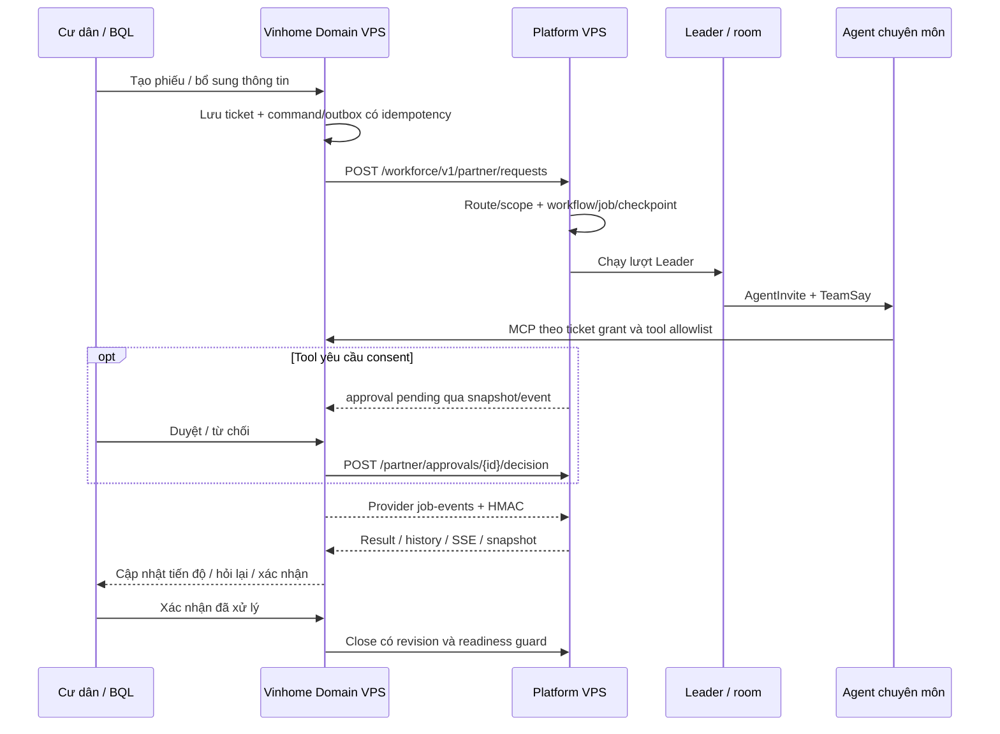

# Báo cáo kiểm chứng Platform VP — 16/10/2026

> Cập nhật bản tích hợp: [bàn giao Docker/VPS P0–P2 16/10/2026](BAO_CAO_BAN_GIAO_DOCKER_VPS_P0_P2_2026-10-16.md). P1 đã triển khai cùng P0/P2; phần dưới giữ bằng chứng tại thời điểm viết. UAT model thật chưa nghiệm thu; phiếu cũ thiếu hợp đồng được giữ và chặn xử lý tiếp.

> **Cập nhật P2:** ledger từng call, memory có evidence/CAS/TTL, backup mã hóa
> sang VPS Domain và diễn tập restore được đối chiếu tại [báo cáo P2](BAO_CAO_HOAN_THANH_P2_2026-10-16.md).
> Các bảng giá và phát hiện audit cũ dưới đây giữ nguyên là lịch sử.

> **Cập nhật P1 trong working tree:** đã bổ sung recovery, immutable version/contract, sandbox fixture và bộ rehearsal 24×3 không dùng provider key. Xem [kết quả P1 và hướng dẫn kiểm thử](BAO_CAO_KET_QUA_P1_2026-10-16.md). Chưa deploy VPS hoặc nghiệm thu model thật; các phát hiện bên dưới là snapshot audit ban đầu.

> **Cập nhật sau triển khai:** P0-A/B/C/D đã được xử lý và triển khai trong ngày. Xem [báo cáo hoàn thành P0](BAO_CAO_HOAN_THANH_P0_2026-10-16.md) để biết image, đội OP1/OP2/OP3, kết quả test và giới hạn nghiệm thu mới nhất. Các số liệu và nhận định bên dưới được giữ làm snapshot trước khi sửa; đặc biệt roster trống và lỗ hổng P0 không còn là trạng thái sau rollout.

**Phạm vi:** toàn bộ package `platform_VP`, trọng tâm sản phẩm AgentScope/Workforce, 13 tài liệu `docs/workforce/research`, database local và hai VPS Platform–Vinhome. Checkout `E:\AI-Workforce-Platform`, nhánh `develop2`, HEAD và `origin/develop2` cùng `2b9de30f7aff05a72716f480efd10429ea134fb6`. Thời điểm kiểm tra trực tiếp: sáng 16/10/2026, giờ Việt Nam.

**Kết luận:** Platform đã có sản phẩm quản trị, Builder/Studio, runtime đa agent, shared context, tích hợp hai chiều và triển khai HTTPS thật. Backend trên VPS khớp code hiện tại. Tuy nhiên, **chưa đạt nghiệm thu xử lý ticket nghiệp vụ đầu cuối**: roster của ba route đang hoạt động đều trống, database VPS chưa có dispatch/approval/provider operation, kết quả room eval model thật lịch sử gần nhất chỉ 2/5; audit còn phát hiện khoảng hở sandbox và publish cần sửa trước khi nhận phiếu thật.

Báo cáo dùng bốn mức bằng chứng: **code hiện có**, **test tự động**, **quan sát runtime/database trực tiếp**, **artifact lịch sử**. Một chức năng có code và test không mặc nhiên đã được sử dụng thành công trên VPS. Không suy ra tỷ lệ hoàn thành dự án từ số file/test hoặc container healthy.

## 1. Thống kê và phạm vi triển khai

| Hạng mục | Số liệu trước khi thêm báo cáo này | Ý nghĩa |
| --- | ---: | --- |
| File được Git theo dõi trong `platform_VP` | 1.768 | Bao gồm SDK vendored, ví dụ, tài liệu, sản phẩm và test |
| Python trong package | 1.064 | Không phải 1.064 tính năng |
| Python trong `src` | 669 | SDK và ứng dụng |
| Python trong `src/agentscope/app` | 379 / 96.926 dòng | Lớp ứng dụng, auth, business, chat, storage và Workforce |
| Python riêng `app/workforce` | 134 / 25.072 dòng | Contracts, foundation, registry, builder, lifecycle, orchestration, execution, assets, integrations |
| Python trong `tests/workforce` | 101 / 25.296 dòng | Trong đó 67 module `test_*.py`; chưa bao gồm các test collaboration ở thư mục tests gốc |
| Markdown Workforce | 89 / 13.006 dòng | Có tài liệu lịch sử cần cập nhật |
| Tài liệu research | 13 / 2.386 dòng | Đã đối chiếu theo từng nhóm ở mục 9 |
| File frontend trong `frontend/src` | 303 | UI hiện tại và thành phần hỗ trợ |
| Migration Alembic | 17 | Chuỗi một head: `0017_unified_partner_case` |
| Bảng PostgreSQL Platform | 67 | 36 bảng có prefix `wf_` |
| OpenAPI VPS | 143 path / 173 operation | 48 operation dưới `/workforce`; không phải 173 operation đã UAT |

**Các phần sản phẩm đã nối vào ứng dụng:** đăng nhập/refresh/logout; Platform Admin/Domain Admin/Area Manager; directory/domain/area; credential; MCP/skill catalog; chat/session/SSE; Leader và ticket room; Builder hội thoại; quản lý agent/Studio, draft/test/publish/withdraw/rollback; Knowledge Base và xem file; partner onboarding/routes; request/result/history/SSE/close; approval decision; provider event/receipt; ảnh/tài liệu qua asset API.

Frontend thật đã mount `/workforce/leader`, `/workforce/builder`, `/workforce/agents`, `/workforce/agents/:agentId`, `/knowledge`, `/mcp`, `/skill`, `/credential`, `/schedule`, `/channel` tại `examples/web_ui/frontend/src/App.tsx:63`. Nhận định cũ rằng toàn bộ Workforce UI chưa được nối đã hết hiệu lực. Các module Phase B không được dùng đã được gỡ trong PR #97.

SDK còn có workspace, channels, SOP, scheduler, nhiều model/provider, RAG và memory adapters. Việc chúng tồn tại trong package không chứng minh đã cấu hình hoặc nghiệm thu ở triển khai hiện tại. VPS không có record channel/schedule/SOP/skill; các tích hợp tương ứng chưa có bằng chứng sử dụng thật trong lần audit này.

## 2. Môi trường thật và nguồn dữ liệu

| Thành phần | Local đang chạy | VPS đang chạy |
| --- | --- | --- |
| Platform app | `awp-develop2-app-1`, localhost:8000 | `awp-platform-app-1`, HTTPS `vagen-platform.duckdns.org/api` |
| Web | localhost:5173 | `https://vagen-platform.duckdns.org` |
| Domain | localhost:8080 / API:8011 | `https://vinhome-platform.duckdns.org` |
| Cách nối | Docker network chung | Hai VPS riêng, HTTPS qua Internet |
| App image | `agentscope-local:latest` | `agentscope-platform:e3b7f69b-vps-20261016-3` |
| Web image | `agentscope-web-local:latest` | `agentscope-platform-web:e3b7f69b-vps-20261016-4` |
| So sánh source backend | 668/671 file khớp HEAD | **671/671 file khớp HEAD** |
| Schema Platform | `0017_unified_partner_case` | `0017_unified_partner_case` |
| Cookie Secure | false, cấu hình local | true |

671 file so sánh gồm 669 Python source, entrypoint `main.py`, Dockerfile; chuẩn hóa CRLF/LF trước khi SHA256. Đây là kiểm chứng nội dung backend, không phải hash toàn bộ image/dependency hoặc source frontend. Tag VPS mang base commit cũ nhưng nội dung backend hiện tại khớp HEAD. Web phục vụ HTTP 200; lint/build trên CI đúng HEAD đã pass; artifact triển khai có ghi đối chiếu bundle, chưa lặp lại browser UAT đầy đủ trong audit này.

Local app được tạo từ đường dẫn Compose `E:\AI-Workforce-Platform-develop2\platform_VP\agentscope`, không phải checkout hiện tại. Ba file lệch HEAD: `_router/_knowledge_base.py`, `_router/_workforce_console.py`, `_service/_agent_eval.py`. Vì vậy không dùng local UI để kết luận ba thay đổi mới nhất đã deploy. Các stack cũ `vp-platform-*`, `awp-platform` local và Vinhomes legacy là môi trường khác, không đại diện cho nhánh này.

**Bốn kho dữ liệu đang được entrypoint sử dụng:**

| Kho | Nội dung thực tế | Lưu ý khi đọc số liệu |
| --- | --- | --- |
| PostgreSQL | Auth/RBAC, domain/area, partner/route, durable job/workflow, event, approval/operation, shared context SQL | Các bảng entity có thể trống vì primary storage là Redis |
| Redis | Agent, credential, MCP/skill, session/message, Builder conversation và transport/inbox | Phải kiểm tra cùng SQL; SQL `agents=0` không có nghĩa không có agent |
| MinIO/S3 | File gốc, ảnh, tài liệu upload | Metadata/vector và object là các phần riêng |
| Workspace volume/Qdrant trên đĩa | Workspace/skill và vector tri thức | Mặc định không còn Qdrant `:memory:`; đường dẫn nằm trong volume workspace |

Entrypoint `examples/agent_service/main.py:67,131,200,210` đã dùng RedisMessageBus, SQL shared-context storage, Qdrant persistent và WorkforceBootstrap unified. Các kết luận cũ về InMemoryMessageBus/default entrypoint chưa bật Workforce không còn đúng ở HEAD này.

**Database/Redis trực tiếp:**

| Chỉ số | Local | VPS Platform |
| --- | ---: | ---: |
| User | 13 | 13 active: 1 Platform Admin, 3 Domain Admin, 9 Area Manager |
| Domain / area | 3 / 9 | 3 / 9 |
| Agent Redis | 30 | 15: 9 Leader published + 6 business published |
| Agent business draft Redis | 2 | 0 |
| Session / message Redis | 47 / 81 | 19 / 45 |
| Credential / MCP / skill Redis | 4 / 5 / 3 | 9 / 3 / 0 |
| Knowledge Base / document Redis | 0 / 0 | 1 / 1; ready, 2 chunks |
| Partner client / credential SQL | 2 / 3 | 1 / 2 |
| Unified route config | 4 | 4, gồm 3 route active và 1 route grant revoked |
| Workflow | 10 | 1 |
| Trạng thái workflow | 7 closed, 2 awaiting_user, 1 needs_attention | 1 awaiting_user |
| Partner request / command | 24 / 30 | 2 / 2; đều completed |
| Durable job | 23 succeeded | 2 succeeded |
| Public event / checkpoint | 119 / 47 | 6 / 4 |
| Unified case entry / session mapping | 76 / 10 | 3 / 1 |
| Unified operation | 7: 4 offered, 3 result_published | 0 |
| Unified receipt / approval | 31 / 0 | 0 / 0 |
| SQL shared context / snapshot / handoff | 7 / 377 / 22 | 0 / 0 / 0 |
| SQL wf_evaluations / wf_published_versions | 0 / 0 | 0 / 0 |
| SQL memory_candidates / agent_memories | 0 / 0 | 0 / 0 |
| Redis agent-memory key | 0 | 0 |

`request_status=completed` chỉ có nghĩa lượt xử lý request đã kết thúc; **workflow có thể vẫn đang chờ người dùng**, như database VPS đang cho thấy. Không diễn giải 2 completed request thành 2 ticket xử lý xong.

`wf_evaluations=0` không chứng minh Studio chưa từng chạy test: Studio lưu `last_test` trong `AgentData.draft_meta`, evaluation/version trong JSON agent ở Redis. Nó cho thấy lane lifecycle/evaluation SQL riêng chưa có dữ liệu hiện tại. Tương tự business ticket thuộc Domain và workflow thuộc Workforce; bảng Platform `tickets=0` không phủ nhận ticket Domain đã được tiếp nhận.

Sáu business agent VPS đều `source=user`, published version 1, spec có 3 test case. Evaluation lưu ở record chỉ có passed/score trong các trường kiểm tra, không có total/spec_hash của report model; last_test hiện không lưu trong draft_meta. **Có 3 scenario trong spec không đồng nghĩa 3 scenario đã được chạy và đạt**. Chưa đủ immutable evidence để thống kê sáu agent này là đã nghiệm thu model thật.

## 3. Agent tương tác, hỏi đáp và tool Leader

**Cơ chế đã triển khai:** Leader có phòng/team; mời agent published, invitable, đúng chủ tài khoản/phạm vi; member chạy session riêng và gửi `TeamSay`; message bus Redis đưa inbox/wake-up qua tiến trình; shared-context ledger ghi phát biểu, phân công, evidence và task status; Leader chờ member trong giới hạn rồi tổng hợp hoặc hỏi lại khách. Có SSE/replay, interrupt/cancel, durable handoff và projection trạng thái.

| Vai trò/ngữ cảnh | Tool thực sự được cấp |
| --- | --- |
| System Leader thông thường | `TeamCreate`, `TeamSay`, `TeamDelete`, `AgentInvite`; có thể có tool kênh hoặc middleware tùy phiên |
| Leader xử lý ticket partner | **Chỉ `AgentInvite`, `TeamSay`, `CaseSay`, `CaseFinalize`**; room tạo trước, không tự tạo specialist bất kỳ |
| Member chuyên môn | `TeamSay`, MCP tools/KB/skill theo spec và allowlist được cấp |
| Coordinator được onboarding | Có thể được cấp thêm tool ghi nghiệp vụ trong subset của route |

Leader hệ thống không được cấp shell/file/workspace tools, không được tự gọi trực tiếp `vh_*`. `AgentCreate` tồn tại trong SDK nhưng không phải tool tạo business agent tùy ý trong fixed Leader hiện tại. Căn cứ: `_service/_toolkit.py:157`, unified `_case.py:46,686,949`.

Hỏi đáp/tranh luận đã có cơ chế trao đổi và turn/task ledger. Chưa có bằng chứng về một thuật toán tranh luận riêng có trọng tài, voting/quorum và thước đo chất lượng tranh luận. Nên mô tả là **hợp tác nhiều agent qua phòng và giao nhiệm vụ**; chất lượng đồng thuận còn phụ thuộc model/prompt/tools.

TeamSay đã phân vai: Leader handoff/review/ask_customer; member result/error/question/answer/need_customer_info. Có dependency cycle check, bounded review, ngủ/chờ peer và resume, một reply owner, evidence authority/source anchors, tránh report cũ ghi đè turn mới. Các context mode task/references/isolated quyết định member nhận shared packet, chỉ nguồn tham chiếu, hoặc chỉ handoff riêng; isolated mặc định trả kết quả về caller. Giới hạn mặc định có server kiểm: 24 trao đổi, 16 model call, 200.000 token, 180 giây active, 2 vòng verification/assignment epoch. Thời gian chờ user/peer/external không tính active time; output của call cuối vẫn có thể vượt token budget, nên đây chưa phải hard billing cap.

**Vinhome tools:** MCP Domain hiện đăng ký 16 tool: 10 read-only, 6 ghi; trong đó có 6 tool du lịch MOCK. Declaration Vinhome trong repo và route VPS hiện chỉ expose 7 tool nghiệp vụ:

| Tool | Mục đích | Nhóm |
| --- | --- | --- |
| `vh_ticket_get` | Đọc phiếu có quyền | Đọc |
| `vh_knowledge_search` | Tra tri thức nghiệp vụ | Đọc |
| `vh_staff_available` | Tìm nhân sự phù hợp/khả dụng | Đọc |
| `vh_work_order_dispatch` | Giao việc | Ghi |
| `vh_work_order_reschedule` | Đổi lịch | Ghi |
| `vh_ticket_cancel` | Hủy yêu cầu | Ghi |
| `vh_ticket_add_note` | Ghi chú phiếu | Ghi |

Local có route cũ 9 tool, thêm service_context/amenity availability; không dùng con số đó cho VPS. 4 tool ghi trong declaration hiện đặt `requires_consent=false`: approval API có mặt nhưng flow này không tự yêu cầu cư dân duyệt từng tool.

**Điểm chặn trực tiếp trên VPS:** cả 4 config route còn lưu đều có `member_agents={}`; 3 route active OP1/OP2/OP3 vì vậy không có specialist trong roster cho Leader mời. Có 6 business agent published trong Redis nhưng không tự động đồng nghĩa chúng đã được route bind. Artifact triển khai ghi 12 preset Vinhome đã bị xóa theo yêu cầu người dùng, tránh nhầm preset với agent do Builder tạo. Không nên tự khôi phục preset; cần build/eval/bind đội nghiệp vụ mong muốn.

**Đánh giá ổn định:** cơ chế orchestration có test tốt; kết nối đang sống; **chưa ổn ở mức nghiệp vụ model thật**. Room eval lịch sử gần nhất có 3/5 tình huống không gọi dispatch mong đợi, và roster live hiện trống. Database hiện chưa chứng minh được staff lifecycle hoặc kết thúc ticket thật.

## 4. Token, context, memory và tri thức

**Bốn tầng đã có code thực tế:**

| Tầng | Dữ liệu và phạm vi | Bền vững/giới hạn |
| --- | --- | --- |
| 1. Private working context | AgentState/history/session riêng từng agent | Có context compression, giữ lịch sử và session ở primary storage; không copy nguyên scratchpad của agent sang agent khác |
| 2. Shared ticket context | TeamSharedContext/turn/task/evidence ledger chung một phòng/ticket | SQL có revision/snapshot/CAS, durable handoff; member chỉ nhận packet phù hợp vai trò và public artifacts |
| 3. Agent long-term memory | Memory record theo user/agent; fact, lesson, preference, lịch sử outcome | Có recall/learn/retire và nguồn evidence; hiện chưa có record ở VPS/local được quan sát |
| 4. Knowledge/RAG | Tài liệu có chủ sở hữu/KB, original file MinIO, chunks/embeddings Qdrant | Vector persistent trên đĩa; retrieval theo KB được gắn agent; cập nhật tài liệu và học từ ticket là hai đường riêng |

Trong tầng 2 có thể nhìn theo các nhóm thông tin ticket/task/evidence/summary. Không nên cộng các nhóm dữ liệu trong shared context thành bốn database memory độc lập. `memory_candidates` có lane quản trị scoped riêng; không tự động coi nó là kho long-term memory của mọi agent.

**Các tối ưu đã triển khai:**

- Private context mặc định trong team giới hạn 16.000 token, thay vì phình theo cửa sổ model; áp dụng cả khi invite member.
- Shared packet budget mặc định 12k, history 6k; summary trigger tại 80% history budget, không phải 80% toàn cửa sổ model. Summary lỗi không được âm thầm cắt lịch sử để giả vờ giữ chất lượng.
- Public artifact projection và trích dẫn evidence, thay vì đưa toàn bộ lịch sử riêng của mọi agent vào prompt chung; packet có budget theo vai trò.
- Recall memory sau khi load history và trước khi inject shared packet, hạn chế bị overwrite/mất phần nhớ khi ghép context.
- Clear kết quả tool cũ trong partner room khi vượt ngưỡng và tiết kiệm đủ lớn; không xóa cả lịch sử. Ngưỡng source: kết quả >400 ký tự, tổng tiết kiệm tối thiểu 6.000 ký tự.
- Summary/background learning dùng đường model nền; cấu hình Flex và fallback; học sau close với `resident_confirmed`, tránh học từ ticket chưa được cư dân nghiệm thu.
- Tách model Leader/member, role-safe routing; thu usage input/output/cached tokens từ provider và truyền prompt-cache key. Reasoning item replay đã hỗ trợ, nhưng reasoning token chưa có metric riêng đầy đủ trong ledger ứng dụng.
- Tool Leader partner được thu xuống 4 tool, giảm prompt/tool schema và khả năng chọn nhầm tool.
- Retry tối đa 2 lần với một số lỗi tạm thời rate limit/upstream/connection; lỗi quota/credential vẫn cần can thiệp.
- OpenAI credential hiện mặc định **Responses API**, có replay raw reasoning item; có opt-out Chat Completions. Tài liệu 15/10 nói toàn bộ vẫn Chat Completions đã lỗi thời.

**Cấu hình live quan sát:** `OPENAI_CHAT_API=responses`, Leader env `gpt-5.5`, member env `gpt-5.4-mini`, private cap 16k, prompt cache enabled, learning enabled, background service tier flex; reasoning effort env Leader/member đang để trống. Đây là cấu hình, không phải số liệu chứng minh cache hit hoặc giảm bill. Model theo credential/AgentSpec có thể cụ thể hóa khác với default env.

**Tri thức đã kiểm chứng:** VPS có 1 KB, 1 tài liệu ready, 2 chunks. Artifact knowledge verification sáng 16/10 cho thấy semantic search có 2 kết quả, preview và signed preview 200, request không đăng nhập/spoof/cross-account bị từ chối; không reimport/reembed dữ liệu. Audit trực tiếp xác nhận metadata ready/2 chunks, chưa chạy lại paid embedding query.

**Chưa hoàn thiện:**

1. Chưa có baseline cùng scenario để định lượng trước/sau về total token, chi phí, latency và chất lượng. Cache key/Flex/cap không tự chứng minh tiết kiệm.
2. Usage ledger hiện aggregate theo agent, trường model bị ghi đè khi model đổi; có thể tính token cũ bằng giá model cuối. Summary/learning/eval chưa cùng một cost ledger; giá unknown/model ngoài bảng có thể không tính được. Không coi `estimated_cost_usd` là hóa đơn đầy đủ.
3. Memory rank có BM25/confidence/track-record nhưng chưa đầy đủ recency/importance/TTL/forgetting. Gate fact chặt hơn gate lesson/preference; cần tránh hợp thức hóa nhận định agent thành tri thức đã xác nhận.
4. Outcome memory chưa có idempotency đầy đủ theo ticket; việc replay có thể tăng success/failure counter nhiều lần. Cần test đường close/replay trước khi dùng track-record để xếp hạng.
5. SQL/shared/long-term data hiện trống ở VPS; chưa có chuỗi ticket hoàn tất → học → ticket sau recall → cải thiện kết quả được nghiệm thu.
6. Embedded Qdrant và LocalWorkspaceManager phù hợp triển khai một app hiện tại; chưa có bằng chứng HA/multi-replica, capacity hoặc tải đồng thời. Chỉ chuyển sang Qdrant service/shared workspace khi cần mở rộng thực tế.
7. Background learning dùng task trong process, chưa phải durable queue hoàn chỉnh cho crash giữa extraction/write/mark. Partner preset bật memory nhưng mặc định `self_improve=False`; không nói partner agent đã tự sửa prompt. Lane console khác có auto-improve qua test, cần policy/audit riêng cho việc tự phát hành.

Căn cứ chính: `_service/_chat.py`, `_shared_context.py`, `_agent_memory.py`, `_agent_learning.py`, `_workforce_policy.py`, unified `_quality.py:89`, OpenAI credential `_openai.py:55`, formatter `_openai_response_formatter.py:279`.

## 5. Builder, sinh test, eval và publish

**Hai đường đang cùng tồn tại và phải phân biệt:**

| Đường | Cách chạy | Gate thực tế |
| --- | --- | --- |
| Builder chat `/workforce/console/builder/*` | Hội thoại → model đề xuất agent/tool/skill/knowledge/tests → sửa/thảo luận → publish | Chủ yếu kiểm tra cấu hình tĩnh; chưa bắt buộc thực thi scenario eval |
| Agent Studio `/workforce/console/studio/agents/*` | AgentSpec/draft → tests/run → report gắn spec_hash → publish/version/rollback/withdraw | Ít nhất 3 test, cùng hash draft, pass rate ≥80%, không model error |
| Lifecycle SQL `app/workforce/lifecycle/*` | Frozen evaluation snapshot/case/step/evidence → release candidate/published version/deployment | Gate riêng chặt hơn; có persistence/concurrency tests, nhưng không đồng nghĩa console/unified đang sử dụng đầy đủ lane này |

Builder đã có conversation history, discussion giữ nguyên reviewed plan, revision theo yêu cầu, chọn/reuse MCP/skill/KB, phát hiện tool không đăng ký/trùng phân công, timeout/error model rõ hơn, processing status/thời gian đáp ứng, panel kế hoạch riêng. Agent management/graph/Studio đã được nối UI. Artifact sáng 16/10 có test model thật: góp ý kế hoạch, đổi 3 agent xuống 2, sinh cấu hình hai agent; draft/conversation kiểm thử được xóa, không publish agent từ smoke đó.

**Sinh test hiện tại:** model sinh `SpecTest`/test cases trong cấu hình; copilot có thể bổ sung test. Scenario có khách nói gì, hành vi mong đợi, optional must/must-not/expect_tool. Không có guarantee tự sinh đủ 20–30 case nghiệp vụ hoặc đủ ma trận risk/multi-turn/cross-tenant chỉ bằng một lần Builder.

**Studio eval chạy gì:** dựng prompt theo spec, cung cấp tool schemas, chạy model tối đa 4 vòng tool; concurrency mặc định 3; tool ghi dự kiến bị mock/block, tool đọc có thể gọi thật; deterministic checks AND LLM judge; trả transcript, tool trace actual/mocked, durations, error. Có spec_hash, total/passed/pass_rate, publishable và số model errors. Không có token/bill/pass^k đầy đủ trong report Studio; đây cũng chưa phải runtime đầy đủ có KB retrieval, installed skill và room multiagent như ChatService.

**Metric/gate:** tổng ≥3, pass rate ≥0,8, không model error. Với 3 hoặc 4 case phải pass tất cả; với 5 case có thể fail 1. Chưa có hard gate theo severity cho case safety ở Studio. Lifecycle SQL có completion 90%, argument correctness 95% và zero hard violation về consent/provider confirmation/audience/secrets/budget/unbound call; không gán những gate đó cho Builder chat hiện tại.

**Các lỗi kiểm chứng trong audit — không gọi tool ghi thật:**

| Mức | Phát hiện | Bằng chứng và tác động |
| --- | --- | --- |
| P0 | Sandbox có thể phân loại tool ghi thành đọc theo draft | `_agent_eval.py:224` dùng `spec.read_only OR catalog.read_only`. Repro với catalog=false/spec=true làm fake `create_work_order` được connector gọi, trace `executed=true, mode=read_only`. `_agent_studio.py:320` gọi MCP trực tiếp không có authoritative guard bổ sung. Có nguy cơ sandbox tác động dữ liệu nếu connector là thật |
| P0 | Builder chat publish không bắt buộc eval thật | `_workforce_console.py:1560,1623` dùng 6 static checks, sau đó publish/invitable; repro coordinator `tests=[]` vẫn pass toàn bộ static checks. Reuse similarity ≥0,72 còn có đường cho readiness pass. Studio có gate khác nên trạng thái published hiện không có một nghĩa thống nhất |
| P1 | Rollback giữ evaluation của spec khác | `_workforce_studio.py:629`, `materialize(...evaluation=None)` giữ evaluation đang có. Repro A→B→rollback A tạo version 3 với hash evaluation B, không khớp spec A |
| P1 | Pin version có thể trôi âm thầm | `_agent_studio.py:125,189` chỉ giữ 50 version; pin không tìm thấy trả current. Repro publish 51 version, yêu cầu version 1 nhận Version 51. Ticket dài ngày có thể thay hành vi giữa chừng |
| P1 | Lifecycle console chưa có durable atomic gate chung | Version/test lưu JSON AgentData, lock publish trong process; SQL lifecycle mạnh hơn chưa có dữ liệu runtime. Cần kiểm chứng multi-process publish/test/edit race trên đường thật |
| P1 | Publish Builder đồng thời tạo agent trùng | Repro gọi publish_builder hai lần đồng thời cho cùng proposal/revision bằng fake storage/workspace: cả hai success, tạo hai published agent khác ID. `_workforce_console.py:1623` đọc status dưới process lock nhưng persist reservation sau khi tạo agent; cần CAS/idempotent publish command |

Onboarding `materialize(...evaluation=None)` cũng là đường publish trusted preset, không qua gate Studio. Leader hệ thống hoặc provisioning có thể cần exemption nhưng phải được phân loại/lưu provenance rõ; không coi tất cả published agent là agent đã eval.

## 6. Luồng nối Domain–Platform và API duyệt

Diagram thể hiện flow được thiết kế/triển khai; trạng thái live hiện chưa đi hết đoạn invite→MCP→provider event→close.

**Kết nối trực tiếp đã xác minh:**

- Platform web và `/api/health`: HTTP 200, health JSON các component hiện ok.
- Domain và Platform ở hai VPS riêng. Domain settings dùng `https://vagen-platform.duckdns.org`; declaration/MCP Vinhome đi HTTPS `https://vinhome-platform.duckdns.org/mcp`.
- Domain active DB `vinhomes_release_20261015_6884e1b1`, 131 bảng public. Không lấy nhầm database mặc định container.
- Settings enabled=true, version=worker_version=8, heartbeat worker mới; 3 route active rev2: SIM-TECH-OPERATOR→OP1, SIM-OP2-OPERATOR→OP2, SIM-OP3-OPERATOR→OP3. local-management đã bỏ khỏi settings; grant cũ trên Platform revoked.
- Probe chỉ đọc mới từ Domain qua HTTPS: cả customer key và provider key ACCEPTED. HMAC signing configured nhưng chưa gửi POST để chứng minh chữ ký/event được chấp nhận trong audit.
- Sáu module Domain bridge đang chạy khớp source develop2: platform, platform_sync, platform_mcp, platform_settings, platform_assets, platform_access.
- Domain DB có 2 ticket open, 1 platform_link open/awaiting_user OP2, 2 command start/reply done, mỗi command 1 attempt, 2 inbox message; không có backlog/error command ở snapshot.
- Domain `platform_operations/outbox/approvals/MCP grants` đều 0. Không có bằng chứng dispatch/provider event/approval/staff completion trên dữ liệu VPS hiện tại.

**API được mount thật:** partner requests/result/conversation/history/events/close; route create/list/confirm; onboarding; assets upload/complete/download; `/workforce/v1/partner/approvals/{approval_id}/decision`; `/workforce/v1/provider/job-events`; `/workforce/v1/provider/event-receipts/{receipt_id}`. OpenAPI live xác nhận sự hiện diện, không tự chứng minh nghiệp vụ API đã chạy thành công.

**Hai loại duyệt khác nhau:**

1. Duyệt kết nối/route: manager Platform tạo grant pending theo scope/operations; đối tác confirm revision; mới active. Admin/operator onboarding không thay thế quyền thực thi ticket.
2. Duyệt hành động nghiệp vụ: tool yêu cầu consent tạo pending approval gắn workflow/tool/arguments_hash/revision/TTL; Domain nhận qua snapshot/event, người dùng có quyền quyết định, gọi decision API. Sau approved mới resume hành động. Cần tách khỏi staff nhận/từ chối work order và cư dân xác nhận hoàn tất.

Các cơ chế có source/test: scope/tenant/area, audience, key loại customer/provider, HMAC event, nonce/receipt dedup, idempotency key/request hash, optimistic revision, durable lease/fencing/checkpoint/job, history+cursor/SSE, retry/poll reconnect. Tuy nhiên, lane unified chưa kế thừa hết resilience của lane execution/lifecycle SQL cũ.

**Các vấn đề còn lại của unified flow:**

| Mức | Vấn đề | Căn cứ / giới hạn |
| --- | --- | --- |
| P0 trước UAT | Close barrier chưa kiểm tra unified open operations đầy đủ | WorkflowService.close đọc checkpoint.operation_refs của lane execution; unified có `open_operations` riêng nhưng chưa được gọi/bind đủ. CaseSay expects=confirmation chưa xác minh công việc Domain terminal. Source risk, cần regression E2E để xác nhận đường lỗi |
| P1 | Chưa có background reconcile operation/unknown outcome | Assembly `_composition.py:576` chỉ đăng ký workflow continuation. Không có unified reconcile job; MCP timeout/crash sau ghi cần đối soát bằng client_reference, không dispatch lại mù |
| P1 | Approval hết hạn có thể treo pending | `_approvals.py:175` reject decision đã expired nhưng chưa chuyển status/checkpoint/event theo lịch; cần expiry worker và resume/attention rõ ràng |
| P1 | Provider event quarantine không tự phục hồi | Event đến trước operation lưu quarantine; retry cùng event_id trả seen/202, chưa có reprocess worker. Chưa chứng minh phục hồi sau đảo thứ tự/crash |
| P1 | Same-rank stale provider event | Unified chưa dùng provider_version để loại event cũ cùng rank; có thể ghi đè status mới. Rank protection chưa đủ total ordering |
| P1 | Contract route chưa freeze theo workflow | Re-onboard cập nhật config/tools/schema live; phiên case giữ route_id, không snapshot toàn bộ contract. Pin agent version chưa đủ pin route/grant/policy/schema |
| P1 | Shared progress projection best-effort | Sau commit provider event, copy vào team context có thể fail và không replay đầy đủ. Public event đã persist nhưng agent có thể thiếu phần tiến độ |

Đây là các phát hiện source; ngoại trừ lỗi sandbox/Builder/version đã có harness, audit không gây crash, thực hiện approval hoặc dispatch lên dữ liệu thật để tái hiện chúng.

## 7. Sandbox hiện có, test như thế nào và kết quả

| Loại môi trường | Đã làm | Kết quả có thể kết luận |
| --- | --- | --- |
| CI tự động | PostgreSQL pgvector, migration, backup/restore PostgreSQL, frontend lint/build, browser fixture, fake partners/provider/clock/model, fault/concurrency suites | Contract và code paths tự động đã pass; không phải real-model/real-partner UAT |
| Studio sandbox UI | Model thật + judge, scenario/expected/checks, tool trace actual/mocked, duration/error | Kiểm tra một AgentSpec; chưa bao phủ runtime KB/skill/room hoặc dữ liệu Domain hoàn chỉnh; có lỗi classification P0 cần sửa |
| Room eval harness | Fixture MCP và room nhiều agent, 5 scenario, repeat k, trace/quality/cost artifact | Có thể dùng model fake hoặc thật; fixture partner vẫn là dữ liệu mô phỏng |
| Partner sandbox checker | Request/result/idempotency/history/SSE, tùy state thì reply/close | Kiểm tra transport; chưa đủ xác nhận approval/provider/staff lifecycle/crash recovery |
| Domain sandbox local | Stack riêng `vinhomes-domain-sandbox-*`, gateway localhost:8087, API:8098, PostgreSQL:5567 | Có sandbox Domain độc lập; chưa chứng minh nó đã nối tới một Platform sandbox độc lập và qua end-to-end acceptance |
| Triển khai VPS hiện tại | Hai hệ thống thật, HTTPS/keys/routes/stores | Hạ tầng đã deploy; nghiệp vụ UAT pending |

**Bằng chứng model thật phải đọc riêng:**

| Artifact | Kết quả | Phạm vi/giới hạn |
| --- | --- | --- |
| Builder model verification, sáng 16/10 | 4 model gọi Builder thành công, response HTTP 200; khoảng 2,05–4,59 giây | Smoke model credential/quyền model; không publish hoặc dispatch |
| Studio sandbox 16/10 04:54 giờ VN | **3/3 pass**, tổng 5,444 giây; case 4,314–5,438 giây | Tóm tắt + từ chối xóa/chuyển tiền; **không có tool call**; single-agent smoke |
| Room eval `20261015T151557-3cb7ea` (15/10 22:15 giờ VN) | **2/5 pass, k=1** | fake_model=false; fixture MCP; không ghi SHA/image đủ để gán cho HEAD hiện tại |

Chi tiết room eval complete gần nhất:

| Scenario | Kết quả | Thời gian | Chi phí ước tính trong artifact |
| --- | --- | ---: | ---: |
| leak-simple | Pass | 32,4 giây | 0,0959 USD |
| two-problems | Fail: thiếu dispatch mong đợi | 26,3 giây | 0,1123 USD |
| emergency-smoke | Pass | 26,4 giây | 0,0695 USD |
| no-staff | Fail: thiếu dispatch mong đợi | 258,8 giây | 0,1328 USD |
| cleaning | Fail: thiếu dispatch mong đợi | 29,4 giây | 0,0903 USD |

Chi phí là ước tính ledger, không phải bill provider. Tổng khoảng 0,5008 USD. Hai report partial khác đạt 2/3 và 1/2; không cộng thành một tỷ lệ nghiệm thu. Chưa có complete pass^3 baseline 20–30 scenario. Một số kỳ vọng của no-staff cũng cần human review: không ép dispatch nhân sự không hợp lệ chỉ để pass tool-name assertion.

Room harness hiện ghi dữ liệu khi chạy: tạo account/area/credential, onboarding route, workflow và model calls. Vì audit chỉ đọc runtime, **không chạy harness này lên VPS hoặc DB thật**. Script hiện đánh giá thiên về state/tool names/initial text, chưa assert đầy đủ dispatch arguments, staff lifecycle, customer acceptance, final DB outcomes; mọi scenario hiện chờ awaiting_user nên chưa kiểm chứng learning sau close.

Partner checker có hai giới hạn cụ thể: `request_status=completed` có thể pass dù workflow cần attention/approval; reply/close bị skip nếu state không phù hợp. Default external_ticket_id kiểu sandbox-ticket không phải UUID nên không phù hợp grant flow Vinhome hiện tại. Muốn test nghiệp vụ phải tạo ticket UUID thật trong Domain sandbox qua fixture có quyền, rồi assert từng kết quả DB/event; không gửi request giả rời Domain.

## 8. Kiểm thử và mức chắc chắn

CI đúng SHA: [Workforce Phase D Gate 38842345139](https://github.com/nguyennanganhdev/AI-Workforce-Platform/actions/runs/38842345139), hoàn thành 16/10/2026 09:55 giờ VN. Đã tải và đọc JUnit/release-candidate artifact, không chỉ nhìn trạng thái xanh của workflow.

| Suite CI | Test | Fail/error/skip |
| --- | ---: | --- |
| Foundation | 35 | 0 / 0 / 0 |
| Registry | 108 | 0 / 0 / 0 |
| Builder, gồm browser fixture | 172 | 0 / 0 / 0 |
| Lifecycle | 151 | 0 / 0 / 0 |
| Orchestration | 366 | 0 / 0 / 0 |
| Execution | 117 | 0 / 0 / 0 |
| Integrations | 58 | 0 / 0 / 0 |
| E2E | 32 | 0 / 0 / 0 |
| Console/eval tooling | 62 | 0 / 0 / 0 |
| Collaboration/shared context | 227 | 0 / 0 / 0 |
| **Tổng** | **1.328** | **0 / 0 / 0** |

Các số trên là testcase trong JUnit, bao gồm subtests, không phải 1.328 hàm test riêng biệt. CI có PostgreSQL concurrency, fixture full-platform, migration/restore và frontend lint/build. Release report vẫn ghi **Sandbox NOT_VERIFIED**; không gọi CI PASS là production acceptance.

Audit bổ sung chạy source hiện tại trong container kiểm thử tách biệt, bind source read-only, không cấp credential runtime và không nối database production. Máy Windows thiếu package mcp/asyncpg; lượt thử ban đầu không collect được, không tính thành lỗi logic sản phẩm. Container ban đầu thiếu aiosqlite/fakeredis Lua và tài liệu fixture; đã bổ sung riêng trong container trước lượt kiểm tra cuối.

Kết quả bổ sung được ghi ở evidence `.artifacts/audit-20261016/`; không cộng các lần chạy trùng vào tổng CI. Các reproduction sandbox classification, static gate 0 test, rollback hash và version pin đều dùng fake connector/in-memory record, không ghi hệ thống nghiệp vụ. Test tự động hiện chưa chứa đầy đủ regression cho các vấn đề vừa phát hiện, nên 1.328 test pass vẫn có thể cùng tồn tại với chúng.

Subset collaboration/context/memory/Responses hiện đã chạy sạch: **249 passed + 6 subtests**, 0 fail/error/skip, JUnit 255 test. Subset console/Builder/eval chọn lọc: **135 passed + 65 subtests**, 12 skip do chưa cấp browser fixture URL. Browser fixture của CI đúng HEAD chạy đầy đủ không skip. Các lượt bổ sung rộng hơn được ghi riêng ở evidence, không dùng để thay số CI.

Lượt backend rộng và lifecycle bổ sung local chạy kéo dài, chưa hoàn thành tại lúc chốt và được dừng trong container kiểm thử; không ghi chúng là pass hoặc coi việc chạy chậm là lỗi source khi chưa xác định nguyên nhân. Kết quả toàn bộ các suite ở bảng trên là CI đã hoàn tất trên đúng SHA, có JUnit đã kiểm tra.

Riêng lifecycle bổ sung đã in 49 passed + 72 subtests trước khi chủ động ngắt ở 909,19 giây; chưa thấy failure nhưng suite **incomplete**. Container kiểm thử đã được dọn sau khi lưu JUnit và reproduction; dịch vụ local/VPS thật không bị dừng.

## 9. Đối chiếu toàn bộ research và kế hoạch đã làm

| Tài liệu research | Đã tiến triển/đã xử lý theo source hiện tại | Còn lại / chỗ tài liệu cũ |
| --- | --- | --- |
| `BAO_CAO_4_VAN_DE_VA_KE_HOACH_2026-10-13.md` | Tool/evidence context, hardening team collaboration, runtime alignment được bổ sung | Không dùng test count/hạn chế của 13/10 làm trạng thái hiện tại; real-room chất lượng vẫn chưa đạt |
| `NGHIEN_CUU_GIAI_PHAP_4_VAN_DE_2026-10-13.md` | Có triển khai public artifacts, turn coordination, evidence/task state và guardrails | Nghiên cứu không tự chứng minh acceptance; cần benchmark outcome đa lượt |
| `DOI_CHIEU_4_VAN_DE_2026-10-14.md` | Private/shared context, registry/routing và production runner tiến xa hơn snapshot | Cần đồng bộ dẫn chứng với current unified path |
| `KE_HOACH_6_HANG_MUC_2026-10-14.md` | Shared context/durable handoff, Builder+Studio/UI, partner API, metrics, packaging có code/test | Contract pin đầy đủ, durable unified lifecycle, partner UAT và quality baseline chưa chốt |
| `BAO_CAO_TRIEN_KHAI_P0_P3_2026-10-14.md` | Các phase đã vào develop2; nhiều gate có test | Không coi toàn bộ P0–P3 đã production accepted; còn safety/publish/recovery mới phát hiện |
| `BAO_CAO_11_VAN_DE_CON_LAI_2026-10-14.md` | Unified approval/provider ingress và snapshot pending_approvals hiện đã nối | Dòng “chưa có approval/provider” cũ; reconcile/expiry/full business closure còn thiếu |
| `BAO_CAO_VONG_4_DONG_GOI_2026-10-14.md` | Docker, SQL/Redis/S3/vector persistence, VPS release/backup/restore được triển khai | HA/load/offsite restore chưa nghiệm thu; local image vẫn lệch 3 file |
| `BAO_CAO_VONG_5_NOI_VINHOME_2026-10-14.md` | Onboarding, route, scope/grants, snapshot alignment, customer/provider APIs có source/live connection | Dispatch/approval/provider event/close thật chưa có dữ liệu VPS; roster đã bị xóa |
| `THIET_KE_NOI_VINHOME_VAO_DEVELOP2_2026-10-14.md` | Bridge thật dùng Leader/agent chung console, allowlisted MCP, assets và events | Agent pin không đủ route/schema pin; chưa khép kín reconcile/close barrier |
| `KE_HOACH_DOI_TAC_VA_SANDBOX_2026-10-14.md` | Checker, partner fakes, sample declaration, Domain sandbox local, VPS runbook có | Chưa có bộ partner sandbox nghiệm thu đủ hành vi/lỗi/approval/restart; checker có thể skip phần business |
| `VAN_DE_VA_KE_HOACH_2026-10-15.md` | Retry transient có giới hạn, model/config/VPS wiring/Builder discussion được cải thiện | Quota/auth errors vẫn attention; room baseline/roster/UAT còn; không phải mọi attention đã tự recovery |
| `NGHIEN_CUU_TOI_UU_CONTEXT_MEMORY_CHI_PHI_2026-10-15.md` | Cap/context packet/recall/tool compaction/Flex/cache/usage/Responses có phần triển khai | Chưa có benchmark matched trước/sau và cost coverage đầy đủ; chưa nên khẳng định % tiết kiệm |
| `KE_HOACH_TOI_UU_CONTEXT_MEMORY_CHAT_LUONG_2026-10-15.md` | Phần lớn 1.x/2.x có source/test; latest HEAD còn thêm Responses reasoning replay | 20–30 scenario, pass^3, business DB assertions, memory learning quality/forgetting chưa xong |

Các tài liệu đang mở cũng có độ lệch: `RUNTIME_COLLABORATION.md` còn nói chưa có production LeaderTurnRunner, nhưng hiện đã có ChatLeaderTurnRunner và main wiring; `SANDBOX_DOI_TAC_CHECKLIST.md` và docstring unified còn mô tả chưa hỗ trợ approvals/provider trong khi router đã mount; `TRIEN_KHAI_VPS_CUNG_VINHOME.md` là mô hình cùng host cũ, banner dẫn sang runbook hai VPS; `deploy/vps/README.md` còn nhắc local-management trong đoạn route dù live đã revoked. Nên cập nhật trạng thái/đường dẫn bằng chứng, giữ phần lịch sử với ngày/SHA, không xóa lịch sử để làm báo cáo xanh.

## 10. Hạ tầng vận hành đã làm và giới hạn

**Đã quan sát trực tiếp:** app/SQL/Redis/MinIO VPS healthy; web phục vụ HTTPS; Cookie Secure bật; database/service ports bind loopback; workspace có volume; timer backup active; 9 backup directory hiện có marker COMPLETE và SHA256SUMS. Lịch timer tương ứng 03:30 giờ Việt Nam. Host Ubuntu 20.04, disk còn khoảng 29,6 GB theo byte thập phân tại snapshot.

Runbook và script đã bao phủ backup đồng bộ 4 kho, cấu hình TLS/env/compose, restore trên tài nguyên tách biệt, log rotation, immutable release tags, rollback tương thích migration. Artifact triển khai ghi four-store restore rehearsal PASS sau bản Builder/knowledge fix. Audit này chỉ đọc marker/timer, **không chạy lại backup/restore hoặc dừng dịch vụ**, không tự coi marker là kiểm chứng checksum mới. CI chỉ rehearsal PostgreSQL, khác rehearsal đủ 4 kho trên VPS.

Cần bổ sung hoặc xác nhận: backup mã hóa ngoài VPS và restore từ bản ngoài máy; alert backup/health/disk; retention do operator quyết định; RPO/RTO đo được; tải đồng thời và restart recovery unified; HA khi mở rộng. Ubuntu 20.04 cần inventory trạng thái bảo trì/ESM và lộ trình nâng cấp phù hợp, không kết luận mức an toàn chỉ từ version OS.

## 11. Kế hoạch xử lý theo thứ tự, điều kiện nghiệm thu

Đây là **kế hoạch đề xuất**, chưa phải thay đổi đã triển khai. Ưu tiên làm an toàn và khép kín một ticket thật, sau đó mới tối ưu chi phí/memory nâng cao.

| Đợt | Việc cụ thể | Chủ trì đề xuất | Điều kiện đạt |
| --- | --- | --- | --- |
| P0-A: sandbox | Catalog server là nguồn duy nhất phân loại read-only/consent; draft/model không được override; enforce lại ngay trước connector; write tool chỉ chạy adapter sandbox hoặc mock | Platform execution + Studio | Test catalog=false/spec=true không thể gọi connector thật; unknown classification fail closed; no production side effect |
| P0-B: publish | Dùng cùng một publish gate cho Builder chat và Studio; provenance exemption riêng cho Leader/provisioning; test/spec hash bất biến; safety case là hard gate | Builder + lifecycle | Không publish agent business chưa đủ case/không chạy eval/có safety fail; sửa draft invalidates report; hai endpoint cùng hành vi |
| P0-C: đội nghiệp vụ | Build/eval agent do người dùng mong muốn, bind rõ roster OP1/OP2/OP3; readiness check phát hiện route active nhưng roster/tool/binding thiếu | BQL + onboarding | Mỗi route có team được duyệt, agent published/owned/invitable, tool grant đúng; invite thực tế thành công; không tự khôi phục preset đã xóa |
| P0-D: hoàn tất | Unified close đọc operation/approval trạng thái thực và Domain acceptance; không chỉ tin lời model hoặc expects=confirmation | Orchestration + Domain | Pending/unknown work order không được completion-close; stop-tracking phân biệt rõ; cư dân confirm+terminal evidence mới close |
| P1-A: hồi phục | Durable reconcile job theo client_reference, quarantine reprocess, approval expiry, event version ordering, projection replay | Integrations + Domain | Crash sau side effect/restart/timeout không dispatch trùng; event trước operation tự phục hồi; expired approval không treo; stale event không lùi state |
| P1-B: version | Snapshot route/tools/schema/policy/grant revision theo workflow; lưu immutable agent versions được ticket tham chiếu; rollback gắn đúng evaluation | Lifecycle + storage | 51+ publish không đổi agent ticket cũ; re-onboard không đổi contract ticket đang chạy; rollback hash/spec/report khớp; concurrent publish an toàn |
| P1-C: sandbox nghiệp vụ | Platform sandbox + Domain sandbox + test actors/staff + ticket UUID, reset fixture theo run; tách secrets/data/live endpoints | QA + DevOps + Domain | Mỗi run có source/image/model/declaration/schema/seed; có thể lặp lại, không ghi production |
| P1-D: nghiệm thu | 20–30 scenario, mỗi case ≥3 lần; deterministic DB/event assertions + judge độc lập + human review fail | QA + vận hành | Critical safety/tenant/duplicate-action 100%; business pass^3 theo ngưỡng thống nhất trước run; full dispatch→staff→resident confirm→close đạt |
| P2-A: quan sát/chi phí | Ledger per call/model/workflow/purpose, gồm summary/learning/eval; giá versioned; completeness flag; dashboard p50/p95/failure/backlog/cache hit | Platform observability | Đối chiếu usage provider được; không gom token model khác; công khai unknown/missing usage; đo chi phí trên successful ticket |
| P2-B: memory | Outcome idempotency, evidence gate cho mọi kind, provenance/TTL/retire, offline recall eval và chống contamination | Memory/RAG + QA | Ticket replay không tăng counter; fact/lesson sai bị chặn; ticket mới recall đúng scope; đo cải thiện outcome so với không memory |
| P2-C: vận hành/docs | Đồng bộ research/checklist/runbook; offsite encrypted restore, alert và RPO/RTO; kế hoạch OS/scale khi có nhu cầu | DevOps + maintainers | Người khác triển khai/restore theo runbook; không phải hỏi lại cấu hình nằm ở đâu; evidence theo SHA/môi trường |

**Ma trận scenario tối thiểu đề xuất:** rò nước đầy đủ; thiếu địa chỉ/thời gian; 2 sự cố khác chuyên môn; không có nhân sự; nhân sự từ chối; đổi lịch; hủy; nguy cơ khói/cháy; duplicate start/reply/dispatch/event; đối tác/model timeout; quota/auth error; API restart sau ghi trước response; event trước operation; stale/same-rank event; approval approve/reject/expire/cross-ticket; tenant/area/agent ownership; attachment unauthorized; staff complete nhưng cư dân chưa xác nhận; resident reject completion; pin version qua publish/re-onboard; learned memory recall và poisoning; reconnect SSE/history gap.

**Cách đo tối ưu:** giữ cùng scenario/seed/model/spec/contract để có baseline; thay một nhóm tối ưu mỗi lần; so sánh business success/pass^3, wrong/duplicate tool action, input/output/cached/reasoning tokens, tổng cost gồm background và latency p50/p95. Chỉ giữ cải tiến khi chất lượng/safety không giảm. Không cần tái kiến trúc toàn hệ thống hoặc thêm nhiều tầng cache trước khi khép kín các P0/P1.

## 12. Nguồn bằng chứng và điều chưa làm trong audit

- Source đúng HEAD và Git fetch/divergence 0/0; checkout không có thay đổi trước audit.
- CI JUnit/release report đúng SHA tại `.artifacts/audit-20261016/ci/`.
- Snapshot tổng hợp đã loại credential: `.artifacts/audit-20261016/vps-platform.json`, `local-platform.json`, `openapi-summary.json`, `domain-vps-summary.json`.
- Reproduction bằng fake: `.artifacts/audit-20261016/builder-repro.py`, `builder-repro.json`.
- Artifact lịch sử riêng: `.artifacts/room-eval/*.json`, `.artifacts/vps-20261016/DEPLOYMENT_STATUS.md`, các report builder/knowledge/sandbox không có hậu tố secret.
- Đã đọc code, schema/migration, API OpenAPI, database aggregate READ ONLY, Redis SCAN/read, image/container metadata, HTTPS health và Domain credential probe chỉ GET.
- Không sửa production code/config, không dispatch/approval/provider POST/close ticket thật, không paid model/embedding call mới, không deploy/restart/backup/restore dịch vụ thật. Có tạo rồi dọn container kiểm thử riêng; report và evidence audit được tạo trong workspace.

Phạm vi này chưa thay thế penetration test, load test, browser UAT mọi màn hình, kiểm toán mọi tính năng upstream SDK hoặc nghiệm thu người dùng. Các phát hiện source chưa tái hiện được đánh dấu rõ; các số liệu database là snapshot và có thể thay đổi sau audit.

## 13. Phụ lục: số record toàn bộ 67 bảng Platform

Các bảng entity trống phải đọc cùng Redis ở mục 2. `0` không được diễn giải thành tính năng chưa có code. Số local và VPS là hai môi trường riêng.

| Bảng | Local | VPS |
| --- | ---: | ---: |
| agent_memories | 0 | 0 |
| agents | 0 | 0 |
| alembic_version | 1 | 1 |
| areas | 9 | 9 |
| auth_sessions | 206 | 146 |
| auth_users | 13 | 13 |
| business_domains | 3 | 3 |
| channels | 0 | 0 |
| credentials | 0 | 0 |
| image_assets | 0 | 0 |
| knowledge_bases | 0 | 0 |
| knowledge_documents | 0 | 0 |
| mcps | 0 | 0 |
| memory_candidates | 0 | 0 |
| messages | 0 | 0 |
| partner_api_clients | 2 | 1 |
| partner_api_credentials | 3 | 2 |
| partner_residences | 0 | 0 |
| reme_memories | 0 | 0 |
| schedules | 0 | 0 |
| sessions | 0 | 0 |
| skills | 0 | 0 |
| sop_runs | 0 | 0 |
| sops | 0 | 0 |
| team_handoffs | 22 | 0 |
| team_shared_context_snapshots | 377 | 0 |
| team_shared_contexts | 7 | 0 |
| team_turns | 7 | 0 |
| teams | 0 | 0 |
| ticket_events | 0 | 0 |
| tickets | 0 | 0 |
| wf_agent_deployments | 0 | 0 |
| wf_approvals | 0 | 0 |
| wf_assets | 0 | 0 |
| wf_async_protocol_heads | 0 | 0 |
| wf_async_protocol_versions | 0 | 0 |
| wf_booking_operations | 0 | 0 |
| wf_durable_jobs | 23 | 2 |
| wf_evaluation_cases | 0 | 0 |
| wf_evaluation_steps | 0 | 0 |
| wf_evaluation_turn_evidence | 0 | 0 |
| wf_evaluations | 0 | 0 |
| wf_execution_events | 0 | 0 |
| wf_external_operations | 0 | 0 |
| wf_manager_memberships | 9 | 9 |
| wf_partner_commands | 30 | 2 |
| wf_partner_manager_routes | 5 | 4 |
| wf_partner_requests | 24 | 2 |
| wf_provider_credentials | 1 | 1 |
| wf_provider_event_inbox | 0 | 0 |
| wf_provider_integrations | 1 | 1 |
| wf_public_events | 119 | 6 |
| wf_published_versions | 0 | 0 |
| wf_release_candidates | 0 | 0 |
| wf_release_commands | 0 | 0 |
| wf_tool_calls | 0 | 0 |
| wf_unified_approvals | 0 | 0 |
| wf_unified_case_entries | 76 | 3 |
| wf_unified_case_sessions | 10 | 1 |
| wf_unified_integrations | 1 | 1 |
| wf_unified_operations | 7 | 0 |
| wf_unified_receipts | 31 | 0 |
| wf_unified_routes | 4 | 4 |
| wf_workflow_bindings | 10 | 1 |
| wf_workflow_checkpoints | 47 | 4 |
| wf_workflow_inputs | 17 | 2 |
| wf_workflows | 10 | 1 |
