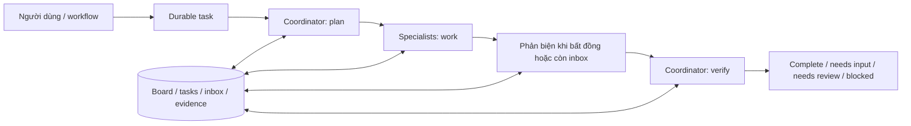

# Đặc tả platform đã triển khai

Phạm vi: platform dùng chung, 20 session hoạt động, nhiều provider/model, không gắn nghiệp vụ Vinhomes. Nhánh `dev_platform` xuất phát từ `b47e5da88111f8e970df3fe204ac9efb24a00c18`, worktree riêng để giữ nguyên các thay đổi đang làm ở checkout ban đầu.

## Danh tính và vòng đời agent

Agent có tên, mục đích, charter, chuyên môn, giới hạn, quyền tool, KB, skill, memory policy và model policy. Agent registry là danh tính lâu dài; revision là cấu hình bất biến. Draft phải qua kiểm tra cấu hình trước publish. Đây là **policy test**, không phải chứng nhận chất lượng LLM; evaluation chạy session là bước riêng.

Session chốt revision ID khi tạo. Model settings, giá và skill content được đóng băng trong revision; đổi catalog không thay đổi âm thầm phiên cũ. Tắt model là kill switch; credential binding lấy từ snapshot, xoay secret của cùng credential ID vẫn có hiệu lực. Rollback chọn revision published cũ làm bản mặc định cho session mới. Retire ngăn dùng làm mặc định; không xóa lịch sử.

Không giữ một đối tượng SDK Agent dùng chung giữa session. Mỗi leased task tạo đối tượng mới, với context giới hạn theo workspace/session/agent/revision/task. SDK state đã lọc thinking/secrets được lưu trong artifact, không trả trong inspector và không nối toàn bộ transcript trở lại prompt. Tính liên tục đến từ shared board, kết quả gần nhất, inbox, evidence và memory đã xác minh.

## Cộng tác và xử lý điều chưa biết

Một session xử lý task tuần tự; các session chia sẻ pool 8 worker. Team tối đa 3 agent, tranh luận tối đa 2 vòng. Đây là coordinator/specialist có kiểm soát, không phải một nhóm agent tự nói vô hạn. `team_message` gửi trực tiếp hoặc broadcast; `task_update` chỉ cập nhật task đang được cấp. Mỗi lượt giới hạn số tin và số ReAct iteration.

Context gồm goal, phase, danh tính/vai trò, board, tasks, kết quả gần đây, inbox đúng người nhận, trích đoạn KB/memory. Inspector phân biệt **đã chuẩn bị → đã gửi model → provider phản hồi → kết quả được chấp nhận**. Provider phản hồi không chứng minh model đã hiểu từng tin. `basis_seq` cho biết mốc dữ liệu khi chọn context; agent đọc board mới qua tool khi cần.

Kết quả có schema: status, answer, claims/quote/evidence IDs, unknowns, next_action, disagreement. Server kiểm tra nguồn tồn tại trong phiên, quote thuộc nội dung nguồn, chưa hết hạn/thu hồi và còn ACL. Thiếu nguồn hoặc còn unknowns không được complete. Một agent tự xác nhận kết quả cuối bị chuyển review. Có nhiều agent và nguồn hợp lệ cũng không chứng minh dữ kiện đúng: nghiệm thu nội dung cần evaluation phù hợp và người chịu trách nhiệm.

Nội dung user, inbox, KB, memory và MCP được coi là dữ liệu không tin cậy; quyền thực thi do máy chủ quyết định. Prompt hướng dẫn chống injection, nhưng bảo vệ cứng nằm ở grant/ACL/approval/lease. Không cấp shell, thực thi code tùy ý hoặc filesystem tools.

## Durable execution

PostgreSQL lưu session, jobs, generation, leases, events, artifacts, reservation và audit. Claim dùng `FOR UPDATE SKIP LOCKED`; mutation kiểm tra generation, lease, turn và quyền hiện tại của owner. API idempotency key chống gửi chat/webhook trùng; cùng key khác nội dung bị từ chối. Event log cũng là outbox; SSE replay theo sequence, không phụ thuộc Redis Pub/Sub. Redis chỉ đánh thức worker, hỏng Redis vẫn poll DB.

Crash làm lease hết hạn rồi được reclaim; reservation thiếu usage được tính chi phí dự phòng, không hoàn về 0. Tối đa 3 recovery attempt; trì hoãn RPM/TPM không tiêu số recovery. Khi thất bại có mã lỗi an toàn và needs_review. Admin được yêu cầu retry agent job an toàn; job có tool tạo tác động cần đối soát, không cho retry tự động.

MCP HTTP dùng endpoint/credential allowlist, quyền tool cụ thể. Tool đọc chỉ chạy tự động khi cả cấu hình admin và annotation remote xác nhận read-only. Tool khác tạo intent với tham số cụ thể và config version, chờ admin duyệt. Cấu hình đổi thì chặn. Ghi intent trước call, ghi kết quả trước ack job. Crash sau durable success tiếp tục mà không gọi lại; crash/timeout sau intent nhưng chưa có kết quả chuyển uncertain, không tự lặp. Không hứa exactly-once cho hệ thống bên ngoài.

Schema hiện tại là migration khởi tạo v1, PostgreSQL advisory lock chống hai tiến trình khởi tạo đồng thời. Chưa có lịch sử schema nâng cấp từ phiên bản production cũ; mọi nâng cấp schema sau v1 phải bổ sung migration có version, không dựa vào create_all để alter table.

## Knowledge và memory

Tài liệu text/Markdown/CSV/PDF được upload, chia chunk bền vững và index bởi worker riêng. PDF cần có text; chưa có OCR. Keyword retrieval dùng DB; optional semantic retrieval dùng native OpenAI/Ollama embeddings và Qdrant. Query embedding cũng tính vào ngân sách.

Vector space bao gồm workspace, adapter, endpoint, model, dimension, catalog ID và version. Không pad/truncate/mix vector. DB kiểm tra lại ACL/expiry/revocation sau vector match. Thu hồi document xóa text/chunk DB; vector cũ không còn được sử dụng nhờ post-filter. Không coi đó là xóa vật lý toàn bộ Qdrant/backup; cần retention/cleanup vận hành nếu xử lý dữ liệu cần purge.

Memory có owner/agent/source evidence/TTL; candidate không vào prompt cho đến khi admin verify. Memory của agent khác hoặc owner khác không được lấy. Thu hồi nguồn làm memory mất hiệu lực. Người vận hành có thể xóa memory. Không tự tích lũy câu trả lời LLM thành “sự thật”.

## Model và chi phí

Native adapters: OpenAI Chat/Responses, Anthropic, DashScope, Gemini, Ollama. Model được chọn thủ công hoặc sắp theo chi phí upper bound trong nhóm model/fallback được cấp; fallback giữ capability tương thích. Không tự gửi dữ liệu sang provider chưa được cấu hình. SDK/transport retries đã tắt; fallback hiển thị thành event riêng.

Giá, capability và quota do admin khai báo theo tài khoản/provider thực tế, có pricing version. Catalog không tự biết giá hay rate limit tài khoản. Money dùng integer micro USD; mặc định $100/workspace/tháng và $0.50/session. Trước mỗi call, atomically giữ chi phí cho context window + output cap. TPM dùng bound UTF-8 serialized input thực tế + output. Usage trả về được đối soát; timeout không usage giữ chi phí upper bound và đánh dấu ước tính. Usage chưa thay thế hóa đơn provider; giá khai sai hoặc phí provider khác vẫn cần đối soát.

Tối ưu bằng context có chọn lọc, giới hạn retrieval/history/iteration/debate, không chạy agent khi chưa đến lượt, model rẻ trong tập được cấp và không lặp việc đã có kết quả. Cửa sổ catalog lớn làm khoản dự phòng lớn: giảm context cap cho agent đơn giản hoặc tăng ngân sách sau khi đánh giá. Chưa bật tự động paid summarization hoặc semantic cache thiếu kiểm định.

## Quản trị và kết nối

Cookie login HttpOnly/SameSite, PBKDF2 salted password, server xác minh membership; không tin X-User-ID. CSRF Origin guard, rate limit login, admin/operator/viewer, workspace/owner ACL. Secrets mã hóa Fernet trước persist, không đưa vào API/audit/context. Không tái dùng khóa/mạng/database của Vinhomes.

Console quản lý agents/revisions, sessions/chat/inspector, KB/docs, memory, skills, models/embeddings/credentials, MCP, workflows/human gates, cron timezone, inbound webhook idempotent, evaluations, jobs/usage/audit/budget/members. Webhook token cố định owner/workspace/team; payload không tự cấp quyền. Chưa có connector Slack/Zalo/email chuyên biệt; nối qua MCP hoặc webhook được cấp.

Jev là tùy chọn shadow tắt mặc định, chỉ nhận dữ liệu thử giả/ẩn danh, model version pinned. Không quyết định quyền, routing production, memory hoặc tool execution. Xem [nghiên cứu Jev](research/jev-shadow.md).
