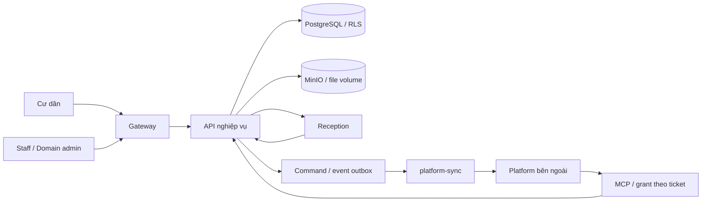

# Ranh giới kiến trúc Domain Vinhomes

Domain là nguồn trạng thái nghiệp vụ; Platform quản lý session/điều phối. Staff cập nhật tiến độ/bằng chứng tại Domain, worker gửi sự kiện để Platform tổng hợp và phản hồi. Cư dân quyết định báo giá và nghiệm thu. Không thêm lại role BQL hoặc UI điều phối Agent vào Domain.

| Nhóm | Module chính | Trách nhiệm |
|---|---|---|
| Danh tính/quyền | `password_auth`, `account_onboarding`, `v3_auth`, `unit_access` | Session/delegation, cư trú có hiệu lực và phạm vi; không tin ID tự khai của model |
| Ticket/staff | `v3_resident`, `resident_cases`, `supervised_flow`, `v3_field_*` | Coverage, assignment, ETA, consent, tiến độ và bằng chứng |
| Tra cứu | `knowledge`, `resident_services`, `zone_rules` | Site/zone/building/audience, provenance và quarantine |
| MCP | `platform_mcp`, `platform_access`, `platform_work` | Transport mỏng, grant theo ticket/workflow, mutation có transaction |
| Bridge | `platform`, `platform_settings`, `platform_sync` | Outbox cùng transaction, retry/đối soát, cấu hình tenant mã hóa |
| Travel | `travel`, `travel_models`, `travel_seed` | Mock catalog/intent/booking tách biệt; prepare/commit và consent |
| Dữ liệu | `database`, `bootstrap`, `owner_*`, `production_reset` | Migration/checksum, staging/provenance và sandbox guard |

## Quy tắc bảo trì

- Giữ router/transport mỏng; dùng dịch vụ nghiệp vụ hiện có thay vì nhân bản SQL/trạng thái vào frontend hoặc MCP wrapper.
- Tool trả thành công không chứng minh staff đã nhận việc/cư dân đã nghiệm thu. Giữ phân biệt pending, queued, kết quả công việc và xác nhận đóng.
- Không gọi HTTP/LLM trong transaction bàn giao: ghi command/event để worker gửi. Giữ reference/idempotency/version khi retry.
- Lệnh Platform theo `enqueue_seq`, không theo timestamp/UUID: nhiều lệnh trong cùng transaction có thể cùng `created_at`. Quyết định approval vẫn được ưu tiên để tránh chặn luồng đang chờ đồng ý.
- Runtime DB role không owner/BYPASSRLS; thiết lập tenant/user trong transaction. Không tắt constraint/trigger khi import.
- Khi chuyển database, giữ admin/secret/cấu hình tích hợp của đích; kiểm tra nguồn cấu hình database/env, API giải mã, tuyến active và worker. So hash env đơn thuần là chưa đủ.
- Không sửa migration đã áp dụng để làm test xanh; thêm migration mới khi cần đổi schema.
- Giữ fixture/mock/importer có nhiệm vụ kiểm thử/khôi phục, tách qua entry point/flag/guard. Không coi chúng là dữ liệu vận hành đã xác nhận.
- Component staff dùng state aliases trong `apps/staff-web/src/state-variants.css`; không phụ thuộc CLI shadcn để build/run UI.
- Không tách file chỉ vì số dòng; tách theo contract/trách nhiệm khi có thay đổi thực sự và giữ regression test cho hành vi.

## Entry point và kiểm tra

- API: `services/vinhomes-api/src/vinhomes_api/main.py`.
- Reception: `agents/reception/src/runtime/service.py`.
- Deployment chính: `deploy/compose.yml`; sandbox độc lập: `deploy/compose.sandbox.yml`.
- DOM test process riêng: `scripts/test-ui.mjs`, cùng lệnh local/CI.
- CI: `.github/workflows/vinhomes-domain.yml`, toàn bộ API tests, HTTP closure/rework, lint import/tên không định nghĩa, Reception offline, frontend build/test.

Nghiệm thu dữ liệu/API/mock transport, nghiệm thu Agent thật và nghiệm thu vận hành production là các bằng chứng khác nhau. Không nâng mức nghiệm thu chỉ vì build hoặc container healthy.
