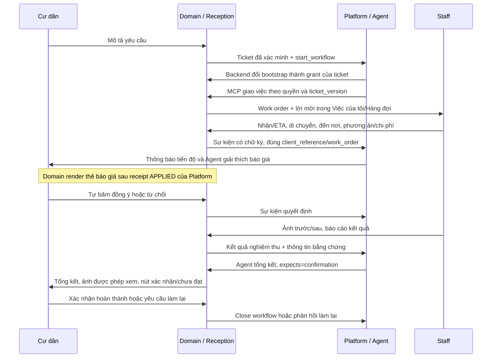

# Nghiệm thu luồng dịch vụ do Platform điều phối — 14/10/2026

## Kết luận và phạm vi

Đã triển khai lên VPS `103.238.235.156` và hoàn thành **một kịch bản Vệ sinh trên cùng ticket/workflow**, sử dụng Reception và Agent điều phối thật. Domain lưu dữ liệu nghiệp vụ, phân quyền và bằng chứng; Platform sở hữu session, giao việc, theo dõi tiến độ, tổng hợp báo giá/kết quả và gửi thông tin về cư dân. Không có bước BQL duyệt tiếp nhận ticket thông thường.

Tài khoản thử là `mock-an` và nhân viên Vệ sinh khởi tạo, cùng phạm vi Local Management hiện tại. Thao tác staff được mô phỏng qua API nghiệp vụ đã xác thực. Ảnh và báo giá **50.000 đồng** là fixture nghiệm thu, không phải công việc, bảng phí hoặc thanh toán thực tế. Trình duyệt tự động chỉ đọc UI, không gửi thêm tin nhắn cho Agent.

Lượt đầu bị lỗi trước khi gọi model vì thiếu cache tokenizer trên VPS. Đã sửa Docker và tiếp tục **chính ticket đó**, không tạo thêm kịch bản trả phí. Ba lượt Platform sau sửa đều có trả lời và công cụ thật. Không tính lượt lỗi đầu là thành công.

## Luồng hiện hành



Staff sử dụng app domain; trình duyệt staff không cần gọi MCP hay giữ key Platform. Mọi mốc staff được lưu tại domain rồi xếp vào outbox gửi Platform. Thông báo ETA/di chuyển/đến nơi do Platform phát theo schema; Agent được đánh thức khi có báo giá và kết quả để tổng hợp. Domain không tự gửi bản tổng kết kết quả trước Platform.

Các bước duyệt/điều kiện nghiệp vụ đặc thù hiện có vẫn được thực thi ở domain. Việc bỏ duyệt tiếp nhận BQL không có nghĩa là Agent được thay cư dân đồng ý chi phí hoặc tự bỏ quyền vận hành đặc thù.

## MCP và quyền đã nối

| Tool cung cấp Platform | Phạm vi |
|---|---|
| `vh_ticket_get` | Snapshot, version, policy, work orders, báo giá và kết quả của ticket đã bàn giao |
| `vh_knowledge_search` | Tra cứu nghiệp vụ theo phạm vi của ticket và provenance |
| `vh_staff_available` | Nhân sự đúng chuyên môn, ca trực, địa bàn và sức chứa |
| `vh_work_order_dispatch` | Giao việc cho staff; kết quả pending/queued không được gọi là đã nhận hoặc hoàn thành |
| `vh_work_order_reschedule` | Đổi lịch theo quyền, version và lời cư dân có nguồn |
| `vh_ticket_cancel` | Hủy trong điều kiện policy cho phép, không bỏ qua công việc đang thực hiện |
| `vh_ticket_add_note` | Bổ sung thông tin vào ticket hiện có |

Không cung cấp công cụ Reception tạo ticket, xác định lại cư dân/căn hộ, booking, khách/thẻ hoặc công nợ trên surface này. Ba nhóm nghiệp vụ hiện tại là Kỹ thuật, An ninh và Vệ sinh; đợt nghiệm thu Agent thật này chỉ chọn Vệ sinh.

Route `local-management` đang active, revision **2**, Agent khai báo version **2**, MCP runtime có đúng **7 tool**. Client hiện tại giữ nhãn `Vinhomes (sandbox)` và dùng key đang kết nối; không chuyển hoặc xoay key sang client production khác. Model thật vẫn chạy trong kịch bản nghiệm thu trên VPS.

Bootstrap chỉ dùng discovery và backend cấp grant. Platform cấu hình:

```json
{"mcp_grants":{"vinhomes":{"path":"/platform/mcp-grants","ttl_seconds":3600}}}
```

MCP nội bộ là `http://api:8000/mcp`. Đường dẫn cấp grant nội bộ là `/platform/mcp-grants`; qua gateway là `/api/business/platform/mcp-grants`. Grant ràng buộc `ticket_id`, `external_request_id` của lệnh bắt đầu, `workflow_id`, danh sách tool và TTL. Endpoint cấp grant phải cùng origin với MCP. Mỗi workflow dùng transport clone, không sửa key dùng chung; token không vào prompt, tài liệu bàn giao công khai hoặc log.

Platform ghi operation trước khi gọi MCP giao việc. Vì vậy sự kiện đến trước phản hồi MCP vẫn có bản ghi để đối chiếu, và phản hồi cũ không ghi đè mốc mới đã nhận.

## Kết quả thực tế trên VPS

| Hạng mục | Kết quả |
|---|---|
| Ticket thử | `VH-A59BA8CCA85D` / `a59ba8cc-a85d-5b82-b749-0074e81be4a8` |
| Workflow | `5d4ec620a4d14cd1ad87524ef28faa21` |
| Work order | `4afb8235-ae57-491b-aad3-0fadab744e4e` |
| Reception | Tạo ticket Vệ sinh từ lời cư dân; bàn giao Platform thành công |
| Giao việc | Agent gọi `vh_ticket_get`, `vh_staff_available`, `vh_work_order_dispatch`, rồi `CaseSay` |
| Staff | Nhận việc với ETA; en_route → arrived → báo giá → in_progress → completed → báo cáo nghiệm thu |
| Chi phí | Agent giải thích đúng tổng giả lập 50.000 đồng; cư dân tự bấm duyệt bằng API quyết định |
| Bằng chứng | 1 ảnh before, 1 after, 1 verification; cư dân đọc được cả 3 ảnh, HTTP 200 |
| Tổng kết | Agent đọc snapshot, nêu báo cáo staff là giả lập, mời cư dân xác nhận; không tự xác nhận thay |
| Quyết định cư dân | Approved, lúc **14:44:22 giờ Việt Nam** |
| Trạng thái cuối | Ticket `closed`, work order `completed`, Platform workflow/link `closed`, next_action `none` |
| Operation đang mở | **0**, tổng operation **1** |
| Sự kiện tiến độ | **9/9 APPLIED**, không rejected/quarantined trong ticket thử |
| Grant | 2 grant được cấp/đổi theo thời gian, cùng ràng buộc đúng workflow |

Chín sự kiện: `job.offered`, `job.accepted`, `job.en_route`, `job.arrived`, `job.quote_ready`, `job.quote_approved`, `job.started`, `job.completed`, `job.result_published`.

Reception mất khoảng **6,0 giây**, ghi nhận **5.784 input / 98 output token**. Ba lượt Platform thực tế sau sửa mất **8,50 / 5,93 / 4,93 giây**, ghi nhận tổng **81.266 input / 589 output token**, trong đó **67.712 input token từ cache**. Đây là usage cộng theo các lần gọi model trong từng lượt, không phải số token duy nhất của phiếu. Không quy đổi thành chi phí tiền.

Lượt lỗi tokenizer đầu tiên kéo dài khoảng **135,2 giây**, không có usage model và không gọi công cụ nghiệp vụ. Dữ liệu lỗi được giữ trong lịch sử; thống kê nghiệm thu loại riêng lượt này. Không coi toàn bộ thời gian tạo/đóng ticket là latency model vì có các khoảng dừng để sửa, triển khai và kiểm tra.

## Những lỗi đã sửa

1. Reception gửi fallback nhưng trả `status=completed`: runtime trả failed với mã ổn định; delegation lưu failed/error_code và vẫn ghi usage.
2. Platform gọi tool nghiệp vụ bằng bootstrap: đổi sang grant riêng theo ticket tại backend, fail closed nếu không cấp được quyền.
3. Sự kiện staff đến sớm khi MCP chưa trả: đăng ký operation trước khi dispatch, giữ mốc mới khi nhận phản hồi cũ.
4. Domain phát báo giá/kết quả sớm: thẻ báo giá chờ receipt APPLIED; kết quả do Platform/Agent tổng hợp; bước xác nhận chờ trạng thái `awaiting_confirmation`.
5. Cư dân không xem được ảnh staff: mở đúng ảnh evidence của ticket mình sau khi Platform nhận kết quả; cư dân khác vẫn bị từ chối.
6. Domain tự biến lệnh đóng bị từ chối thành stop_tracking: giữ chờ/retry, không gọi đó là hoàn thành.
7. Tokenizer cần tải mạng lúc request đầu: đóng cache `o200k_base` và `cl100k_base` vào image; đã chạy tokenization với `--network none`.
8. Platform chat lỗi/không có `CaseSay` nhưng workflow vẫn đi tiếp bình thường: trả fallback có `outcome=fallback`, mã lỗi và `needs_attention` khi không có approval đang chờ.
9. Chỉ báo chờ tiếp tục chạy sau trả lời Platform: gắn nguồn tin nhắn vào command, đọc kết quả cuối qua `GET /workforce/v1/partner/requests/{request_id}` với external_user_id, phân biệt 202 với kết quả nghiệp vụ, kết thúc/freeze latency đúng lượt.

Riêng ticket thử đã đóng trước bản sửa metadata 202 cuối cùng, đã đọc lại kết quả request của **chính ticket đó**: không mở lại workflow và không tạo tin nhắn trùng. Không backfill hoặc đổi trạng thái hàng loạt ticket/lượt fallback lịch sử.

## Kiểm thử và bằng chứng

| Gate | Kết quả / giới hạn |
|---|---|
| PostgreSQL: importer, MCP, bridge, grants, staff dispatch, delegation | 161 test khác nhau đã đạt. Lượt full cuối: 160 pass và 1 assertion cũ giữ result=null sau 202; sau cập nhật assertion theo contract, chạy lại 3 bài liên quan đều pass |
| Reception CSKH | 13 pass, offline provider fixture; không phải 13 lần gọi model thật |
| Platform grant/case runtime | 12 pass; có test silent failure, grant isolation, sai origin và sự kiện sớm |
| HTTP business closure/concurrent decision/rework | 2 pass trên database cô lập; không gọi Agent |
| Tokenizer | Passed trong container không có mạng |
| UI có đăng nhập thật | Cư dân và staff tại 375/1440 px, trước/sau xác nhận; không tràn ngang, không lỗi JavaScript; sau đóng không còn nút xác nhận hoặc cảnh báo chờ sai |
| Happy case Agent thật | 1 ticket/workflow; Reception thật + 3 lượt Platform thành công sau sửa tokenizer; thao tác staff và ảnh là giả lập |

CI trên `dev_Vinhome@6c1a5be0`: [run 38531971155](https://github.com/nguyennanganhdev/AI-Workforce-Platform/actions/runs/38531971155) **success** ở cả business-api, reception-cskh và frontend. Hai lần CI trước vướng fixture HTTP tự tạo platform link nhưng chưa mô phỏng bước Platform mở xác nhận; fixture đã được sửa để kiểm tra 409 trước khi mở bước và kiểm tra quyết định đồng thời sau đó, không nới điều kiện của API.

Các artifact riêng nằm trong thư mục ignored `vinhome_Recident/deploy/test-accounts-20261013/domain-audit/`: `happy-platform-owned-20261014.private.json`, `happy-final.private.json`, log kiểm thử và thư mục `happy-platform-owned-ui*`. Mật khẩu/key không nằm trong báo cáo này hoặc Git.

## Docker / source đã triển khai

| Thành phần | Image trên VPS | Source chức năng |
|---|---|---|
| Domain API, scheduler, platform-sync | `vinhomes-domain-api:platform-owned-c8dbc981` | `dev_Vinhome@c8dbc981` |
| Reception | `vinhomes-domain-reception:platform-owned-641f76c8` | `dev_Vinhome@641f76c8` |
| Platform app | `agentscope-local:platform-owned-d4d0af55` | `feat/wf-partner-case@d4d0af55` |

Đã sao lưu database/config của cả hai stack trước thay đổi. Kiểm tra image đang chạy và hash source, không chỉ trạng thái healthy: release chính đối chiếu 142 file; release tokenizer đối chiếu 3 file runtime + 2 file cache; release API cuối đối chiếu 3 file thay đổi. Các commit test/tài liệu sau source chức năng không đòi hỏi đổi image.

Resident/staff frontend và gateway dùng image đang phục vụ trước đợt này; đã kiểm tra UI thực tế trên bundle đó. Không trộn thay đổi frontend Platform khác đang nằm ở worktree chính. Thư mục VPS `/opt/vinhomes/releases/` giữ backup và manifest; `/opt/awp-platform/app/compose.yaml` đã pin image Platform mới, `deployment.env` pin image API/Reception tương ứng.

## Còn cần bổ sung / chưa nghiệm thu đợt này

- Danh mục dịch vụ, phí, giờ làm việc, đầu mối và phạm vi từng khu cần tài liệu được xác nhận. Không dùng dữ liệu tham khảo hoặc báo giá fixture làm thông tin chính thức.
- Nhân viên Vệ sinh hiện là tài khoản khởi tạo, chưa thay cho danh sách người/ca trực vận hành thực tế.
- Nhánh từ chối, hết ca, làm lại, lỗi provider, quyền sai và tranh chấp version đã có kiểm thử cô lập; chưa chạy thêm Agent thật cho các nhánh đó hoặc cho An ninh/Kỹ thuật trong đợt này.
- SMTP thật và nghiệm thu `renew --dry-run` HTTPS là các gate riêng; đợt này không xác nhận chúng đã hoàn tất.
- Usage/token lịch sử không được sửa ngược. Khi thống kê, tách transport/job completed khỏi outcome nghiệp vụ, fallback và lỗi model; không lấy container healthy hoặc receipt accepted làm nghiệm thu.
